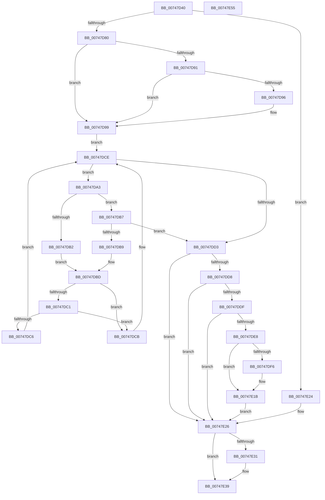

# KiTrackSystemCallEntry

- RVA: `0x00747D40`–`0x00747E56` (길이 `278` bytes)
- VA: `0x0000000140747D40`
- 실행 섹션: `PAGE`
- PDB 이름 있음: `예`; PDB Function 태그: `아니요`
- unwind 정보 RVA: `0x00093E28`
- 디코드: `81`개 명령, `278/278` bytes 표시
- 미해석 바이트: `0` (있으면 어셈블리에 `.byte`로 보존)

> 이 문서는 커널 이미지의 기계어와 PDB 기호를 분석해 생성했습니다. 4번과 5번은 함수 원형과 자료형을 바이너리 사용 방식에서 추정한 C 해석이며 원본 소스 복구 결과는 아닙니다.

## 1. Dependencies

- 직접 호출 지점: **4**; 고유 호출 대상: **4**
- 직접 호출자로 확인된 함수: **1**
- RIP 상대 이미지 참조: **5**

### Outgoing calls
- `0x00747D73` → [KeIsTraceCallbackAllowed](../../text/2F/KeIsTraceCallbackAllowed_function_002FCE6C.md) (function, `0x002FCE6C`)
- `0x00747DA9` → [KiSystemServiceTraceTableCompareFunction](KiSystemServiceTraceTableCompareFunction_function_00747D24.md) (function, `0x00747D24`)
- `0x00747E16` → [guard_dispatch_icall](../../text/6B/guard_dispatch_icall_function_006BAAD0.md) (function, `0x006BAAD0`)
- `0x00747E34` → [PerfInfoLogSysCallEntry](../../text/22/PerfInfoLogSysCallEntry_function_002255C0.md) (function, `0x002255C0`)

### Direct callers
- [KiSystemCall64](../../text/6C/KiSystemCall64_function_006C4A40.md) at `0x006C57BB`

### Static image references
- `0x00747D80` → RVA `0x00FD9EA0` (`PAGEDATA`; read)
- `0x00747DDF` → RVA `0x00FC6C10` (`ALMOSTRO`; read)
- `0x00747DE8` → RVA `0x00FD9B1C` (`PAGEDATA`; read/write)
- `0x00747DF6` → RVA `0x00FC7410` (`ALMOSTRO`; read)
- `0x00747E26` → RVA `0x00FC6B08` (`ALMOSTRO`; read)

## 2. Other-region calls and transfers

- 다른 실행 섹션으로 향하는 call: **3**
  - `0x00747D73` → [KeIsTraceCallbackAllowed](../../text/2F/KeIsTraceCallbackAllowed_function_002FCE6C.md) (`PAGE` → `.text`)
  - `0x00747E16` → [guard_dispatch_icall](../../text/6B/guard_dispatch_icall_function_006BAAD0.md) (`PAGE` → `.text`)
  - `0x00747E34` → [PerfInfoLogSysCallEntry](../../text/22/PerfInfoLogSysCallEntry_function_002255C0.md) (`PAGE` → `.text`)
- 별도 외부 분기/꼬리 이동을 확인하지 못했습니다.

## 3. Assembly (complete function range)

```asm
00747D40  48 89 5C 24 08                  mov qword ptr [rsp + 8], rbx
00747D45  48 89 6C 24 10                  mov qword ptr [rsp + 0x10], rbp
00747D4A  48 89 74 24 18                  mov qword ptr [rsp + 0x18], rsi
00747D4F  57                              push rdi
00747D50  41 56                           push r14
00747D52  41 57                           push r15
00747D54  48 83 EC 40                     sub rsp, 0x40
00747D58  48 8B F1                        mov rsi, rcx
00747D5B  49 8B E9                        mov rbp, r9
00747D5E  65 48 8B 0C 25 88 01 00 00      mov rcx, qword ptr gs:[0x188]
00747D67  45 8B F0                        mov r14d, r8d
00747D6A  4C 8B FA                        mov r15, rdx
00747D6D  8A 89 32 02 00 00               mov cl, byte ptr [rcx + 0x232]
00747D73  E8 F4 50 BB FF                  call 0x1402fce6c
00747D78  85 C0                           test eax, eax
00747D7A  0F 84 A4 00 00 00               je 0x140747e24
00747D80  4C 8B 15 19 21 89 00            mov r10, qword ptr [rip + 0x892119]
00747D87  41 F6 42 08 01                  test byte ptr [r10 + 8], 1
00747D8C  49 8B 1A                        mov rbx, qword ptr [r10]
00747D8F  74 08                           je 0x140747d99
00747D91  48 85 DB                        test rbx, rbx
00747D94  74 03                           je 0x140747d99
00747D96  49 33 DA                        xor rbx, r10
00747D99  41 0F B6 7A 08                  movzx edi, byte ptr [r10 + 8]
00747D9E  83 E7 01                        and edi, 1
00747DA1  EB 2B                           jmp 0x140747dce
00747DA3  48 8B D3                        mov rdx, rbx
00747DA6  48 8B CE                        mov rcx, rsi
00747DA9  E8 76 FF FF FF                  call 0x140747d24
00747DAE  85 C0                           test eax, eax
00747DB0  79 05                           jns 0x140747db7
00747DB2  48 8B 03                        mov rax, qword ptr [rbx]
00747DB5  EB 06                           jmp 0x140747dbd
00747DB7  7E 1A                           jle 0x140747dd3
00747DB9  48 8B 43 08                     mov rax, qword ptr [rbx + 8]
00747DBD  85 FF                           test edi, edi
00747DBF  74 0A                           je 0x140747dcb
00747DC1  48 85 C0                        test rax, rax
00747DC4  74 05                           je 0x140747dcb
00747DC6  48 33 D8                        xor rbx, rax
00747DC9  EB 03                           jmp 0x140747dce
00747DCB  48 8B D8                        mov rbx, rax
00747DCE  48 85 DB                        test rbx, rbx
00747DD1  75 D0                           jne 0x140747da3
00747DD3  48 85 DB                        test rbx, rbx
00747DD6  74 4E                           je 0x140747e26
00747DD8  8A 43 28                        mov al, byte ptr [rbx + 0x28]
00747DDB  84 C0                           test al, al
00747DDD  74 47                           je 0x140747e26
00747DDF  83 3D 2A EE 87 00 00            cmp dword ptr [rip + 0x87ee2a], 0
00747DE6  74 3E                           je 0x140747e26
00747DE8  F0 FF 05 2D 1D 89 00            lock inc dword ptr [rip + 0x891d2d]
00747DEF  8A 43 28                        mov al, byte ptr [rbx + 0x28]
00747DF2  84 C0                           test al, al
00747DF4  74 25                           je 0x140747e1b
00747DF6  48 8B 05 13 F6 87 00            mov rax, qword ptr [rip + 0x87f613]
00747DFD  4D 8B CF                        mov r9, r15
00747E00  44 8B 43 20                     mov r8d, dword ptr [rbx + 0x20]
00747E04  48 8B 53 30                     mov rdx, qword ptr [rbx + 0x30]
00747E08  48 8B 4B 18                     mov rcx, qword ptr [rbx + 0x18]
00747E0C  48 89 6C 24 28                  mov qword ptr [rsp + 0x28], rbp
00747E11  44 89 74 24 20                  mov dword ptr [rsp + 0x20], r14d
00747E16  E8 B5 2C F7 FF                  call 0x1406baad0
00747E1B  F0 FF 0D FA 1C 89 00            lock dec dword ptr [rip + 0x891cfa]
00747E22  EB 02                           jmp 0x140747e26
00747E24  33 DB                           xor ebx, ebx
00747E26  8B 0D DC EC 87 00               mov ecx, dword ptr [rip + 0x87ecdc]
00747E2C  F6 C1 40                        test cl, 0x40
00747E2F  74 08                           je 0x140747e39
00747E31  48 8B CE                        mov rcx, rsi
00747E34  E8 87 D7 AD FF                  call 0x1402255c0
00747E39  48 8B 6C 24 68                  mov rbp, qword ptr [rsp + 0x68]
00747E3E  48 8B C3                        mov rax, rbx
00747E41  48 8B 5C 24 60                  mov rbx, qword ptr [rsp + 0x60]
00747E46  48 8B 74 24 70                  mov rsi, qword ptr [rsp + 0x70]
00747E4B  48 83 C4 40                     add rsp, 0x40
00747E4F  41 5F                           pop r15
00747E51  41 5E                           pop r14
00747E53  5F                              pop rdi
00747E54  C3                              ret
00747E55  CC                              int3
```

## 4. C-style interpretation (structured pseudocode)

```c
__int64 __fastcall KiTrackSystemCallEntry(__int64 a1, __int64 a2, int a3, __int64 a4)
{
    __int64 result;
    __int64 v_rbx;
    __int64 v_rdi;
    __int64 v_rsp;
    unsigned __int64 v_stack_m30;
    unsigned int v_stack_m38;
    unsigned __int64 v_stack_p10;
    unsigned __int64 v_stack_p18;
    unsigned __int64 v_stack_p8;

    v_stack_p8 = v_rbx;
    v_stack_p10 = v_rbp;
    v_stack_p18 = v_rsi;
    v_rsp = (v_rsp) - (64);
    result = KeIsTraceCallbackAllowed(*(unsigned __int8 *)(*(unsigned __int64 *)(gs_base + (0 + 392)) + 562), a2, a3, a4);
    if ((unsigned int)(result) == 0) goto loc_00747E24;
    if (((*(unsigned __int8 *)(*(unsigned __int64 *)(v_rip + 8986905) + 8)) & (1)) == 0) goto loc_00747D99;
    v_rbx = *(unsigned __int64 *)(*(unsigned __int64 *)(v_rip + 8986905));
    if (*(unsigned __int64 *)(*(unsigned __int64 *)(v_rip + 8986905)) != 0) {
        v_rbx = (*(unsigned __int64 *)(*(unsigned __int64 *)(v_rip + 8986905))) ^ (*(unsigned __int64 *)(v_rip + 8986905));
    }
    v_rdi = (unsigned int)((*(unsigned __int8 *)(*(unsigned __int64 *)(v_rip + 8986905) + 8)) & (1));
    goto loc_00747DCE;
loc_00747DA3:
    result = KiSystemServiceTraceTableCompareFunction(a1, v_rbx, a3, a4);
    if (!sign_flag) goto loc_00747DB7;
    goto loc_00747DBD;
loc_00747DB7:
    if (condition_is_less_or_equal) goto loc_00747DD3;
loc_00747DBD:
    if ((unsigned int)(v_rdi) == 0) goto loc_00747DCB;
    if (*(unsigned __int64 *)(v_rbx + 8) == 0) goto loc_00747DCB;
    v_rbx = (v_rbx) ^ (*(unsigned __int64 *)(v_rbx + 8));
    goto loc_00747DCE;
loc_00747DCB:
loc_00747DCE:
    if (*(unsigned __int64 *)(v_rbx + 8) != 0) goto loc_00747DA3;
loc_00747DD3:
    if (*(unsigned __int64 *)(v_rbx + 8) == 0) goto loc_00747E26;
    if ((unsigned __int8)(*(unsigned __int8 *)(*(unsigned __int64 *)(v_rbx + 8) + 40)) == 0) goto loc_00747E26;
    if ((*(unsigned int *)(v_rip + 8908330)) == 0) goto loc_00747E26;
    result = *(unsigned __int8 *)(*(unsigned __int64 *)(v_rbx + 8) + 40);
    if ((unsigned __int8)(*(unsigned __int8 *)(*(unsigned __int64 *)(v_rbx + 8) + 40)) != 0) {
        result = *(unsigned __int64 *)(v_rip + 8910355);
        a4 = a2;
        a3 = *(unsigned int *)(*(unsigned __int64 *)(v_rbx + 8) + 32);
        a2 = *(unsigned __int64 *)(*(unsigned __int64 *)(v_rbx + 8) + 48);
        a1 = *(unsigned __int64 *)(*(unsigned __int64 *)(v_rbx + 8) + 24);
        v_stack_m30 = a4;
        v_stack_m38 = (unsigned int)((unsigned int)(a3));
        result = guard_dispatch_icall(a1, a2, a3, a4);
    }
    goto loc_00747E26;
loc_00747E24:
    v_rbx = 0;
loc_00747E26:
    if ((((unsigned __int8)((unsigned int)(*(unsigned int *)(v_rip + 8907996)))) & (64)) != 0) {
        a1 = a1;
        result = PerfInfoLogSysCallEntry(a1, a2, a3, a4);
    }
    v_rsp = (v_rsp) + (64);
    return 0;
}
```

## 5. (Beta) C Style

```c
int64_t KiTrackSystemCallEntry(int64_t Arg1, int64_t Arg2, int32_t Arg3, int64_t Arg4)
{
    int64_t result;
    int64_t local_rbx;
    int64_t local_rdi;
    int64_t local_rsp;
    uint64_t v_stack_m30;
    uint32_t v_stack_m38;
    uint64_t v_stack_p10;
    uint64_t v_stack_p18;
    uint64_t v_stack_p8;

    v_stack_p8 = local_rbx;
    v_stack_p10 = local_rbp;
    v_stack_p18 = local_rsi;
    local_rsp = (local_rsp) - (64);
    result = KeIsTraceCallbackAllowed(*(uint8_t *)(*(uint64_t *)(gs_base + (0 + 0x188)) + 0x232), Arg2, Arg3, Arg4);
    if ((uint32_t)(result) == 0) goto loc_00747E24;
    if (((*(uint8_t *)(*(uint64_t *)(v_rip + 0x892119) + 0x8)) & (1)) == 0) goto loc_00747D99;
    local_rbx = *(uint64_t *)(*(uint64_t *)(v_rip + 0x892119));
    if (*(uint64_t *)(*(uint64_t *)(v_rip + 0x892119)) != 0) {
        local_rbx = (*(uint64_t *)(*(uint64_t *)(v_rip + 0x892119))) ^ (*(uint64_t *)(v_rip + 0x892119));
    }
    local_rdi = (uint32_t)((*(uint8_t *)(*(uint64_t *)(v_rip + 0x892119) + 0x8)) & (1));
    goto loc_00747DCE;
loc_00747DA3:
    result = KiSystemServiceTraceTableCompareFunction(Arg1, local_rbx, Arg3, Arg4);
    if (!sign_flag) goto loc_00747DB7;
    goto loc_00747DBD;
loc_00747DB7:
    if (condition_is_less_or_equal) goto loc_00747DD3;
loc_00747DBD:
    if ((uint32_t)(local_rdi) == 0) goto loc_00747DCB;
    if (*(uint64_t *)(local_rbx + 0x8) == 0) goto loc_00747DCB;
    local_rbx = (local_rbx) ^ (*(uint64_t *)(local_rbx + 0x8));
    goto loc_00747DCE;
loc_00747DCB:
loc_00747DCE:
    if (*(uint64_t *)(local_rbx + 0x8) != 0) goto loc_00747DA3;
loc_00747DD3:
    if (*(uint64_t *)(local_rbx + 0x8) == 0) goto loc_00747E26;
    if ((uint8_t)(*(uint8_t *)(*(uint64_t *)(local_rbx + 0x8) + 0x28)) == 0) goto loc_00747E26;
    if ((*(uint32_t *)(v_rip + 0x87EE2A)) == 0) goto loc_00747E26;
    result = *(uint8_t *)(*(uint64_t *)(local_rbx + 0x8) + 0x28);
    if ((uint8_t)(*(uint8_t *)(*(uint64_t *)(local_rbx + 0x8) + 0x28)) != 0) {
        result = *(uint64_t *)(v_rip + 0x87F613);
        Arg4 = Arg2;
        Arg3 = *(uint32_t *)(*(uint64_t *)(local_rbx + 0x8) + 0x20);
        Arg2 = *(uint64_t *)(*(uint64_t *)(local_rbx + 0x8) + 0x30);
        Arg1 = *(uint64_t *)(*(uint64_t *)(local_rbx + 0x8) + 0x18);
        v_stack_m30 = Arg4;
        v_stack_m38 = (uint32_t)((uint32_t)(Arg3));
        result = guard_dispatch_icall(Arg1, Arg2, Arg3, Arg4);
    }
    goto loc_00747E26;
loc_00747E24:
    local_rbx = 0;
loc_00747E26:
    if ((((uint8_t)((uint32_t)(*(uint32_t *)(v_rip + 0x87ECDC)))) & (64)) != 0) {
        Arg1 = Arg1;
        result = PerfInfoLogSysCallEntry(Arg1, Arg2, Arg3, Arg4);
    }
    local_rsp = (local_rsp) + (64);
    return 0;
}
```

## 6. Execution-region graph

[열기: 2D/3D 그래프와 함수 탐색 컨트롤 패널](../../../control-panel.html?section=page&rva=0x00747D40&view=graph)

- 2D 그래프는 위에서 아래로 흐르고, 3D 그래프는 빈 공간을 드래그해 회전합니다. Shift+드래그는 이동, 휠은 확대·축소, 함수 노드 선택은 대상 보고서 이동입니다.

### Static fallback


