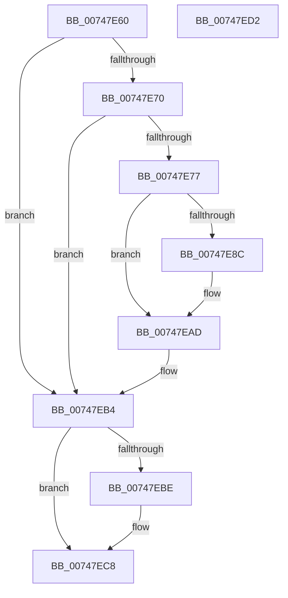

# KiTrackSystemCallExit

- RVA: `0x00747E60`–`0x00747ED3` (길이 `115` bytes)
- VA: `0x0000000140747E60`
- 실행 섹션: `PAGE`
- PDB 이름 있음: `예`; PDB Function 태그: `아니요`
- unwind 정보 RVA: `0x000CAC88`
- 디코드: `30`개 명령, `115/115` bytes 표시
- 미해석 바이트: `0` (있으면 어셈블리에 `.byte`로 보존)

> 이 문서는 커널 이미지의 기계어와 PDB 기호를 분석해 생성했습니다. 4번과 5번은 함수 원형과 자료형을 바이너리 사용 방식에서 추정한 C 해석이며 원본 소스 복구 결과는 아닙니다.

## 1. Dependencies

- 직접 호출 지점: **2**; 고유 호출 대상: **2**
- 직접 호출자로 확인된 함수: **1**
- RIP 상대 이미지 참조: **3**

### Outgoing calls
- `0x00747EA8` → [guard_dispatch_icall](../../text/6B/guard_dispatch_icall_function_006BAAD0.md) (function, `0x006BAAD0`)
- `0x00747EC3` → [PerfInfoLogSysCallExit](../../text/22/PerfInfoLogSysCallExit_function_00225470.md) (function, `0x00225470`)

### Direct callers
- [KiSystemCall64](../../text/6C/KiSystemCall64_function_006C4A40.md) at `0x006C57F0`

### Static image references
- `0x00747E7D` → RVA `0x00FD9B1C` (`PAGEDATA`; read/write)
- `0x00747E9D` → RVA `0x00FC7418` (`ALMOSTRO`; read)
- `0x00747EB4` → RVA `0x00FC6B08` (`ALMOSTRO`; read)

## 2. Other-region calls and transfers

- 다른 실행 섹션으로 향하는 call: **2**
  - `0x00747EA8` → [guard_dispatch_icall](../../text/6B/guard_dispatch_icall_function_006BAAD0.md) (`PAGE` → `.text`)
  - `0x00747EC3` → [PerfInfoLogSysCallExit](../../text/22/PerfInfoLogSysCallExit_function_00225470.md) (`PAGE` → `.text`)
- 별도 외부 분기/꼬리 이동을 확인하지 못했습니다.

## 3. Assembly (complete function range)

```asm
00747E60  4C 8B DC                        mov r11, rsp
00747E63  49 89 53 10                     mov qword ptr [r11 + 0x10], rdx
00747E67  48 83 EC 48                     sub rsp, 0x48
00747E6B  48 85 C9                        test rcx, rcx
00747E6E  74 44                           je 0x140747eb4
00747E70  8A 41 29                        mov al, byte ptr [rcx + 0x29]
00747E73  84 C0                           test al, al
00747E75  74 3D                           je 0x140747eb4
00747E77  41 B8 01 00 00 00               mov r8d, 1
00747E7D  F0 44 01 05 97 1C 89 00         lock add dword ptr [rip + 0x891c97], r8d
00747E85  8A 41 29                        mov al, byte ptr [rcx + 0x29]
00747E88  84 C0                           test al, al
00747E8A  74 21                           je 0x140747ead
00747E8C  48 8B 51 38                     mov rdx, qword ptr [rcx + 0x38]
00747E90  4D 8D 4B 10                     lea r9, [r11 + 0x10]
00747E94  49 83 63 E0 00                  and qword ptr [r11 - 0x20], 0
00747E99  48 8B 49 18                     mov rcx, qword ptr [rcx + 0x18]
00747E9D  48 8B 05 74 F5 87 00            mov rax, qword ptr [rip + 0x87f574]
00747EA4  45 89 43 D8                     mov dword ptr [r11 - 0x28], r8d
00747EA8  E8 23 2C F7 FF                  call 0x1406baad0
00747EAD  F0 FF 0D 68 1C 89 00            lock dec dword ptr [rip + 0x891c68]
00747EB4  8B 05 4E EC 87 00               mov eax, dword ptr [rip + 0x87ec4e]
00747EBA  A8 40                           test al, 0x40
00747EBC  74 0A                           je 0x140747ec8
00747EBE  48 8B 4C 24 58                  mov rcx, qword ptr [rsp + 0x58]
00747EC3  E8 A8 D5 AD FF                  call 0x140225470
00747EC8  48 8B 44 24 58                  mov rax, qword ptr [rsp + 0x58]
00747ECD  48 83 C4 48                     add rsp, 0x48
00747ED1  C3                              ret
00747ED2  CC                              int3
```

## 4. C-style interpretation (structured pseudocode)

```c
__int64 __fastcall KiTrackSystemCallExit(__int64 a1, __int64 a2)
{
    __int64 result;
    __int64 v_rsp;
    unsigned __int64 v_stack_p10;

    *(unsigned __int64 *)(v_rsp + 16) = a2;
    v_rsp = (v_rsp) - (72);
    if (a1 == 0) goto loc_00747EB4;
    if ((unsigned __int8)(*(unsigned __int8 *)(a1 + 41)) == 0) goto loc_00747EB4;
    result = *(unsigned __int8 *)(a1 + 41);
    if ((unsigned __int8)(*(unsigned __int8 *)(a1 + 41)) != 0) {
        a2 = *(unsigned __int64 *)(a1 + 56);
        a4 = v_rsp + 16;
        a1 = *(unsigned __int64 *)(a1 + 24);
        result = *(unsigned __int64 *)(v_rip + 8910196);
        *(unsigned int *)(v_rsp - 40) = 1;
        result = guard_dispatch_icall(a1, a2, 1, a4);
    }
loc_00747EB4:
    result = (unsigned int)(*(unsigned int *)(v_rip + 8907854));
    if ((((unsigned __int8)((unsigned int)(*(unsigned int *)(v_rip + 8907854)))) & (64)) != 0) {
        a1 = v_stack_p10;
        result = PerfInfoLogSysCallExit(a1, a2, 1, a4);
    }
    v_rsp = (v_rsp) + (72);
    return v_stack_p10;
}
```

## 5. (Beta) C Style

```c
int64_t KiTrackSystemCallExit(int64_t Arg1, int64_t Arg2)
{
    int64_t result;
    int64_t local_rsp;
    uint64_t v_stack_p10;

    *(uint64_t *)(local_rsp + 0x10) = Arg2;
    local_rsp = (local_rsp) - (72);
    if (Arg1 == 0) goto loc_00747EB4;
    if ((uint8_t)(*(uint8_t *)(Arg1 + 0x29)) == 0) goto loc_00747EB4;
    result = *(uint8_t *)(Arg1 + 0x29);
    if ((uint8_t)(*(uint8_t *)(Arg1 + 0x29)) != 0) {
        Arg2 = *(uint64_t *)(Arg1 + 0x38);
        a4 = local_rsp + 16;
        Arg1 = *(uint64_t *)(Arg1 + 0x18);
        result = *(uint64_t *)(v_rip + 0x87F574);
        *(uint32_t *)(local_rsp - 0x28) = 1;
        result = guard_dispatch_icall(Arg1, Arg2, 1, a4);
    }
loc_00747EB4:
    result = (uint32_t)(*(uint32_t *)(v_rip + 0x87EC4E));
    if ((((uint8_t)((uint32_t)(*(uint32_t *)(v_rip + 0x87EC4E)))) & (64)) != 0) {
        Arg1 = v_stack_p10;
        result = PerfInfoLogSysCallExit(Arg1, Arg2, 1, a4);
    }
    local_rsp = (local_rsp) + (72);
    return v_stack_p10;
}
```

## 6. Execution-region graph

[열기: 2D/3D 그래프와 함수 탐색 컨트롤 패널](../../../control-panel.html?section=page&rva=0x00747E60&view=graph)

- 2D 그래프는 위에서 아래로 흐르고, 3D 그래프는 빈 공간을 드래그해 회전합니다. Shift+드래그는 이동, 휠은 확대·축소, 함수 노드 선택은 대상 보고서 이동입니다.

### Static fallback


