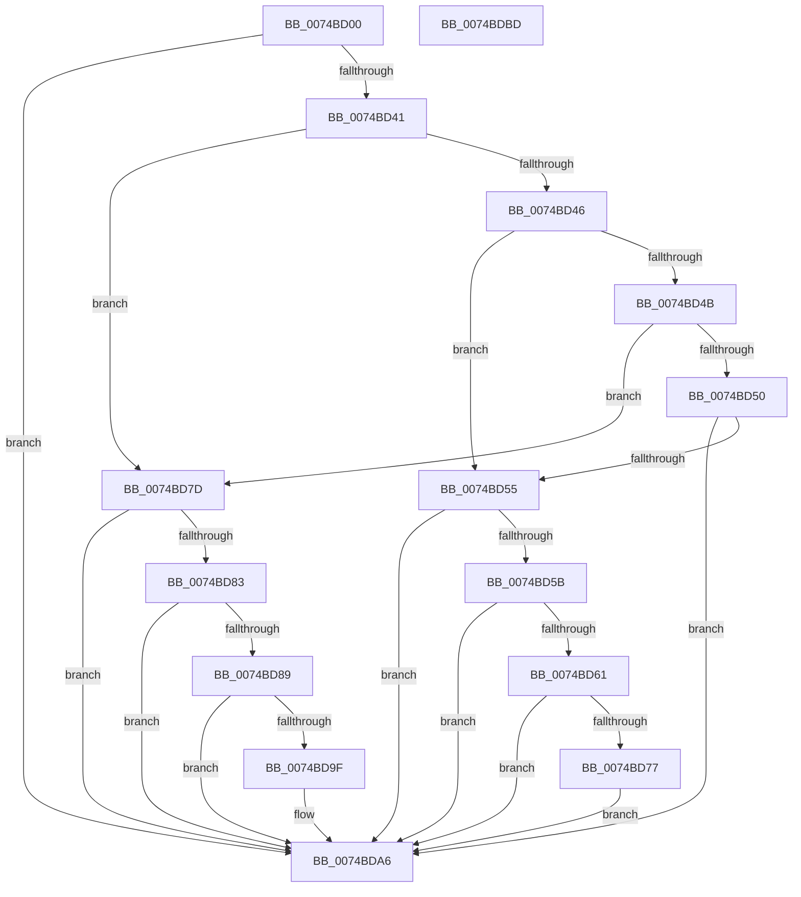

# KseHookQueryValueKey

- RVA: `0x0074BD00`–`0x0074BDBE` (길이 `190` bytes)
- VA: `0x000000014074BD00`
- 실행 섹션: `PAGE`
- PDB 이름 있음: `예`; PDB Function 태그: `아니요`
- unwind 정보 RVA: `0x0007D3C0`
- 디코드: `58`개 명령, `190/190` bytes 표시
- 미해석 바이트: `0` (있으면 어셈블리에 `.byte`로 보존)

> 이 문서는 커널 이미지의 기계어와 PDB 기호를 분석해 생성했습니다. 4번과 5번은 함수 원형과 자료형을 바이너리 사용 방식에서 추정한 C 해석이며 원본 소스 복구 결과는 아닙니다.

## 1. Dependencies

- 직접 호출 지점: **3**; 고유 호출 대상: **2**
- 직접 호출자로 확인된 함수: **0**
- RIP 상대 이미지 참조: **2**

### Outgoing calls
- `0x0074BD36` → [guard_dispatch_icall](../../text/6B/guard_dispatch_icall_function_006BAAD0.md) (function, `0x006BAAD0`)
- `0x0074BD6E` → [RtlEqualUnicodeString](../93/RtlEqualUnicodeString_function_00932A20.md) (function, `0x00932A20`)
- `0x0074BD96` → [RtlEqualUnicodeString](../93/RtlEqualUnicodeString_function_00932A20.md) (function, `0x00932A20`)

### Direct callers
- 이 함수 시작 RVA로 연결되는 직접 call은 확인되지 않았습니다. 간접 호출은 완전히 역산할 수 없습니다.

### Static image references
- `0x0074BD1C` → RVA `0x00E018A8` (`.data`; read)
- `0x0074BD64` → RVA `0x0000B1F0` (`.rdata`; read)

## 2. Other-region calls and transfers

- 다른 실행 섹션으로 향하는 call: **1**
  - `0x0074BD36` → [guard_dispatch_icall](../../text/6B/guard_dispatch_icall_function_006BAAD0.md) (`PAGE` → `.text`)
- 별도 외부 분기/꼬리 이동을 확인하지 못했습니다.

## 3. Assembly (complete function range)

```asm
0074BD00  4C 8B DC                        mov r11, rsp
0074BD03  49 89 5B 08                     mov qword ptr [r11 + 8], rbx
0074BD07  49 89 6B 10                     mov qword ptr [r11 + 0x10], rbp
0074BD0B  49 89 73 18                     mov qword ptr [r11 + 0x18], rsi
0074BD0F  57                              push rdi
0074BD10  48 83 EC 40                     sub rsp, 0x40
0074BD14  4C 8B 54 24 78                  mov r10, qword ptr [rsp + 0x78]
0074BD19  49 8B F9                        mov rdi, r9
0074BD1C  48 8B 05 85 5B 6B 00            mov rax, qword ptr [rip + 0x6b5b85]
0074BD23  41 8B D8                        mov ebx, r8d
0074BD26  4D 89 53 E0                     mov qword ptr [r11 - 0x20], r10
0074BD2A  48 8B F2                        mov rsi, rdx
0074BD2D  44 8B 54 24 70                  mov r10d, dword ptr [rsp + 0x70]
0074BD32  45 89 53 D8                     mov dword ptr [r11 - 0x28], r10d
0074BD36  E8 95 ED F6 FF                  call 0x1406baad0
0074BD3B  8B E8                           mov ebp, eax
0074BD3D  85 C0                           test eax, eax
0074BD3F  78 65                           js 0x14074bda6
0074BD41  83 EB 01                        sub ebx, 1
0074BD44  74 37                           je 0x14074bd7d
0074BD46  83 EB 01                        sub ebx, 1
0074BD49  74 0A                           je 0x14074bd55
0074BD4B  83 EB 01                        sub ebx, 1
0074BD4E  74 2D                           je 0x14074bd7d
0074BD50  83 FB 01                        cmp ebx, 1
0074BD53  75 51                           jne 0x14074bda6
0074BD55  83 7F 04 04                     cmp dword ptr [rdi + 4], 4
0074BD59  75 4B                           jne 0x14074bda6
0074BD5B  83 7F 08 04                     cmp dword ptr [rdi + 8], 4
0074BD5F  75 45                           jne 0x14074bda6
0074BD61  41 B0 01                        mov r8b, 1
0074BD64  48 8D 0D 85 F4 8B FF            lea rcx, [rip - 0x740b7b]
0074BD6B  48 8B D6                        mov rdx, rsi
0074BD6E  E8 AD 6C 1E 00                  call 0x140932a20
0074BD73  84 C0                           test al, al
0074BD75  74 2F                           je 0x14074bda6
0074BD77  83 67 0C 00                     and dword ptr [rdi + 0xc], 0
0074BD7B  EB 29                           jmp 0x14074bda6
0074BD7D  83 7F 04 04                     cmp dword ptr [rdi + 4], 4
0074BD81  75 23                           jne 0x14074bda6
0074BD83  83 7F 0C 04                     cmp dword ptr [rdi + 0xc], 4
0074BD87  75 1D                           jne 0x14074bda6
0074BD89  41 B0 01                        mov r8b, 1
0074BD8C  48 8D 0D 5D F4 8B FF            lea rcx, [rip - 0x740ba3]
0074BD93  48 8B D6                        mov rdx, rsi
0074BD96  E8 85 6C 1E 00                  call 0x140932a20
0074BD9B  84 C0                           test al, al
0074BD9D  74 07                           je 0x14074bda6
0074BD9F  8B 47 08                        mov eax, dword ptr [rdi + 8]
0074BDA2  83 24 38 00                     and dword ptr [rax + rdi], 0
0074BDA6  48 8B 5C 24 50                  mov rbx, qword ptr [rsp + 0x50]
0074BDAB  8B C5                           mov eax, ebp
0074BDAD  48 8B 6C 24 58                  mov rbp, qword ptr [rsp + 0x58]
0074BDB2  48 8B 74 24 60                  mov rsi, qword ptr [rsp + 0x60]
0074BDB7  48 83 C4 40                     add rsp, 0x40
0074BDBB  5F                              pop rdi
0074BDBC  C3                              ret
0074BDBD  CC                              int3
```

## 4. C-style interpretation (structured pseudocode)

```c
__int64 __fastcall KseHookQueryValueKey(__int64 a1, __int64 a2, int a3, __int64 a4, unsigned int a5, __int64 a6)
{
    __int64 result;
    __int64 v_rbx;
    __int64 v_rsp;
    unsigned __int64 v_stack_p10;
    unsigned __int64 v_stack_p18;
    unsigned __int64 v_stack_p8;

    *(unsigned __int64 *)(v_rsp + 8) = v_rbx;
    *(unsigned __int64 *)(v_rsp + 16) = v_rbp;
    *(unsigned __int64 *)(v_rsp + 24) = v_rsi;
    v_rsp = (v_rsp) - (64);
    *(unsigned __int64 *)(v_rsp - 32) = a6;
    *(unsigned int *)(v_rsp - 40) = (unsigned int)((unsigned int)(a5));
    result = guard_dispatch_icall(a1, a2, a3, a4);
    if (sign_flag) goto loc_0074BDA6;
    v_rbx = (unsigned int)(((unsigned int)(a3)) - (1));
    if (condition_is_equal) goto loc_0074BD7D;
    v_rbx = (unsigned int)((v_rbx) - (1));
    if (condition_is_equal) goto loc_0074BD55;
    v_rbx = (unsigned int)((v_rbx) - (1));
    if (condition_is_equal) goto loc_0074BD7D;
    if (((unsigned int)(v_rbx)) != 1) goto loc_0074BDA6;
loc_0074BD55:
    if ((*(unsigned int *)(a4 + 4)) != 4) goto loc_0074BDA6;
    if ((*(unsigned int *)(a4 + 8)) != 4) goto loc_0074BDA6;
    result = RtlEqualUnicodeString(v_rip - 7605115, a2, 1, a4);
    if ((unsigned __int8)(result) == 0) goto loc_0074BDA6;
    goto loc_0074BDA6;
loc_0074BD7D:
    if ((*(unsigned int *)(a4 + 4)) != 4) goto loc_0074BDA6;
    if ((*(unsigned int *)(a4 + 12)) != 4) goto loc_0074BDA6;
    result = RtlEqualUnicodeString(v_rip - 7605155, a2, 1, a4);
    if ((unsigned __int8)(result) != 0) {
        result = *(unsigned int *)(a4 + 8);
    }
    v_rsp = (v_rsp) + (64);
    return (unsigned int)((unsigned int)((unsigned int)((unsigned int)(result))));
}
```

## 5. (Beta) C Style

```c
int64_t KseHookQueryValueKey(int64_t Arg1, int64_t Arg2, int32_t Arg3, void *Arg4, uint32_t Arg5, int64_t Arg6)
{
    uint8_t *arg4 = (uint8_t *)Arg4;

    int64_t result;
    int64_t local_rbx;
    int64_t local_rsp;
    uint64_t v_stack_p10;
    uint64_t v_stack_p18;
    uint64_t v_stack_p8;

    *(uint64_t *)(local_rsp + 0x8) = local_rbx;
    *(uint64_t *)(local_rsp + 0x10) = local_rbp;
    *(uint64_t *)(local_rsp + 0x18) = local_rsi;
    local_rsp = (local_rsp) - (64);
    *(uint64_t *)(local_rsp - 0x20) = Arg6;
    *(uint32_t *)(local_rsp - 0x28) = (uint32_t)((uint32_t)(Arg5));
    result = guard_dispatch_icall(Arg1, Arg2, Arg3, Arg4);
    if (sign_flag) goto loc_0074BDA6;
    local_rbx = (uint32_t)(((uint32_t)(Arg3)) - (1));
    if (condition_is_equal) goto loc_0074BD7D;
    local_rbx = (uint32_t)((local_rbx) - (1));
    if (condition_is_equal) goto loc_0074BD55;
    local_rbx = (uint32_t)((local_rbx) - (1));
    if (condition_is_equal) goto loc_0074BD7D;
    if (((uint32_t)(local_rbx)) != 1) goto loc_0074BDA6;
loc_0074BD55:
    if ((*(uint32_t *)(arg4 + 0x4)) != 4) goto loc_0074BDA6;
    if ((*(uint32_t *)(arg4 + 0x8)) != 4) goto loc_0074BDA6;
    result = RtlEqualUnicodeString(v_rip - 7605115, Arg2, 1, Arg4);
    if ((uint8_t)(result) == 0) goto loc_0074BDA6;
    goto loc_0074BDA6;
loc_0074BD7D:
    if ((*(uint32_t *)(arg4 + 0x4)) != 4) goto loc_0074BDA6;
    if ((*(uint32_t *)(arg4 + 0xC)) != 4) goto loc_0074BDA6;
    result = RtlEqualUnicodeString(v_rip - 7605155, Arg2, 1, Arg4);
    if ((uint8_t)(result) != 0) {
        result = *(uint32_t *)(arg4 + 0x8);
    }
    local_rsp = (local_rsp) + (64);
    return (uint32_t)((uint32_t)((uint32_t)((uint32_t)(result))));
}
```

### 관측된 메모리 오프셋

구조체 형식이 확인되지 않은 접근은 인자 기준의 오프셋으로만 기록했습니다.

| 기준 인자 | 오프셋 표현 | 폭 (bit) | 접근 |
|---|---:|---:|---|
| `Arg4` | `+ 0x4` | `32` | `R` |
| `Arg4` | `+ 0x8` | `32` | `R` |
| `Arg4` | `+ 0xC` | `32` | `R` |
| `Arg4` | `+ 0xC` | `32` | `R/W` |

## 6. Execution-region graph

[열기: 2D/3D 그래프와 함수 탐색 컨트롤 패널](../../../control-panel.html?section=page&rva=0x0074BD00&view=graph)

- 2D 그래프는 위에서 아래로 흐르고, 3D 그래프는 빈 공간을 드래그해 회전합니다. Shift+드래그는 이동, 휠은 확대·축소, 함수 노드 선택은 대상 보고서 이동입니다.

### Static fallback


