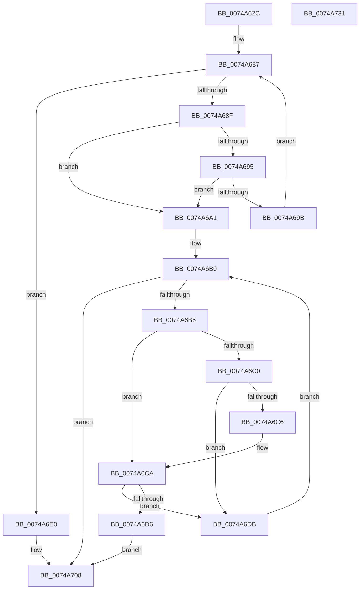

# KseLookupHardwareId

- RVA: `0x0074A62C`–`0x0074A732` (길이 `262` bytes)
- VA: `0x000000014074A62C`
- 실행 섹션: `PAGE`
- PDB 이름 있음: `예`; PDB Function 태그: `아니요`
- unwind 정보 RVA: `0x000BAC3C`
- 디코드: `78`개 명령, `262/262` bytes 표시
- 미해석 바이트: `0` (있으면 어셈블리에 `.byte`로 보존)

> 이 문서는 커널 이미지의 기계어와 PDB 기호를 분석해 생성했습니다. 4번과 5번은 함수 원형과 자료형을 바이너리 사용 방식에서 추정한 C 해석이며 원본 소스 복구 결과는 아닙니다.

## 1. Dependencies

- 직접 호출 지점: **6**; 고유 호출 대상: **5**
- 직접 호출자로 확인된 함수: **1**
- RIP 상대 이미지 참조: **1**

### Outgoing calls
- `0x0074A6A4` → [CmpLockSiloKeyLockTrackerExclusive](../8F/CmpLockSiloKeyLockTrackerExclusive_function_008F9EF8.md) (function, `0x008F9EF8`)
- `0x0074A6CD` → [AslStringPatternMatchExW](../95/AslStringPatternMatchExW_function_0095E850.md) (function, `0x0095E850`)
- `0x0074A6E5` → [RtlInitUnicodeString](../../text/42/RtlInitUnicodeString_function_0042A780.md) (function, `0x0042A780`)
- `0x0074A6ED` → [CmpLockSiloKeyLockTrackerExclusive](../8F/CmpLockSiloKeyLockTrackerExclusive_function_008F9EF8.md) (function, `0x008F9EF8`)
- `0x0074A6FA` → [KsepCacheLookup](../95/KsepCacheLookup_function_00959DE8.md) (function, `0x00959DE8`)
- `0x0074A70B` → [KsepCacheUnlock](../95/KsepCacheUnlock_function_00959ECC.md) (function, `0x00959ECC`)

### Direct callers
- [AhcCacheQueryHwId](../83/AhcCacheQueryHwId_function_0083ACB8.md) at `0x0083AE1A`

### Static image references
- `0x0074A651` → RVA `0x00E66CD0` (`.data`; read)

## 2. Other-region calls and transfers

- 다른 실행 섹션으로 향하는 call: **1**
  - `0x0074A6E5` → [RtlInitUnicodeString](../../text/42/RtlInitUnicodeString_function_0042A780.md) (`PAGE` → `.text`)
- 별도 외부 분기/꼬리 이동을 확인하지 못했습니다.

## 3. Assembly (complete function range)

```asm
0074A62C  48 8B C4                        mov rax, rsp
0074A62F  48 89 58 08                     mov qword ptr [rax + 8], rbx
0074A633  48 89 68 10                     mov qword ptr [rax + 0x10], rbp
0074A637  48 89 70 18                     mov qword ptr [rax + 0x18], rsi
0074A63B  48 89 78 20                     mov qword ptr [rax + 0x20], rdi
0074A63F  41 55                           push r13
0074A641  41 56                           push r14
0074A643  41 57                           push r15
0074A645  48 83 EC 60                     sub rsp, 0x60
0074A649  44 0F B7 39                     movzx r15d, word ptr [rcx]
0074A64D  48 8D 69 02                     lea rbp, [rcx + 2]
0074A651  48 8B 3D 78 C6 71 00            mov rdi, qword ptr [rip + 0x71c678]
0074A658  33 C0                           xor eax, eax
0074A65A  0F 57 C0                        xorps xmm0, xmm0
0074A65D  89 44 24 50                     mov dword ptr [rsp + 0x50], eax
0074A661  66 41 83 FF 2A                  cmp r15w, 0x2a
0074A666  48 8B D1                        mov rdx, rcx
0074A669  BE 25 02 00 C0                  mov esi, 0xc0000225
0074A66E  48 0F 45 E9                     cmovne rbp, rcx
0074A672  45 33 ED                        xor r13d, r13d
0074A675  48 8B CD                        mov rcx, rbp
0074A678  0F 11 44 24 20                  movups xmmword ptr [rsp + 0x20], xmm0
0074A67D  0F 11 44 24 30                  movups xmmword ptr [rsp + 0x30], xmm0
0074A682  0F 11 44 24 40                  movups xmmword ptr [rsp + 0x40], xmm0
0074A687  0F B7 01                        movzx eax, word ptr [rcx]
0074A68A  66 85 C0                        test ax, ax
0074A68D  74 51                           je 0x14074a6e0
0074A68F  66 83 F8 2A                     cmp ax, 0x2a
0074A693  74 0C                           je 0x14074a6a1
0074A695  66 83 F8 3F                     cmp ax, 0x3f
0074A699  74 06                           je 0x14074a6a1
0074A69B  48 83 C1 02                     add rcx, 2
0074A69F  EB E6                           jmp 0x14074a687
0074A6A1  48 8B CF                        mov rcx, rdi
0074A6A4  E8 4F F8 1A 00                  call 0x1408f9ef8
0074A6A9  4C 8D 77 20                     lea r14, [rdi + 0x20]
0074A6AD  49 8B 1E                        mov rbx, qword ptr [r14]
0074A6B0  49 3B DE                        cmp rbx, r14
0074A6B3  74 53                           je 0x14074a708
0074A6B5  48 8B 53 18                     mov rdx, qword ptr [rbx + 0x18]
0074A6B9  66 41 83 FF 2A                  cmp r15w, 0x2a
0074A6BE  75 0A                           jne 0x14074a6ca
0074A6C0  66 44 39 3A                     cmp word ptr [rdx], r15w
0074A6C4  75 15                           jne 0x14074a6db
0074A6C6  48 83 C2 02                     add rdx, 2
0074A6CA  48 8B CD                        mov rcx, rbp
0074A6CD  E8 7E 41 21 00                  call 0x14095e850
0074A6D2  85 C0                           test eax, eax
0074A6D4  74 05                           je 0x14074a6db
0074A6D6  41 8B F5                        mov esi, r13d
0074A6D9  EB 2D                           jmp 0x14074a708
0074A6DB  48 8B 1B                        mov rbx, qword ptr [rbx]
0074A6DE  EB D0                           jmp 0x14074a6b0
0074A6E0  48 8D 4C 24 48                  lea rcx, [rsp + 0x48]
0074A6E5  E8 96 00 CE FF                  call 0x14042a780
0074A6EA  48 8B CF                        mov rcx, rdi
0074A6ED  E8 06 F8 1A 00                  call 0x1408f9ef8
0074A6F2  48 8D 54 24 20                  lea rdx, [rsp + 0x20]
0074A6F7  48 8B CF                        mov rcx, rdi
0074A6FA  E8 E9 F6 20 00                  call 0x140959de8
0074A6FF  48 F7 D8                        neg rax
0074A702  1B D2                           sbb edx, edx
0074A704  F7 D2                           not edx
0074A706  23 F2                           and esi, edx
0074A708  48 8B CF                        mov rcx, rdi
0074A70B  E8 BC F7 20 00                  call 0x140959ecc
0074A710  4C 8D 5C 24 60                  lea r11, [rsp + 0x60]
0074A715  8B C6                           mov eax, esi
0074A717  49 8B 5B 20                     mov rbx, qword ptr [r11 + 0x20]
0074A71B  49 8B 6B 28                     mov rbp, qword ptr [r11 + 0x28]
0074A71F  49 8B 73 30                     mov rsi, qword ptr [r11 + 0x30]
0074A723  49 8B 7B 38                     mov rdi, qword ptr [r11 + 0x38]
0074A727  49 8B E3                        mov rsp, r11
0074A72A  41 5F                           pop r15
0074A72C  41 5E                           pop r14
0074A72E  41 5D                           pop r13
0074A730  C3                              ret
0074A731  CC                              int3
```

## 4. C-style interpretation (structured pseudocode)

```c
__int64 __fastcall KseLookupHardwareId(__int64 a1)
{
    __int64 result;
    __int64 v_r13;
    __int64 v_rbp;
    __int64 v_rsi;
    __int64 v_rsp;
    unsigned __int64 v_stack_m18;
    unsigned int v_stack_m28;
    unsigned __int64 v_stack_m30;
    unsigned __int64 v_stack_m38;
    unsigned __int64 v_stack_m48;
    unsigned __int64 v_stack_m58;

    *(unsigned __int64 *)(v_rsp + 8) = v_rbx;
    *(unsigned __int64 *)(v_rsp + 16) = v_rbp;
    *(unsigned __int64 *)(v_rsp + 24) = v_rsi;
    *(unsigned __int64 *)(v_rsp + 32) = v_rdi;
    v_rsp = (v_rsp) - (96);
    result = 0;
    v_stack_m28 = 0;
    v_rbp = a1 + 2;
    if (((unsigned __int16)(*(unsigned __int16 *)(a1))) != 42) { v_rbp = a1; }
    v_r13 = 0;
    v_stack_m58 = v_xmm0;
    v_stack_m48 = v_xmm0;
    v_stack_m38 = v_xmm0;
loc_0074A687:
    if ((unsigned __int16)(*(unsigned __int16 *)(v_rbp)) == 0) goto loc_0074A6E0;
    if (((unsigned __int16)(*(unsigned __int16 *)(v_rbp))) == 42) goto loc_0074A6A1;
    if (((unsigned __int16)(*(unsigned __int16 *)(v_rbp))) == 63) goto loc_0074A6A1;
    a1 = (v_rbp) + (2);
    goto loc_0074A687;
loc_0074A6A1:
    result = CmpLockSiloKeyLockTrackerExclusive(*(unsigned __int64 *)(v_rip + 7456376), a1, a3, a4);
loc_0074A6B0:
    if ((*(unsigned __int64 *)(*(unsigned __int64 *)(v_rip + 7456376) + 32)) == (*(unsigned __int64 *)(v_rip + 7456376) + 32)) goto loc_0074A708;
    if (((unsigned __int16)(*(unsigned __int16 *)(a1))) != 42) goto loc_0074A6CA;
    if ((*(unsigned __int16 *)(*(unsigned __int64 *)(*(unsigned __int64 *)(*(unsigned __int64 *)(v_rip + 7456376) + 32) + 24))) != ((unsigned __int16)(*(unsigned __int16 *)(a1)))) goto loc_0074A6DB;
    a2 = (*(unsigned __int64 *)(*(unsigned __int64 *)(*(unsigned __int64 *)(v_rip + 7456376) + 32) + 24)) + (2);
loc_0074A6CA:
    result = AslStringPatternMatchExW(v_rbp, a2, a3, a4);
    if ((unsigned int)(result) == 0) goto loc_0074A6DB;
    goto loc_0074A708;
loc_0074A6DB:
    goto loc_0074A6B0;
loc_0074A6E0:
    result = RtlInitUnicodeString(v_stack_m30, a2, a3, a4);
    result = CmpLockSiloKeyLockTrackerExclusive(*(unsigned __int64 *)(v_rip + 7456376), a2, a3, a4);
    result = KsepCacheLookup(*(unsigned __int64 *)(v_rip + 7456376), v_stack_m58, a3, a4);
    result = -(result);
    a2 = (unsigned int)(~(v_stack_m58));
    v_rsi = (unsigned int)((0) & ((unsigned int)(a2)));
loc_0074A708:
    result = KsepCacheUnlock(*(unsigned __int64 *)(v_rip + 7456376), a2, a3, a4);
    return (unsigned int)((unsigned int)(v_rsi));
}
```

## 5. (Beta) C Style

```c
int64_t KseLookupHardwareId(void *Arg1)
{
    uint8_t *arg1 = (uint8_t *)Arg1;

    int64_t result;
    int64_t local_r13;
    int64_t local_rbp;
    int64_t local_rsi;
    int64_t local_rsp;
    uint64_t v_stack_m18;
    uint32_t v_stack_m28;
    uint64_t v_stack_m30;
    uint64_t v_stack_m38;
    uint64_t v_stack_m48;
    uint64_t v_stack_m58;

    *(uint64_t *)(local_rsp + 0x8) = local_rbx;
    *(uint64_t *)(local_rsp + 0x10) = local_rbp;
    *(uint64_t *)(local_rsp + 0x18) = local_rsi;
    *(uint64_t *)(local_rsp + 0x20) = local_rdi;
    local_rsp = (local_rsp) - (96);
    result = 0;
    v_stack_m28 = 0;
    local_rbp = Arg1 + 2;
    if (((uint16_t)(*(uint16_t *)(arg1))) != 42) { local_rbp = Arg1; }
    local_r13 = 0;
    v_stack_m58 = v_xmm0;
    v_stack_m48 = v_xmm0;
    v_stack_m38 = v_xmm0;
loc_0074A687:
    if ((uint16_t)(*(uint16_t *)(local_rbp)) == 0) goto loc_0074A6E0;
    if (((uint16_t)(*(uint16_t *)(local_rbp))) == 42) goto loc_0074A6A1;
    if (((uint16_t)(*(uint16_t *)(local_rbp))) == 63) goto loc_0074A6A1;
    Arg1 = (local_rbp) + (2);
    goto loc_0074A687;
loc_0074A6A1:
    result = CmpLockSiloKeyLockTrackerExclusive(*(uint64_t *)(v_rip + 0x71C678), Arg1, a3, a4);
loc_0074A6B0:
    if ((*(uint64_t *)(*(uint64_t *)(v_rip + 0x71C678) + 0x20)) == (*(uint64_t *)(v_rip + 0x71C678) + 32)) goto loc_0074A708;
    if (((uint16_t)(*(uint16_t *)(arg1))) != 42) goto loc_0074A6CA;
    if ((*(uint16_t *)(*(uint64_t *)(*(uint64_t *)(*(uint64_t *)(v_rip + 0x71C678) + 0x20) + 0x18))) != ((uint16_t)(*(uint16_t *)(arg1)))) goto loc_0074A6DB;
    a2 = (*(uint64_t *)(*(uint64_t *)(*(uint64_t *)(v_rip + 0x71C678) + 0x20) + 0x18)) + (2);
loc_0074A6CA:
    result = AslStringPatternMatchExW(local_rbp, a2, a3, a4);
    if ((uint32_t)(result) == 0) goto loc_0074A6DB;
    goto loc_0074A708;
loc_0074A6DB:
    goto loc_0074A6B0;
loc_0074A6E0:
    result = RtlInitUnicodeString(v_stack_m30, a2, a3, a4);
    result = CmpLockSiloKeyLockTrackerExclusive(*(uint64_t *)(v_rip + 0x71C678), a2, a3, a4);
    result = KsepCacheLookup(*(uint64_t *)(v_rip + 0x71C678), v_stack_m58, a3, a4);
    result = -(result);
    a2 = (uint32_t)(~(v_stack_m58));
    local_rsi = (uint32_t)((0) & ((uint32_t)(a2)));
loc_0074A708:
    result = KsepCacheUnlock(*(uint64_t *)(v_rip + 0x71C678), a2, a3, a4);
    return (uint32_t)((uint32_t)(local_rsi));
}
```

### 관측된 메모리 오프셋

구조체 형식이 확인되지 않은 접근은 인자 기준의 오프셋으로만 기록했습니다.

| 기준 인자 | 오프셋 표현 | 폭 (bit) | 접근 |
|---|---:|---:|---|
| `Arg1` | `+ 0x0` | `16` | `R` |
| `Arg1` | `+ 0x2` | `64` | `R` |

## 6. Execution-region graph

[열기: 2D/3D 그래프와 함수 탐색 컨트롤 패널](../../../control-panel.html?section=page&rva=0x0074A62C&view=graph)

- 2D 그래프는 위에서 아래로 흐르고, 3D 그래프는 빈 공간을 드래그해 회전합니다. Shift+드래그는 이동, 휠은 확대·축소, 함수 노드 선택은 대상 보고서 이동입니다.

### Static fallback


