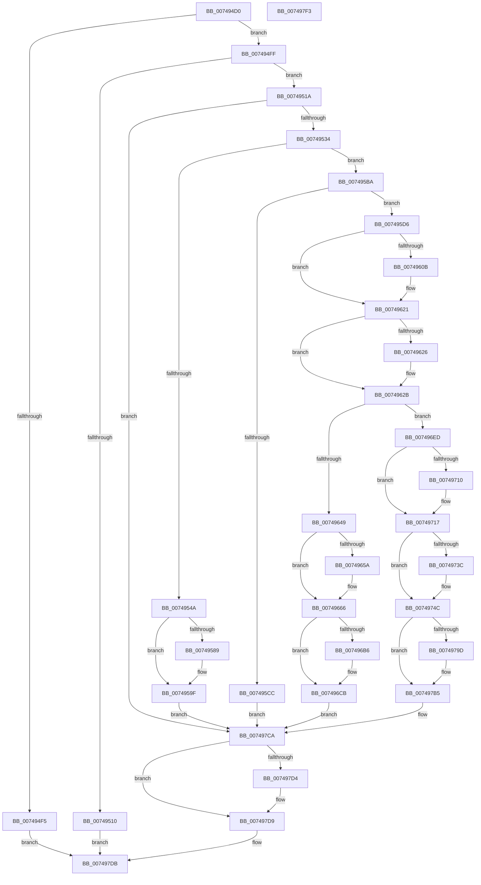

# KseRegisterShimEx

- RVA: `0x007494D0`–`0x007497F4` (길이 `804` bytes)
- VA: `0x00000001407494D0`
- 실행 섹션: `PAGE`
- PDB 이름 있음: `예`; PDB Function 태그: `아니요`
- unwind 정보 RVA: `0x000CB40C`
- 디코드: `184`개 명령, `804/804` bytes 표시
- 미해석 바이트: `0` (있으면 어셈블리에 `.byte`로 보존)

> 이 문서는 커널 이미지의 기계어와 PDB 기호를 분석해 생성했습니다. 4번과 5번은 함수 원형과 자료형을 바이너리 사용 방식에서 추정한 C 해석이며 원본 소스 복구 결과는 아닙니다.

## 1. Dependencies

- 직접 호출 지점: **20**; 고유 호출 대상: **13**
- 직접 호출자로 확인된 함수: **1**
- RIP 상대 이미지 참조: **15**

### Outgoing calls
- `0x00749525` → [KsepGetLoadedModulesList](KsepGetLoadedModulesList_function_0074A960.md) (function, `0x0074A960`)
- `0x00749541` → [KsepValidateShimProviderAndData](KsepValidateShimProviderAndData_function_00749BB0.md) (function, `0x00749BB0`)
- `0x0074959A` → [KsepDebugPrint](../../text/4D/KsepDebugPrint_function_004DCFF0.md) (function, `0x004DCFF0`)
- `0x007495B0` → [KsepLogError](../../text/49/KsepLogError_function_00499A98.md) (function, `0x00499A98`)
- `0x007495BF` → [KsepPoolAllocatePaged](../../text/4A/KsepPoolAllocatePaged_function_004A9EFC.md) (function, `0x004A9EFC`)
- `0x007495F7` → [KeAbPreAcquire](../../text/21/KeAbPreAcquire_function_00210230.md) (function, `0x00210230`)
- `0x0074961C` → [ExfAcquirePushLockExclusiveEx](../../text/20/ExfAcquirePushLockExclusiveEx_function_0020FC90.md) (function, `0x0020FC90`)
- `0x0074963C` → [KsepIsShimRegistered](../AC/KsepIsShimRegistered_function_00ACEBCC.md) (function, `0x00ACEBCC`)
- `0x00749661` → [ExfTryToWakePushLock](../../text/26/ExfTryToWakePushLock_function_00265DD0.md) (function, `0x00265DD0`)
- `0x0074966D` → [KeAbPostRelease](../../text/2E/KeAbPostRelease_function_002E1600.md) (function, `0x002E1600`)
- `0x00749672` → [KeLeaveCriticalRegion](../../text/25/KeLeaveCriticalRegion_function_0025D8B0.md) (function, `0x0025D8B0`)
- `0x007496C6` → [KsepDebugPrint](../../text/4D/KsepDebugPrint_function_004DCFF0.md) (function, `0x004DCFF0`)
- `0x007496DB` → [KsepLogError](../../text/49/KsepLogError_function_00499A98.md) (function, `0x00499A98`)
- `0x007496E3` → [KsepPoolFreePaged](../../text/4B/KsepPoolFreePaged_function_004B0E10.md) (function, `0x004B0E10`)
- `0x00749743` → [ExfTryToWakePushLock](../../text/26/ExfTryToWakePushLock_function_00265DD0.md) (function, `0x00265DD0`)
- `0x00749753` → [KeAbPostRelease](../../text/2E/KeAbPostRelease_function_002E1600.md) (function, `0x002E1600`)
- `0x00749758` → [KeLeaveCriticalRegion](../../text/25/KeLeaveCriticalRegion_function_0025D8B0.md) (function, `0x0025D8B0`)
- `0x007497AD` → [KsepDebugPrint](../../text/4D/KsepDebugPrint_function_004DCFF0.md) (function, `0x004DCFF0`)
- `0x007497C5` → [KsepLogInfo](../../text/49/KsepLogInfo_function_00499A68.md) (function, `0x00499A68`)
- `0x007497D4` → [KsepPoolFreePaged](../../text/4B/KsepPoolFreePaged_function_004B0E10.md) (function, `0x004B0E10`)

### Direct callers
- [KseRegisterShim](KseRegisterShim_function_007494B0.md) at `0x007494B7`

### Static image references
- `0x007494FF` → RVA `0x00E66C84` (`.data`; read)
- `0x00749554` → RVA `0x00F101C0` (`.data`; read/write)
- `0x0074955E` → RVA `0x00000000` (`image boundary/outside`; read)
- `0x0074957E` → RVA `0x00E66CE8` (`.data`; read)
- `0x0074958D` → RVA `0x00B008D0` (` ?? ::NNGAKEGL::`string'`; read)
- `0x007495DF` → RVA `0x00E66CB0` (`.data`; read)
- `0x007495FC` → RVA `0x00E66CB0` (`.data`; read/write)
- `0x00749635` → RVA `0x00E66C80` (`.data`; read)
- `0x007496B9` → RVA `0x00B00900` (` ?? ::NNGAKEGL::`string'`; read)
- `0x007496F1` → RVA `0x00E66C90` (`.data`; read)
- `0x00749704` → RVA `0x00E66C98` (`.data`; read)
- `0x00749721` → RVA `0x00E66C98` (`.data`; write)
- `0x0074975D` → RVA `0x00E66CB8` (`.data`; read)
- `0x0074976D` → RVA `0x00F105E0` (`.data`; read/write)
- `0x007497A0` → RVA `0x00B00840` (` ?? ::NNGAKEGL::`string'`; read)

## 2. Other-region calls and transfers

- 다른 실행 섹션으로 향하는 call: **17**
  - `0x0074959A` → [KsepDebugPrint](../../text/4D/KsepDebugPrint_function_004DCFF0.md) (`PAGE` → `.text`)
  - `0x007495B0` → [KsepLogError](../../text/49/KsepLogError_function_00499A98.md) (`PAGE` → `.text`)
  - `0x007495BF` → [KsepPoolAllocatePaged](../../text/4A/KsepPoolAllocatePaged_function_004A9EFC.md) (`PAGE` → `.text`)
  - `0x007495F7` → [KeAbPreAcquire](../../text/21/KeAbPreAcquire_function_00210230.md) (`PAGE` → `.text`)
  - `0x0074961C` → [ExfAcquirePushLockExclusiveEx](../../text/20/ExfAcquirePushLockExclusiveEx_function_0020FC90.md) (`PAGE` → `.text`)
  - `0x00749661` → [ExfTryToWakePushLock](../../text/26/ExfTryToWakePushLock_function_00265DD0.md) (`PAGE` → `.text`)
  - `0x0074966D` → [KeAbPostRelease](../../text/2E/KeAbPostRelease_function_002E1600.md) (`PAGE` → `.text`)
  - `0x00749672` → [KeLeaveCriticalRegion](../../text/25/KeLeaveCriticalRegion_function_0025D8B0.md) (`PAGE` → `.text`)
  - `0x007496C6` → [KsepDebugPrint](../../text/4D/KsepDebugPrint_function_004DCFF0.md) (`PAGE` → `.text`)
  - `0x007496DB` → [KsepLogError](../../text/49/KsepLogError_function_00499A98.md) (`PAGE` → `.text`)
  - `0x007496E3` → [KsepPoolFreePaged](../../text/4B/KsepPoolFreePaged_function_004B0E10.md) (`PAGE` → `.text`)
  - `0x00749743` → [ExfTryToWakePushLock](../../text/26/ExfTryToWakePushLock_function_00265DD0.md) (`PAGE` → `.text`)
  - `0x00749753` → [KeAbPostRelease](../../text/2E/KeAbPostRelease_function_002E1600.md) (`PAGE` → `.text`)
  - `0x00749758` → [KeLeaveCriticalRegion](../../text/25/KeLeaveCriticalRegion_function_0025D8B0.md) (`PAGE` → `.text`)
  - `0x007497AD` → [KsepDebugPrint](../../text/4D/KsepDebugPrint_function_004DCFF0.md) (`PAGE` → `.text`)
  - `0x007497C5` → [KsepLogInfo](../../text/49/KsepLogInfo_function_00499A68.md) (`PAGE` → `.text`)
  - `0x007497D4` → [KsepPoolFreePaged](../../text/4B/KsepPoolFreePaged_function_004B0E10.md) (`PAGE` → `.text`)
- 별도 외부 분기/꼬리 이동을 확인하지 못했습니다.

## 3. Assembly (complete function range)

```asm
007494D0  48 89 5C 24 10                  mov qword ptr [rsp + 0x10], rbx
007494D5  48 89 74 24 18                  mov qword ptr [rsp + 0x18], rsi
007494DA  57                              push rdi
007494DB  41 54                           push r12
007494DD  41 55                           push r13
007494DF  41 56                           push r14
007494E1  41 57                           push r15
007494E3  48 83 EC 20                     sub rsp, 0x20
007494E7  4D 8B F9                        mov r15, r9
007494EA  45 8B E0                        mov r12d, r8d
007494ED  48 8B F1                        mov rsi, rcx
007494F0  48 85 C9                        test rcx, rcx
007494F3  75 0A                           jne 0x1407494ff
007494F5  B8 0D 00 00 C0                  mov eax, 0xc000000d
007494FA  E9 DC 02 00 00                  jmp 0x1407497db
007494FF  8B 05 7F D7 71 00               mov eax, dword ptr [rip + 0x71d77f]
00749505  41 BD 02 00 00 00               mov r13d, 2
0074950B  41 3B C5                        cmp eax, r13d
0074950E  74 0A                           je 0x14074951a
00749510  B8 01 00 00 C0                  mov eax, 0xc0000001
00749515  E9 C1 02 00 00                  jmp 0x1407497db
0074951A  48 83 64 24 50 00               and qword ptr [rsp + 0x50], 0
00749520  48 8D 4C 24 50                  lea rcx, [rsp + 0x50]
00749525  E8 36 14 00 00                  call 0x14074a960
0074952A  8B D8                           mov ebx, eax
0074952C  85 C0                           test eax, eax
0074952E  0F 88 96 02 00 00               js 0x1407497ca
00749534  48 8B 4C 24 48                  mov rcx, qword ptr [rsp + 0x48]
00749539  4C 8B C6                        mov r8, rsi
0074953C  48 8B 54 24 50                  mov rdx, qword ptr [rsp + 0x50]
00749541  E8 6A 06 00 00                  call 0x140749bb0
00749546  85 C0                           test eax, eax
00749548  75 70                           jne 0x1407495ba
0074954A  BB 01 00 00 C0                  mov ebx, 0xc0000001
0074954F  B8 01 00 00 00                  mov eax, 1
00749554  F0 0F C1 05 64 6C 7C 00         lock xadd dword ptr [rip + 0x7c6c64], eax
0074955C  FF C0                           inc eax
0074955E  48 8D 0D 9B 6A 8B FF            lea rcx, [rip - 0x749565]
00749565  83 E0 3F                        and eax, 0x3f
00749568  C7 84 C1 E4 01 F1 00 01 00 00 C0  mov dword ptr [rcx + rax*8 + 0xf101e4], 0xc0000001
00749573  C7 84 C1 E0 01 F1 00 CD 00 02 00  mov dword ptr [rcx + rax*8 + 0xf101e0], 0x200cd
0074957E  8B 05 64 D7 71 00               mov eax, dword ptr [rip + 0x71d764]
00749584  41 84 C5                        test r13b, al
00749587  74 16                           je 0x14074959f
00749589  4C 8B 46 08                     mov r8, qword ptr [rsi + 8]
0074958D  48 8D 15 3C 73 3B 00            lea rdx, [rip + 0x3b733c]
00749594  41 8B CD                        mov ecx, r13d
00749597  45 8B 00                        mov r8d, dword ptr [r8]
0074959A  E8 51 3A D9 FF                  call 0x1404dcff0
0074959F  4C 8B 46 08                     mov r8, qword ptr [rsi + 8]
007495A3  48 8D 15 26 73 3B 00            lea rdx, [rip + 0x3b7326]
007495AA  41 8B CD                        mov ecx, r13d
007495AD  45 8B 00                        mov r8d, dword ptr [r8]
007495B0  E8 E3 04 D5 FF                  call 0x140499a98
007495B5  E9 10 02 00 00                  jmp 0x1407497ca
007495BA  B9 28 00 00 00                  mov ecx, 0x28
007495BF  E8 38 09 D6 FF                  call 0x1404a9efc
007495C4  48 8B F8                        mov rdi, rax
007495C7  48 85 C0                        test rax, rax
007495CA  75 0A                           jne 0x1407495d6
007495CC  BB 9A 00 00 C0                  mov ebx, 0xc000009a
007495D1  E9 F4 01 00 00                  jmp 0x1407497ca
007495D6  65 48 8B 04 25 88 01 00 00      mov rax, qword ptr gs:[0x188]
007495DF  48 8D 0D CA D6 71 00            lea rcx, [rip + 0x71d6ca]
007495E6  48 83 CB FF                     or rbx, 0xffffffffffffffff
007495EA  45 33 C0                        xor r8d, r8d
007495ED  33 D2                           xor edx, edx
007495EF  66 01 98 E4 01 00 00            add word ptr [rax + 0x1e4], bx
007495F6  90                              nop
007495F7  E8 34 6C AC FF                  call 0x140210230
007495FC  F0 48 0F BA 2D AA D6 71 00 00   lock bts qword ptr [rip + 0x71d6aa], 0
00749606  4C 8B F0                        mov r14, rax
00749609  73 16                           jae 0x140749621
0074960B  4C 8D 05 9E D6 71 00            lea r8, [rip + 0x71d69e]
00749612  48 8B D0                        mov rdx, rax
00749615  48 8D 0D 94 D6 71 00            lea rcx, [rip + 0x71d694]
0074961C  E8 6F 66 AC FF                  call 0x14020fc90
00749621  4D 85 F6                        test r14, r14
00749624  74 05                           je 0x14074962b
00749626  41 C6 46 0A 01                  mov byte ptr [r14 + 0xa], 1
0074962B  4C 8D 76 08                     lea r14, [rsi + 8]
0074962F  45 33 C9                        xor r9d, r9d
00749632  49 8B 16                        mov rdx, qword ptr [r14]
00749635  48 8D 0D 44 D6 71 00            lea rcx, [rip + 0x71d644]
0074963C  E8 8B 55 38 00                  call 0x140acebcc
00749641  85 C0                           test eax, eax
00749643  0F 84 A4 00 00 00               je 0x1407496ed
00749649  F0 48 0F C1 1D 5E D6 71 00      lock xadd qword ptr [rip + 0x71d65e], rbx
00749652  80 E3 06                        and bl, 6
00749655  41 3A DD                        cmp bl, r13b
00749658  75 0C                           jne 0x140749666
0074965A  48 8D 0D 4F D6 71 00            lea rcx, [rip + 0x71d64f]
00749661  E8 6A C7 B1 FF                  call 0x140265dd0
00749666  48 8D 0D 43 D6 71 00            lea rcx, [rip + 0x71d643]
0074966D  E8 8E 7F B9 FF                  call 0x1402e1600
00749672  E8 39 42 B1 FF                  call 0x14025d8b0
00749677  B8 01 00 00 00                  mov eax, 1
0074967C  BB 35 00 00 C0                  mov ebx, 0xc0000035
00749681  F0 0F C1 05 37 6B 7C 00         lock xadd dword ptr [rip + 0x7c6b37], eax
00749689  FF C0                           inc eax
0074968B  48 8D 0D 6E 69 8B FF            lea rcx, [rip - 0x749692]
00749692  83 E0 3F                        and eax, 0x3f
00749695  C7 84 C1 E4 01 F1 00 35 00 00 C0  mov dword ptr [rcx + rax*8 + 0xf101e4], 0xc0000035
007496A0  C7 84 C1 E0 01 F1 00 EE 00 02 00  mov dword ptr [rcx + rax*8 + 0xf101e0], 0x200ee
007496AB  8B 05 37 D6 71 00               mov eax, dword ptr [rip + 0x71d637]
007496B1  41 84 C5                        test r13b, al
007496B4  74 15                           je 0x1407496cb
007496B6  4D 8B 06                        mov r8, qword ptr [r14]
007496B9  48 8D 15 40 72 3B 00            lea rdx, [rip + 0x3b7240]
007496C0  41 8B CD                        mov ecx, r13d
007496C3  45 8B 00                        mov r8d, dword ptr [r8]
007496C6  E8 25 39 D9 FF                  call 0x1404dcff0
007496CB  4D 8B 06                        mov r8, qword ptr [r14]
007496CE  48 8D 15 2B 72 3B 00            lea rdx, [rip + 0x3b722b]
007496D5  41 8B CD                        mov ecx, r13d
007496D8  45 8B 00                        mov r8d, dword ptr [r8]
007496DB  E8 B8 03 D5 FF                  call 0x140499a98
007496E0  48 8B CF                        mov rcx, rdi
007496E3  E8 28 77 D6 FF                  call 0x1404b0e10
007496E8  E9 DD 00 00 00                  jmp 0x1407497ca
007496ED  83 67 18 00                     and dword ptr [rdi + 0x18], 0
007496F1  48 8D 0D 98 D5 71 00            lea rcx, [rip + 0x71d598]
007496F8  48 89 77 10                     mov qword ptr [rdi + 0x10], rsi
007496FC  44 89 67 1C                     mov dword ptr [rdi + 0x1c], r12d
00749700  4C 89 7F 20                     mov qword ptr [rdi + 0x20], r15
00749704  48 8B 05 8D D5 71 00            mov rax, qword ptr [rip + 0x71d58d]
0074970B  48 39 08                        cmp qword ptr [rax], rcx
0074970E  74 07                           je 0x140749717
00749710  B9 03 00 00 00                  mov ecx, 3
00749715  CD 29                           int 0x29
00749717  48 89 0F                        mov qword ptr [rdi], rcx
0074971A  48 89 47 08                     mov qword ptr [rdi + 8], rax
0074971E  48 89 38                        mov qword ptr [rax], rdi
00749721  48 89 3D 70 D5 71 00            mov qword ptr [rip + 0x71d570], rdi
00749728  F0 48 0F C1 1D 7F D5 71 00      lock xadd qword ptr [rip + 0x71d57f], rbx
00749731  80 E3 06                        and bl, 6
00749734  49 8B FE                        mov rdi, r14
00749737  41 3A DD                        cmp bl, r13b
0074973A  75 10                           jne 0x14074974c
0074973C  48 8D 0D 6D D5 71 00            lea rcx, [rip + 0x71d56d]
00749743  E8 88 C6 B1 FF                  call 0x140265dd0
00749748  48 8D 7E 08                     lea rdi, [rsi + 8]
0074974C  48 8D 0D 5D D5 71 00            lea rcx, [rip + 0x71d55d]
00749753  E8 A8 7E B9 FF                  call 0x1402e1600
00749758  E8 53 41 B1 FF                  call 0x14025d8b0
0074975D  48 8D 05 54 D5 71 00            lea rax, [rip + 0x71d554]
00749764  33 DB                           xor ebx, ebx
00749766  48 89 46 18                     mov qword ptr [rsi + 0x18], rax
0074976A  8D 43 01                        lea eax, [rbx + 1]
0074976D  F0 0F C1 05 6B 6E 7C 00         lock xadd dword ptr [rip + 0x7c6e6b], eax
00749775  FF C0                           inc eax
00749777  48 8D 0D 82 68 8B FF            lea rcx, [rip - 0x74977e]
0074977E  83 E0 3F                        and eax, 0x3f
00749781  21 9C C1 E4 03 F1 00            and dword ptr [rcx + rax*8 + 0xf103e4], ebx
00749788  C7 84 C1 E0 03 F1 00 19 01 02 00  mov dword ptr [rcx + rax*8 + 0xf103e0], 0x20119
00749793  8B 05 4F D5 71 00               mov eax, dword ptr [rip + 0x71d54f]
00749799  A8 01                           test al, 1
0074979B  74 18                           je 0x1407497b5
0074979D  4D 8B 06                        mov r8, qword ptr [r14]
007497A0  48 8D 15 99 70 3B 00            lea rdx, [rip + 0x3b7099]
007497A7  41 8B CD                        mov ecx, r13d
007497AA  45 8B 00                        mov r8d, dword ptr [r8]
007497AD  E8 3E 38 D9 FF                  call 0x1404dcff0
007497B2  4C 8B F7                        mov r14, rdi
007497B5  4D 8B 06                        mov r8, qword ptr [r14]
007497B8  48 8D 15 81 70 3B 00            lea rdx, [rip + 0x3b7081]
007497BF  41 8B CD                        mov ecx, r13d
007497C2  45 8B 00                        mov r8d, dword ptr [r8]
007497C5  E8 9E 02 D5 FF                  call 0x140499a68
007497CA  48 8B 4C 24 50                  mov rcx, qword ptr [rsp + 0x50]
007497CF  48 85 C9                        test rcx, rcx
007497D2  74 05                           je 0x1407497d9
007497D4  E8 37 76 D6 FF                  call 0x1404b0e10
007497D9  8B C3                           mov eax, ebx
007497DB  48 8B 5C 24 58                  mov rbx, qword ptr [rsp + 0x58]
007497E0  48 8B 74 24 60                  mov rsi, qword ptr [rsp + 0x60]
007497E5  48 83 C4 20                     add rsp, 0x20
007497E9  41 5F                           pop r15
007497EB  41 5E                           pop r14
007497ED  41 5D                           pop r13
007497EF  41 5C                           pop r12
007497F1  5F                              pop rdi
007497F2  C3                              ret
007497F3  CC                              int3
```

## 4. C-style interpretation (structured pseudocode)

```c
__int64 __fastcall KseRegisterShimEx(__int64 a1, __int64 a2, int a3, __int64 a4)
{
    __int64 result;
    __int64 v_r14;
    __int64 v_rbx;
    __int64 v_rdi;
    __int64 v_rsp;
    unsigned __int64 v_stack_p0;
    unsigned __int64 v_stack_p10;
    unsigned __int64 v_stack_p18;
    unsigned __int64 v_stack_p8;

    v_stack_p10 = v_rbx;
    v_stack_p18 = v_rsi;
    v_rsp = (v_rsp) - (32);
    if (a1 != 0) goto loc_007494FF;
    goto loc_007497DB;
loc_007494FF:
    if (((unsigned int)((unsigned int)(*(unsigned int *)(v_rip + 7460735)))) == 2) goto loc_0074951A;
    goto loc_007497DB;
loc_0074951A:
    result = KsepGetLoadedModulesList(v_stack_p8, a2, a3, a4);
    if (sign_flag) goto loc_007497CA;
    result = KsepValidateShimProviderAndData(v_stack_p0, v_stack_p8, a1, a4);
    if ((unsigned int)(result) != 0) goto loc_007495BA;
    result = (unsigned int)((1) + 1);
    result = (unsigned int)((result) & (63));
    *(unsigned int *)(v_rip - 7640421 + result * 8 + 15794660) = 0xC0000001ULL;
    *(unsigned int *)(v_rip - 7640421 + result * 8 + 15794656) = 0x200CDULL;
    result = (unsigned int)(*(unsigned int *)(v_rip + 7460708));
    if (((2) & ((unsigned __int8)((unsigned int)(*(unsigned int *)(v_rip + 7460708))))) != 0) {
        a3 = *(unsigned __int64 *)(a1 + 8);
        a2 = v_rip + 3896124;
        a1 = 2;
        a3 = *(unsigned int *)(a3);
        result = KsepDebugPrint(a1, a2, a3, a4);
    }
    result = KsepLogError(2, v_rip + 3896102, (unsigned int)(*(unsigned int *)(*(unsigned __int64 *)(a1 + 8))), a4);
    goto loc_007497CA;
loc_007495BA:
    result = KsepPoolAllocatePaged(40, v_rip + 3896102, (unsigned int)(*(unsigned int *)(*(unsigned __int64 *)(a1 + 8))), a4);
    if (result != 0) goto loc_007495D6;
    goto loc_007497CA;
loc_007495D6:
    v_rbx = ((unsigned int)(0xC000009AULL)) | (-1);
    a3 = 0;
    a2 = 0;
    result = KeAbPreAcquire(v_rip + 7460554, a2, a3, a4);
    if (!(condition_is_above_or_equal)) {
        a3 = v_rip + 7460510;
        a2 = result;
        a1 = v_rip + 7460500;
        result = ExfAcquirePushLockExclusiveEx(a1, a2, a3, a4);
    }
    if (result != 0) {
        *(unsigned __int8 *)(result + 10) = 1;
    }
    a4 = 0;
    result = KsepIsShimRegistered(v_rip + 7460420, *(unsigned __int64 *)(a1 + 8), a3, a4);
    if ((unsigned int)(result) == 0) goto loc_007496ED;
    v_rbx = (unsigned __int8)((v_rbx) & (6));
    if (((unsigned __int8)(v_rbx)) == 2) {
        a1 = v_rip + 7460431;
        result = ExfTryToWakePushLock(a1, *(unsigned __int64 *)(a1 + 8), a3, a4);
    }
    result = KeAbPostRelease(v_rip + 7460419, *(unsigned __int64 *)(a1 + 8), a3, a4);
    result = KeLeaveCriticalRegion(v_rip + 7460419, *(unsigned __int64 *)(a1 + 8), a3, a4);
    result = (unsigned int)((1) + 1);
    result = (unsigned int)((result) & (63));
    *(unsigned int *)(v_rip - 7640722 + result * 8 + 15794660) = 0xC0000035ULL;
    *(unsigned int *)(v_rip - 7640722 + result * 8 + 15794656) = 0x200EEULL;
    result = (unsigned int)(*(unsigned int *)(v_rip + 7460407));
    if (((2) & ((unsigned __int8)((unsigned int)(*(unsigned int *)(v_rip + 7460407))))) != 0) {
        a3 = *(unsigned __int64 *)(a1 + 8);
        a2 = v_rip + 3895872;
        a1 = 2;
        a3 = *(unsigned int *)(a3);
        result = KsepDebugPrint(a1, a2, a3, a4);
    }
    result = KsepLogError(2, v_rip + 3895851, (unsigned int)(*(unsigned int *)(*(unsigned __int64 *)(a1 + 8))), a4);
    result = KsepPoolFreePaged(result, v_rip + 3895851, (unsigned int)(*(unsigned int *)(*(unsigned __int64 *)(a1 + 8))), a4);
    goto loc_007497CA;
loc_007496ED:
    *(unsigned __int64 *)(result + 16) = a1;
    *(unsigned int *)(result + 28) = (unsigned int)((unsigned int)(a3));
    *(unsigned __int64 *)(result + 32) = 0;
    if ((*(unsigned __int64 *)(*(unsigned __int64 *)(v_rip + 7460237))) != (v_rip + 7460248)) {
        a1 = 3;
    }
    *(unsigned __int64 *)(result) = a1;
    *(unsigned __int64 *)(result + 8) = *(unsigned __int64 *)(v_rip + 7460237);
    *(unsigned __int64 *)(*(unsigned __int64 *)(v_rip + 7460237)) = result;
    *(unsigned __int64 *)(v_rip + 7460208) = result;
    v_rbx = (unsigned __int8)(((unsigned int)(0xC0000035ULL)) & (6));
    result = *(unsigned __int64 *)(v_rip + 7460237);
    v_rdi = a1 + 8;
    if (((unsigned __int8)(v_rbx)) == 2) {
        a1 = v_rip + 7460205;
        result = ExfTryToWakePushLock(a1, v_rip + 3895851, (unsigned int)(*(unsigned int *)(*(unsigned __int64 *)(a1 + 8))), a4);
        v_rdi = a1 + 8;
    }
    result = KeAbPostRelease(v_rip + 7460189, v_rip + 3895851, (unsigned int)(*(unsigned int *)(*(unsigned __int64 *)(a1 + 8))), a4);
    result = KeLeaveCriticalRegion(v_rip + 7460189, v_rip + 3895851, (unsigned int)(*(unsigned int *)(*(unsigned __int64 *)(a1 + 8))), a4);
    v_rbx = 0;
    *(unsigned __int64 *)(a1 + 24) = v_rip + 7460180;
    result = (unsigned int)((v_rbx + 1) + 1);
    result = (unsigned int)((result) & (63));
    *(unsigned int *)(v_rip - 7640958 + result * 8 + 15795168) = 0x20119ULL;
    result = (unsigned int)(*(unsigned int *)(v_rip + 7460175));
    v_r14 = a1 + 8;
    if ((((unsigned __int8)((unsigned int)(*(unsigned int *)(v_rip + 7460175)))) & (1)) != 0) {
        a3 = *(unsigned __int64 *)(a1 + 8);
        a2 = v_rip + 3895449;
        a1 = 2;
        a3 = *(unsigned int *)(a3);
        result = KsepDebugPrint(a1, a2, a3, a4);
        v_r14 = v_rdi;
    }
    result = KsepLogInfo(2, v_rip + 3895425, (unsigned int)(*(unsigned int *)(*(unsigned __int64 *)(v_r14))), a4);
loc_007497CA:
    if (v_stack_p8 != 0) {
        result = KsepPoolFreePaged(v_stack_p8, v_rip + 3895425, (unsigned int)(*(unsigned int *)(*(unsigned __int64 *)(v_r14))), a4);
    }
loc_007497DB:
    v_rsp = (v_rsp) + (32);
    return 0;
}
```

## 5. (Beta) C Style

```c
int64_t KseRegisterShimEx(void *Arg1, int64_t Arg2, int32_t Arg3, int64_t Arg4)
{
    uint8_t *arg1 = (uint8_t *)Arg1;

    int64_t result;
    int64_t local_r14;
    int64_t local_rbx;
    int64_t local_rdi;
    int64_t local_rsp;
    uint64_t v_stack_p0;
    uint64_t v_stack_p10;
    uint64_t v_stack_p18;
    uint64_t v_stack_p8;

    v_stack_p10 = local_rbx;
    v_stack_p18 = local_rsi;
    local_rsp = (local_rsp) - (32);
    if (Arg1 != NULL) goto loc_007494FF;
    goto loc_007497DB;
loc_007494FF:
    if (((uint32_t)((uint32_t)(*(uint32_t *)(v_rip + 0x71D77F)))) == 2) goto loc_0074951A;
    goto loc_007497DB;
loc_0074951A:
    result = KsepGetLoadedModulesList(v_stack_p8, Arg2, Arg3, Arg4);
    if (sign_flag) goto loc_007497CA;
    result = KsepValidateShimProviderAndData(v_stack_p0, v_stack_p8, Arg1, Arg4);
    if ((uint32_t)(result) != 0) goto loc_007495BA;
    result = (uint32_t)((1) + 1);
    result = (uint32_t)((result) & (63));
    *(uint32_t *)(v_rip - 0x749565 + result * 8 + 0xF101E4) = 0xC0000001ULL;
    *(uint32_t *)(v_rip - 0x749565 + result * 8 + 0xF101E0) = 0x200CDULL;
    result = (uint32_t)(*(uint32_t *)(v_rip + 0x71D764));
    if (((2) & ((uint8_t)((uint32_t)(*(uint32_t *)(v_rip + 0x71D764))))) != 0) {
        Arg3 = *(uint64_t *)(arg1 + 0x8);
        Arg2 = v_rip + 3896124;
        Arg1 = 2;
        Arg3 = *(uint32_t *)(Arg3);
        result = KsepDebugPrint(Arg1, Arg2, Arg3, Arg4);
    }
    result = KsepLogError(2, v_rip + 3896102, (uint32_t)(*(uint32_t *)(*(uint64_t *)(arg1 + 0x8))), Arg4);
    goto loc_007497CA;
loc_007495BA:
    result = KsepPoolAllocatePaged(40, v_rip + 3896102, (uint32_t)(*(uint32_t *)(*(uint64_t *)(arg1 + 0x8))), Arg4);
    if (result != 0) goto loc_007495D6;
    goto loc_007497CA;
loc_007495D6:
    local_rbx = ((uint32_t)(0xC000009AULL)) | (-1);
    Arg3 = 0;
    Arg2 = 0;
    result = KeAbPreAcquire(v_rip + 7460554, Arg2, Arg3, Arg4);
    if (!(condition_is_above_or_equal)) {
        Arg3 = v_rip + 7460510;
        Arg2 = result;
        Arg1 = v_rip + 7460500;
        result = ExfAcquirePushLockExclusiveEx(Arg1, Arg2, Arg3, Arg4);
    }
    if (result != 0) {
        *(uint8_t *)(result + 0xA) = 1;
    }
    Arg4 = 0;
    result = KsepIsShimRegistered(v_rip + 7460420, *(uint64_t *)(arg1 + 0x8), Arg3, Arg4);
    if ((uint32_t)(result) == 0) goto loc_007496ED;
    local_rbx = (uint8_t)((local_rbx) & (6));
    if (((uint8_t)(local_rbx)) == 2) {
        Arg1 = v_rip + 7460431;
        result = ExfTryToWakePushLock(Arg1, *(uint64_t *)(arg1 + 0x8), Arg3, Arg4);
    }
    result = KeAbPostRelease(v_rip + 7460419, *(uint64_t *)(arg1 + 0x8), Arg3, Arg4);
    result = KeLeaveCriticalRegion(v_rip + 7460419, *(uint64_t *)(arg1 + 0x8), Arg3, Arg4);
    result = (uint32_t)((1) + 1);
    result = (uint32_t)((result) & (63));
    *(uint32_t *)(v_rip - 0x749692 + result * 8 + 0xF101E4) = 0xC0000035ULL;
    *(uint32_t *)(v_rip - 0x749692 + result * 8 + 0xF101E0) = 0x200EEULL;
    result = (uint32_t)(*(uint32_t *)(v_rip + 0x71D637));
    if (((2) & ((uint8_t)((uint32_t)(*(uint32_t *)(v_rip + 0x71D637))))) != 0) {
        Arg3 = *(uint64_t *)(arg1 + 0x8);
        Arg2 = v_rip + 3895872;
        Arg1 = 2;
        Arg3 = *(uint32_t *)(Arg3);
        result = KsepDebugPrint(Arg1, Arg2, Arg3, Arg4);
    }
    result = KsepLogError(2, v_rip + 3895851, (uint32_t)(*(uint32_t *)(*(uint64_t *)(arg1 + 0x8))), Arg4);
    result = KsepPoolFreePaged(result, v_rip + 3895851, (uint32_t)(*(uint32_t *)(*(uint64_t *)(arg1 + 0x8))), Arg4);
    goto loc_007497CA;
loc_007496ED:
    *(void **)(result + 0x10) = Arg1;
    *(uint32_t *)(result + 0x1C) = (uint32_t)((uint32_t)(Arg3));
    *(uint64_t *)(result + 0x20) = 0;
    if ((*(uint64_t *)(*(uint64_t *)(v_rip + 0x71D58D))) != (v_rip + 7460248)) {
        Arg1 = 3;
    }
    *(void **)(result) = Arg1;
    *(uint64_t *)(result + 0x8) = *(uint64_t *)(v_rip + 0x71D58D);
    *(uint64_t *)(*(uint64_t *)(v_rip + 0x71D58D)) = result;
    *(uint64_t *)(v_rip + 0x71D570) = result;
    local_rbx = (uint8_t)(((uint32_t)(0xC0000035ULL)) & (6));
    result = *(uint64_t *)(v_rip + 0x71D58D);
    local_rdi = Arg1 + 8;
    if (((uint8_t)(local_rbx)) == 2) {
        Arg1 = v_rip + 7460205;
        result = ExfTryToWakePushLock(Arg1, v_rip + 3895851, (uint32_t)(*(uint32_t *)(*(uint64_t *)(arg1 + 0x8))), Arg4);
        local_rdi = Arg1 + 8;
    }
    result = KeAbPostRelease(v_rip + 7460189, v_rip + 3895851, (uint32_t)(*(uint32_t *)(*(uint64_t *)(arg1 + 0x8))), Arg4);
    result = KeLeaveCriticalRegion(v_rip + 7460189, v_rip + 3895851, (uint32_t)(*(uint32_t *)(*(uint64_t *)(arg1 + 0x8))), Arg4);
    local_rbx = 0;
    *(uint64_t *)(arg1 + 0x18) = v_rip + 7460180;
    result = (uint32_t)((local_rbx + 1) + 1);
    result = (uint32_t)((result) & (63));
    *(uint32_t *)(v_rip - 0x74977E + result * 8 + 0xF103E0) = 0x20119ULL;
    result = (uint32_t)(*(uint32_t *)(v_rip + 0x71D54F));
    local_r14 = Arg1 + 8;
    if ((((uint8_t)((uint32_t)(*(uint32_t *)(v_rip + 0x71D54F)))) & (1)) != 0) {
        Arg3 = *(uint64_t *)(arg1 + 0x8);
        Arg2 = v_rip + 3895449;
        Arg1 = 2;
        Arg3 = *(uint32_t *)(Arg3);
        result = KsepDebugPrint(Arg1, Arg2, Arg3, Arg4);
        local_r14 = local_rdi;
    }
    result = KsepLogInfo(2, v_rip + 3895425, (uint32_t)(*(uint32_t *)(*(uint64_t *)(local_r14))), Arg4);
loc_007497CA:
    if (v_stack_p8 != 0) {
        result = KsepPoolFreePaged(v_stack_p8, v_rip + 3895425, (uint32_t)(*(uint32_t *)(*(uint64_t *)(local_r14))), Arg4);
    }
loc_007497DB:
    local_rsp = (local_rsp) + (32);
    return 0;
}
```

### 관측된 메모리 오프셋

구조체 형식이 확인되지 않은 접근은 인자 기준의 오프셋으로만 기록했습니다.

| 기준 인자 | 오프셋 표현 | 폭 (bit) | 접근 |
|---|---:|---:|---|
| `Arg1` | `+ 0x0` | `64` | `R` |
| `Arg1` | `+ 0x8` | `64` | `R` |
| `Arg1` | `+ 0x18` | `64` | `W` |

## 6. Execution-region graph

[열기: 2D/3D 그래프와 함수 탐색 컨트롤 패널](../../../control-panel.html?section=page&rva=0x007494D0&view=graph)

- 2D 그래프는 위에서 아래로 흐르고, 3D 그래프는 빈 공간을 드래그해 회전합니다. Shift+드래그는 이동, 휠은 확대·축소, 함수 노드 선택은 대상 보고서 이동입니다.

### Static fallback


