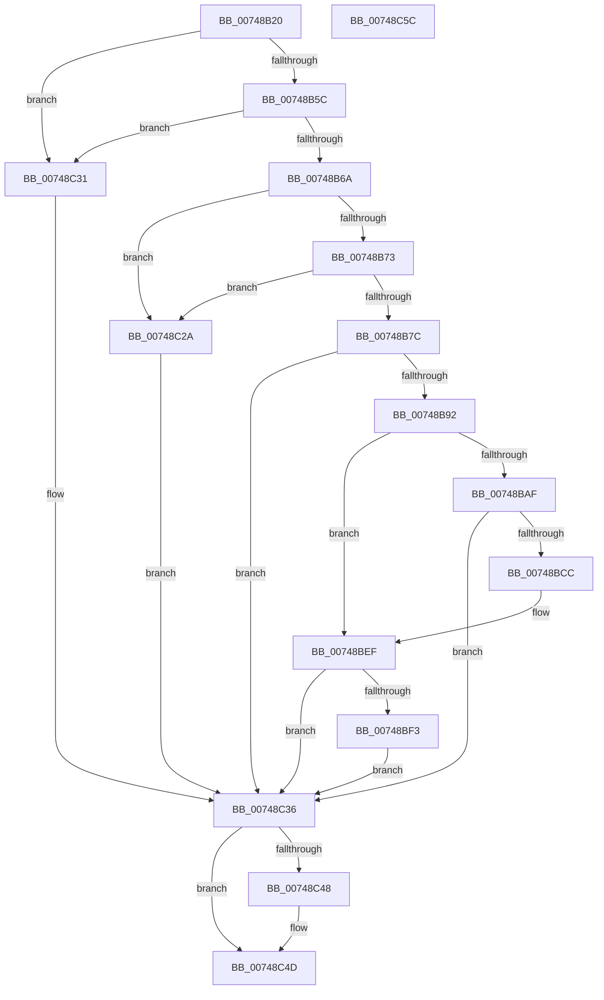

# KseSetDeviceFlags

- RVA: `0x00748B20`–`0x00748C5D` (길이 `317` bytes)
- VA: `0x0000000140748B20`
- 실행 섹션: `PAGE`
- PDB 이름 있음: `예`; PDB Function 태그: `아니요`
- unwind 정보 RVA: `0x000CB3DC`
- 디코드: `84`개 명령, `317/317` bytes 표시
- 미해석 바이트: `0` (있으면 어셈블리에 `.byte`로 보존)

> 이 문서는 커널 이미지의 기계어와 PDB 기호를 분석해 생성했습니다. 4번과 5번은 함수 원형과 자료형을 바이너리 사용 방식에서 추정한 C 해석이며 원본 소스 복구 결과는 아닙니다.

## 1. Dependencies

- 직접 호출 지점: **9**; 고유 호출 대상: **6**
- 직접 호출자로 확인된 함수: **0**
- RIP 상대 이미지 참조: **5**

### Outgoing calls
- `0x00748B83` → [KsepStringTransform](../95/KsepStringTransform_function_0095B318.md) (function, `0x0095B318`)
- `0x00748BA1` → [KsepRegistryCreateKey](KsepRegistryCreateKey_function_0074B008.md) (function, `0x0074B008`)
- `0x00748BC1` → [KsepRegistryCreateKey](KsepRegistryCreateKey_function_0074B008.md) (function, `0x0074B008`)
- `0x00748BD0` → [KsepRegistryCloseKey](../95/KsepRegistryCloseKey_function_00959500.md) (function, `0x00959500`)
- `0x00748BE8` → [KsepRegistryCreateKey](KsepRegistryCreateKey_function_0074B008.md) (function, `0x0074B008`)
- `0x00748BFA` → [RtlInitUnicodeString](../../text/42/RtlInitUnicodeString_function_0042A780.md) (function, `0x0042A780`)
- `0x00748C21` → [ZwSetValueKey](../../text/6A/ZwSetValueKey_function_006ADCD0.md) (function, `0x006ADCD0`)
- `0x00748C3A` → [KsepStringFree](../95/KsepStringFree_function_0095A1B8.md) (function, `0x0095A1B8`)
- `0x00748C48` → [KsepRegistryCloseKey](../95/KsepRegistryCloseKey_function_00959500.md) (function, `0x00959500`)

### Direct callers
- 이 함수 시작 RVA로 연결되는 직접 call은 확인되지 않았습니다. 간접 호출은 완전히 역산할 수 없습니다.

### Static image references
- `0x00748B34` → RVA `0x00E66C84` (`.data`; read)
- `0x00748B5C` → RVA `0x00E66C80` (`.data`; read)
- `0x00748B9A` → RVA `0x00B006E0` (` ?? ::NNGAKEGL::`string'`; read)
- `0x00748BB3` → RVA `0x00AFE540` (` ?? ::NNGAKEGL::`string'`; read)
- `0x00748BBA` → RVA `0x00B00770` (` ?? ::NNGAKEGL::`string'`; read)

## 2. Other-region calls and transfers

- 다른 실행 섹션으로 향하는 call: **2**
  - `0x00748BFA` → [RtlInitUnicodeString](../../text/42/RtlInitUnicodeString_function_0042A780.md) (`PAGE` → `.text`)
  - `0x00748C21` → [ZwSetValueKey](../../text/6A/ZwSetValueKey_function_006ADCD0.md) (`PAGE` → `.text`)
- 별도 외부 분기/꼬리 이동을 확인하지 못했습니다.

## 3. Assembly (complete function range)

```asm
00748B20  48 89 5C 24 08                  mov qword ptr [rsp + 8], rbx
00748B25  4C 89 44 24 18                  mov qword ptr [rsp + 0x18], r8
00748B2A  55                              push rbp
00748B2B  56                              push rsi
00748B2C  57                              push rdi
00748B2D  48 8B EC                        mov rbp, rsp
00748B30  48 83 EC 50                     sub rsp, 0x50
00748B34  8B 05 4A E1 71 00               mov eax, dword ptr [rip + 0x71e14a]
00748B3A  33 F6                           xor esi, esi
00748B3C  48 89 75 E0                     mov qword ptr [rbp - 0x20], rsi
00748B40  48 8B FA                        mov rdi, rdx
00748B43  48 89 75 E8                     mov qword ptr [rbp - 0x18], rsi
00748B47  48 89 75 38                     mov qword ptr [rbp + 0x38], rsi
00748B4B  48 89 75 F0                     mov qword ptr [rbp - 0x10], rsi
00748B4F  48 89 75 F8                     mov qword ptr [rbp - 8], rsi
00748B53  83 F8 02                        cmp eax, 2
00748B56  0F 85 D5 00 00 00               jne 0x140748c31
00748B5C  8B 05 1E E1 71 00               mov eax, dword ptr [rip + 0x71e11e]
00748B62  A8 02                           test al, 2
00748B64  0F 85 C7 00 00 00               jne 0x140748c31
00748B6A  48 85 C9                        test rcx, rcx
00748B6D  0F 84 B7 00 00 00               je 0x140748c2a
00748B73  48 85 D2                        test rdx, rdx
00748B76  0F 84 AE 00 00 00               je 0x140748c2a
00748B7C  48 8B D1                        mov rdx, rcx
00748B7F  48 8D 4D E0                     lea rcx, [rbp - 0x20]
00748B83  E8 90 27 21 00                  call 0x14095b318
00748B88  8B D8                           mov ebx, eax
00748B8A  85 C0                           test eax, eax
00748B8C  0F 88 A4 00 00 00               js 0x140748c36
00748B92  48 8B 55 E8                     mov rdx, qword ptr [rbp - 0x18]
00748B96  4C 8D 45 38                     lea r8, [rbp + 0x38]
00748B9A  48 8D 0D 3F 7B 3B 00            lea rcx, [rip + 0x3b7b3f]
00748BA1  E8 62 24 00 00                  call 0x14074b008
00748BA6  8B D8                           mov ebx, eax
00748BA8  3D 34 00 00 C0                  cmp eax, 0xc0000034
00748BAD  75 40                           jne 0x140748bef
00748BAF  4C 8D 45 38                     lea r8, [rbp + 0x38]
00748BB3  48 8D 15 86 59 3B 00            lea rdx, [rip + 0x3b5986]
00748BBA  48 8D 0D AF 7B 3B 00            lea rcx, [rip + 0x3b7baf]
00748BC1  E8 42 24 00 00                  call 0x14074b008
00748BC6  8B D8                           mov ebx, eax
00748BC8  85 C0                           test eax, eax
00748BCA  78 6A                           js 0x140748c36
00748BCC  48 8B 4D 38                     mov rcx, qword ptr [rbp + 0x38]
00748BD0  E8 2B 09 21 00                  call 0x140959500
00748BD5  48 8B 55 E8                     mov rdx, qword ptr [rbp - 0x18]
00748BD9  4C 8D 45 38                     lea r8, [rbp + 0x38]
00748BDD  48 8D 0D FC 7A 3B 00            lea rcx, [rip + 0x3b7afc]
00748BE4  48 89 75 38                     mov qword ptr [rbp + 0x38], rsi
00748BE8  E8 1B 24 00 00                  call 0x14074b008
00748BED  8B D8                           mov ebx, eax
00748BEF  85 DB                           test ebx, ebx
00748BF1  78 43                           js 0x140748c36
00748BF3  48 8B D7                        mov rdx, rdi
00748BF6  48 8D 4D F0                     lea rcx, [rbp - 0x10]
00748BFA  E8 81 1B CE FF                  call 0x14042a780
00748BFF  48 8B 4D 38                     mov rcx, qword ptr [rbp + 0x38]
00748C03  48 8D 45 30                     lea rax, [rbp + 0x30]
00748C07  C7 44 24 28 08 00 00 00         mov dword ptr [rsp + 0x28], 8
00748C0F  48 8D 55 F0                     lea rdx, [rbp - 0x10]
00748C13  41 B9 0B 00 00 00               mov r9d, 0xb
00748C19  48 89 44 24 20                  mov qword ptr [rsp + 0x20], rax
00748C1E  45 33 C0                        xor r8d, r8d
00748C21  E8 AA 50 F6 FF                  call 0x1406adcd0
00748C26  8B D8                           mov ebx, eax
00748C28  EB 0C                           jmp 0x140748c36
00748C2A  BB 0D 00 00 C0                  mov ebx, 0xc000000d
00748C2F  EB 05                           jmp 0x140748c36
00748C31  BB 01 00 00 C0                  mov ebx, 0xc0000001
00748C36  48 8D 4D E0                     lea rcx, [rbp - 0x20]
00748C3A  E8 79 15 21 00                  call 0x14095a1b8
00748C3F  48 8B 4D 38                     mov rcx, qword ptr [rbp + 0x38]
00748C43  48 85 C9                        test rcx, rcx
00748C46  74 05                           je 0x140748c4d
00748C48  E8 B3 08 21 00                  call 0x140959500
00748C4D  8B C3                           mov eax, ebx
00748C4F  48 8B 5C 24 70                  mov rbx, qword ptr [rsp + 0x70]
00748C54  48 83 C4 50                     add rsp, 0x50
00748C58  5F                              pop rdi
00748C59  5E                              pop rsi
00748C5A  5D                              pop rbp
00748C5B  C3                              ret
00748C5C  CC                              int3
```

## 4. C-style interpretation (structured pseudocode)

```c
__int64 __fastcall KseSetDeviceFlags(__int64 a1, __int64 a2, __int64 a3)
{
    __int64 result;
    __int64 v_rsi;
    __int64 v_rsp;
    unsigned __int64 v_stack_m20;
    unsigned __int64 v_stack_m28;
    unsigned __int64 v_stack_m30;
    unsigned __int64 v_stack_m38;
    unsigned int v_stack_m40;
    unsigned __int64 v_stack_m48;
    unsigned __int64 v_stack_p18;
    unsigned __int64 v_stack_p20;
    unsigned __int64 v_stack_p8;

    v_stack_p8 = v_rbx;
    v_stack_p18 = a3;
    v_rsp = (v_rsp) - (80);
    v_rsi = 0;
    v_stack_m38 = 0;
    v_stack_m30 = 0;
    v_stack_p20 = 0;
    v_stack_m28 = 0;
    v_stack_m20 = 0;
    if (((unsigned int)((unsigned int)(*(unsigned int *)(v_rip + 7463242)))) != 2) goto loc_00748C31;
    if ((((unsigned __int8)((unsigned int)(*(unsigned int *)(v_rip + 7463198)))) & (2)) != 0) goto loc_00748C31;
    if (a1 == 0) goto loc_00748C2A;
    if (a2 == 0) goto loc_00748C2A;
    result = KsepStringTransform(v_stack_m38, a1, a3, a4);
    if (sign_flag) goto loc_00748C36;
    result = KsepRegistryCreateKey(v_rip + 3898175, v_stack_m30, v_stack_p20, a4);
    if (((unsigned int)(result)) != 0xC0000034ULL) goto loc_00748BEF;
    result = KsepRegistryCreateKey(v_rip + 3898287, v_rip + 3889542, v_stack_p20, a4);
    if (sign_flag) goto loc_00748C36;
    result = KsepRegistryCloseKey(v_stack_p20, v_rip + 3889542, v_stack_p20, a4);
    v_stack_p20 = 0;
    result = KsepRegistryCreateKey(v_rip + 3898108, v_stack_m30, v_stack_p20, a4);
loc_00748BEF:
    if (sign_flag) goto loc_00748C36;
    result = RtlInitUnicodeString(v_stack_m28, a2, v_stack_p20, a4);
    v_stack_m40 = 8;
    v_stack_m48 = v_stack_p18;
    a3 = 0;
    result = ZwSetValueKey(v_stack_p20, v_stack_m28, a3, 11);
    goto loc_00748C36;
loc_00748C2A:
    goto loc_00748C36;
loc_00748C31:
loc_00748C36:
    result = KsepStringFree(v_stack_m38, v_stack_m28, a3, 11);
    if (v_stack_p20 != 0) {
        result = KsepRegistryCloseKey(v_stack_p20, v_stack_m28, a3, 11);
    }
    v_rsp = (v_rsp) + (80);
    return (unsigned int)((unsigned int)((unsigned int)(0xC0000001ULL)));
}
```

## 5. (Beta) C Style

```c
int64_t KseSetDeviceFlags(int64_t Arg1, int64_t Arg2, int64_t Arg3)
{
    int64_t result;
    int64_t local_rsi;
    int64_t local_rsp;
    uint64_t v_stack_m20;
    uint64_t v_stack_m28;
    uint64_t v_stack_m30;
    uint64_t v_stack_m38;
    uint32_t v_stack_m40;
    uint64_t v_stack_m48;
    uint64_t v_stack_p18;
    uint64_t v_stack_p20;
    uint64_t v_stack_p8;

    v_stack_p8 = local_rbx;
    v_stack_p18 = Arg3;
    local_rsp = (local_rsp) - (80);
    local_rsi = 0;
    v_stack_m38 = 0;
    v_stack_m30 = 0;
    v_stack_p20 = 0;
    v_stack_m28 = 0;
    v_stack_m20 = 0;
    if (((uint32_t)((uint32_t)(*(uint32_t *)(v_rip + 0x71E14A)))) != 2) goto loc_00748C31;
    if ((((uint8_t)((uint32_t)(*(uint32_t *)(v_rip + 0x71E11E)))) & (2)) != 0) goto loc_00748C31;
    if (Arg1 == 0) goto loc_00748C2A;
    if (Arg2 == 0) goto loc_00748C2A;
    result = KsepStringTransform(v_stack_m38, Arg1, Arg3, a4);
    if (sign_flag) goto loc_00748C36;
    result = KsepRegistryCreateKey(v_rip + 3898175, v_stack_m30, v_stack_p20, a4);
    if (((uint32_t)(result)) != 0xC0000034ULL) goto loc_00748BEF;
    result = KsepRegistryCreateKey(v_rip + 3898287, v_rip + 3889542, v_stack_p20, a4);
    if (sign_flag) goto loc_00748C36;
    result = KsepRegistryCloseKey(v_stack_p20, v_rip + 3889542, v_stack_p20, a4);
    v_stack_p20 = 0;
    result = KsepRegistryCreateKey(v_rip + 3898108, v_stack_m30, v_stack_p20, a4);
loc_00748BEF:
    if (sign_flag) goto loc_00748C36;
    result = RtlInitUnicodeString(v_stack_m28, Arg2, v_stack_p20, a4);
    v_stack_m40 = 8;
    v_stack_m48 = v_stack_p18;
    Arg3 = 0;
    result = ZwSetValueKey(v_stack_p20, v_stack_m28, Arg3, 11);
    goto loc_00748C36;
loc_00748C2A:
    goto loc_00748C36;
loc_00748C31:
loc_00748C36:
    result = KsepStringFree(v_stack_m38, v_stack_m28, Arg3, 11);
    if (v_stack_p20 != 0) {
        result = KsepRegistryCloseKey(v_stack_p20, v_stack_m28, Arg3, 11);
    }
    local_rsp = (local_rsp) + (80);
    return (uint32_t)((uint32_t)((uint32_t)(0xC0000001ULL)));
}
```

## 6. Execution-region graph

[열기: 2D/3D 그래프와 함수 탐색 컨트롤 패널](../../../control-panel.html?section=page&rva=0x00748B20&view=graph)

- 2D 그래프는 위에서 아래로 흐르고, 3D 그래프는 빈 공간을 드래그해 회전합니다. Shift+드래그는 이동, 휠은 확대·축소, 함수 노드 선택은 대상 보고서 이동입니다.

### Static fallback


