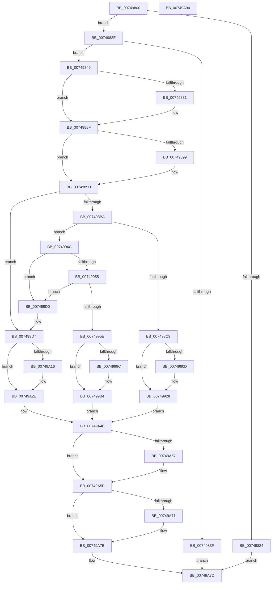

# KseUnregisterShim

- RVA: `0x00749800`–`0x00749A95` (길이 `661` bytes)
- VA: `0x0000000140749800`
- 실행 섹션: `PAGE`
- PDB 이름 있음: `예`; PDB Function 태그: `아니요`
- unwind 정보 RVA: `0x000CB3F0`
- 디코드: `154`개 명령, `661/661` bytes 표시
- 미해석 바이트: `0` (있으면 어셈블리에 `.byte`로 보존)

> 이 문서는 커널 이미지의 기계어와 PDB 기호를 분석해 생성했습니다. 4번과 5번은 함수 원형과 자료형을 바이너리 사용 방식에서 추정한 C 해석이며 원본 소스 복구 결과는 아닙니다.

## 1. Dependencies

- 직접 호출 지점: **13**; 고유 호출 대상: **10**
- 직접 호출자로 확인된 함수: **0**
- RIP 상대 이미지 참조: **11**

### Outgoing calls
- `0x00749870` → [KeAbPreAcquire](../../text/21/KeAbPreAcquire_function_00210230.md) (function, `0x00210230`)
- `0x0074988A` → [ExfAcquirePushLockExclusiveEx](../../text/20/ExfAcquirePushLockExclusiveEx_function_0020FC90.md) (function, `0x0020FC90`)
- `0x007498AD` → [KsepIsShimRegistered](../AC/KsepIsShimRegistered_function_00ACEBCC.md) (function, `0x00ACEBCC`)
- `0x00749923` → [KsepDebugPrint](../../text/4D/KsepDebugPrint_function_004DCFF0.md) (function, `0x004DCFF0`)
- `0x0074993E` → [KsepLogError](../../text/49/KsepLogError_function_00499A98.md) (function, `0x00499A98`)
- `0x007499AF` → [KsepDebugPrint](../../text/4D/KsepDebugPrint_function_004DCFF0.md) (function, `0x004DCFF0`)
- `0x007499C7` → [KsepLogInfo](../../text/49/KsepLogInfo_function_00499A68.md) (function, `0x00499A68`)
- `0x00749A29` → [KsepDebugPrint](../../text/4D/KsepDebugPrint_function_004DCFF0.md) (function, `0x004DCFF0`)
- `0x00749A41` → [KsepLogError](../../text/49/KsepLogError_function_00499A98.md) (function, `0x00499A98`)
- `0x00749A5A` → [ExfTryToWakePushLock](../../text/26/ExfTryToWakePushLock_function_00265DD0.md) (function, `0x00265DD0`)
- `0x00749A62` → [KeAbPostRelease](../../text/2E/KeAbPostRelease_function_002E1600.md) (function, `0x002E1600`)
- `0x00749A67` → [KeLeaveCriticalRegion](../../text/25/KeLeaveCriticalRegion_function_0025D8B0.md) (function, `0x0025D8B0`)
- `0x00749A76` → [KsepPoolFreePaged](../../text/4B/KsepPoolFreePaged_function_004B0E10.md) (function, `0x004B0E10`)

### Direct callers
- 이 함수 시작 RVA로 연결되는 직접 call은 확인되지 않았습니다. 간접 호출은 완전히 역산할 수 없습니다.

### Static image references
- `0x0074982E` → RVA `0x00E66C84` (`.data`; read)
- `0x00749852` → RVA `0x00E66CB0` (`.data`; read)
- `0x007498A6` → RVA `0x00E66C80` (`.data`; read)
- `0x007498D3` → RVA `0x00F101C0` (`.data`; read/write)
- `0x007498E0` → RVA `0x00000000` (`image boundary/outside`; read)
- `0x00749902` → RVA `0x00E66CE8` (`.data`; read)
- `0x00749911` → RVA `0x00B00870` (` ?? ::NNGAKEGL::`string'`; read)
- `0x0074996A` → RVA `0x00F105E0` (`.data`; read/write)
- `0x007499A0` → RVA `0x00B00970` (` ?? ::NNGAKEGL::`string'`; read)
- `0x00749A1A` → RVA `0x00B009A0` (` ?? ::NNGAKEGL::`string'`; read)
- `0x00749A46` → RVA `0x00E66CB0` (`.data`; read/write)

## 2. Other-region calls and transfers

- 다른 실행 섹션으로 향하는 call: **12**
  - `0x00749870` → [KeAbPreAcquire](../../text/21/KeAbPreAcquire_function_00210230.md) (`PAGE` → `.text`)
  - `0x0074988A` → [ExfAcquirePushLockExclusiveEx](../../text/20/ExfAcquirePushLockExclusiveEx_function_0020FC90.md) (`PAGE` → `.text`)
  - `0x00749923` → [KsepDebugPrint](../../text/4D/KsepDebugPrint_function_004DCFF0.md) (`PAGE` → `.text`)
  - `0x0074993E` → [KsepLogError](../../text/49/KsepLogError_function_00499A98.md) (`PAGE` → `.text`)
  - `0x007499AF` → [KsepDebugPrint](../../text/4D/KsepDebugPrint_function_004DCFF0.md) (`PAGE` → `.text`)
  - `0x007499C7` → [KsepLogInfo](../../text/49/KsepLogInfo_function_00499A68.md) (`PAGE` → `.text`)
  - `0x00749A29` → [KsepDebugPrint](../../text/4D/KsepDebugPrint_function_004DCFF0.md) (`PAGE` → `.text`)
  - `0x00749A41` → [KsepLogError](../../text/49/KsepLogError_function_00499A98.md) (`PAGE` → `.text`)
  - `0x00749A5A` → [ExfTryToWakePushLock](../../text/26/ExfTryToWakePushLock_function_00265DD0.md) (`PAGE` → `.text`)
  - `0x00749A62` → [KeAbPostRelease](../../text/2E/KeAbPostRelease_function_002E1600.md) (`PAGE` → `.text`)
  - `0x00749A67` → [KeLeaveCriticalRegion](../../text/25/KeLeaveCriticalRegion_function_0025D8B0.md) (`PAGE` → `.text`)
  - `0x00749A76` → [KsepPoolFreePaged](../../text/4B/KsepPoolFreePaged_function_004B0E10.md) (`PAGE` → `.text`)
- 별도 외부 분기/꼬리 이동을 확인하지 못했습니다.

## 3. Assembly (complete function range)

```asm
00749800  48 89 5C 24 10                  mov qword ptr [rsp + 0x10], rbx
00749805  48 89 6C 24 18                  mov qword ptr [rsp + 0x18], rbp
0074980A  56                              push rsi
0074980B  57                              push rdi
0074980C  41 54                           push r12
0074980E  41 55                           push r13
00749810  41 56                           push r14
00749812  48 83 EC 20                     sub rsp, 0x20
00749816  48 83 64 24 50 00               and qword ptr [rsp + 0x50], 0
0074981C  48 8B F9                        mov rdi, rcx
0074981F  48 85 C9                        test rcx, rcx
00749822  75 0A                           jne 0x14074982e
00749824  B8 0D 00 00 C0                  mov eax, 0xc000000d
00749829  E9 4F 02 00 00                  jmp 0x140749a7d
0074982E  8B 05 50 D4 71 00               mov eax, dword ptr [rip + 0x71d450]
00749834  41 BD 02 00 00 00               mov r13d, 2
0074983A  41 3B C5                        cmp eax, r13d
0074983D  74 0A                           je 0x140749849
0074983F  B8 01 00 00 C0                  mov eax, 0xc0000001
00749844  E9 34 02 00 00                  jmp 0x140749a7d
00749849  65 48 8B 04 25 88 01 00 00      mov rax, qword ptr gs:[0x188]
00749852  4C 8D 25 57 D4 71 00            lea r12, [rip + 0x71d457]
00749859  48 83 CB FF                     or rbx, 0xffffffffffffffff
0074985D  45 33 C0                        xor r8d, r8d
00749860  33 D2                           xor edx, edx
00749862  49 8B CC                        mov rcx, r12
00749865  45 33 F6                        xor r14d, r14d
00749868  66 01 98 E4 01 00 00            add word ptr [rax + 0x1e4], bx
0074986F  90                              nop
00749870  E8 BB 69 AC FF                  call 0x140210230
00749875  F0 49 0F BA 2C 24 00            lock bts qword ptr [r12], 0
0074987C  48 8B F0                        mov rsi, rax
0074987F  73 0E                           jae 0x14074988f
00749881  4D 8B C4                        mov r8, r12
00749884  48 8B D0                        mov rdx, rax
00749887  49 8B CC                        mov rcx, r12
0074988A  E8 01 64 AC FF                  call 0x14020fc90
0074988F  BD 01 00 00 00                  mov ebp, 1
00749894  48 85 F6                        test rsi, rsi
00749897  74 04                           je 0x14074989d
00749899  40 88 6E 0A                     mov byte ptr [rsi + 0xa], bpl
0074989D  48 8B 57 08                     mov rdx, qword ptr [rdi + 8]
007498A1  4C 8D 4C 24 50                  lea r9, [rsp + 0x50]
007498A6  48 8D 0D D3 D3 71 00            lea rcx, [rip + 0x71d3d3]
007498AD  E8 1A 53 38 00                  call 0x140acebcc
007498B2  85 C0                           test eax, eax
007498B4  0F 84 1D 01 00 00               je 0x1407499d7
007498BA  48 8B 44 24 50                  mov rax, qword ptr [rsp + 0x50]
007498BF  44 39 70 18                     cmp dword ptr [rax + 0x18], r14d
007498C3  0F 84 83 00 00 00               je 0x14074994c
007498C9  BD 22 00 00 C0                  mov ebp, 0xc0000022
007498CE  B8 01 00 00 00                  mov eax, 1
007498D3  F0 0F C1 05 E5 68 7C 00         lock xadd dword ptr [rip + 0x7c68e5], eax
007498DB  48 8B 74 24 50                  mov rsi, qword ptr [rsp + 0x50]
007498E0  48 8D 0D 19 67 8B FF            lea rcx, [rip - 0x7498e7]
007498E7  FF C0                           inc eax
007498E9  83 E0 3F                        and eax, 0x3f
007498EC  C7 84 C1 E4 01 F1 00 22 00 00 C0  mov dword ptr [rcx + rax*8 + 0xf101e4], 0xc0000022
007498F7  C7 84 C1 E0 01 F1 00 7D 01 02 00  mov dword ptr [rcx + rax*8 + 0xf101e0], 0x2017d
00749902  8B 05 E0 D3 71 00               mov eax, dword ptr [rip + 0x71d3e0]
00749908  41 84 C5                        test r13b, al
0074990B  74 1B                           je 0x140749928
0074990D  4C 8B 47 08                     mov r8, qword ptr [rdi + 8]
00749911  48 8D 15 58 6F 3B 00            lea rdx, [rip + 0x3b6f58]
00749918  4C 8B CE                        mov r9, rsi
0074991B  B9 03 00 00 00                  mov ecx, 3
00749920  45 8B 00                        mov r8d, dword ptr [r8]
00749923  E8 C8 36 D9 FF                  call 0x1404dcff0
00749928  4C 8B 47 08                     mov r8, qword ptr [rdi + 8]
0074992C  48 8D 15 3D 6F 3B 00            lea rdx, [rip + 0x3b6f3d]
00749933  4C 8B CE                        mov r9, rsi
00749936  B9 03 00 00 00                  mov ecx, 3
0074993B  45 8B 00                        mov r8d, dword ptr [r8]
0074993E  E8 55 01 D5 FF                  call 0x140499a98
00749943  83 4E 1C 04                     or dword ptr [rsi + 0x1c], 4
00749947  E9 FA 00 00 00                  jmp 0x140749a46
0074994C  48 8B 10                        mov rdx, qword ptr [rax]
0074994F  48 39 42 08                     cmp qword ptr [rdx + 8], rax
00749953  75 7B                           jne 0x1407499d0
00749955  48 8B 48 08                     mov rcx, qword ptr [rax + 8]
00749959  48 39 01                        cmp qword ptr [rcx], rax
0074995C  75 72                           jne 0x1407499d0
0074995E  48 89 11                        mov qword ptr [rcx], rdx
00749961  44 8B F5                        mov r14d, ebp
00749964  48 89 4A 08                     mov qword ptr [rdx + 8], rcx
00749968  8B C5                           mov eax, ebp
0074996A  F0 0F C1 05 6E 6C 7C 00         lock xadd dword ptr [rip + 0x7c6c6e], eax
00749972  03 C5                           add eax, ebp
00749974  48 8D 0D 85 66 8B FF            lea rcx, [rip - 0x74997b]
0074997B  83 E0 3F                        and eax, 0x3f
0074997E  83 A4 C1 E4 03 F1 00 00         and dword ptr [rcx + rax*8 + 0xf103e4], 0
00749986  C7 84 C1 E0 03 F1 00 8E 01 02 00  mov dword ptr [rcx + rax*8 + 0xf103e0], 0x2018e
00749991  8B 05 51 D3 71 00               mov eax, dword ptr [rip + 0x71d351]
00749997  40 84 C5                        test bpl, al
0074999A  74 18                           je 0x1407499b4
0074999C  4C 8B 47 08                     mov r8, qword ptr [rdi + 8]
007499A0  48 8D 15 C9 6F 3B 00            lea rdx, [rip + 0x3b6fc9]
007499A7  B9 03 00 00 00                  mov ecx, 3
007499AC  45 8B 00                        mov r8d, dword ptr [r8]
007499AF  E8 3C 36 D9 FF                  call 0x1404dcff0
007499B4  4C 8B 47 08                     mov r8, qword ptr [rdi + 8]
007499B8  48 8D 15 B1 6F 3B 00            lea rdx, [rip + 0x3b6fb1]
007499BF  B9 03 00 00 00                  mov ecx, 3
007499C4  45 8B 00                        mov r8d, dword ptr [r8]
007499C7  E8 9C 00 D5 FF                  call 0x140499a68
007499CC  33 ED                           xor ebp, ebp
007499CE  EB 76                           jmp 0x140749a46
007499D0  B9 03 00 00 00                  mov ecx, 3
007499D5  CD 29                           int 0x29
007499D7  BD 34 00 00 C0                  mov ebp, 0xc0000034
007499DC  B8 01 00 00 00                  mov eax, 1
007499E1  F0 0F C1 05 D7 67 7C 00         lock xadd dword ptr [rip + 0x7c67d7], eax
007499E9  FF C0                           inc eax
007499EB  48 8D 0D 0E 66 8B FF            lea rcx, [rip - 0x7499f2]
007499F2  83 E0 3F                        and eax, 0x3f
007499F5  C7 84 C1 E4 01 F1 00 34 00 00 C0  mov dword ptr [rcx + rax*8 + 0xf101e4], 0xc0000034
00749A00  C7 84 C1 E0 01 F1 00 9A 01 02 00  mov dword ptr [rcx + rax*8 + 0xf101e0], 0x2019a
00749A0B  8B 05 D7 D2 71 00               mov eax, dword ptr [rip + 0x71d2d7]
00749A11  41 84 C5                        test r13b, al
00749A14  74 18                           je 0x140749a2e
00749A16  4C 8B 47 08                     mov r8, qword ptr [rdi + 8]
00749A1A  48 8D 15 7F 6F 3B 00            lea rdx, [rip + 0x3b6f7f]
00749A21  B9 03 00 00 00                  mov ecx, 3
00749A26  45 8B 00                        mov r8d, dword ptr [r8]
00749A29  E8 C2 35 D9 FF                  call 0x1404dcff0
00749A2E  4C 8B 47 08                     mov r8, qword ptr [rdi + 8]
00749A32  48 8D 15 67 6F 3B 00            lea rdx, [rip + 0x3b6f67]
00749A39  B9 03 00 00 00                  mov ecx, 3
00749A3E  45 8B 00                        mov r8d, dword ptr [r8]
00749A41  E8 52 00 D5 FF                  call 0x140499a98
00749A46  F0 48 0F C1 1D 61 D2 71 00      lock xadd qword ptr [rip + 0x71d261], rbx
00749A4F  80 E3 06                        and bl, 6
00749A52  41 3A DD                        cmp bl, r13b
00749A55  75 08                           jne 0x140749a5f
00749A57  49 8B CC                        mov rcx, r12
00749A5A  E8 71 C3 B1 FF                  call 0x140265dd0
00749A5F  49 8B CC                        mov rcx, r12
00749A62  E8 99 7B B9 FF                  call 0x1402e1600
00749A67  E8 44 3E B1 FF                  call 0x14025d8b0
00749A6C  45 85 F6                        test r14d, r14d
00749A6F  74 0A                           je 0x140749a7b
00749A71  48 8B 4C 24 50                  mov rcx, qword ptr [rsp + 0x50]
00749A76  E8 95 73 D6 FF                  call 0x1404b0e10
00749A7B  8B C5                           mov eax, ebp
00749A7D  48 8B 5C 24 58                  mov rbx, qword ptr [rsp + 0x58]
00749A82  48 8B 6C 24 60                  mov rbp, qword ptr [rsp + 0x60]
00749A87  48 83 C4 20                     add rsp, 0x20
00749A8B  41 5E                           pop r14
00749A8D  41 5D                           pop r13
00749A8F  41 5C                           pop r12
00749A91  5F                              pop rdi
00749A92  5E                              pop rsi
00749A93  C3                              ret
00749A94  CC                              int3
```

## 4. C-style interpretation (structured pseudocode)

```c
__int64 __fastcall KseUnregisterShim(__int64 a1, int a2, int a3)
{
    __int64 result;
    __int64 v_r14;
    __int64 v_rbp;
    __int64 v_rbx;
    __int64 v_rsp;
    unsigned __int64 v_stack_p10;
    unsigned __int64 v_stack_p18;
    unsigned __int64 v_stack_p8;

    v_stack_p10 = v_rbx;
    v_stack_p18 = v_rbp;
    v_rsp = (v_rsp) - (32);
    if (a1 != 0) goto loc_0074982E;
    goto loc_00749A7D;
loc_0074982E:
    if (((unsigned int)((unsigned int)(*(unsigned int *)(v_rip + 7459920)))) == 2) goto loc_00749849;
    goto loc_00749A7D;
loc_00749849:
    v_rbx = (v_rbx) | (-1);
    a3 = 0;
    a2 = 0;
    v_r14 = 0;
    result = KeAbPreAcquire(v_rip + 7459927, a2, a3, a4);
    if (!(condition_is_above_or_equal)) {
        a3 = v_rip + 7459927;
        a2 = result;
        a1 = v_rip + 7459927;
        result = ExfAcquirePushLockExclusiveEx(a1, a2, a3, a4);
    }
    if (result != 0) {
        *(unsigned __int8 *)(result + 10) = 1;
    }
    result = KsepIsShimRegistered(v_rip + 7459795, *(unsigned __int64 *)(a1 + 8), a3, v_stack_p8);
    if ((unsigned int)(result) == 0) goto loc_007499D7;
    if ((*(unsigned int *)(v_stack_p8 + 24)) == 0) goto loc_0074994C;
    result = (unsigned int)((1) + 1);
    result = (unsigned int)((result) & (63));
    *(unsigned int *)(v_rip - 7641319 + result * 8 + 15794660) = 0xC0000022ULL;
    *(unsigned int *)(v_rip - 7641319 + result * 8 + 15794656) = 0x2017DULL;
    result = (unsigned int)(*(unsigned int *)(v_rip + 7459808));
    if (((2) & ((unsigned __int8)((unsigned int)(*(unsigned int *)(v_rip + 7459808))))) != 0) {
        a3 = *(unsigned __int64 *)(a1 + 8);
        a2 = v_rip + 3895128;
        a4 = v_stack_p8;
        a1 = 3;
        a3 = *(unsigned int *)(a3);
        result = KsepDebugPrint(a1, a2, a3, a4);
    }
    result = KsepLogError(3, v_rip + 3895101, (unsigned int)(*(unsigned int *)(*(unsigned __int64 *)(a1 + 8))), v_stack_p8);
    goto loc_00749A46;
loc_0074994C:
    if ((*(unsigned __int64 *)(*(unsigned __int64 *)(result) + 8)) != result) goto loc_007499D0;
    if ((*(unsigned __int64 *)(*(unsigned __int64 *)(result + 8))) != result) goto loc_007499D0;
    *(unsigned __int64 *)(*(unsigned __int64 *)(result + 8)) = *(unsigned __int64 *)(result);
    *(unsigned __int64 *)(*(unsigned __int64 *)(result) + 8) = *(unsigned __int64 *)(result + 8);
    result = (unsigned int)(((unsigned int)((unsigned int)((unsigned int)(0xC0000022ULL)))) + ((unsigned int)((unsigned int)(0xC0000022ULL))));
    result = (unsigned int)((result) & (63));
    *(unsigned int *)(v_rip - 7641467 + result * 8 + 15795168) = 0x2018EULL;
    result = (unsigned int)(*(unsigned int *)(v_rip + 7459665));
    if ((((unsigned __int8)((unsigned int)(0xC0000022ULL))) & ((unsigned __int8)((unsigned int)(*(unsigned int *)(v_rip + 7459665))))) != 0) {
        a3 = *(unsigned __int64 *)(a1 + 8);
        a2 = v_rip + 3895241;
        a1 = 3;
        a3 = *(unsigned int *)(a3);
        result = KsepDebugPrint(a1, a2, a3, v_stack_p8);
    }
    result = KsepLogInfo(3, v_rip + 3895217, (unsigned int)(*(unsigned int *)(*(unsigned __int64 *)(a1 + 8))), v_stack_p8);
    v_rbp = 0;
    goto loc_00749A46;
loc_007499D0:
loc_007499D7:
    result = (unsigned int)((1) + 1);
    result = (unsigned int)((result) & (63));
    *(unsigned int *)(v_rip - 7641586 + result * 8 + 15794660) = 0xC0000034ULL;
    *(unsigned int *)(v_rip - 7641586 + result * 8 + 15794656) = 0x2019AULL;
    result = (unsigned int)(*(unsigned int *)(v_rip + 7459543));
    if (((2) & ((unsigned __int8)((unsigned int)(*(unsigned int *)(v_rip + 7459543))))) != 0) {
        a3 = *(unsigned __int64 *)(a1 + 8);
        a2 = v_rip + 3895167;
        a1 = 3;
        a3 = *(unsigned int *)(a3);
        result = KsepDebugPrint(a1, a2, a3, v_stack_p8);
    }
    result = KsepLogError(3, v_rip + 3895143, (unsigned int)(*(unsigned int *)(*(unsigned __int64 *)(a1 + 8))), v_stack_p8);
loc_00749A46:
    v_rbx = (unsigned __int8)((v_rbx) & (6));
    if (((unsigned __int8)(v_rbx)) == 2) {
        a1 = v_rip + 7459927;
        result = ExfTryToWakePushLock(a1, v_rip + 3895143, (unsigned int)(*(unsigned int *)(*(unsigned __int64 *)(a1 + 8))), v_stack_p8);
    }
    result = KeAbPostRelease(v_rip + 7459927, v_rip + 3895143, (unsigned int)(*(unsigned int *)(*(unsigned __int64 *)(a1 + 8))), v_stack_p8);
    result = KeLeaveCriticalRegion(v_rip + 7459927, v_rip + 3895143, (unsigned int)(*(unsigned int *)(*(unsigned __int64 *)(a1 + 8))), v_stack_p8);
    if ((unsigned int)((unsigned int)((unsigned int)((unsigned int)(0xC0000022ULL)))) != 0) {
        a1 = v_stack_p8;
        result = KsepPoolFreePaged(a1, v_rip + 3895143, (unsigned int)(*(unsigned int *)(*(unsigned __int64 *)(a1 + 8))), v_stack_p8);
    }
loc_00749A7D:
    v_rsp = (v_rsp) + (32);
    return (unsigned int)((unsigned int)((unsigned int)(0xC0000034ULL)));
}
```

## 5. (Beta) C Style

```c
int64_t KseUnregisterShim(void *Arg1, int32_t Arg2, int32_t Arg3)
{
    uint8_t *arg1 = (uint8_t *)Arg1;

    int64_t result;
    int64_t local_r14;
    int64_t local_rbp;
    int64_t local_rbx;
    int64_t local_rsp;
    uint64_t v_stack_p10;
    uint64_t v_stack_p18;
    uint64_t v_stack_p8;

    v_stack_p10 = local_rbx;
    v_stack_p18 = local_rbp;
    local_rsp = (local_rsp) - (32);
    if (Arg1 != NULL) goto loc_0074982E;
    goto loc_00749A7D;
loc_0074982E:
    if (((uint32_t)((uint32_t)(*(uint32_t *)(v_rip + 0x71D450)))) == 2) goto loc_00749849;
    goto loc_00749A7D;
loc_00749849:
    local_rbx = (local_rbx) | (-1);
    Arg3 = 0;
    Arg2 = 0;
    local_r14 = 0;
    result = KeAbPreAcquire(v_rip + 7459927, Arg2, Arg3, a4);
    if (!(condition_is_above_or_equal)) {
        Arg3 = v_rip + 7459927;
        Arg2 = result;
        Arg1 = v_rip + 7459927;
        result = ExfAcquirePushLockExclusiveEx(Arg1, Arg2, Arg3, a4);
    }
    if (result != 0) {
        *(uint8_t *)(result + 0xA) = 1;
    }
    result = KsepIsShimRegistered(v_rip + 7459795, *(uint64_t *)(arg1 + 0x8), Arg3, v_stack_p8);
    if ((uint32_t)(result) == 0) goto loc_007499D7;
    if ((*(uint32_t *)(v_stack_p8 + 0x18)) == 0) goto loc_0074994C;
    result = (uint32_t)((1) + 1);
    result = (uint32_t)((result) & (63));
    *(uint32_t *)(v_rip - 0x7498E7 + result * 8 + 0xF101E4) = 0xC0000022ULL;
    *(uint32_t *)(v_rip - 0x7498E7 + result * 8 + 0xF101E0) = 0x2017DULL;
    result = (uint32_t)(*(uint32_t *)(v_rip + 0x71D3E0));
    if (((2) & ((uint8_t)((uint32_t)(*(uint32_t *)(v_rip + 0x71D3E0))))) != 0) {
        Arg3 = *(uint64_t *)(arg1 + 0x8);
        Arg2 = v_rip + 3895128;
        a4 = v_stack_p8;
        Arg1 = 3;
        Arg3 = *(uint32_t *)(Arg3);
        result = KsepDebugPrint(Arg1, Arg2, Arg3, a4);
    }
    result = KsepLogError(3, v_rip + 3895101, (uint32_t)(*(uint32_t *)(*(uint64_t *)(arg1 + 0x8))), v_stack_p8);
    goto loc_00749A46;
loc_0074994C:
    if ((*(uint64_t *)(*(uint64_t *)(result) + 0x8)) != result) goto loc_007499D0;
    if ((*(uint64_t *)(*(uint64_t *)(result + 0x8))) != result) goto loc_007499D0;
    *(uint64_t *)(*(uint64_t *)(result + 0x8)) = *(uint64_t *)(result);
    *(uint64_t *)(*(uint64_t *)(result) + 0x8) = *(uint64_t *)(result + 0x8);
    result = (uint32_t)(((uint32_t)((uint32_t)((uint32_t)(0xC0000022ULL)))) + ((uint32_t)((uint32_t)(0xC0000022ULL))));
    result = (uint32_t)((result) & (63));
    *(uint32_t *)(v_rip - 0x74997B + result * 8 + 0xF103E0) = 0x2018EULL;
    result = (uint32_t)(*(uint32_t *)(v_rip + 0x71D351));
    if ((((uint8_t)((uint32_t)(0xC0000022ULL))) & ((uint8_t)((uint32_t)(*(uint32_t *)(v_rip + 0x71D351))))) != 0) {
        Arg3 = *(uint64_t *)(arg1 + 0x8);
        Arg2 = v_rip + 3895241;
        Arg1 = 3;
        Arg3 = *(uint32_t *)(Arg3);
        result = KsepDebugPrint(Arg1, Arg2, Arg3, v_stack_p8);
    }
    result = KsepLogInfo(3, v_rip + 3895217, (uint32_t)(*(uint32_t *)(*(uint64_t *)(arg1 + 0x8))), v_stack_p8);
    local_rbp = 0;
    goto loc_00749A46;
loc_007499D0:
loc_007499D7:
    result = (uint32_t)((1) + 1);
    result = (uint32_t)((result) & (63));
    *(uint32_t *)(v_rip - 0x7499F2 + result * 8 + 0xF101E4) = 0xC0000034ULL;
    *(uint32_t *)(v_rip - 0x7499F2 + result * 8 + 0xF101E0) = 0x2019AULL;
    result = (uint32_t)(*(uint32_t *)(v_rip + 0x71D2D7));
    if (((2) & ((uint8_t)((uint32_t)(*(uint32_t *)(v_rip + 0x71D2D7))))) != 0) {
        Arg3 = *(uint64_t *)(arg1 + 0x8);
        Arg2 = v_rip + 3895167;
        Arg1 = 3;
        Arg3 = *(uint32_t *)(Arg3);
        result = KsepDebugPrint(Arg1, Arg2, Arg3, v_stack_p8);
    }
    result = KsepLogError(3, v_rip + 3895143, (uint32_t)(*(uint32_t *)(*(uint64_t *)(arg1 + 0x8))), v_stack_p8);
loc_00749A46:
    local_rbx = (uint8_t)((local_rbx) & (6));
    if (((uint8_t)(local_rbx)) == 2) {
        Arg1 = v_rip + 7459927;
        result = ExfTryToWakePushLock(Arg1, v_rip + 3895143, (uint32_t)(*(uint32_t *)(*(uint64_t *)(arg1 + 0x8))), v_stack_p8);
    }
    result = KeAbPostRelease(v_rip + 7459927, v_rip + 3895143, (uint32_t)(*(uint32_t *)(*(uint64_t *)(arg1 + 0x8))), v_stack_p8);
    result = KeLeaveCriticalRegion(v_rip + 7459927, v_rip + 3895143, (uint32_t)(*(uint32_t *)(*(uint64_t *)(arg1 + 0x8))), v_stack_p8);
    if ((uint32_t)((uint32_t)((uint32_t)((uint32_t)(0xC0000022ULL)))) != 0) {
        Arg1 = v_stack_p8;
        result = KsepPoolFreePaged(Arg1, v_rip + 3895143, (uint32_t)(*(uint32_t *)(*(uint64_t *)(arg1 + 0x8))), v_stack_p8);
    }
loc_00749A7D:
    local_rsp = (local_rsp) + (32);
    return (uint32_t)((uint32_t)((uint32_t)(0xC0000034ULL)));
}
```

### 관측된 메모리 오프셋

구조체 형식이 확인되지 않은 접근은 인자 기준의 오프셋으로만 기록했습니다.

| 기준 인자 | 오프셋 표현 | 폭 (bit) | 접근 |
|---|---:|---:|---|
| `Arg1` | `+ 0x8` | `64` | `R` |

## 6. Execution-region graph

[열기: 2D/3D 그래프와 함수 탐색 컨트롤 패널](../../../control-panel.html?section=page&rva=0x00749800&view=graph)

- 2D 그래프는 위에서 아래로 흐르고, 3D 그래프는 빈 공간을 드래그해 회전합니다. Shift+드래그는 이동, 휠은 확대·축소, 함수 노드 선택은 대상 보고서 이동입니다.

### Static fallback


