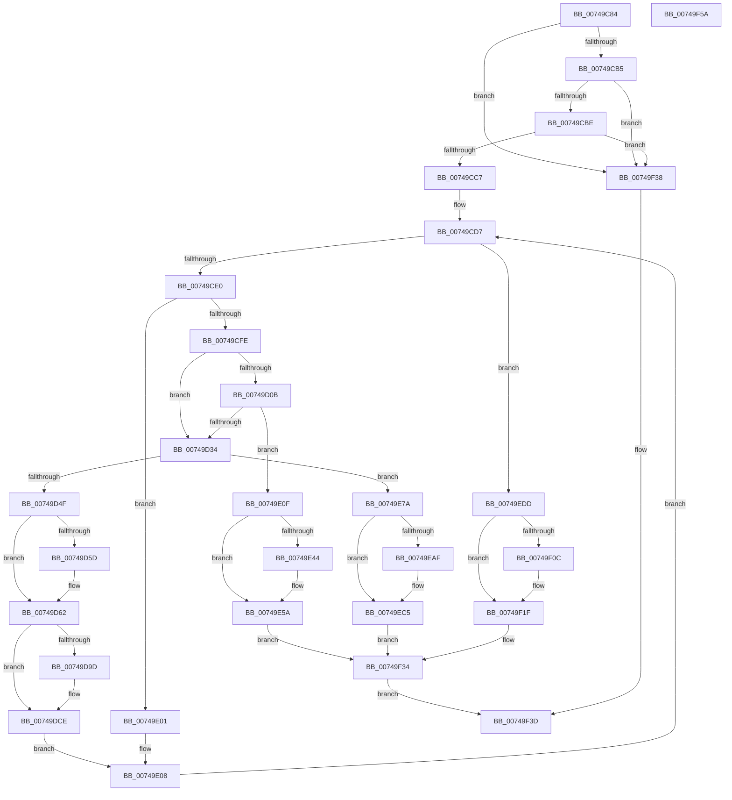

# KsepApplyShimsToDriver

- RVA: `0x00749C84`–`0x00749F5B` (길이 `727` bytes)
- VA: `0x0000000140749C84`
- 실행 섹션: `PAGE`
- PDB 이름 있음: `예`; PDB Function 태그: `아니요`
- unwind 정보 RVA: `0x0008C20C`
- 디코드: `170`개 명령, `727/727` bytes 표시
- 미해석 바이트: `0` (있으면 어셈블리에 `.byte`로 보존)

> 이 문서는 커널 이미지의 기계어와 PDB 기호를 분석해 생성했습니다. 4번과 5번은 함수 원형과 자료형을 바이너리 사용 방식에서 추정한 C 해석이며 원본 소스 복구 결과는 아닙니다.

## 1. Dependencies

- 직접 호출 지점: **11**; 고유 호출 대상: **6**
- 직접 호출자로 확인된 함수: **1**
- RIP 상대 이미지 참조: **8**

### Outgoing calls
- `0x00749D25` → [guard_dispatch_icall](../../text/6B/guard_dispatch_icall_function_006BAAD0.md) (function, `0x006BAAD0`)
- `0x00749D40` → [KsepPatchDriverImportsTable](KsepPatchDriverImportsTable_function_00749F64.md) (function, `0x00749F64`)
- `0x00749D5D` → [ObfReferenceObject](../../text/20/ObfReferenceObject_function_0020FA20.md) (function, `0x0020FA20`)
- `0x00749DC9` → [KsepDebugPrint](../../text/4D/KsepDebugPrint_function_004DCFF0.md) (function, `0x004DCFF0`)
- `0x00749DFA` → [KsepLogInfo](../../text/49/KsepLogInfo_function_00499A68.md) (function, `0x00499A68`)
- `0x00749E55` → [KsepDebugPrint](../../text/4D/KsepDebugPrint_function_004DCFF0.md) (function, `0x004DCFF0`)
- `0x00749E6B` → [KsepLogError](../../text/49/KsepLogError_function_00499A98.md) (function, `0x00499A98`)
- `0x00749EC0` → [KsepDebugPrint](../../text/4D/KsepDebugPrint_function_004DCFF0.md) (function, `0x004DCFF0`)
- `0x00749ED6` → [KsepLogError](../../text/49/KsepLogError_function_00499A98.md) (function, `0x00499A98`)
- `0x00749F1A` → [KsepDebugPrint](../../text/4D/KsepDebugPrint_function_004DCFF0.md) (function, `0x004DCFF0`)
- `0x00749F2D` → [KsepLogInfo](../../text/49/KsepLogInfo_function_00499A68.md) (function, `0x00499A68`)

### Direct callers
- [KseDriverLoadImage](../95/KseDriverLoadImage_function_009588C0.md) at `0x00958A14`

### Static image references
- `0x00749CC9` → RVA `0x00000000` (`image boundary/outside`; read)
- `0x00749D69` → RVA `0x00F105E0` (`.data`; read/write)
- `0x00749D92` → RVA `0x00E66CE8` (`.data`; read)
- `0x00749DAC` → RVA `0x00B00CC0` (` ?? ::NNGAKEGL::`string'`; read)
- `0x00749E14` → RVA `0x00F101C0` (`.data`; read/write)
- `0x00749E48` → RVA `0x00B00A10` (` ?? ::NNGAKEGL::`string'`; read)
- `0x00749EB3` → RVA `0x00B00A40` (` ?? ::NNGAKEGL::`string'`; read)
- `0x00749F10` → RVA `0x00B00CF0` (` ?? ::NNGAKEGL::`string'`; read)

## 2. Other-region calls and transfers

- 다른 실행 섹션으로 향하는 call: **10**
  - `0x00749D25` → [guard_dispatch_icall](../../text/6B/guard_dispatch_icall_function_006BAAD0.md) (`PAGE` → `.text`)
  - `0x00749D5D` → [ObfReferenceObject](../../text/20/ObfReferenceObject_function_0020FA20.md) (`PAGE` → `.text`)
  - `0x00749DC9` → [KsepDebugPrint](../../text/4D/KsepDebugPrint_function_004DCFF0.md) (`PAGE` → `.text`)
  - `0x00749DFA` → [KsepLogInfo](../../text/49/KsepLogInfo_function_00499A68.md) (`PAGE` → `.text`)
  - `0x00749E55` → [KsepDebugPrint](../../text/4D/KsepDebugPrint_function_004DCFF0.md) (`PAGE` → `.text`)
  - `0x00749E6B` → [KsepLogError](../../text/49/KsepLogError_function_00499A98.md) (`PAGE` → `.text`)
  - `0x00749EC0` → [KsepDebugPrint](../../text/4D/KsepDebugPrint_function_004DCFF0.md) (`PAGE` → `.text`)
  - `0x00749ED6` → [KsepLogError](../../text/49/KsepLogError_function_00499A98.md) (`PAGE` → `.text`)
  - `0x00749F1A` → [KsepDebugPrint](../../text/4D/KsepDebugPrint_function_004DCFF0.md) (`PAGE` → `.text`)
  - `0x00749F2D` → [KsepLogInfo](../../text/49/KsepLogInfo_function_00499A68.md) (`PAGE` → `.text`)
- 별도 외부 분기/꼬리 이동을 확인하지 못했습니다.

## 3. Assembly (complete function range)

```asm
00749C84  48 89 5C 24 08                  mov qword ptr [rsp + 8], rbx
00749C89  48 89 6C 24 10                  mov qword ptr [rsp + 0x10], rbp
00749C8E  48 89 74 24 18                  mov qword ptr [rsp + 0x18], rsi
00749C93  57                              push rdi
00749C94  41 54                           push r12
00749C96  41 55                           push r13
00749C98  41 56                           push r14
00749C9A  41 57                           push r15
00749C9C  48 83 EC 30                     sub rsp, 0x30
00749CA0  45 8B E1                        mov r12d, r9d
00749CA3  49 8B F0                        mov rsi, r8
00749CA6  48 8B DA                        mov rbx, rdx
00749CA9  4C 8B F9                        mov r15, rcx
00749CAC  48 85 C9                        test rcx, rcx
00749CAF  0F 84 83 02 00 00               je 0x140749f38
00749CB5  48 85 D2                        test rdx, rdx
00749CB8  0F 84 7A 02 00 00               je 0x140749f38
00749CBE  4D 85 C0                        test r8, r8
00749CC1  0F 84 71 02 00 00               je 0x140749f38
00749CC7  33 ED                           xor ebp, ebp
00749CC9  4C 8D 35 30 63 8B FF            lea r14, [rip - 0x749cd0]
00749CD0  8D 7D 01                        lea edi, [rbp + 1]
00749CD3  44 8D 6D 08                     lea r13d, [rbp + 8]
00749CD7  41 3B EC                        cmp ebp, r12d
00749CDA  0F 83 FD 01 00 00               jae 0x140749edd
00749CE0  4C 8D 34 AD 00 00 00 00         lea r14, [rbp*4]
00749CE8  4C 03 F5                        add r14, rbp
00749CEB  4D 03 F6                        add r14, r14
00749CEE  4A 8B 4C F6 48                  mov rcx, qword ptr [rsi + r14*8 + 0x48]
00749CF3  8B 41 1C                        mov eax, dword ptr [rcx + 0x1c]
00749CF6  A8 04                           test al, 4
00749CF8  0F 85 03 01 00 00               jne 0x140749e01
00749CFE  48 8B 41 10                     mov rax, qword ptr [rcx + 0x10]
00749D02  48 8B 40 28                     mov rax, qword ptr [rax + 0x28]
00749D06  48 85 C0                        test rax, rax
00749D09  74 29                           je 0x140749d34
00749D0B  41 8B 4F 78                     mov ecx, dword ptr [r15 + 0x78]
00749D0F  45 8B 8F 9C 00 00 00            mov r9d, dword ptr [r15 + 0x9c]
00749D16  45 8B 47 40                     mov r8d, dword ptr [r15 + 0x40]
00749D1A  49 8B 57 30                     mov rdx, qword ptr [r15 + 0x30]
00749D1E  89 4C 24 20                     mov dword ptr [rsp + 0x20], ecx
00749D22  48 8B CB                        mov rcx, rbx
00749D25  E8 A6 0D F7 FF                  call 0x1406baad0
00749D2A  8B F8                           mov edi, eax
00749D2C  85 C0                           test eax, eax
00749D2E  0F 88 DB 00 00 00               js 0x140749e0f
00749D34  4A 8B 54 F6 48                  mov rdx, qword ptr [rsi + r14*8 + 0x48]
00749D39  49 8B CF                        mov rcx, r15
00749D3C  48 8B 52 10                     mov rdx, qword ptr [rdx + 0x10]
00749D40  E8 1F 02 00 00                  call 0x140749f64
00749D45  8B F8                           mov edi, eax
00749D47  85 C0                           test eax, eax
00749D49  0F 88 2B 01 00 00               js 0x140749e7a
00749D4F  4A 8B 44 F6 48                  mov rax, qword ptr [rsi + r14*8 + 0x48]
00749D54  48 8B 48 20                     mov rcx, qword ptr [rax + 0x20]
00749D58  48 85 C9                        test rcx, rcx
00749D5B  74 05                           je 0x140749d62
00749D5D  E8 BE 5C AC FF                  call 0x14020fa20
00749D62  BF 01 00 00 00                  mov edi, 1
00749D67  8B C7                           mov eax, edi
00749D69  F0 0F C1 05 6F 68 7C 00         lock xadd dword ptr [rip + 0x7c686f], eax
00749D71  03 C7                           add eax, edi
00749D73  4C 8D 35 86 62 8B FF            lea r14, [rip - 0x749d7a]
00749D7A  83 E0 3F                        and eax, 0x3f
00749D7D  41 83 A4 C6 E4 03 F1 00 00      and dword ptr [r14 + rax*8 + 0xf103e4], 0
00749D86  41 C7 84 C6 E0 03 F1 00 A6 02 07 00  mov dword ptr [r14 + rax*8 + 0xf103e0], 0x702a6
00749D92  8B 05 50 CF 71 00               mov eax, dword ptr [rip + 0x71cf50]
00749D98  40 84 C7                        test dil, al
00749D9B  74 31                           je 0x140749dce
00749D9D  4C 8B 4B 08                     mov r9, qword ptr [rbx + 8]
00749DA1  48 8D 04 AD 00 00 00 00         lea rax, [rbp*4]
00749DA9  48 03 C5                        add rax, rbp
00749DAC  48 8D 15 0D 6F 3B 00            lea rdx, [rip + 0x3b6f0d]
00749DB3  48 03 C0                        add rax, rax
00749DB6  48 8B 44 C6 48                  mov rax, qword ptr [rsi + rax*8 + 0x48]
00749DBB  48 8B 48 10                     mov rcx, qword ptr [rax + 0x10]
00749DBF  4C 8B 41 08                     mov r8, qword ptr [rcx + 8]
00749DC3  41 8B CD                        mov ecx, r13d
00749DC6  45 8B 00                        mov r8d, dword ptr [r8]
00749DC9  E8 22 32 D9 FF                  call 0x1404dcff0
00749DCE  4C 8B 4B 08                     mov r9, qword ptr [rbx + 8]
00749DD2  48 8D 04 AD 00 00 00 00         lea rax, [rbp*4]
00749DDA  48 03 C5                        add rax, rbp
00749DDD  48 8D 15 DC 6E 3B 00            lea rdx, [rip + 0x3b6edc]
00749DE4  48 03 C0                        add rax, rax
00749DE7  48 8B 44 C6 48                  mov rax, qword ptr [rsi + rax*8 + 0x48]
00749DEC  48 8B 48 10                     mov rcx, qword ptr [rax + 0x10]
00749DF0  4C 8B 41 08                     mov r8, qword ptr [rcx + 8]
00749DF4  41 8B CD                        mov ecx, r13d
00749DF7  45 8B 00                        mov r8d, dword ptr [r8]
00749DFA  E8 69 FC D4 FF                  call 0x140499a68
00749DFF  EB 07                           jmp 0x140749e08
00749E01  4C 8D 35 F8 61 8B FF            lea r14, [rip - 0x749e08]
00749E08  03 EF                           add ebp, edi
00749E0A  E9 C8 FE FF FF                  jmp 0x140749cd7
00749E0F  B8 01 00 00 00                  mov eax, 1
00749E14  F0 0F C1 05 A4 63 7C 00         lock xadd dword ptr [rip + 0x7c63a4], eax
00749E1C  FF C0                           inc eax
00749E1E  48 8D 15 DB 61 8B FF            lea rdx, [rip - 0x749e25]
00749E25  83 E0 3F                        and eax, 0x3f
00749E28  89 BC C2 E4 01 F1 00            mov dword ptr [rdx + rax*8 + 0xf101e4], edi
00749E2F  C7 84 C2 E0 01 F1 00 80 02 07 00  mov dword ptr [rdx + rax*8 + 0xf101e0], 0x70280
00749E3A  8B 05 A8 CE 71 00               mov eax, dword ptr [rip + 0x71cea8]
00749E40  A8 02                           test al, 2
00749E42  74 16                           je 0x140749e5a
00749E44  4C 8B 43 08                     mov r8, qword ptr [rbx + 8]
00749E48  48 8D 15 C1 6B 3B 00            lea rdx, [rip + 0x3b6bc1]
00749E4F  44 8B CF                        mov r9d, edi
00749E52  41 8B CD                        mov ecx, r13d
00749E55  E8 96 31 D9 FF                  call 0x1404dcff0
00749E5A  4C 8B 43 08                     mov r8, qword ptr [rbx + 8]
00749E5E  48 8D 15 AB 6B 3B 00            lea rdx, [rip + 0x3b6bab]
00749E65  44 8B CF                        mov r9d, edi
00749E68  41 8B CD                        mov ecx, r13d
00749E6B  E8 28 FC D4 FF                  call 0x140499a98
00749E70  BF 6C 03 00 C0                  mov edi, 0xc000036c
00749E75  E9 BA 00 00 00                  jmp 0x140749f34
00749E7A  B8 01 00 00 00                  mov eax, 1
00749E7F  F0 0F C1 05 39 63 7C 00         lock xadd dword ptr [rip + 0x7c6339], eax
00749E87  FF C0                           inc eax
00749E89  48 8D 15 70 61 8B FF            lea rdx, [rip - 0x749e90]
00749E90  83 E0 3F                        and eax, 0x3f
00749E93  89 BC C2 E4 01 F1 00            mov dword ptr [rdx + rax*8 + 0xf101e4], edi
00749E9A  C7 84 C2 E0 01 F1 00 93 02 07 00  mov dword ptr [rdx + rax*8 + 0xf101e0], 0x70293
00749EA5  8B 05 3D CE 71 00               mov eax, dword ptr [rip + 0x71ce3d]
00749EAB  A8 02                           test al, 2
00749EAD  74 16                           je 0x140749ec5
00749EAF  4C 8B 43 08                     mov r8, qword ptr [rbx + 8]
00749EB3  48 8D 15 86 6B 3B 00            lea rdx, [rip + 0x3b6b86]
00749EBA  44 8B CF                        mov r9d, edi
00749EBD  41 8B CD                        mov ecx, r13d
00749EC0  E8 2B 31 D9 FF                  call 0x1404dcff0
00749EC5  4C 8B 43 08                     mov r8, qword ptr [rbx + 8]
00749EC9  48 8D 15 70 6B 3B 00            lea rdx, [rip + 0x3b6b70]
00749ED0  44 8B CF                        mov r9d, edi
00749ED3  41 8B CD                        mov ecx, r13d
00749ED6  E8 BD FB D4 FF                  call 0x140499a98
00749EDB  EB 57                           jmp 0x140749f34
00749EDD  8B C7                           mov eax, edi
00749EDF  F0 0F C1 05 F9 66 7C 00         lock xadd dword ptr [rip + 0x7c66f9], eax
00749EE7  03 C7                           add eax, edi
00749EE9  83 E0 3F                        and eax, 0x3f
00749EEC  41 83 A4 C6 E4 03 F1 00 00      and dword ptr [r14 + rax*8 + 0xf103e4], 0
00749EF5  41 C7 84 C6 E0 03 F1 00 AA 02 07 00  mov dword ptr [r14 + rax*8 + 0xf103e0], 0x702aa
00749F01  8B 05 E1 CD 71 00               mov eax, dword ptr [rip + 0x71cde1]
00749F07  40 84 C7                        test dil, al
00749F0A  74 13                           je 0x140749f1f
00749F0C  4C 8B 43 08                     mov r8, qword ptr [rbx + 8]
00749F10  48 8D 15 D9 6D 3B 00            lea rdx, [rip + 0x3b6dd9]
00749F17  41 8B CD                        mov ecx, r13d
00749F1A  E8 D1 30 D9 FF                  call 0x1404dcff0
00749F1F  4C 8B 43 08                     mov r8, qword ptr [rbx + 8]
00749F23  48 8D 15 C6 6D 3B 00            lea rdx, [rip + 0x3b6dc6]
00749F2A  41 8B CD                        mov ecx, r13d
00749F2D  E8 36 FB D4 FF                  call 0x140499a68
00749F32  33 FF                           xor edi, edi
00749F34  8B C7                           mov eax, edi
00749F36  EB 05                           jmp 0x140749f3d
00749F38  B8 0D 00 00 C0                  mov eax, 0xc000000d
00749F3D  48 8B 5C 24 60                  mov rbx, qword ptr [rsp + 0x60]
00749F42  48 8B 6C 24 68                  mov rbp, qword ptr [rsp + 0x68]
00749F47  48 8B 74 24 70                  mov rsi, qword ptr [rsp + 0x70]
00749F4C  48 83 C4 30                     add rsp, 0x30
00749F50  41 5F                           pop r15
00749F52  41 5E                           pop r14
00749F54  41 5D                           pop r13
00749F56  41 5C                           pop r12
00749F58  5F                              pop rdi
00749F59  C3                              ret
00749F5A  CC                              int3
```

## 4. C-style interpretation (structured pseudocode)

```c
__int64 __fastcall KsepApplyShimsToDriver(__int64 a1, __int64 a2, __int64 a3, int a4)
{
    __int64 result;
    __int64 v_r14;
    __int64 v_rbp;
    __int64 v_rdi;
    __int64 v_rsp;
    unsigned int v_stack_m38;
    unsigned __int64 v_stack_p10;
    unsigned __int64 v_stack_p18;
    unsigned __int64 v_stack_p8;

    v_stack_p8 = v_rbx;
    v_stack_p10 = v_rbp;
    v_stack_p18 = v_rsi;
    v_rsp = (v_rsp) - (48);
    if (a1 == 0) goto loc_00749F38;
    if (a2 == 0) goto loc_00749F38;
    if (a3 == 0) goto loc_00749F38;
    v_rbp = 0;
loc_00749CD7:
    if (0 >= ((unsigned int)((unsigned int)(a4)))) goto loc_00749EDD;
    v_r14 = (v_rbp * 4) + (0);
    v_r14 = (v_r14) + (v_r14);
    if ((((unsigned __int8)((unsigned int)(*(unsigned int *)(*(unsigned __int64 *)(a3 + v_r14 * 8 + 72) + 28)))) & (4)) != 0) goto loc_00749E01;
    if (*(unsigned __int64 *)(*(unsigned __int64 *)(*(unsigned __int64 *)(a3 + v_r14 * 8 + 72) + 16) + 40) == 0) goto loc_00749D34;
    v_stack_m38 = (unsigned int)((unsigned int)(*(unsigned int *)(a1 + 120)));
    result = guard_dispatch_icall(a2, *(unsigned __int64 *)(a1 + 48), (unsigned int)(*(unsigned int *)(a1 + 64)), (unsigned int)(*(unsigned int *)(a1 + 156)));
    if (sign_flag) goto loc_00749E0F;
loc_00749D34:
    result = KsepPatchDriverImportsTable(a1, *(unsigned __int64 *)(*(unsigned __int64 *)(a3 + v_r14 * 8 + 72) + 16), (unsigned int)(*(unsigned int *)(a1 + 64)), (unsigned int)(*(unsigned int *)(a1 + 156)));
    if (sign_flag) goto loc_00749E7A;
    result = *(unsigned __int64 *)(a3 + v_r14 * 8 + 72);
    if (*(unsigned __int64 *)(*(unsigned __int64 *)(a3 + v_r14 * 8 + 72) + 32) != 0) {
        result = ObfReferenceObject(*(unsigned __int64 *)(*(unsigned __int64 *)(a3 + v_r14 * 8 + 72) + 32), *(unsigned __int64 *)(*(unsigned __int64 *)(a3 + v_r14 * 8 + 72) + 16), (unsigned int)(*(unsigned int *)(a1 + 64)), (unsigned int)(*(unsigned int *)(a1 + 156)));
    }
    result = (unsigned int)((1) + (1));
    result = (unsigned int)((result) & (63));
    *(unsigned int *)(v_rip - 7642490 + result * 8 + 15795168) = 0x702A6ULL;
    result = (unsigned int)(*(unsigned int *)(v_rip + 7458640));
    if (((1) & ((unsigned __int8)((unsigned int)(*(unsigned int *)(v_rip + 7458640))))) != 0) {
        a4 = *(unsigned __int64 *)(a2 + 8);
        result = v_rbp * 4;
        result = (result) + (0);
        a2 = v_rip + 3895053;
        result = (result) + (result);
        result = *(unsigned __int64 *)(a3 + result * 8 + 72);
        a1 = *(unsigned __int64 *)(result + 16);
        a3 = *(unsigned __int64 *)(a1 + 8);
        a1 = (unsigned int)(v_rbp + 8);
        a3 = *(unsigned int *)(a3);
        result = KsepDebugPrint(a1, a2, a3, a4);
    }
    result = (v_rbp * 4) + (0);
    result = (result) + (result);
    result = KsepLogInfo((unsigned int)((unsigned int)(v_rbp + 8)), v_rip + 3895004, (unsigned int)(*(unsigned int *)(*(unsigned __int64 *)(*(unsigned __int64 *)(*(unsigned __int64 *)(a3 + result * 8 + 72) + 16) + 8))), *(unsigned __int64 *)(a2 + 8));
    goto loc_00749E08;
loc_00749E01:
loc_00749E08:
    v_rbp = (unsigned int)((v_rbp) + (1));
    goto loc_00749CD7;
loc_00749E0F:
    result = (unsigned int)((1) + 1);
    result = (unsigned int)((result) & (63));
    *(unsigned int *)(v_rip - 7642661 + result * 8 + 15794660) = 1;
    *(unsigned int *)(v_rip - 7642661 + result * 8 + 15794656) = 0x70280ULL;
    result = (unsigned int)(*(unsigned int *)(v_rip + 7458472));
    if ((((unsigned __int8)((unsigned int)(*(unsigned int *)(v_rip + 7458472)))) & (2)) != 0) {
        a3 = *(unsigned __int64 *)(a2 + 8);
        a2 = v_rip + 3894209;
        a4 = 1;
        a1 = (unsigned int)(v_rbp + 8);
        result = KsepDebugPrint(a1, a2, a3, a4);
    }
    result = KsepLogError((unsigned int)((unsigned int)(v_rbp + 8)), v_rip + 3894187, *(unsigned __int64 *)(a2 + 8), 1);
    goto loc_00749F34;
loc_00749E7A:
    result = (unsigned int)((1) + 1);
    result = (unsigned int)((result) & (63));
    *(unsigned int *)(v_rip - 7642768 + result * 8 + 15794660) = (unsigned int)((unsigned int)(0xC000036CULL));
    *(unsigned int *)(v_rip - 7642768 + result * 8 + 15794656) = 0x70293ULL;
    result = (unsigned int)(*(unsigned int *)(v_rip + 7458365));
    if ((((unsigned __int8)((unsigned int)(*(unsigned int *)(v_rip + 7458365)))) & (2)) != 0) {
        a3 = *(unsigned __int64 *)(a2 + 8);
        a2 = v_rip + 3894150;
        a4 = (unsigned int)((unsigned int)(0xC000036CULL));
        a1 = (unsigned int)(v_rbp + 8);
        result = KsepDebugPrint(a1, a2, a3, a4);
    }
    result = KsepLogError((unsigned int)((unsigned int)(v_rbp + 8)), v_rip + 3894128, *(unsigned __int64 *)(a2 + 8), (unsigned int)((unsigned int)((unsigned int)(0xC000036CULL))));
    goto loc_00749F34;
loc_00749EDD:
    result = (unsigned int)(((unsigned int)((unsigned int)((unsigned int)(0xC000036CULL)))) + ((unsigned int)((unsigned int)(0xC000036CULL))));
    result = (unsigned int)((result) & (63));
    *(unsigned int *)(v_rip - 7642632 + result * 8 + 15795168) = 0x702AAULL;
    result = (unsigned int)(*(unsigned int *)(v_rip + 7458273));
    if ((((unsigned __int8)((unsigned int)(0xC000036CULL))) & ((unsigned __int8)((unsigned int)(*(unsigned int *)(v_rip + 7458273))))) != 0) {
        a3 = *(unsigned __int64 *)(a2 + 8);
        a2 = v_rip + 3894745;
        a1 = (unsigned int)(v_rbp + 8);
        result = KsepDebugPrint(a1, a2, a3, (unsigned int)((unsigned int)((unsigned int)(0xC000036CULL))));
    }
    result = KsepLogInfo((unsigned int)((unsigned int)(v_rbp + 8)), v_rip + 3894726, *(unsigned __int64 *)(a2 + 8), (unsigned int)((unsigned int)((unsigned int)(0xC000036CULL))));
    v_rdi = 0;
loc_00749F34:
    goto loc_00749F3D;
loc_00749F38:
loc_00749F3D:
    v_rsp = (v_rsp) + (48);
    return (unsigned int)(0xC000000DULL);
}
```

## 5. (Beta) C Style

```c
int64_t KsepApplyShimsToDriver(void *Arg1, void *Arg2, void *Arg3, int32_t Arg4)
{
    uint8_t *arg1 = (uint8_t *)Arg1;
    uint8_t *arg2 = (uint8_t *)Arg2;
    uint8_t *arg3 = (uint8_t *)Arg3;

    int64_t result;
    int64_t local_r14;
    int64_t local_rbp;
    int64_t local_rdi;
    int64_t local_rsp;
    uint32_t v_stack_m38;
    uint64_t v_stack_p10;
    uint64_t v_stack_p18;
    uint64_t v_stack_p8;

    v_stack_p8 = local_rbx;
    v_stack_p10 = local_rbp;
    v_stack_p18 = local_rsi;
    local_rsp = (local_rsp) - (48);
    if (Arg1 == NULL) goto loc_00749F38;
    if (Arg2 == NULL) goto loc_00749F38;
    if (Arg3 == NULL) goto loc_00749F38;
    local_rbp = 0;
loc_00749CD7:
    if (0 >= ((uint32_t)((uint32_t)(Arg4)))) goto loc_00749EDD;
    local_r14 = (local_rbp * 4) + (0);
    local_r14 = (local_r14) + (local_r14);
    if ((((uint8_t)((uint32_t)(*(uint32_t *)(*(uint64_t *)(arg3 + local_r14 * 8 + 0x48) + 0x1C)))) & (4)) != 0) goto loc_00749E01;
    if (*(uint64_t *)(*(uint64_t *)(*(uint64_t *)(arg3 + local_r14 * 8 + 0x48) + 0x10) + 0x28) == 0) goto loc_00749D34;
    v_stack_m38 = (uint32_t)((uint32_t)(*(uint32_t *)(arg1 + 0x78)));
    result = guard_dispatch_icall(Arg2, *(uint64_t *)(arg1 + 0x30), (uint32_t)(*(uint32_t *)(arg1 + 0x40)), (uint32_t)(*(uint32_t *)(arg1 + 0x9C)));
    if (sign_flag) goto loc_00749E0F;
loc_00749D34:
    result = KsepPatchDriverImportsTable(Arg1, *(uint64_t *)(*(uint64_t *)(arg3 + local_r14 * 8 + 0x48) + 0x10), (uint32_t)(*(uint32_t *)(arg1 + 0x40)), (uint32_t)(*(uint32_t *)(arg1 + 0x9C)));
    if (sign_flag) goto loc_00749E7A;
    result = *(uint64_t *)(arg3 + local_r14 * 8 + 0x48);
    if (*(uint64_t *)(*(uint64_t *)(arg3 + local_r14 * 8 + 0x48) + 0x20) != 0) {
        result = ObfReferenceObject(*(uint64_t *)(*(uint64_t *)(arg3 + local_r14 * 8 + 0x48) + 0x20), *(uint64_t *)(*(uint64_t *)(arg3 + local_r14 * 8 + 0x48) + 0x10), (uint32_t)(*(uint32_t *)(arg1 + 0x40)), (uint32_t)(*(uint32_t *)(arg1 + 0x9C)));
    }
    result = (uint32_t)((1) + (1));
    result = (uint32_t)((result) & (63));
    *(uint32_t *)(v_rip - 0x749D7A + result * 8 + 0xF103E0) = 0x702A6ULL;
    result = (uint32_t)(*(uint32_t *)(v_rip + 0x71CF50));
    if (((1) & ((uint8_t)((uint32_t)(*(uint32_t *)(v_rip + 0x71CF50))))) != 0) {
        Arg4 = *(uint64_t *)(arg2 + 0x8);
        result = local_rbp * 4;
        result = (result) + (0);
        Arg2 = v_rip + 3895053;
        result = (result) + (result);
        result = *(uint64_t *)(arg3 + result * 8 + 0x48);
        Arg1 = *(uint64_t *)(result + 0x10);
        Arg3 = *(uint64_t *)(arg1 + 0x8);
        Arg1 = (uint32_t)(local_rbp + 8);
        Arg3 = *(uint32_t *)(arg3);
        result = KsepDebugPrint(Arg1, Arg2, Arg3, Arg4);
    }
    result = (local_rbp * 4) + (0);
    result = (result) + (result);
    result = KsepLogInfo((uint32_t)((uint32_t)(local_rbp + 8)), v_rip + 3895004, (uint32_t)(*(uint32_t *)(*(uint64_t *)(*(uint64_t *)(*(uint64_t *)(arg3 + result * 8 + 0x48) + 0x10) + 0x8))), *(uint64_t *)(arg2 + 0x8));
    goto loc_00749E08;
loc_00749E01:
loc_00749E08:
    local_rbp = (uint32_t)((local_rbp) + (1));
    goto loc_00749CD7;
loc_00749E0F:
    result = (uint32_t)((1) + 1);
    result = (uint32_t)((result) & (63));
    *(uint32_t *)(v_rip - 0x749E25 + result * 8 + 0xF101E4) = 1;
    *(uint32_t *)(v_rip - 0x749E25 + result * 8 + 0xF101E0) = 0x70280ULL;
    result = (uint32_t)(*(uint32_t *)(v_rip + 0x71CEA8));
    if ((((uint8_t)((uint32_t)(*(uint32_t *)(v_rip + 0x71CEA8)))) & (2)) != 0) {
        Arg3 = *(uint64_t *)(arg2 + 0x8);
        Arg2 = v_rip + 3894209;
        Arg4 = 1;
        Arg1 = (uint32_t)(local_rbp + 8);
        result = KsepDebugPrint(Arg1, Arg2, Arg3, Arg4);
    }
    result = KsepLogError((uint32_t)((uint32_t)(local_rbp + 8)), v_rip + 3894187, *(uint64_t *)(arg2 + 0x8), 1);
    goto loc_00749F34;
loc_00749E7A:
    result = (uint32_t)((1) + 1);
    result = (uint32_t)((result) & (63));
    *(uint32_t *)(v_rip - 0x749E90 + result * 8 + 0xF101E4) = (uint32_t)((uint32_t)(0xC000036CULL));
    *(uint32_t *)(v_rip - 0x749E90 + result * 8 + 0xF101E0) = 0x70293ULL;
    result = (uint32_t)(*(uint32_t *)(v_rip + 0x71CE3D));
    if ((((uint8_t)((uint32_t)(*(uint32_t *)(v_rip + 0x71CE3D)))) & (2)) != 0) {
        Arg3 = *(uint64_t *)(arg2 + 0x8);
        Arg2 = v_rip + 3894150;
        Arg4 = (uint32_t)((uint32_t)(0xC000036CULL));
        Arg1 = (uint32_t)(local_rbp + 8);
        result = KsepDebugPrint(Arg1, Arg2, Arg3, Arg4);
    }
    result = KsepLogError((uint32_t)((uint32_t)(local_rbp + 8)), v_rip + 3894128, *(uint64_t *)(arg2 + 0x8), (uint32_t)((uint32_t)((uint32_t)(0xC000036CULL))));
    goto loc_00749F34;
loc_00749EDD:
    result = (uint32_t)(((uint32_t)((uint32_t)((uint32_t)(0xC000036CULL)))) + ((uint32_t)((uint32_t)(0xC000036CULL))));
    result = (uint32_t)((result) & (63));
    *(uint32_t *)(v_rip - 0x749E08 + result * 8 + 0xF103E0) = 0x702AAULL;
    result = (uint32_t)(*(uint32_t *)(v_rip + 0x71CDE1));
    if ((((uint8_t)((uint32_t)(0xC000036CULL))) & ((uint8_t)((uint32_t)(*(uint32_t *)(v_rip + 0x71CDE1))))) != 0) {
        Arg3 = *(uint64_t *)(arg2 + 0x8);
        Arg2 = v_rip + 3894745;
        Arg1 = (uint32_t)(local_rbp + 8);
        result = KsepDebugPrint(Arg1, Arg2, Arg3, (uint32_t)((uint32_t)((uint32_t)(0xC000036CULL))));
    }
    result = KsepLogInfo((uint32_t)((uint32_t)(local_rbp + 8)), v_rip + 3894726, *(uint64_t *)(arg2 + 0x8), (uint32_t)((uint32_t)((uint32_t)(0xC000036CULL))));
    local_rdi = 0;
loc_00749F34:
    goto loc_00749F3D;
loc_00749F38:
loc_00749F3D:
    local_rsp = (local_rsp) + (48);
    return (uint32_t)(0xC000000DULL);
}
```

### 관측된 메모리 오프셋

구조체 형식이 확인되지 않은 접근은 인자 기준의 오프셋으로만 기록했습니다.

| 기준 인자 | 오프셋 표현 | 폭 (bit) | 접근 |
|---|---:|---:|---|
| `Arg1` | `+ 0x30` | `64` | `R` |
| `Arg1` | `+ 0x40` | `32` | `R` |
| `Arg1` | `+ 0x78` | `32` | `R` |
| `Arg1` | `+ 0x9C` | `32` | `R` |
| `Arg2` | `+ 0x8` | `64` | `R` |
| `Arg3` | `+ 0x48 + r14*8` | `64` | `R` |
| `Arg3` | `+ 0x48 + rax*8` | `64` | `R` |

## 6. Execution-region graph

[열기: 2D/3D 그래프와 함수 탐색 컨트롤 패널](../../../control-panel.html?section=page&rva=0x00749C84&view=graph)

- 2D 그래프는 위에서 아래로 흐르고, 3D 그래프는 빈 공간을 드래그해 회전합니다. Shift+드래그는 이동, 휠은 확대·축소, 함수 노드 선택은 대상 보고서 이동입니다.

### Static fallback


