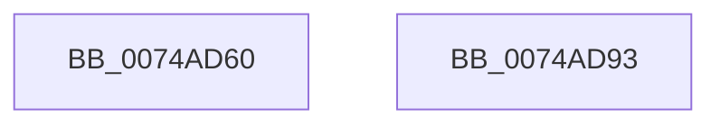

# KsepCacheDeviceEqual

- RVA: `0x0074AD60`–`0x0074AD94` (길이 `52` bytes)
- VA: `0x000000014074AD60`
- 실행 섹션: `PAGE`
- PDB 이름 있음: `예`; PDB Function 태그: `아니요`
- unwind 정보 RVA: `0x0005D2F4`
- 디코드: `16`개 명령, `52/52` bytes 표시
- 미해석 바이트: `0` (있으면 어셈블리에 `.byte`로 보존)

> 이 문서는 커널 이미지의 기계어와 PDB 기호를 분석해 생성했습니다. 4번과 5번은 함수 원형과 자료형을 바이너리 사용 방식에서 추정한 C 해석이며 원본 소스 복구 결과는 아닙니다.

## 1. Dependencies

- 직접 호출 지점: **1**; 고유 호출 대상: **1**
- 직접 호출자로 확인된 함수: **0**
- RIP 상대 이미지 참조: **0**

### Outgoing calls
- `0x0074AD80` → [RtlCompareUnicodeStrings](../97/RtlCompareUnicodeStrings_function_009727E0.md) (function, `0x009727E0`)

### Direct callers
- 이 함수 시작 RVA로 연결되는 직접 call은 확인되지 않았습니다. 간접 호출은 완전히 역산할 수 없습니다.

### Static image references
- 디코드된 RIP-relative 메모리 참조가 없습니다.

## 2. Other-region calls and transfers

- 다른 실행 섹션으로 향하는 call: **0**
- 별도 외부 분기/꼬리 이동을 확인하지 못했습니다.

## 3. Assembly (complete function range)

```asm
0074AD60  48 83 EC 38                     sub rsp, 0x38
0074AD64  44 0F B7 4A 28                  movzx r9d, word ptr [rdx + 0x28]
0074AD69  4C 8B 42 30                     mov r8, qword ptr [rdx + 0x30]
0074AD6D  0F B7 51 28                     movzx edx, word ptr [rcx + 0x28]
0074AD71  48 8B 49 30                     mov rcx, qword ptr [rcx + 0x30]
0074AD75  48 D1 EA                        shr rdx, 1
0074AD78  49 D1 E9                        shr r9, 1
0074AD7B  C6 44 24 20 01                  mov byte ptr [rsp + 0x20], 1
0074AD80  E8 5B 7A 22 00                  call 0x1409727e0
0074AD85  33 C9                           xor ecx, ecx
0074AD87  85 C0                           test eax, eax
0074AD89  0F 94 C1                        sete cl
0074AD8C  8B C1                           mov eax, ecx
0074AD8E  48 83 C4 38                     add rsp, 0x38
0074AD92  C3                              ret
0074AD93  CC                              int3
```

## 4. C-style interpretation (structured pseudocode)

```c
__int64 __fastcall KsepCacheDeviceEqual(__int64 a1, __int64 a2)
{
    __int64 result;
    __int64 v_rsp;
    unsigned __int8 v_stack_m18;

    v_rsp = (v_rsp) - (56);
    a2 = (*(unsigned __int16 *)(a1 + 40)) >> (1);
    a4 = (*(unsigned __int16 *)(a2 + 40)) >> (1);
    v_stack_m18 = 1;
    result = RtlCompareUnicodeStrings(*(unsigned __int64 *)(a1 + 48), a2, *(unsigned __int64 *)(a2 + 48), a4);
    a1 = 0;
    a1 = ((unsigned int)(result) == 0) ? 1 : 0;
    v_rsp = (v_rsp) + (56);
    return (unsigned int)((unsigned int)(a1));
}
```

## 5. (Beta) C Style

```c
int64_t KsepCacheDeviceEqual(void *Arg1, void *Arg2)
{
    uint8_t *arg1 = (uint8_t *)Arg1;
    uint8_t *arg2 = (uint8_t *)Arg2;

    int64_t result;
    int64_t local_rsp;
    uint8_t v_stack_m18;

    local_rsp = (local_rsp) - (56);
    Arg2 = (*(uint16_t *)(arg1 + 0x28)) >> (1);
    a4 = (*(uint16_t *)(arg2 + 0x28)) >> (1);
    v_stack_m18 = 1;
    result = RtlCompareUnicodeStrings(*(uint64_t *)(arg1 + 0x30), Arg2, *(uint64_t *)(arg2 + 0x30), a4);
    Arg1 = 0;
    Arg1 = ((uint32_t)(result) == 0) ? 1 : 0;
    local_rsp = (local_rsp) + (56);
    return (uint32_t)((uint32_t)(Arg1));
}
```

### 관측된 메모리 오프셋

구조체 형식이 확인되지 않은 접근은 인자 기준의 오프셋으로만 기록했습니다.

| 기준 인자 | 오프셋 표현 | 폭 (bit) | 접근 |
|---|---:|---:|---|
| `Arg1` | `+ 0x28` | `16` | `R` |
| `Arg1` | `+ 0x30` | `64` | `R` |
| `Arg2` | `+ 0x28` | `16` | `R` |
| `Arg2` | `+ 0x30` | `64` | `R` |

## 6. Execution-region graph

[열기: 2D/3D 그래프와 함수 탐색 컨트롤 패널](../../../control-panel.html?section=page&rva=0x0074AD60&view=graph)

- 2D 그래프는 위에서 아래로 흐르고, 3D 그래프는 빈 공간을 드래그해 회전합니다. Shift+드래그는 이동, 휠은 확대·축소, 함수 노드 선택은 대상 보고서 이동입니다.

### Static fallback


