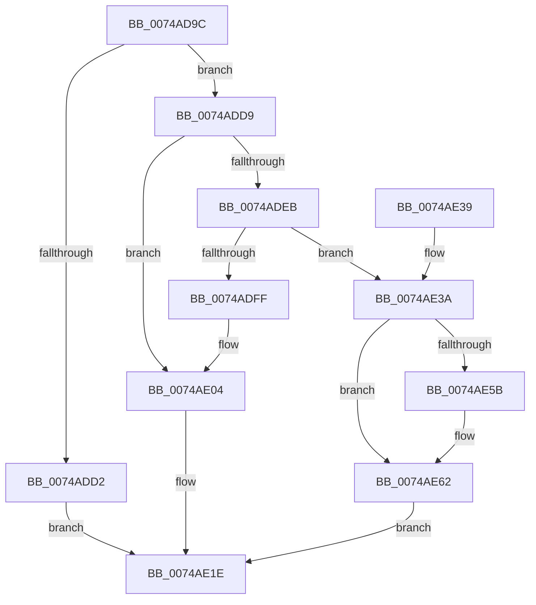

# KsepCacheDeviceInsertData

- RVA: `0x0074AD9C`–`0x0074AE74` (길이 `216` bytes)
- VA: `0x000000014074AD9C`
- 실행 섹션: `PAGE`
- PDB 이름 있음: `예`; PDB Function 태그: `아니요`
- unwind 정보 RVA: `0x00087EEC`
- 디코드: `65`개 명령, `216/216` bytes 표시
- 미해석 바이트: `0` (있으면 어셈블리에 `.byte`로 보존)

> 이 문서는 커널 이미지의 기계어와 PDB 기호를 분석해 생성했습니다. 4번과 5번은 함수 원형과 자료형을 바이너리 사용 방식에서 추정한 C 해석이며 원본 소스 복구 결과는 아닙니다.

## 1. Dependencies

- 직접 호출 지점: **7**; 고유 호출 대상: **5**
- 직접 호출자로 확인된 함수: **1**
- RIP 상대 이미지 참조: **0**

### Outgoing calls
- `0x0074ADC5` → [KsepPoolAllocatePaged](../../text/4A/KsepPoolAllocatePaged_function_004A9EFC.md) (function, `0x004A9EFC`)
- `0x0074ADE0` → [KsepStringDuplicate](../95/KsepStringDuplicate_function_0095B454.md) (function, `0x0095B454`)
- `0x0074ADF1` → [KsepPoolAllocatePaged](../../text/4A/KsepPoolAllocatePaged_function_004A9EFC.md) (function, `0x004A9EFC`)
- `0x0074AE08` → [KsepStringFree](../95/KsepStringFree_function_0095A1B8.md) (function, `0x0095A1B8`)
- `0x0074AE11` → [KsepPoolFreePaged](../../text/4B/KsepPoolFreePaged_function_004B0E10.md) (function, `0x004B0E10`)
- `0x0074AE19` → [KsepPoolFreePaged](../../text/4B/KsepPoolFreePaged_function_004B0E10.md) (function, `0x004B0E10`)
- `0x0074AE43` → [memcpy](../../text/6C/memcpy_function_006C6840.md) (function, `0x006C6840`)

### Direct callers
- [sub_00B2789A](../B2/Unknown_function_00B2789A.md) at `0x00B278CC`
- [sub_00B2789A](../B2/Unknown_function_00B2789A.md) at `0x00B27929`

### Static image references
- 디코드된 RIP-relative 메모리 참조가 없습니다.

## 2. Other-region calls and transfers

- 다른 실행 섹션으로 향하는 call: **5**
  - `0x0074ADC5` → [KsepPoolAllocatePaged](../../text/4A/KsepPoolAllocatePaged_function_004A9EFC.md) (`PAGE` → `.text`)
  - `0x0074ADF1` → [KsepPoolAllocatePaged](../../text/4A/KsepPoolAllocatePaged_function_004A9EFC.md) (`PAGE` → `.text`)
  - `0x0074AE11` → [KsepPoolFreePaged](../../text/4B/KsepPoolFreePaged_function_004B0E10.md) (`PAGE` → `.text`)
  - `0x0074AE19` → [KsepPoolFreePaged](../../text/4B/KsepPoolFreePaged_function_004B0E10.md) (`PAGE` → `.text`)
  - `0x0074AE43` → [memcpy](../../text/6C/memcpy_function_006C6840.md) (`PAGE` → `.text`)
- 별도 외부 분기/꼬리 이동을 확인하지 못했습니다.

## 3. Assembly (complete function range)

```asm
0074AD9C  48 89 5C 24 08                  mov qword ptr [rsp + 8], rbx
0074ADA1  48 89 6C 24 10                  mov qword ptr [rsp + 0x10], rbp
0074ADA6  48 89 74 24 18                  mov qword ptr [rsp + 0x18], rsi
0074ADAB  57                              push rdi
0074ADAC  41 56                           push r14
0074ADAE  41 57                           push r15
0074ADB0  48 83 EC 20                     sub rsp, 0x20
0074ADB4  4C 8B F9                        mov r15, rcx
0074ADB7  41 8B E9                        mov ebp, r9d
0074ADBA  B9 30 00 00 00                  mov ecx, 0x30
0074ADBF  4D 8B F0                        mov r14, r8
0074ADC2  48 8B FA                        mov rdi, rdx
0074ADC5  E8 32 F1 D5 FF                  call 0x1404a9efc
0074ADCA  48 8B D8                        mov rbx, rax
0074ADCD  48 85 C0                        test rax, rax
0074ADD0  75 07                           jne 0x14074add9
0074ADD2  BF 17 00 00 C0                  mov edi, 0xc0000017
0074ADD7  EB 45                           jmp 0x14074ae1e
0074ADD9  48 8D 48 10                     lea rcx, [rax + 0x10]
0074ADDD  48 8B D7                        mov rdx, rdi
0074ADE0  E8 6F 06 21 00                  call 0x14095b454
0074ADE5  8B F8                           mov edi, eax
0074ADE7  85 C0                           test eax, eax
0074ADE9  78 19                           js 0x14074ae04
0074ADEB  8B 7C 24 60                     mov edi, dword ptr [rsp + 0x60]
0074ADEF  8B CF                           mov ecx, edi
0074ADF1  E8 06 F1 D5 FF                  call 0x1404a9efc
0074ADF6  48 89 43 28                     mov qword ptr [rbx + 0x28], rax
0074ADFA  48 85 C0                        test rax, rax
0074ADFD  75 3B                           jne 0x14074ae3a
0074ADFF  BF 17 00 00 C0                  mov edi, 0xc0000017
0074AE04  48 8D 4B 10                     lea rcx, [rbx + 0x10]
0074AE08  E8 AB F3 20 00                  call 0x14095a1b8
0074AE0D  48 8B 4B 28                     mov rcx, qword ptr [rbx + 0x28]
0074AE11  E8 FA 5F D6 FF                  call 0x1404b0e10
0074AE16  48 8B CB                        mov rcx, rbx
0074AE19  E8 F2 5F D6 FF                  call 0x1404b0e10
0074AE1E  48 8B 5C 24 40                  mov rbx, qword ptr [rsp + 0x40]
0074AE23  8B C7                           mov eax, edi
0074AE25  48 8B 6C 24 48                  mov rbp, qword ptr [rsp + 0x48]
0074AE2A  48 8B 74 24 50                  mov rsi, qword ptr [rsp + 0x50]
0074AE2F  48 83 C4 20                     add rsp, 0x20
0074AE33  41 5F                           pop r15
0074AE35  41 5E                           pop r14
0074AE37  5F                              pop rdi
0074AE38  C3                              ret
0074AE39  CC                              int3
0074AE3A  4C 8B C7                        mov r8, rdi
0074AE3D  49 8B D6                        mov rdx, r14
0074AE40  48 8B C8                        mov rcx, rax
0074AE43  E8 F8 B9 F7 FF                  call 0x1406c6840
0074AE48  49 8D 47 38                     lea rax, [r15 + 0x38]
0074AE4C  89 6B 24                        mov dword ptr [rbx + 0x24], ebp
0074AE4F  89 7B 20                        mov dword ptr [rbx + 0x20], edi
0074AE52  48 8B 48 08                     mov rcx, qword ptr [rax + 8]
0074AE56  48 39 01                        cmp qword ptr [rcx], rax
0074AE59  74 07                           je 0x14074ae62
0074AE5B  B9 03 00 00 00                  mov ecx, 3
0074AE60  CD 29                           int 0x29
0074AE62  48 89 03                        mov qword ptr [rbx], rax
0074AE65  33 FF                           xor edi, edi
0074AE67  48 89 4B 08                     mov qword ptr [rbx + 8], rcx
0074AE6B  48 89 19                        mov qword ptr [rcx], rbx
0074AE6E  48 89 58 08                     mov qword ptr [rax + 8], rbx
0074AE72  EB AA                           jmp 0x14074ae1e
```

## 4. C-style interpretation (structured pseudocode)

```c
__int64 __fastcall KsepCacheDeviceInsertData(__int64 a1, __int64 a2, __int64 a3, int a4, unsigned int a5)
{
    __int64 result;
    __int64 v_rdi;
    __int64 v_rsp;
    unsigned __int64 v_stack_p10;
    unsigned __int64 v_stack_p18;
    unsigned __int64 v_stack_p8;

    v_stack_p8 = v_rbx;
    v_stack_p10 = v_rbp;
    v_stack_p18 = v_rsi;
    v_rsp = (v_rsp) - (32);
    result = KsepPoolAllocatePaged(48, a2, a3, a4);
    if (result != 0) goto loc_0074ADD9;
    goto loc_0074AE1E;
loc_0074ADD9:
    result = KsepStringDuplicate(result + 16, (unsigned int)(0xC0000017ULL), a3, a4);
    if (sign_flag) goto loc_0074AE04;
    result = KsepPoolAllocatePaged((unsigned int)((unsigned int)((unsigned int)(a5))), (unsigned int)(0xC0000017ULL), a3, a4);
    *(unsigned __int64 *)(result + 40) = result;
    if (result != 0) goto loc_0074AE3A;
loc_0074AE04:
    result = KsepStringFree(result + 16, (unsigned int)(0xC0000017ULL), a3, a4);
    result = KsepPoolFreePaged(*(unsigned __int64 *)(result + 40), (unsigned int)(0xC0000017ULL), a3, a4);
    result = KsepPoolFreePaged(result, (unsigned int)(0xC0000017ULL), a3, a4);
loc_0074AE1E:
    v_rsp = (v_rsp) + (32);
    return (unsigned int)((unsigned int)((unsigned int)(0xC0000017ULL)));
loc_0074AE3A:
    result = memcpy((unsigned int)((unsigned int)((unsigned int)(0xC0000017ULL))), a3, (unsigned int)(0xC0000017ULL), a4);
    *(unsigned int *)(v_stack_p8 + 36) = (unsigned int)(v_stack_p10);
    *(unsigned int *)(v_stack_p8 + 32) = (unsigned int)((unsigned int)(0xC0000017ULL));
    if ((*(unsigned __int64 *)(*(unsigned __int64 *)(a1 + 56 + 8))) != (a1 + 56)) {
        a1 = 3;
    }
    *(unsigned __int64 *)(v_stack_p8) = a1 + 56;
    v_rdi = 0;
    *(unsigned __int64 *)(v_stack_p8 + 8) = a1;
    *(unsigned __int64 *)(a1) = v_stack_p8;
    *(unsigned __int64 *)(a1 + 56 + 8) = v_stack_p8;
    goto loc_0074AE1E;
}
```

## 5. (Beta) C Style

```c
int64_t KsepCacheDeviceInsertData(void *Arg1, int64_t Arg2, int64_t Arg3, int32_t Arg4, uint32_t Arg5)
{
    uint8_t *arg1 = (uint8_t *)Arg1;

    int64_t result;
    int64_t local_rdi;
    int64_t local_rsp;
    uint64_t v_stack_p10;
    uint64_t v_stack_p18;
    uint64_t v_stack_p8;

    v_stack_p8 = local_rbx;
    v_stack_p10 = local_rbp;
    v_stack_p18 = local_rsi;
    local_rsp = (local_rsp) - (32);
    result = KsepPoolAllocatePaged(48, Arg2, Arg3, Arg4);
    if (result != 0) goto loc_0074ADD9;
    goto loc_0074AE1E;
loc_0074ADD9:
    result = KsepStringDuplicate(result + 16, (uint32_t)(0xC0000017ULL), Arg3, Arg4);
    if (sign_flag) goto loc_0074AE04;
    result = KsepPoolAllocatePaged((uint32_t)((uint32_t)((uint32_t)(Arg5))), (uint32_t)(0xC0000017ULL), Arg3, Arg4);
    *(uint64_t *)(result + 0x28) = result;
    if (result != 0) goto loc_0074AE3A;
loc_0074AE04:
    result = KsepStringFree(result + 16, (uint32_t)(0xC0000017ULL), Arg3, Arg4);
    result = KsepPoolFreePaged(*(uint64_t *)(result + 0x28), (uint32_t)(0xC0000017ULL), Arg3, Arg4);
    result = KsepPoolFreePaged(result, (uint32_t)(0xC0000017ULL), Arg3, Arg4);
loc_0074AE1E:
    local_rsp = (local_rsp) + (32);
    return (uint32_t)((uint32_t)((uint32_t)(0xC0000017ULL)));
loc_0074AE3A:
    result = memcpy((uint32_t)((uint32_t)((uint32_t)(0xC0000017ULL))), Arg3, (uint32_t)(0xC0000017ULL), Arg4);
    *(uint32_t *)(v_stack_p8 + 0x24) = (uint32_t)(v_stack_p10);
    *(uint32_t *)(v_stack_p8 + 0x20) = (uint32_t)((uint32_t)(0xC0000017ULL));
    if ((*(uint64_t *)(*(uint64_t *)(arg1 + 0x38 + 0x8))) != (Arg1 + 56)) {
        Arg1 = 3;
    }
    *(void **)(v_stack_p8) = Arg1 + 56;
    local_rdi = 0;
    *(void **)(v_stack_p8 + 0x8) = Arg1;
    *(uint64_t *)(arg1) = v_stack_p8;
    *(uint64_t *)(arg1 + 0x38 + 0x8) = v_stack_p8;
    goto loc_0074AE1E;
}
```

### 관측된 메모리 오프셋

구조체 형식이 확인되지 않은 접근은 인자 기준의 오프셋으로만 기록했습니다.

| 기준 인자 | 오프셋 표현 | 폭 (bit) | 접근 |
|---|---:|---:|---|
| `Arg1` | `+ 0x8` | `64` | `R` |
| `Arg1` | `+ 0x8` | `64` | `W` |
| `Arg1` | `+ 0x38` | `64` | `R` |

## 6. Execution-region graph

[열기: 2D/3D 그래프와 함수 탐색 컨트롤 패널](../../../control-panel.html?section=page&rva=0x0074AD9C&view=graph)

- 2D 그래프는 위에서 아래로 흐르고, 3D 그래프는 빈 공간을 드래그해 회전합니다. Shift+드래그는 이동, 휠은 확대·축소, 함수 노드 선택은 대상 보고서 이동입니다.

### Static fallback


