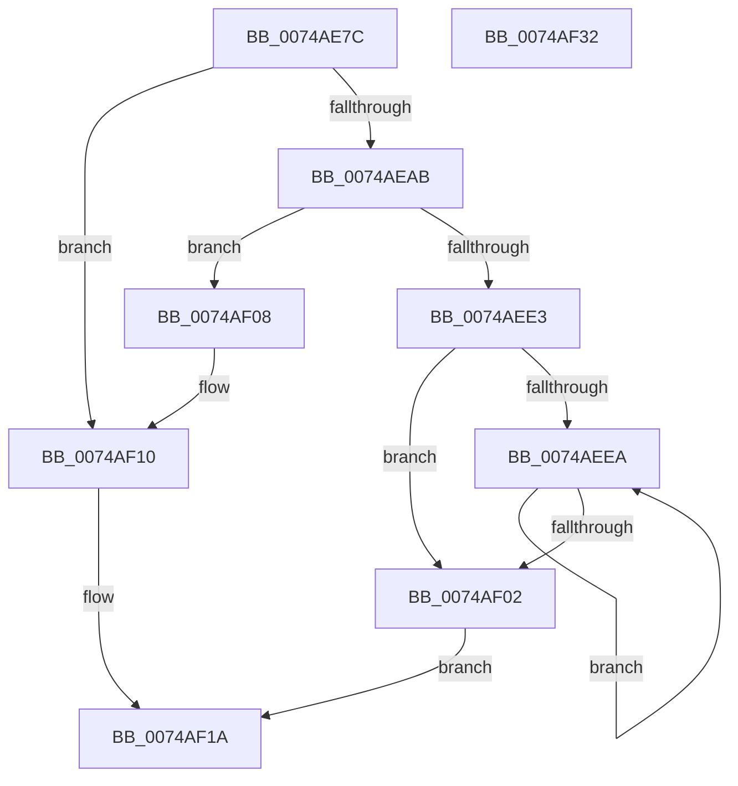

# KsepCacheInitialize

- RVA: `0x0074AE7C`–`0x0074AF33` (길이 `183` bytes)
- VA: `0x000000014074AE7C`
- 실행 섹션: `PAGE`
- PDB 이름 있음: `예`; PDB Function 태그: `아니요`
- unwind 정보 RVA: `0x0005C954`
- 디코드: `52`개 명령, `183/183` bytes 표시
- 미해석 바이트: `0` (있으면 어셈블리에 `.byte`로 보존)

> 이 문서는 커널 이미지의 기계어와 PDB 기호를 분석해 생성했습니다. 4번과 5번은 함수 원형과 자료형을 바이너리 사용 방식에서 추정한 C 해석이며 원본 소스 복구 결과는 아닙니다.

## 1. Dependencies

- 직접 호출 지점: **4**; 고유 호출 대상: **2**
- 직접 호출자로 확인된 함수: **1**
- RIP 상대 이미지 참조: **0**

### Outgoing calls
- `0x0074AE9E` → [KsepPoolAllocatePaged](../../text/4A/KsepPoolAllocatePaged_function_004A9EFC.md) (function, `0x004A9EFC`)
- `0x0074AED5` → [KsepPoolAllocatePaged](../../text/4A/KsepPoolAllocatePaged_function_004A9EFC.md) (function, `0x004A9EFC`)
- `0x0074AF0B` → [KsepPoolFreePaged](../../text/4B/KsepPoolFreePaged_function_004B0E10.md) (function, `0x004B0E10`)
- `0x0074AF13` → [KsepPoolFreePaged](../../text/4B/KsepPoolFreePaged_function_004B0E10.md) (function, `0x004B0E10`)

### Direct callers
- [KsepEngineInitialize](../../init/C3/KsepEngineInitialize_function_00C3B4A0.md) at `0x00C3B52A`
- [KsepEngineInitialize](../../init/C3/KsepEngineInitialize_function_00C3B4A0.md) at `0x00C3B554`

### Static image references
- 디코드된 RIP-relative 메모리 참조가 없습니다.

## 2. Other-region calls and transfers

- 다른 실행 섹션으로 향하는 call: **4**
  - `0x0074AE9E` → [KsepPoolAllocatePaged](../../text/4A/KsepPoolAllocatePaged_function_004A9EFC.md) (`PAGE` → `.text`)
  - `0x0074AED5` → [KsepPoolAllocatePaged](../../text/4A/KsepPoolAllocatePaged_function_004A9EFC.md) (`PAGE` → `.text`)
  - `0x0074AF0B` → [KsepPoolFreePaged](../../text/4B/KsepPoolFreePaged_function_004B0E10.md) (`PAGE` → `.text`)
  - `0x0074AF13` → [KsepPoolFreePaged](../../text/4B/KsepPoolFreePaged_function_004B0E10.md) (`PAGE` → `.text`)
- 별도 외부 분기/꼬리 이동을 확인하지 못했습니다.

## 3. Assembly (complete function range)

```asm
0074AE7C  48 89 5C 24 08                  mov qword ptr [rsp + 8], rbx
0074AE81  48 89 6C 24 10                  mov qword ptr [rsp + 0x10], rbp
0074AE86  48 89 74 24 18                  mov qword ptr [rsp + 0x18], rsi
0074AE8B  57                              push rdi
0074AE8C  48 83 EC 20                     sub rsp, 0x20
0074AE90  B9 60 00 00 00                  mov ecx, 0x60
0074AE95  49 8B F9                        mov rdi, r9
0074AE98  49 8B F0                        mov rsi, r8
0074AE9B  48 8B EA                        mov rbp, rdx
0074AE9E  E8 59 F0 D5 FF                  call 0x1404a9efc
0074AEA3  48 8B D8                        mov rbx, rax
0074AEA6  48 85 C0                        test rax, rax
0074AEA9  74 65                           je 0x14074af10
0074AEAB  48 8D 48 20                     lea rcx, [rax + 0x20]
0074AEAF  C7 40 18 00 01 00 00            mov dword ptr [rax + 0x18], 0x100
0074AEB6  48 89 49 08                     mov qword ptr [rcx + 8], rcx
0074AEBA  48 89 09                        mov qword ptr [rcx], rcx
0074AEBD  B9 F0 0D 00 00                  mov ecx, 0xdf0
0074AEC2  48 89 68 48                     mov qword ptr [rax + 0x48], rbp
0074AEC6  48 89 70 50                     mov qword ptr [rax + 0x50], rsi
0074AECA  48 89 78 58                     mov qword ptr [rax + 0x58], rdi
0074AECE  C7 40 0C DF 00 00 00            mov dword ptr [rax + 0xc], 0xdf
0074AED5  E8 22 F0 D5 FF                  call 0x1404a9efc
0074AEDA  48 89 43 10                     mov qword ptr [rbx + 0x10], rax
0074AEDE  48 85 C0                        test rax, rax
0074AEE1  74 25                           je 0x14074af08
0074AEE3  33 C9                           xor ecx, ecx
0074AEE5  39 4B 0C                        cmp dword ptr [rbx + 0xc], ecx
0074AEE8  76 18                           jbe 0x14074af02
0074AEEA  8B C1                           mov eax, ecx
0074AEEC  FF C1                           inc ecx
0074AEEE  48 C1 E0 04                     shl rax, 4
0074AEF2  48 03 43 10                     add rax, qword ptr [rbx + 0x10]
0074AEF6  48 89 40 08                     mov qword ptr [rax + 8], rax
0074AEFA  48 89 00                        mov qword ptr [rax], rax
0074AEFD  3B 4B 0C                        cmp ecx, dword ptr [rbx + 0xc]
0074AF00  72 E8                           jb 0x14074aeea
0074AF02  48 83 23 00                     and qword ptr [rbx], 0
0074AF06  EB 12                           jmp 0x14074af1a
0074AF08  48 8B C8                        mov rcx, rax
0074AF0B  E8 00 5F D6 FF                  call 0x1404b0e10
0074AF10  48 8B CB                        mov rcx, rbx
0074AF13  E8 F8 5E D6 FF                  call 0x1404b0e10
0074AF18  33 DB                           xor ebx, ebx
0074AF1A  48 8B 6C 24 38                  mov rbp, qword ptr [rsp + 0x38]
0074AF1F  48 8B C3                        mov rax, rbx
0074AF22  48 8B 5C 24 30                  mov rbx, qword ptr [rsp + 0x30]
0074AF27  48 8B 74 24 40                  mov rsi, qword ptr [rsp + 0x40]
0074AF2C  48 83 C4 20                     add rsp, 0x20
0074AF30  5F                              pop rdi
0074AF31  C3                              ret
0074AF32  CC                              int3
```

## 4. C-style interpretation (structured pseudocode)

```c
__int64 __fastcall KsepCacheInitialize(__int64 a1, __int64 a2, __int64 a3, __int64 a4)
{
    __int64 result;
    __int64 v_rbx;
    __int64 v_rsp;
    unsigned __int64 v_stack_p10;
    unsigned __int64 v_stack_p18;
    unsigned __int64 v_stack_p8;

    v_stack_p8 = v_rbx;
    v_stack_p10 = v_rbp;
    v_stack_p18 = v_rsi;
    v_rsp = (v_rsp) - (32);
    result = KsepPoolAllocatePaged(96, a2, a3, a4);
    if (result == 0) goto loc_0074AF10;
    *(unsigned int *)(result + 24) = 256;
    *(unsigned __int64 *)(result + 32 + 8) = result + 32;
    *(unsigned __int64 *)(result + 32) = result + 32;
    *(unsigned __int64 *)(result + 72) = a2;
    *(unsigned __int64 *)(result + 80) = a3;
    *(unsigned __int64 *)(result + 88) = a4;
    *(unsigned int *)(result + 12) = 223;
    result = KsepPoolAllocatePaged((unsigned int)(0xDF0ULL), a2, a3, a4);
    *(unsigned __int64 *)(result + 16) = result;
    if (result == 0) goto loc_0074AF08;
    a1 = 0;
    if ((*(unsigned int *)(result + 12)) <= 0) goto loc_0074AF02;
loc_0074AEEA:
    a1 = (unsigned int)((a1) + 1);
    result = (0) << (4);
    result = (result) + (*(unsigned __int64 *)(result + 16));
    *(unsigned __int64 *)(result + 8) = result;
    *(unsigned __int64 *)(result) = result;
    if (((unsigned int)(a1)) < (*(unsigned int *)(result + 12))) goto loc_0074AEEA;
loc_0074AF02:
    goto loc_0074AF1A;
loc_0074AF08:
    result = KsepPoolFreePaged(result, a2, a3, a4);
loc_0074AF10:
    result = KsepPoolFreePaged(result, a2, a3, a4);
    v_rbx = 0;
loc_0074AF1A:
    v_rsp = (v_rsp) + (32);
    return 0;
}
```

## 5. (Beta) C Style

```c
int64_t KsepCacheInitialize(int64_t Arg1, int64_t Arg2, int64_t Arg3, int64_t Arg4)
{
    int64_t result;
    int64_t local_rbx;
    int64_t local_rsp;
    uint64_t v_stack_p10;
    uint64_t v_stack_p18;
    uint64_t v_stack_p8;

    v_stack_p8 = local_rbx;
    v_stack_p10 = local_rbp;
    v_stack_p18 = local_rsi;
    local_rsp = (local_rsp) - (32);
    result = KsepPoolAllocatePaged(96, Arg2, Arg3, Arg4);
    if (result == 0) goto loc_0074AF10;
    *(uint32_t *)(result + 0x18) = 256;
    *(uint64_t *)(result + 0x20 + 0x8) = result + 32;
    *(uint64_t *)(result + 0x20) = result + 32;
    *(uint64_t *)(result + 0x48) = Arg2;
    *(uint64_t *)(result + 0x50) = Arg3;
    *(uint64_t *)(result + 0x58) = Arg4;
    *(uint32_t *)(result + 0xC) = 223;
    result = KsepPoolAllocatePaged((uint32_t)(0xDF0ULL), Arg2, Arg3, Arg4);
    *(uint64_t *)(result + 0x10) = result;
    if (result == 0) goto loc_0074AF08;
    Arg1 = 0;
    if ((*(uint32_t *)(result + 0xC)) <= 0) goto loc_0074AF02;
loc_0074AEEA:
    Arg1 = (uint32_t)((Arg1) + 1);
    result = (0) << (4);
    result = (result) + (*(uint64_t *)(result + 0x10));
    *(uint64_t *)(result + 0x8) = result;
    *(uint64_t *)(result) = result;
    if (((uint32_t)(Arg1)) < (*(uint32_t *)(result + 0xC))) goto loc_0074AEEA;
loc_0074AF02:
    goto loc_0074AF1A;
loc_0074AF08:
    result = KsepPoolFreePaged(result, Arg2, Arg3, Arg4);
loc_0074AF10:
    result = KsepPoolFreePaged(result, Arg2, Arg3, Arg4);
    local_rbx = 0;
loc_0074AF1A:
    local_rsp = (local_rsp) + (32);
    return 0;
}
```

## 6. Execution-region graph

[열기: 2D/3D 그래프와 함수 탐색 컨트롤 패널](../../../control-panel.html?section=page&rva=0x0074AE7C&view=graph)

- 2D 그래프는 위에서 아래로 흐르고, 3D 그래프는 빈 공간을 드래그해 회전합니다. Shift+드래그는 이동, 휠은 확대·축소, 함수 노드 선택은 대상 보고서 이동입니다.

### Static fallback


