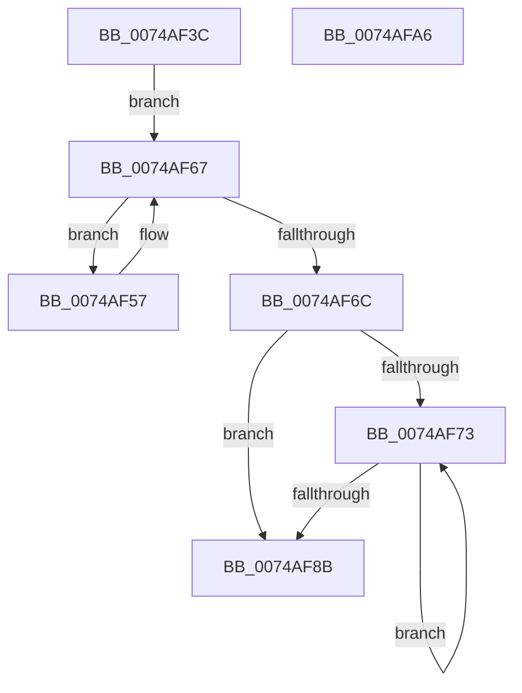

# KsepCacheReset

- RVA: `0x0074AF3C`–`0x0074AFA7` (길이 `107` bytes)
- VA: `0x000000014074AF3C`
- 실행 섹션: `PAGE`
- PDB 이름 있음: `예`; PDB Function 태그: `아니요`
- unwind 정보 RVA: `0x00060BC4`
- 디코드: `34`개 명령, `107/107` bytes 표시
- 미해석 바이트: `0` (있으면 어셈블리에 `.byte`로 보존)

> 이 문서는 커널 이미지의 기계어와 PDB 기호를 분석해 생성했습니다. 4번과 5번은 함수 원형과 자료형을 바이너리 사용 방식에서 추정한 C 해석이며 원본 소스 복구 결과는 아닙니다.

## 1. Dependencies

- 직접 호출 지점: **1**; 고유 호출 대상: **1**
- 직접 호출자로 확인된 함수: **1**
- RIP 상대 이미지 참조: **0**

### Outgoing calls
- `0x0074AF62` → [guard_dispatch_icall](../../text/6B/guard_dispatch_icall_function_006BAAD0.md) (function, `0x006BAAD0`)

### Direct callers
- [KseResetDeviceCache](../95/KseResetDeviceCache_function_00959CDC.md) at `0x00959CFE`

### Static image references
- 디코드된 RIP-relative 메모리 참조가 없습니다.

## 2. Other-region calls and transfers

- 다른 실행 섹션으로 향하는 call: **1**
  - `0x0074AF62` → [guard_dispatch_icall](../../text/6B/guard_dispatch_icall_function_006BAAD0.md) (`PAGE` → `.text`)
- 별도 외부 분기/꼬리 이동을 확인하지 못했습니다.

## 3. Assembly (complete function range)

```asm
0074AF3C  48 89 5C 24 08                  mov qword ptr [rsp + 8], rbx
0074AF41  48 89 74 24 10                  mov qword ptr [rsp + 0x10], rsi
0074AF46  57                              push rdi
0074AF47  48 83 EC 20                     sub rsp, 0x20
0074AF4B  48 8D 59 20                     lea rbx, [rcx + 0x20]
0074AF4F  48 8B F9                        mov rdi, rcx
0074AF52  48 8B 33                        mov rsi, qword ptr [rbx]
0074AF55  EB 10                           jmp 0x14074af67
0074AF57  48 8B 47 58                     mov rax, qword ptr [rdi + 0x58]
0074AF5B  48 8D 4E E8                     lea rcx, [rsi - 0x18]
0074AF5F  48 8B 36                        mov rsi, qword ptr [rsi]
0074AF62  E8 69 FB F6 FF                  call 0x1406baad0
0074AF67  48 3B F3                        cmp rsi, rbx
0074AF6A  75 EB                           jne 0x14074af57
0074AF6C  33 C9                           xor ecx, ecx
0074AF6E  39 4F 0C                        cmp dword ptr [rdi + 0xc], ecx
0074AF71  76 18                           jbe 0x14074af8b
0074AF73  8B C1                           mov eax, ecx
0074AF75  FF C1                           inc ecx
0074AF77  48 C1 E0 04                     shl rax, 4
0074AF7B  48 03 47 10                     add rax, qword ptr [rdi + 0x10]
0074AF7F  48 89 40 08                     mov qword ptr [rax + 8], rax
0074AF83  48 89 00                        mov qword ptr [rax], rax
0074AF86  3B 4F 0C                        cmp ecx, dword ptr [rdi + 0xc]
0074AF89  72 E8                           jb 0x14074af73
0074AF8B  48 8B 74 24 38                  mov rsi, qword ptr [rsp + 0x38]
0074AF90  48 89 5B 08                     mov qword ptr [rbx + 8], rbx
0074AF94  48 89 1B                        mov qword ptr [rbx], rbx
0074AF97  83 67 08 00                     and dword ptr [rdi + 8], 0
0074AF9B  48 8B 5C 24 30                  mov rbx, qword ptr [rsp + 0x30]
0074AFA0  48 83 C4 20                     add rsp, 0x20
0074AFA4  5F                              pop rdi
0074AFA5  C3                              ret
0074AFA6  CC                              int3
```

## 4. C-style interpretation (structured pseudocode)

```c
__int64 __fastcall KsepCacheReset(__int64 a1)
{
    __int64 result;
    __int64 v_rsp;
    unsigned __int64 v_stack_p10;
    unsigned __int64 v_stack_p8;

    v_stack_p8 = v_rbx;
    v_stack_p10 = v_rsi;
    v_rsp = (v_rsp) - (32);
    goto loc_0074AF67;
loc_0074AF57:
    result = guard_dispatch_icall(*(unsigned __int64 *)(a1 + 32) - 24, a2, a3, a4);
loc_0074AF67:
    if ((*(unsigned __int64 *)(*(unsigned __int64 *)(a1 + 32))) != (a1 + 32)) goto loc_0074AF57;
    a1 = 0;
    if ((*(unsigned int *)(a1 + 12)) <= 0) goto loc_0074AF8B;
loc_0074AF73:
    a1 = (unsigned int)((a1) + 1);
    result = (0) << (4);
    result = (result) + (*(unsigned __int64 *)(a1 + 16));
    *(unsigned __int64 *)(result + 8) = result;
    *(unsigned __int64 *)(result) = result;
    if (((unsigned int)(a1)) < (*(unsigned int *)(a1 + 12))) goto loc_0074AF73;
loc_0074AF8B:
    *(unsigned __int64 *)(a1 + 32 + 8) = a1 + 32;
    *(unsigned __int64 *)(a1 + 32) = a1 + 32;
    v_rsp = (v_rsp) + (32);
    return result;
}
```

## 5. (Beta) C Style

```c
int64_t KsepCacheReset(void *Arg1)
{
    uint8_t *arg1 = (uint8_t *)Arg1;

    int64_t result;
    int64_t local_rsp;
    uint64_t v_stack_p10;
    uint64_t v_stack_p8;

    v_stack_p8 = local_rbx;
    v_stack_p10 = local_rsi;
    local_rsp = (local_rsp) - (32);
    goto loc_0074AF67;
loc_0074AF57:
    result = guard_dispatch_icall(*(uint64_t *)(arg1 + 0x20) - 24, a2, a3, a4);
loc_0074AF67:
    if ((*(uint64_t *)(*(uint64_t *)(arg1 + 0x20))) != (Arg1 + 32)) goto loc_0074AF57;
    Arg1 = 0;
    if ((*(uint32_t *)(arg1 + 0xC)) <= 0) goto loc_0074AF8B;
loc_0074AF73:
    Arg1 = (uint32_t)((Arg1) + 1);
    result = (0) << (4);
    result = (result) + (*(uint64_t *)(arg1 + 0x10));
    *(uint64_t *)(result + 0x8) = result;
    *(uint64_t *)(result) = result;
    if (((uint32_t)(Arg1)) < (*(uint32_t *)(arg1 + 0xC))) goto loc_0074AF73;
loc_0074AF8B:
    *(void **)(arg1 + 0x20 + 0x8) = Arg1 + 32;
    *(void **)(arg1 + 0x20) = Arg1 + 32;
    local_rsp = (local_rsp) + (32);
    return result;
}
```

### 관측된 메모리 오프셋

구조체 형식이 확인되지 않은 접근은 인자 기준의 오프셋으로만 기록했습니다.

| 기준 인자 | 오프셋 표현 | 폭 (bit) | 접근 |
|---|---:|---:|---|
| `Arg1` | `+ 0x0` | `64` | `R` |
| `Arg1` | `+ 0x0` | `64` | `W` |
| `Arg1` | `+ 0x8` | `32` | `R/W` |
| `Arg1` | `+ 0x8` | `64` | `W` |
| `Arg1` | `+ 0xC` | `32` | `R` |
| `Arg1` | `+ 0x10` | `64` | `R` |
| `Arg1` | `+ 0x20` | `64` | `R` |
| `Arg1` | `+ 0x58` | `64` | `R` |

## 6. Execution-region graph

[열기: 2D/3D 그래프와 함수 탐색 컨트롤 패널](../../../control-panel.html?section=page&rva=0x0074AF3C&view=graph)

- 2D 그래프는 위에서 아래로 흐르고, 3D 그래프는 빈 공간을 드래그해 회전합니다. Shift+드래그는 이동, 휠은 확대·축소, 함수 노드 선택은 대상 보고서 이동입니다.

### Static fallback


