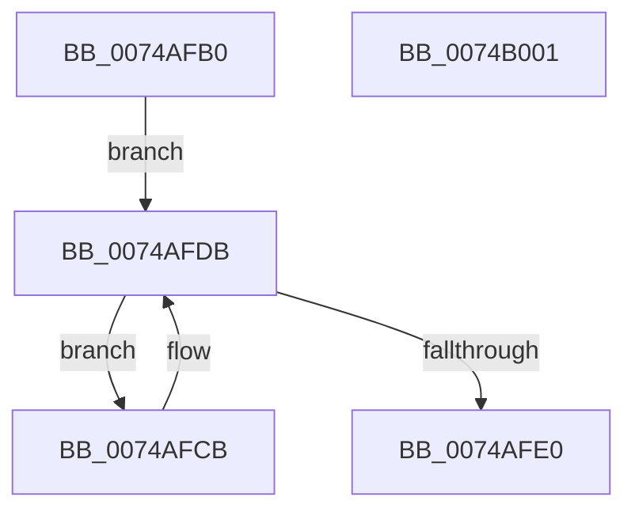

# KsepCacheUninitialize

- RVA: `0x0074AFB0`–`0x0074B002` (길이 `82` bytes)
- VA: `0x000000014074AFB0`
- 실행 섹션: `PAGE`
- PDB 이름 있음: `예`; PDB Function 태그: `아니요`
- unwind 정보 RVA: `0x00060BC4`
- 디코드: `24`개 명령, `82/82` bytes 표시
- 미해석 바이트: `0` (있으면 어셈블리에 `.byte`로 보존)

> 이 문서는 커널 이미지의 기계어와 PDB 기호를 분석해 생성했습니다. 4번과 5번은 함수 원형과 자료형을 바이너리 사용 방식에서 추정한 C 해석이며 원본 소스 복구 결과는 아닙니다.

## 1. Dependencies

- 직접 호출 지점: **3**; 고유 호출 대상: **2**
- 직접 호출자로 확인된 함수: **1**
- RIP 상대 이미지 참조: **0**

### Outgoing calls
- `0x0074AFD6` → [guard_dispatch_icall](../../text/6B/guard_dispatch_icall_function_006BAAD0.md) (function, `0x006BAAD0`)
- `0x0074AFE4` → [KsepPoolFreePaged](../../text/4B/KsepPoolFreePaged_function_004B0E10.md) (function, `0x004B0E10`)
- `0x0074AFEC` → [KsepPoolFreePaged](../../text/4B/KsepPoolFreePaged_function_004B0E10.md) (function, `0x004B0E10`)

### Direct callers
- [KseInitialize](../../init/C3/KseInitialize_function_00C3B5AC.md) at `0x00C3BA8A`

### Static image references
- 디코드된 RIP-relative 메모리 참조가 없습니다.

## 2. Other-region calls and transfers

- 다른 실행 섹션으로 향하는 call: **3**
  - `0x0074AFD6` → [guard_dispatch_icall](../../text/6B/guard_dispatch_icall_function_006BAAD0.md) (`PAGE` → `.text`)
  - `0x0074AFE4` → [KsepPoolFreePaged](../../text/4B/KsepPoolFreePaged_function_004B0E10.md) (`PAGE` → `.text`)
  - `0x0074AFEC` → [KsepPoolFreePaged](../../text/4B/KsepPoolFreePaged_function_004B0E10.md) (`PAGE` → `.text`)
- 별도 외부 분기/꼬리 이동을 확인하지 못했습니다.

## 3. Assembly (complete function range)

```asm
0074AFB0  48 89 5C 24 08                  mov qword ptr [rsp + 8], rbx
0074AFB5  48 89 74 24 10                  mov qword ptr [rsp + 0x10], rsi
0074AFBA  57                              push rdi
0074AFBB  48 83 EC 20                     sub rsp, 0x20
0074AFBF  48 8D 71 20                     lea rsi, [rcx + 0x20]
0074AFC3  48 8B D9                        mov rbx, rcx
0074AFC6  48 8B 3E                        mov rdi, qword ptr [rsi]
0074AFC9  EB 10                           jmp 0x14074afdb
0074AFCB  48 8B 43 58                     mov rax, qword ptr [rbx + 0x58]
0074AFCF  48 8D 4F E8                     lea rcx, [rdi - 0x18]
0074AFD3  48 8B 3F                        mov rdi, qword ptr [rdi]
0074AFD6  E8 F5 FA F6 FF                  call 0x1406baad0
0074AFDB  48 3B FE                        cmp rdi, rsi
0074AFDE  75 EB                           jne 0x14074afcb
0074AFE0  48 8B 4B 10                     mov rcx, qword ptr [rbx + 0x10]
0074AFE4  E8 27 5E D6 FF                  call 0x1404b0e10
0074AFE9  48 8B CB                        mov rcx, rbx
0074AFEC  E8 1F 5E D6 FF                  call 0x1404b0e10
0074AFF1  48 8B 5C 24 30                  mov rbx, qword ptr [rsp + 0x30]
0074AFF6  48 8B 74 24 38                  mov rsi, qword ptr [rsp + 0x38]
0074AFFB  48 83 C4 20                     add rsp, 0x20
0074AFFF  5F                              pop rdi
0074B000  C3                              ret
0074B001  CC                              int3
```

## 4. C-style interpretation (structured pseudocode)

```c
__int64 __fastcall KsepCacheUninitialize(__int64 a1)
{
    __int64 result;
    __int64 v_rsp;
    unsigned __int64 v_stack_p10;
    unsigned __int64 v_stack_p8;

    v_stack_p8 = v_rbx;
    v_stack_p10 = v_rsi;
    v_rsp = (v_rsp) - (32);
    goto loc_0074AFDB;
loc_0074AFCB:
    result = guard_dispatch_icall(*(unsigned __int64 *)(a1 + 32) - 24, a2, a3, a4);
loc_0074AFDB:
    if ((*(unsigned __int64 *)(*(unsigned __int64 *)(a1 + 32))) != (a1 + 32)) goto loc_0074AFCB;
    result = KsepPoolFreePaged(*(unsigned __int64 *)(a1 + 16), a2, a3, a4);
    result = KsepPoolFreePaged(a1, a2, a3, a4);
    v_rsp = (v_rsp) + (32);
    return result;
}
```

## 5. (Beta) C Style

```c
int64_t KsepCacheUninitialize(void *Arg1)
{
    uint8_t *arg1 = (uint8_t *)Arg1;

    int64_t result;
    int64_t local_rsp;
    uint64_t v_stack_p10;
    uint64_t v_stack_p8;

    v_stack_p8 = local_rbx;
    v_stack_p10 = local_rsi;
    local_rsp = (local_rsp) - (32);
    goto loc_0074AFDB;
loc_0074AFCB:
    result = guard_dispatch_icall(*(uint64_t *)(arg1 + 0x20) - 24, a2, a3, a4);
loc_0074AFDB:
    if ((*(uint64_t *)(*(uint64_t *)(arg1 + 0x20))) != (Arg1 + 32)) goto loc_0074AFCB;
    result = KsepPoolFreePaged(*(uint64_t *)(arg1 + 0x10), a2, a3, a4);
    result = KsepPoolFreePaged(Arg1, a2, a3, a4);
    local_rsp = (local_rsp) + (32);
    return result;
}
```

### 관측된 메모리 오프셋

구조체 형식이 확인되지 않은 접근은 인자 기준의 오프셋으로만 기록했습니다.

| 기준 인자 | 오프셋 표현 | 폭 (bit) | 접근 |
|---|---:|---:|---|
| `Arg1` | `+ 0x0` | `64` | `R` |
| `Arg1` | `+ 0x10` | `64` | `R` |
| `Arg1` | `+ 0x20` | `64` | `R` |
| `Arg1` | `+ 0x58` | `64` | `R` |

## 6. Execution-region graph

[열기: 2D/3D 그래프와 함수 탐색 컨트롤 패널](../../../control-panel.html?section=page&rva=0x0074AFB0&view=graph)

- 2D 그래프는 위에서 아래로 흐르고, 3D 그래프는 빈 공간을 드래그해 회전합니다. Shift+드래그는 이동, 휠은 확대·축소, 함수 노드 선택은 대상 보고서 이동입니다.

### Static fallback


