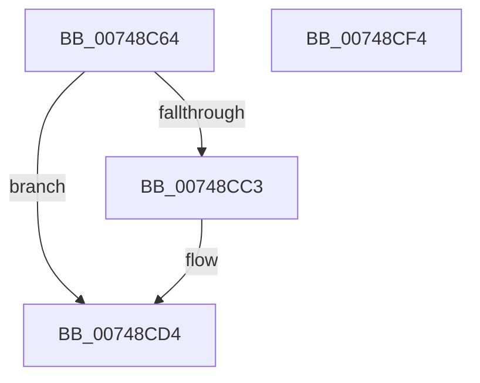

# KsepDbCacheInsertDevice

- RVA: `0x00748C64`–`0x00748CF5` (길이 `145` bytes)
- VA: `0x0000000140748C64`
- 실행 섹션: `PAGE`
- PDB 이름 있음: `예`; PDB Function 태그: `아니요`
- unwind 정보 RVA: `0x000CA9E0`
- 디코드: `37`개 명령, `145/145` bytes 표시
- 미해석 바이트: `0` (있으면 어셈블리에 `.byte`로 보존)

> 이 문서는 커널 이미지의 기계어와 PDB 기호를 분석해 생성했습니다. 4번과 5번은 함수 원형과 자료형을 바이너리 사용 방식에서 추정한 C 해석이며 원본 소스 복구 결과는 아닙니다.

## 1. Dependencies

- 직접 호출 지점: **6**; 고유 호출 대상: **6**
- 직접 호출자로 확인된 함수: **2**
- RIP 상대 이미지 참조: **1**

### Outgoing calls
- `0x00748C8F` → [memset](../../text/6C/memset_function_006C6C40.md) (function, `0x006C6C40`)
- `0x00748C9B` → [CmpLockSiloKeyLockTrackerExclusive](../8F/CmpLockSiloKeyLockTrackerExclusive_function_008F9EF8.md) (function, `0x008F9EF8`)
- `0x00748CA8` → [RtlInitUnicodeString](../../text/42/RtlInitUnicodeString_function_0042A780.md) (function, `0x0042A780`)
- `0x00748CB9` → [KsepCacheLookup](../95/KsepCacheLookup_function_00959DE8.md) (function, `0x00959DE8`)
- `0x00748CCD` → [KsepCacheInsert](../AB/KsepCacheInsert_function_00AB722C.md) (function, `0x00AB722C`)
- `0x00748CDB` → [KsepCacheUnlock](../95/KsepCacheUnlock_function_00959ECC.md) (function, `0x00959ECC`)

### Direct callers
- [KseQueryDeviceDataList](../95/KseQueryDeviceDataList_function_00959390.md) at `0x009594BB`
- [KseQueryDeviceData](../95/KseQueryDeviceData_function_0095AFB0.md) at `0x0095B0D1`

### Static image references
- `0x00748C94` → RVA `0x00E66CC8` (`.data`; read)

## 2. Other-region calls and transfers

- 다른 실행 섹션으로 향하는 call: **2**
  - `0x00748C8F` → [memset](../../text/6C/memset_function_006C6C40.md) (`PAGE` → `.text`)
  - `0x00748CA8` → [RtlInitUnicodeString](../../text/42/RtlInitUnicodeString_function_0042A780.md) (`PAGE` → `.text`)
- 별도 외부 분기/꼬리 이동을 확인하지 못했습니다.

## 3. Assembly (complete function range)

```asm
00748C64  48 89 5C 24 08                  mov qword ptr [rsp + 8], rbx
00748C69  48 89 74 24 10                  mov qword ptr [rsp + 0x10], rsi
00748C6E  57                              push rdi
00748C6F  48 83 EC 70                     sub rsp, 0x70
00748C73  33 C0                           xor eax, eax
00748C75  48 8B F2                        mov rsi, rdx
00748C78  48 8B D9                        mov rbx, rcx
00748C7B  89 44 24 24                     mov dword ptr [rsp + 0x24], eax
00748C7F  33 D2                           xor edx, edx
00748C81  48 8D 4C 24 20                  lea rcx, [rsp + 0x20]
00748C86  BF 0D 00 00 C0                  mov edi, 0xc000000d
00748C8B  44 8D 40 44                     lea r8d, [rax + 0x44]
00748C8F  E8 AC DF F7 FF                  call 0x1406c6c40
00748C94  48 8B 0D 2D E0 71 00            mov rcx, qword ptr [rip + 0x71e02d]
00748C9B  E8 58 12 1B 00                  call 0x1408f9ef8
00748CA0  48 8B D3                        mov rdx, rbx
00748CA3  48 8D 4C 24 48                  lea rcx, [rsp + 0x48]
00748CA8  E8 D3 1A CE FF                  call 0x14042a780
00748CAD  48 8B 0D 14 E0 71 00            mov rcx, qword ptr [rip + 0x71e014]
00748CB4  48 8D 54 24 20                  lea rdx, [rsp + 0x20]
00748CB9  E8 2A 11 21 00                  call 0x140959de8
00748CBE  48 85 C0                        test rax, rax
00748CC1  75 11                           jne 0x140748cd4
00748CC3  48 8B 0D FE DF 71 00            mov rcx, qword ptr [rip + 0x71dffe]
00748CCA  48 8B D6                        mov rdx, rsi
00748CCD  E8 5A E5 36 00                  call 0x140ab722c
00748CD2  33 FF                           xor edi, edi
00748CD4  48 8B 0D ED DF 71 00            mov rcx, qword ptr [rip + 0x71dfed]
00748CDB  E8 EC 11 21 00                  call 0x140959ecc
00748CE0  4C 8D 5C 24 70                  lea r11, [rsp + 0x70]
00748CE5  8B C7                           mov eax, edi
00748CE7  49 8B 5B 10                     mov rbx, qword ptr [r11 + 0x10]
00748CEB  49 8B 73 18                     mov rsi, qword ptr [r11 + 0x18]
00748CEF  49 8B E3                        mov rsp, r11
00748CF2  5F                              pop rdi
00748CF3  C3                              ret
00748CF4  CC                              int3
```

## 4. C-style interpretation (structured pseudocode)

```c
__int64 __fastcall KsepDbCacheInsertDevice(__int64 a1, __int64 a2)
{
    __int64 result;
    __int64 v_rdi;
    __int64 v_rsp;
    unsigned __int64 v_stack_m30;
    unsigned int v_stack_m54;
    unsigned __int64 v_stack_m58;
    unsigned __int64 v_stack_m8;
    unsigned __int64 v_stack_p10;
    unsigned __int64 v_stack_p8;

    v_stack_p8 = v_rbx;
    v_stack_p10 = v_rsi;
    v_rsp = (v_rsp) - (112);
    result = 0;
    v_stack_m54 = 0;
    a2 = 0;
    result = memset(v_stack_m58, a2, result + 68, a4);
    result = CmpLockSiloKeyLockTrackerExclusive(*(unsigned __int64 *)(v_rip + 7462957), a2, result + 68, a4);
    result = RtlInitUnicodeString(v_stack_m30, a1, result + 68, a4);
    result = KsepCacheLookup(*(unsigned __int64 *)(v_rip + 7462932), v_stack_m58, result + 68, a4);
    v_rdi = (unsigned int)(0xC000000DULL);
    if (result == 0) {
        a1 = *(unsigned __int64 *)(v_rip + 7462910);
        a2 = 0;
        result = KsepCacheInsert(a1, a2, result + 68, a4);
        v_rdi = 0;
    }
    result = KsepCacheUnlock(*(unsigned __int64 *)(v_rip + 7462893), a2, result + 68, a4);
    return 0;
}
```

## 5. (Beta) C Style

```c
int64_t KsepDbCacheInsertDevice(int64_t Arg1, int64_t Arg2)
{
    int64_t result;
    int64_t local_rdi;
    int64_t local_rsp;
    uint64_t v_stack_m30;
    uint32_t v_stack_m54;
    uint64_t v_stack_m58;
    uint64_t v_stack_m8;
    uint64_t v_stack_p10;
    uint64_t v_stack_p8;

    v_stack_p8 = local_rbx;
    v_stack_p10 = local_rsi;
    local_rsp = (local_rsp) - (112);
    result = 0;
    v_stack_m54 = 0;
    Arg2 = 0;
    result = memset(v_stack_m58, Arg2, result + 68, a4);
    result = CmpLockSiloKeyLockTrackerExclusive(*(uint64_t *)(v_rip + 0x71E02D), Arg2, result + 68, a4);
    result = RtlInitUnicodeString(v_stack_m30, Arg1, result + 68, a4);
    result = KsepCacheLookup(*(uint64_t *)(v_rip + 0x71E014), v_stack_m58, result + 68, a4);
    local_rdi = (uint32_t)(0xC000000DULL);
    if (result == 0) {
        Arg1 = *(uint64_t *)(v_rip + 0x71DFFE);
        Arg2 = 0;
        result = KsepCacheInsert(Arg1, Arg2, result + 68, a4);
        local_rdi = 0;
    }
    result = KsepCacheUnlock(*(uint64_t *)(v_rip + 0x71DFED), Arg2, result + 68, a4);
    return 0;
}
```

## 6. Execution-region graph

[열기: 2D/3D 그래프와 함수 탐색 컨트롤 패널](../../../control-panel.html?section=page&rva=0x00748C64&view=graph)

- 2D 그래프는 위에서 아래로 흐르고, 3D 그래프는 빈 공간을 드래그해 회전합니다. Shift+드래그는 이동, 휠은 확대·축소, 함수 노드 선택은 대상 보고서 이동입니다.

### Static fallback


