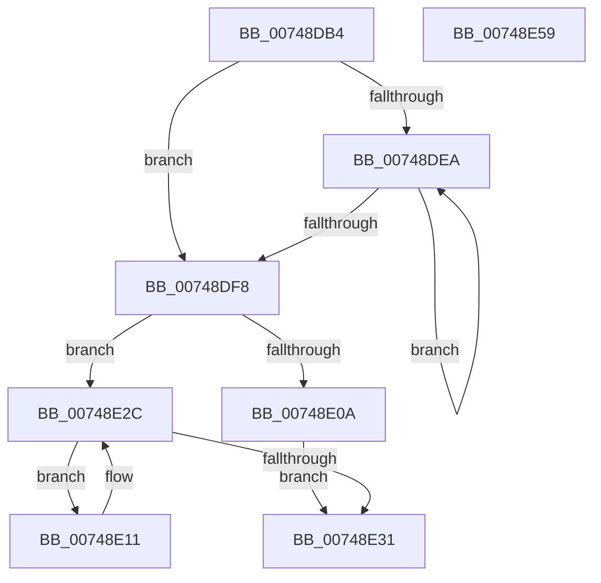

# KsepDbCacheQueryDeviceDataList

- RVA: `0x00748DB4`–`0x00748E5A` (길이 `166` bytes)
- VA: `0x0000000140748DB4`
- 실행 섹션: `PAGE`
- PDB 이름 있음: `예`; PDB Function 태그: `아니요`
- unwind 정보 RVA: `0x0005FEF8`
- 디코드: `53`개 명령, `166/166` bytes 표시
- 미해석 바이트: `0` (있으면 어셈블리에 `.byte`로 보존)

> 이 문서는 커널 이미지의 기계어와 PDB 기호를 분석해 생성했습니다. 4번과 5번은 함수 원형과 자료형을 바이너리 사용 방식에서 추정한 C 해석이며 원본 소스 복구 결과는 아닙니다.

## 1. Dependencies

- 직접 호출 지점: **1**; 고유 호출 대상: **1**
- 직접 호출자로 확인된 함수: **1**
- RIP 상대 이미지 참조: **0**

### Outgoing calls
- `0x00748E1D` → [memcpy](../../text/6C/memcpy_function_006C6840.md) (function, `0x006C6840`)

### Direct callers
- [KseQueryDeviceDataList](../95/KseQueryDeviceDataList_function_00959390.md) at `0x00959472`
- [KseQueryDeviceDataList](../95/KseQueryDeviceDataList_function_00959390.md) at `0x009594AE`

### Static image references
- 디코드된 RIP-relative 메모리 참조가 없습니다.

## 2. Other-region calls and transfers

- 다른 실행 섹션으로 향하는 call: **1**
  - `0x00748E1D` → [memcpy](../../text/6C/memcpy_function_006C6840.md) (`PAGE` → `.text`)
- 별도 외부 분기/꼬리 이동을 확인하지 못했습니다.

## 3. Assembly (complete function range)

```asm
00748DB4  48 8B C4                        mov rax, rsp
00748DB7  48 89 58 08                     mov qword ptr [rax + 8], rbx
00748DBB  48 89 68 10                     mov qword ptr [rax + 0x10], rbp
00748DBF  48 89 70 18                     mov qword ptr [rax + 0x18], rsi
00748DC3  48 89 78 20                     mov qword ptr [rax + 0x20], rdi
00748DC7  41 54                           push r12
00748DC9  41 56                           push r14
00748DCB  41 57                           push r15
00748DCD  48 83 EC 20                     sub rsp, 0x20
00748DD1  4C 8D 71 38                     lea r14, [rcx + 0x38]
00748DD5  33 ED                           xor ebp, ebp
00748DD7  49 8B 3E                        mov rdi, qword ptr [r14]
00748DDA  4D 8B E1                        mov r12, r9
00748DDD  4C 8B FA                        mov r15, rdx
00748DE0  8B DD                           mov ebx, ebp
00748DE2  48 8B CF                        mov rcx, rdi
00748DE5  49 3B FE                        cmp rdi, r14
00748DE8  74 0E                           je 0x140748df8
00748DEA  0F B7 41 12                     movzx eax, word ptr [rcx + 0x12]
00748DEE  48 8B 09                        mov rcx, qword ptr [rcx]
00748DF1  03 D8                           add ebx, eax
00748DF3  49 3B CE                        cmp rcx, r14
00748DF6  75 F2                           jne 0x140748dea
00748DF8  8B CB                           mov ecx, ebx
00748DFA  BE 02 00 00 00                  mov esi, 2
00748DFF  48 03 CE                        add rcx, rsi
00748E02  41 8B C0                        mov eax, r8d
00748E05  48 3B C8                        cmp rcx, rax
00748E08  76 22                           jbe 0x140748e2c
00748E0A  BD 23 00 00 C0                  mov ebp, 0xc0000023
00748E0F  EB 20                           jmp 0x140748e31
00748E11  44 0F B7 47 12                  movzx r8d, word ptr [rdi + 0x12]
00748E16  49 8B CF                        mov rcx, r15
00748E19  48 8B 57 18                     mov rdx, qword ptr [rdi + 0x18]
00748E1D  E8 1E DA F7 FF                  call 0x1406c6840
00748E22  0F B7 4F 12                     movzx ecx, word ptr [rdi + 0x12]
00748E26  48 8B 3F                        mov rdi, qword ptr [rdi]
00748E29  4C 03 F9                        add r15, rcx
00748E2C  49 3B FE                        cmp rdi, r14
00748E2F  75 E0                           jne 0x140748e11
00748E31  8D 0C 33                        lea ecx, [rbx + rsi]
00748E34  8B C5                           mov eax, ebp
00748E36  41 89 0C 24                     mov dword ptr [r12], ecx
00748E3A  48 8B 5C 24 40                  mov rbx, qword ptr [rsp + 0x40]
00748E3F  48 8B 6C 24 48                  mov rbp, qword ptr [rsp + 0x48]
00748E44  48 8B 74 24 50                  mov rsi, qword ptr [rsp + 0x50]
00748E49  48 8B 7C 24 58                  mov rdi, qword ptr [rsp + 0x58]
00748E4E  48 83 C4 20                     add rsp, 0x20
00748E52  41 5F                           pop r15
00748E54  41 5E                           pop r14
00748E56  41 5C                           pop r12
00748E58  C3                              ret
00748E59  CC                              int3
```

## 4. C-style interpretation (structured pseudocode)

```c
__int64 __fastcall KsepDbCacheQueryDeviceDataList(__int64 a1, __int64 a2, int a3, __int64 a4)
{
    __int64 result;
    __int64 v_r15;
    __int64 v_rbp;
    __int64 v_rbx;
    __int64 v_rsp;
    unsigned __int64 v_stack_p10;
    unsigned __int64 v_stack_p18;
    unsigned __int64 v_stack_p20;
    unsigned __int64 v_stack_p8;

    *(unsigned __int64 *)(v_rsp + 8) = v_rbx;
    *(unsigned __int64 *)(v_rsp + 16) = v_rbp;
    *(unsigned __int64 *)(v_rsp + 24) = v_rsi;
    *(unsigned __int64 *)(v_rsp + 32) = v_rdi;
    v_rsp = (v_rsp) - (32);
    v_rbp = 0;
    if ((*(unsigned __int64 *)(a1 + 56)) == (a1 + 56)) goto loc_00748DF8;
loc_00748DEA:
    v_rbx = (unsigned int)((0) + ((unsigned int)(*(unsigned __int16 *)(*(unsigned __int64 *)(a1 + 56) + 18))));
    if ((*(unsigned __int64 *)(*(unsigned __int64 *)(a1 + 56))) != (a1 + 56)) goto loc_00748DEA;
loc_00748DF8:
    a1 = ((unsigned int)((unsigned int)(v_rbx))) + (2);
    if (a1 <= ((unsigned int)(a3))) goto loc_00748E2C;
    goto loc_00748E31;
loc_00748E11:
    result = memcpy(a2, *(unsigned __int64 *)(*(unsigned __int64 *)(a1 + 56) + 24), *(unsigned __int16 *)(*(unsigned __int64 *)(a1 + 56) + 18), a4);
    v_r15 = (a2) + (*(unsigned __int16 *)(*(unsigned __int64 *)(a1 + 56) + 18));
loc_00748E2C:
    if ((*(unsigned __int64 *)(*(unsigned __int64 *)(a1 + 56))) != (a1 + 56)) goto loc_00748E11;
loc_00748E31:
    *(unsigned int *)(a4) = (unsigned int)(v_rbx + 2 * 1);
    v_rsp = (v_rsp) + (32);
    return (unsigned int)((unsigned int)((unsigned int)(0xC0000023ULL)));
}
```

## 5. (Beta) C Style

```c
int64_t KsepDbCacheQueryDeviceDataList(void *Arg1, int64_t Arg2, int32_t Arg3, void *Arg4)
{
    uint8_t *arg1 = (uint8_t *)Arg1;
    uint8_t *arg4 = (uint8_t *)Arg4;

    int64_t result;
    int64_t local_r15;
    int64_t local_rbp;
    int64_t local_rbx;
    int64_t local_rsp;
    uint64_t v_stack_p10;
    uint64_t v_stack_p18;
    uint64_t v_stack_p20;
    uint64_t v_stack_p8;

    *(uint64_t *)(local_rsp + 0x8) = local_rbx;
    *(uint64_t *)(local_rsp + 0x10) = local_rbp;
    *(uint64_t *)(local_rsp + 0x18) = local_rsi;
    *(uint64_t *)(local_rsp + 0x20) = local_rdi;
    local_rsp = (local_rsp) - (32);
    local_rbp = 0;
    if ((*(uint64_t *)(arg1 + 0x38)) == (Arg1 + 56)) goto loc_00748DF8;
loc_00748DEA:
    local_rbx = (uint32_t)((0) + ((uint32_t)(*(uint16_t *)(*(uint64_t *)(arg1 + 0x38) + 0x12))));
    if ((*(uint64_t *)(*(uint64_t *)(arg1 + 0x38))) != (Arg1 + 56)) goto loc_00748DEA;
loc_00748DF8:
    Arg1 = ((uint32_t)((uint32_t)(local_rbx))) + (2);
    if (Arg1 <= ((uint32_t)(Arg3))) goto loc_00748E2C;
    goto loc_00748E31;
loc_00748E11:
    result = memcpy(Arg2, *(uint64_t *)(*(uint64_t *)(arg1 + 0x38) + 0x18), *(uint16_t *)(*(uint64_t *)(arg1 + 0x38) + 0x12), Arg4);
    local_r15 = (Arg2) + (*(uint16_t *)(*(uint64_t *)(arg1 + 0x38) + 0x12));
loc_00748E2C:
    if ((*(uint64_t *)(*(uint64_t *)(arg1 + 0x38))) != (Arg1 + 56)) goto loc_00748E11;
loc_00748E31:
    *(uint32_t *)(arg4) = (uint32_t)(local_rbx + 2 * 1);
    local_rsp = (local_rsp) + (32);
    return (uint32_t)((uint32_t)((uint32_t)(0xC0000023ULL)));
}
```

### 관측된 메모리 오프셋

구조체 형식이 확인되지 않은 접근은 인자 기준의 오프셋으로만 기록했습니다.

| 기준 인자 | 오프셋 표현 | 폭 (bit) | 접근 |
|---|---:|---:|---|
| `Arg1` | `+ 0x0` | `64` | `R` |
| `Arg1` | `+ 0x38` | `64` | `R` |
| `Arg4` | `+ 0x0` | `32` | `W` |

## 6. Execution-region graph

[열기: 2D/3D 그래프와 함수 탐색 컨트롤 패널](../../../control-panel.html?section=page&rva=0x00748DB4&view=graph)

- 2D 그래프는 위에서 아래로 흐르고, 3D 그래프는 빈 공간을 드래그해 회전합니다. Shift+드래그는 이동, 휠은 확대·축소, 함수 노드 선택은 대상 보고서 이동입니다.

### Static fallback


