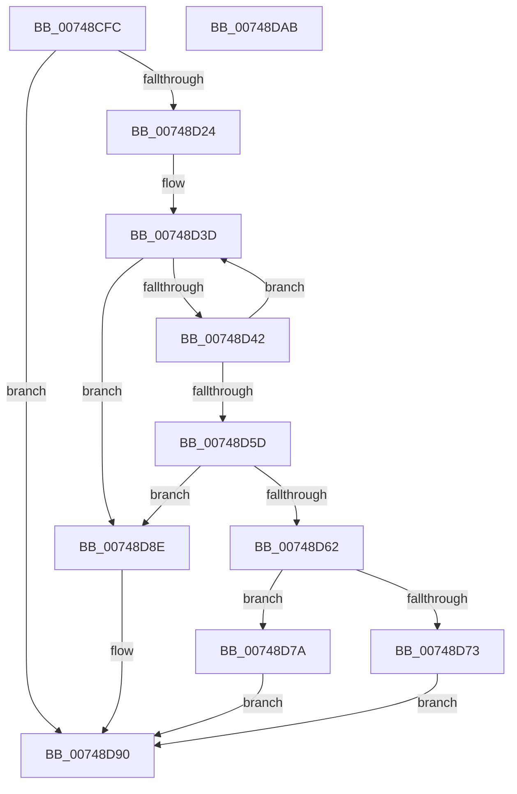

# KsepDbCacheQueryDeviceData

- RVA: `0x00748CFC`–`0x00748DAC` (길이 `176` bytes)
- VA: `0x0000000140748CFC`
- 실행 섹션: `PAGE`
- PDB 이름 있음: `예`; PDB Function 태그: `아니요`
- unwind 정보 RVA: `0x00084C9C`
- 디코드: `57`개 명령, `176/176` bytes 표시
- 미해석 바이트: `0` (있으면 어셈블리에 `.byte`로 보존)

> 이 문서는 커널 이미지의 기계어와 PDB 기호를 분석해 생성했습니다. 4번과 5번은 함수 원형과 자료형을 바이너리 사용 방식에서 추정한 C 해석이며 원본 소스 복구 결과는 아닙니다.

## 1. Dependencies

- 직접 호출 지점: **3**; 고유 호출 대상: **3**
- 직접 호출자로 확인된 함수: **2**
- RIP 상대 이미지 참조: **0**

### Outgoing calls
- `0x00748D38` → [RtlInitUnicodeString](../../text/42/RtlInitUnicodeString_function_0042A780.md) (function, `0x0042A780`)
- `0x00748D54` → [RtlEqualUnicodeString](../93/RtlEqualUnicodeString_function_00932A20.md) (function, `0x00932A20`)
- `0x00748D87` → [memcpy](../../text/6C/memcpy_function_006C6840.md) (function, `0x006C6840`)

### Direct callers
- [KsepDbCacheQueryDevice](../95/KsepDbCacheQueryDevice_function_00959D20.md) at `0x00959DD7`
- [KseQueryDeviceData](../95/KseQueryDeviceData_function_0095AFB0.md) at `0x0095B0C4`

### Static image references
- 디코드된 RIP-relative 메모리 참조가 없습니다.

## 2. Other-region calls and transfers

- 다른 실행 섹션으로 향하는 call: **2**
  - `0x00748D38` → [RtlInitUnicodeString](../../text/42/RtlInitUnicodeString_function_0042A780.md) (`PAGE` → `.text`)
  - `0x00748D87` → [memcpy](../../text/6C/memcpy_function_006C6840.md) (`PAGE` → `.text`)
- 별도 외부 분기/꼬리 이동을 확인하지 못했습니다.

## 3. Assembly (complete function range)

```asm
00748CFC  48 8B C4                        mov rax, rsp
00748CFF  48 89 58 08                     mov qword ptr [rax + 8], rbx
00748D03  48 89 68 10                     mov qword ptr [rax + 0x10], rbp
00748D07  48 89 70 18                     mov qword ptr [rax + 0x18], rsi
00748D0B  57                              push rdi
00748D0C  41 56                           push r14
00748D0E  41 57                           push r15
00748D10  48 83 EC 30                     sub rsp, 0x30
00748D14  49 8B F1                        mov rsi, r9
00748D17  49 8B E8                        mov rbp, r8
00748D1A  BF 25 02 00 C0                  mov edi, 0xc0000225
00748D1F  48 85 C9                        test rcx, rcx
00748D22  74 6C                           je 0x140748d90
00748D24  4C 8D 79 38                     lea r15, [rcx + 0x38]
00748D28  0F 57 C0                        xorps xmm0, xmm0
00748D2B  4D 8B 37                        mov r14, qword ptr [r15]
00748D2E  48 8D 48 D8                     lea rcx, [rax - 0x28]
00748D32  33 FF                           xor edi, edi
00748D34  0F 11 40 D8                     movups xmmword ptr [rax - 0x28], xmm0
00748D38  E8 43 1A CE FF                  call 0x14042a780
00748D3D  4D 3B F7                        cmp r14, r15
00748D40  74 4C                           je 0x140748d8e
00748D42  49 8B DE                        mov rbx, r14
00748D45  48 8D 54 24 20                  lea rdx, [rsp + 0x20]
00748D4A  4D 8B 36                        mov r14, qword ptr [r14]
00748D4D  41 B0 01                        mov r8b, 1
00748D50  48 8D 4B 10                     lea rcx, [rbx + 0x10]
00748D54  E8 C7 9C 1E 00                  call 0x140932a20
00748D59  84 C0                           test al, al
00748D5B  74 E0                           je 0x140748d3d
00748D5D  48 85 DB                        test rbx, rbx
00748D60  74 2C                           je 0x140748d8e
00748D62  8B 43 24                        mov eax, dword ptr [rbx + 0x24]
00748D65  89 45 00                        mov dword ptr [rbp], eax
00748D68  8B 0E                           mov ecx, dword ptr [rsi]
00748D6A  8B 43 20                        mov eax, dword ptr [rbx + 0x20]
00748D6D  89 06                           mov dword ptr [rsi], eax
00748D6F  3B C8                           cmp ecx, eax
00748D71  73 07                           jae 0x140748d7a
00748D73  BF 23 00 00 C0                  mov edi, 0xc0000023
00748D78  EB 16                           jmp 0x140748d90
00748D7A  44 8B 43 20                     mov r8d, dword ptr [rbx + 0x20]
00748D7E  48 8B 53 28                     mov rdx, qword ptr [rbx + 0x28]
00748D82  48 8B 4C 24 70                  mov rcx, qword ptr [rsp + 0x70]
00748D87  E8 B4 DA F7 FF                  call 0x1406c6840
00748D8C  EB 02                           jmp 0x140748d90
00748D8E  21 3E                           and dword ptr [rsi], edi
00748D90  48 8B 5C 24 50                  mov rbx, qword ptr [rsp + 0x50]
00748D95  8B C7                           mov eax, edi
00748D97  48 8B 6C 24 58                  mov rbp, qword ptr [rsp + 0x58]
00748D9C  48 8B 74 24 60                  mov rsi, qword ptr [rsp + 0x60]
00748DA1  48 83 C4 30                     add rsp, 0x30
00748DA5  41 5F                           pop r15
00748DA7  41 5E                           pop r14
00748DA9  5F                              pop rdi
00748DAA  C3                              ret
00748DAB  CC                              int3
```

## 4. C-style interpretation (structured pseudocode)

```c
__int64 __fastcall KsepDbCacheQueryDeviceData(__int64 a1, __int64 a2, __int64 a3, __int64 a4, __int64 a5)
{
    __int64 result;
    __int64 v_rdi;
    __int64 v_rsp;
    unsigned __int64 v_stack_m28;
    unsigned __int64 v_stack_p10;
    unsigned __int64 v_stack_p18;
    unsigned __int64 v_stack_p8;

    *(unsigned __int64 *)(v_rsp + 8) = v_rbx;
    *(unsigned __int64 *)(v_rsp + 16) = v_rbp;
    *(unsigned __int64 *)(v_rsp + 24) = v_rsi;
    v_rsp = (v_rsp) - (48);
    if (a1 == 0) goto loc_00748D90;
    v_rdi = 0;
    *(unsigned __int64 *)(v_rsp - 40) = v_xmm0;
    result = RtlInitUnicodeString(v_rsp - 40, a2, a3, a4);
loc_00748D3D:
    if ((*(unsigned __int64 *)(a1 + 56)) == (a1 + 56)) goto loc_00748D8E;
    result = RtlEqualUnicodeString(*(unsigned __int64 *)(a1 + 56) + 16, v_stack_m28, 1, a4);
    if ((unsigned __int8)(result) == 0) goto loc_00748D3D;
    if (*(unsigned __int64 *)(a1 + 56) == 0) goto loc_00748D8E;
    *(unsigned int *)(a3) = (unsigned int)((unsigned int)(*(unsigned int *)(*(unsigned __int64 *)(a1 + 56) + 36)));
    *(unsigned int *)(a4) = (unsigned int)((unsigned int)(*(unsigned int *)(*(unsigned __int64 *)(a1 + 56) + 32)));
    if (((unsigned int)((unsigned int)(*(unsigned int *)(a4)))) >= ((unsigned int)((unsigned int)(*(unsigned int *)(*(unsigned __int64 *)(a1 + 56) + 32))))) goto loc_00748D7A;
    goto loc_00748D90;
loc_00748D7A:
    result = memcpy(a5, *(unsigned __int64 *)(*(unsigned __int64 *)(a1 + 56) + 40), (unsigned int)(*(unsigned int *)(*(unsigned __int64 *)(a1 + 56) + 32)), a4);
    goto loc_00748D90;
loc_00748D8E:
loc_00748D90:
    v_rsp = (v_rsp) + (48);
    return (unsigned int)((unsigned int)((unsigned int)(0xC0000023ULL)));
}
```

## 5. (Beta) C Style

```c
int64_t KsepDbCacheQueryDeviceData(int64_t Arg1, int64_t Arg2, void *Arg3, void *Arg4, int64_t Arg5)
{
    uint8_t *arg3 = (uint8_t *)Arg3;
    uint8_t *arg4 = (uint8_t *)Arg4;

    int64_t result;
    int64_t local_rdi;
    int64_t local_rsp;
    uint64_t v_stack_m28;
    uint64_t v_stack_p10;
    uint64_t v_stack_p18;
    uint64_t v_stack_p8;

    *(uint64_t *)(local_rsp + 0x8) = local_rbx;
    *(uint64_t *)(local_rsp + 0x10) = local_rbp;
    *(uint64_t *)(local_rsp + 0x18) = local_rsi;
    local_rsp = (local_rsp) - (48);
    if (Arg1 == 0) goto loc_00748D90;
    local_rdi = 0;
    *(uint64_t *)(local_rsp - 0x28) = v_xmm0;
    result = RtlInitUnicodeString(local_rsp - 40, Arg2, Arg3, Arg4);
loc_00748D3D:
    if ((*(uint64_t *)(Arg1 + 0x38)) == (Arg1 + 56)) goto loc_00748D8E;
    result = RtlEqualUnicodeString(*(uint64_t *)(Arg1 + 0x38) + 16, v_stack_m28, 1, Arg4);
    if ((uint8_t)(result) == 0) goto loc_00748D3D;
    if (*(uint64_t *)(Arg1 + 0x38) == 0) goto loc_00748D8E;
    *(uint32_t *)(arg3) = (uint32_t)((uint32_t)(*(uint32_t *)(*(uint64_t *)(Arg1 + 0x38) + 0x24)));
    *(uint32_t *)(arg4) = (uint32_t)((uint32_t)(*(uint32_t *)(*(uint64_t *)(Arg1 + 0x38) + 0x20)));
    if (((uint32_t)((uint32_t)(*(uint32_t *)(arg4)))) >= ((uint32_t)((uint32_t)(*(uint32_t *)(*(uint64_t *)(Arg1 + 0x38) + 0x20))))) goto loc_00748D7A;
    goto loc_00748D90;
loc_00748D7A:
    result = memcpy(Arg5, *(uint64_t *)(*(uint64_t *)(Arg1 + 0x38) + 0x28), (uint32_t)(*(uint32_t *)(*(uint64_t *)(Arg1 + 0x38) + 0x20)), Arg4);
    goto loc_00748D90;
loc_00748D8E:
loc_00748D90:
    local_rsp = (local_rsp) + (48);
    return (uint32_t)((uint32_t)((uint32_t)(0xC0000023ULL)));
}
```

### 관측된 메모리 오프셋

구조체 형식이 확인되지 않은 접근은 인자 기준의 오프셋으로만 기록했습니다.

| 기준 인자 | 오프셋 표현 | 폭 (bit) | 접근 |
|---|---:|---:|---|
| `Arg3` | `+ 0x0` | `32` | `W` |
| `Arg4` | `+ 0x0` | `32` | `R` |
| `Arg4` | `+ 0x0` | `32` | `R/W` |
| `Arg4` | `+ 0x0` | `32` | `W` |

## 6. Execution-region graph

[열기: 2D/3D 그래프와 함수 탐색 컨트롤 패널](../../../control-panel.html?section=page&rva=0x00748CFC&view=graph)

- 2D 그래프는 위에서 아래로 흐르고, 3D 그래프는 빈 공간을 드래그해 회전합니다. Shift+드래그는 이동, 휠은 확대·축소, 함수 노드 선택은 대상 보고서 이동입니다.

### Static fallback


