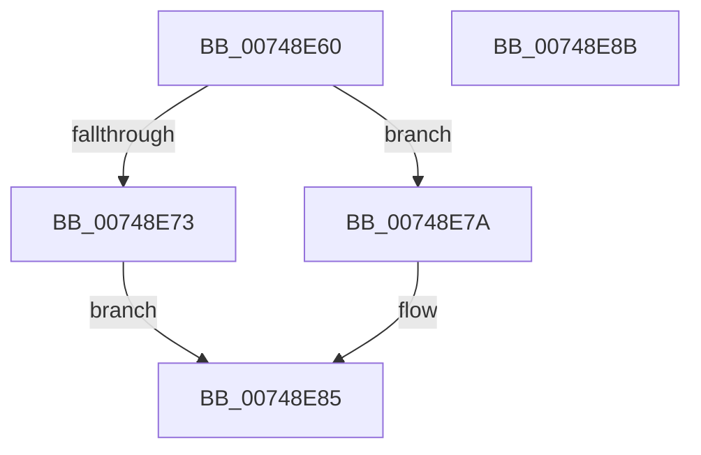

# KsepDbGetSdbString

- RVA: `0x00748E60`–`0x00748E8C` (길이 `44` bytes)
- VA: `0x0000000140748E60`
- 실행 섹션: `PAGE`
- PDB 이름 있음: `예`; PDB Function 태그: `아니요`
- unwind 정보 RVA: `0x0005CF00`
- 디코드: `15`개 명령, `44/44` bytes 표시
- 미해석 바이트: `0` (있으면 어셈블리에 `.byte`로 보존)

> 이 문서는 커널 이미지의 기계어와 PDB 기호를 분석해 생성했습니다. 4번과 5번은 함수 원형과 자료형을 바이너리 사용 방식에서 추정한 C 해석이며 원본 소스 복구 결과는 아닙니다.

## 1. Dependencies

- 직접 호출 지점: **2**; 고유 호출 대상: **2**
- 직접 호출자로 확인된 함수: **2**
- RIP 상대 이미지 참조: **0**

### Outgoing calls
- `0x00748E69` → [SdbGetStringTagPtr](../95/SdbGetStringTagPtr_function_0095DDA8.md) (function, `0x0095DDA8`)
- `0x00748E80` → [KsepStringDuplicate](../95/KsepStringDuplicate_function_0095B454.md) (function, `0x0095B454`)

### Direct callers
- [KsepDbGetShimInfo](KsepDbGetShimInfo_function_00748E94.md) at `0x00748FE3`
- [KsepDbGetDriverShimsInternal](../95/KsepDbGetDriverShimsInternal_function_009597C4.md) at `0x0095994D`
- [KsepDbGetDriverShimsInternal](../95/KsepDbGetDriverShimsInternal_function_009597C4.md) at `0x00959987`
- [KsepDbGetDriverShimsInternal](../95/KsepDbGetDriverShimsInternal_function_009597C4.md) at `0x009599F0`

### Static image references
- 디코드된 RIP-relative 메모리 참조가 없습니다.

## 2. Other-region calls and transfers

- 다른 실행 섹션으로 향하는 call: **0**
- 별도 외부 분기/꼬리 이동을 확인하지 못했습니다.

## 3. Assembly (complete function range)

```asm
00748E60  40 53                           push rbx
00748E62  48 83 EC 20                     sub rsp, 0x20
00748E66  49 8B D8                        mov rbx, r8
00748E69  E8 3A 4F 21 00                  call 0x14095dda8
00748E6E  48 85 C0                        test rax, rax
00748E71  75 07                           jne 0x140748e7a
00748E73  B8 0D 00 00 C0                  mov eax, 0xc000000d
00748E78  EB 0B                           jmp 0x140748e85
00748E7A  48 8B D0                        mov rdx, rax
00748E7D  48 8B CB                        mov rcx, rbx
00748E80  E8 CF 25 21 00                  call 0x14095b454
00748E85  48 83 C4 20                     add rsp, 0x20
00748E89  5B                              pop rbx
00748E8A  C3                              ret
00748E8B  CC                              int3
```

## 4. C-style interpretation (structured pseudocode)

```c
__int64 __fastcall KsepDbGetSdbString(__int64 a1, __int64 a2, __int64 a3)
{
    __int64 result;
    __int64 v_rsp;

    v_rsp = (v_rsp) - (32);
    result = SdbGetStringTagPtr(a1, a2, a3, a4);
    if (result != 0) goto loc_00748E7A;
    goto loc_00748E85;
loc_00748E7A:
    result = KsepStringDuplicate(a3, (unsigned int)(0xC000000DULL), a3, a4);
loc_00748E85:
    v_rsp = (v_rsp) + (32);
    return result;
}
```

## 5. (Beta) C Style

```c
int64_t KsepDbGetSdbString(int64_t Arg1, int64_t Arg2, int64_t Arg3)
{
    int64_t result;
    int64_t local_rsp;

    local_rsp = (local_rsp) - (32);
    result = SdbGetStringTagPtr(Arg1, Arg2, Arg3, a4);
    if (result != 0) goto loc_00748E7A;
    goto loc_00748E85;
loc_00748E7A:
    result = KsepStringDuplicate(Arg3, (uint32_t)(0xC000000DULL), Arg3, a4);
loc_00748E85:
    local_rsp = (local_rsp) + (32);
    return result;
}
```

## 6. Execution-region graph

[열기: 2D/3D 그래프와 함수 탐색 컨트롤 패널](../../../control-panel.html?section=page&rva=0x00748E60&view=graph)

- 2D 그래프는 위에서 아래로 흐르고, 3D 그래프는 빈 공간을 드래그해 회전합니다. Shift+드래그는 이동, 휠은 확대·축소, 함수 노드 선택은 대상 보고서 이동입니다.

### Static fallback


