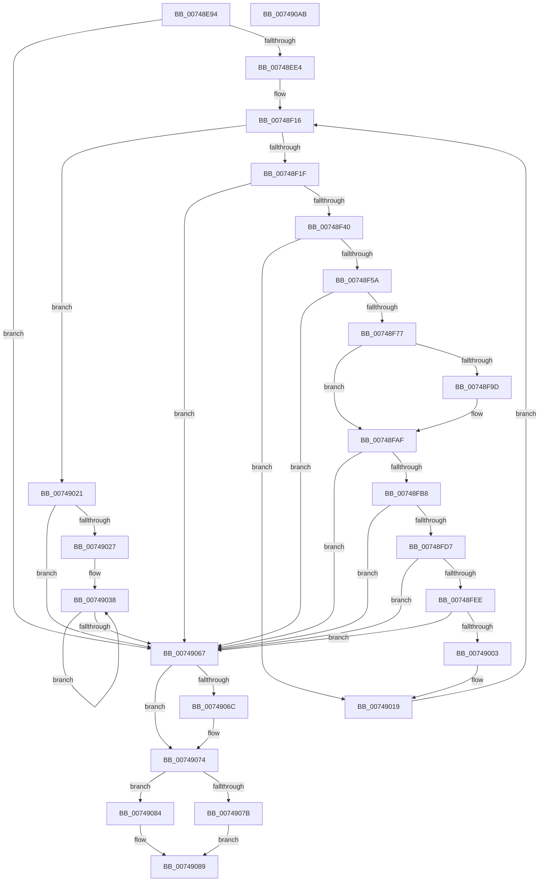

# KsepDbGetShimInfo

- RVA: `0x00748E94`–`0x007490AC` (길이 `536` bytes)
- VA: `0x0000000140748E94`
- 실행 섹션: `PAGE`
- PDB 이름 있음: `예`; PDB Function 태그: `아니요`
- unwind 정보 RVA: `0x000CB3B8`
- 디코드: `149`개 명령, `536/536` bytes 표시
- 미해석 바이트: `0` (있으면 어셈블리에 `.byte`로 보존)

> 이 문서는 커널 이미지의 기계어와 PDB 기호를 분석해 생성했습니다. 4번과 5번은 함수 원형과 자료형을 바이너리 사용 방식에서 추정한 C 해석이며 원본 소스 복구 결과는 아닙니다.

## 1. Dependencies

- 직접 호출 지점: **13**; 고유 호출 대상: **11**
- 직접 호출자로 확인된 함수: **1**
- RIP 상대 이미지 참조: **0**

### Outgoing calls
- `0x00748ED1` → [KseShimDatabaseOpen](../95/KseShimDatabaseOpen_function_0095AD7C.md) (function, `0x0095AD7C`)
- `0x00748EEC` → [KsepPoolAllocatePaged](../../text/4A/KsepPoolAllocatePaged_function_004A9EFC.md) (function, `0x004A9EFC`)
- `0x00748F33` → [SdbGetKShimTagRef](../81/SdbGetKShimTagRef_function_00813564.md) (function, `0x00813564`)
- `0x00748F4D` → [SdbTagRefToTagID](../81/SdbTagRefToTagID_function_0081717C.md) (function, `0x0081717C`)
- `0x00748F6A` → [SdbFindFirstTag](../95/SdbFindFirstTag_function_0095E34C.md) (function, `0x0095E34C`)
- `0x00748F8A` → [SdbReadGUIDTag](../81/SdbReadGUIDTag_function_00817000.md) (function, `0x00817000`)
- `0x00748FCA` → [SdbFindFirstTag](../95/SdbFindFirstTag_function_0095E34C.md) (function, `0x0095E34C`)
- `0x00748FE3` → [KsepDbGetSdbString](KsepDbGetSdbString_function_00748E60.md) (function, `0x00748E60`)
- `0x00748FFA` → [SdbFindFirstTag](../95/SdbFindFirstTag_function_0095E34C.md) (function, `0x0095E34C`)
- `0x0074900B` → [SdbReadDWORDTag](../95/SdbReadDWORDTag_function_0095D408.md) (function, `0x0095D408`)
- `0x0074906F` → [KseShimDatabaseClose](../95/KseShimDatabaseClose_function_0095ABCC.md) (function, `0x0095ABCC`)
- `0x0074907D` → [KsepDbFreeDriverShims](../95/KsepDbFreeDriverShims_function_00958754.md) (function, `0x00958754`)
- `0x00749084` → [KsepPoolFreePaged](../../text/4B/KsepPoolFreePaged_function_004B0E10.md) (function, `0x004B0E10`)

### Direct callers
- [sub_00B27464](../B2/Unknown_function_00B27464.md) at `0x00B2749D`

### Static image references
- 디코드된 RIP-relative 메모리 참조가 없습니다.

## 2. Other-region calls and transfers

- 다른 실행 섹션으로 향하는 call: **2**
  - `0x00748EEC` → [KsepPoolAllocatePaged](../../text/4A/KsepPoolAllocatePaged_function_004A9EFC.md) (`PAGE` → `.text`)
  - `0x00749084` → [KsepPoolFreePaged](../../text/4B/KsepPoolFreePaged_function_004B0E10.md) (`PAGE` → `.text`)
- 별도 외부 분기/꼬리 이동을 확인하지 못했습니다.

## 3. Assembly (complete function range)

```asm
00748E94  48 8B C4                        mov rax, rsp
00748E97  48 89 58 18                     mov qword ptr [rax + 0x18], rbx
00748E9B  55                              push rbp
00748E9C  56                              push rsi
00748E9D  57                              push rdi
00748E9E  41 54                           push r12
00748EA0  41 55                           push r13
00748EA2  41 56                           push r14
00748EA4  41 57                           push r15
00748EA6  48 8D 68 A1                     lea rbp, [rax - 0x5f]
00748EAA  48 81 EC 90 00 00 00            sub rsp, 0x90
00748EB1  0F 29 70 B8                     movaps xmmword ptr [rax - 0x48], xmm6
00748EB5  33 C0                           xor eax, eax
00748EB7  48 89 4D DF                     mov qword ptr [rbp - 0x21], rcx
00748EBB  8B F8                           mov edi, eax
00748EBD  48 8D 4D C7                     lea rcx, [rbp - 0x39]
00748EC1  89 45 B7                        mov dword ptr [rbp - 0x49], eax
00748EC4  48 89 45 D7                     mov qword ptr [rbp - 0x29], rax
00748EC8  0F 57 F6                        xorps xmm6, xmm6
00748ECB  48 89 45 C7                     mov qword ptr [rbp - 0x39], rax
00748ECF  8B F2                           mov esi, edx
00748ED1  E8 A6 1E 21 00                  call 0x14095ad7c
00748ED6  4C 8B 6D C7                     mov r13, qword ptr [rbp - 0x39]
00748EDA  8B D8                           mov ebx, eax
00748EDC  85 C0                           test eax, eax
00748EDE  0F 88 83 01 00 00               js 0x140749067
00748EE4  48 8D 0C B6                     lea rcx, [rsi + rsi*4]
00748EE8  48 C1 E1 04                     shl rcx, 4
00748EEC  E8 0B 10 D6 FF                  call 0x1404a9efc
00748EF1  4D 8B 75 00                     mov r14, qword ptr [r13]
00748EF5  0F 57 C0                        xorps xmm0, xmm0
00748EF8  66 0F 73 D8 08                  psrldq xmm0, 8
00748EFD  48 8B F8                        mov rdi, rax
00748F00  66 0F D6 45 E7                  movq qword ptr [rbp - 0x19], xmm0
00748F05  BB 25 02 00 C0                  mov ebx, 0xc0000225
00748F0A  4C 89 75 EF                     mov qword ptr [rbp - 0x11], r14
00748F0E  45 33 E4                        xor r12d, r12d
00748F11  66 0F D6 75 C7                  movq qword ptr [rbp - 0x39], xmm6
00748F16  44 3B E6                        cmp r12d, esi
00748F19  0F 83 02 01 00 00               jae 0x140749021
00748F1F  48 8B 45 DF                     mov rax, qword ptr [rbp - 0x21]
00748F23  4F 8D 3C A4                     lea r15, [r12 + r12*4]
00748F27  49 C1 E7 04                     shl r15, 4
00748F2B  49 8B CE                        mov rcx, r14
00748F2E  49 8B 54 07 18                  mov rdx, qword ptr [r15 + rax + 0x18]
00748F33  E8 2C A6 0C 00                  call 0x140813564
00748F38  85 C0                           test eax, eax
00748F3A  0F 84 27 01 00 00               je 0x140749067
00748F40  4C 8D 4D B7                     lea r9, [rbp - 0x49]
00748F44  8B D0                           mov edx, eax
00748F46  4C 8D 45 D7                     lea r8, [rbp - 0x29]
00748F4A  49 8B CE                        mov rcx, r14
00748F4D  E8 2A E2 0C 00                  call 0x14081717c
00748F52  85 C0                           test eax, eax
00748F54  0F 84 BF 00 00 00               je 0x140749019
00748F5A  4C 8B 75 D7                     mov r14, qword ptr [rbp - 0x29]
00748F5E  41 B8 10 90 00 00               mov r8d, 0x9010
00748F64  8B 55 B7                        mov edx, dword ptr [rbp - 0x49]
00748F67  49 8B CE                        mov rcx, r14
00748F6A  E8 DD 53 21 00                  call 0x14095e34c
00748F6F  85 C0                           test eax, eax
00748F71  0F 84 F0 00 00 00               je 0x140749067
00748F77  4C 8D 4D F7                     lea r9, [rbp - 9]
00748F7B  66 0F 7F 75 F7                  movdqa xmmword ptr [rbp - 9], xmm6
00748F80  44 8B C0                        mov r8d, eax
00748F83  48 8D 4D 07                     lea rcx, [rbp + 7]
00748F87  49 8B D6                        mov rdx, r14
00748F8A  E8 71 E0 0C 00                  call 0x140817000
00748F8F  0F 10 08                        movups xmm1, xmmword ptr [rax]
00748F92  66 48 0F 7E C8                  movq rax, xmm1
00748F97  48 2B 45 C7                     sub rax, qword ptr [rbp - 0x39]
00748F9B  75 12                           jne 0x140748faf
00748F9D  66 0F 6F C1                     movdqa xmm0, xmm1
00748FA1  66 0F 73 D8 08                  psrldq xmm0, 8
00748FA6  66 48 0F 7E C0                  movq rax, xmm0
00748FAB  48 2B 45 E7                     sub rax, qword ptr [rbp - 0x19]
00748FAF  48 85 C0                        test rax, rax
00748FB2  0F 84 AF 00 00 00               je 0x140749067
00748FB8  8B 55 B7                        mov edx, dword ptr [rbp - 0x49]
00748FBB  41 B8 03 60 00 00               mov r8d, 0x6003
00748FC1  49 8B CE                        mov rcx, r14
00748FC4  F3 41 0F 7F 0C 3F               movdqu xmmword ptr [r15 + rdi], xmm1
00748FCA  E8 7D 53 21 00                  call 0x14095e34c
00748FCF  85 C0                           test eax, eax
00748FD1  0F 84 90 00 00 00               je 0x140749067
00748FD7  4C 8D 47 20                     lea r8, [rdi + 0x20]
00748FDB  8B D0                           mov edx, eax
00748FDD  4D 03 C7                        add r8, r15
00748FE0  49 8B CE                        mov rcx, r14
00748FE3  E8 78 FE FF FF                  call 0x140748e60
00748FE8  8B D8                           mov ebx, eax
00748FEA  85 C0                           test eax, eax
00748FEC  78 79                           js 0x140749067
00748FEE  8B 55 B7                        mov edx, dword ptr [rbp - 0x49]
00748FF1  41 B8 17 40 00 00               mov r8d, 0x4017
00748FF7  49 8B CE                        mov rcx, r14
00748FFA  E8 4D 53 21 00                  call 0x14095e34c
00748FFF  85 C0                           test eax, eax
00749001  74 64                           je 0x140749067
00749003  45 33 C0                        xor r8d, r8d
00749006  8B D0                           mov edx, eax
00749008  49 8B CE                        mov rcx, r14
0074900B  E8 F8 43 21 00                  call 0x14095d408
00749010  4C 8B 75 EF                     mov r14, qword ptr [rbp - 0x11]
00749014  41 89 44 3F 40                  mov dword ptr [r15 + rdi + 0x40], eax
00749019  41 FF C4                        inc r12d
0074901C  E9 F5 FE FF FF                  jmp 0x140748f16
00749021  33 DB                           xor ebx, ebx
00749023  85 F6                           test esi, esi
00749025  74 40                           je 0x140749067
00749027  4C 8B 7D DF                     mov r15, qword ptr [rbp - 0x21]
0074902B  4C 8B CF                        mov r9, rdi
0074902E  4D 2B CF                        sub r9, r15
00749031  4C 8B F6                        mov r14, rsi
00749034  4D 8D 47 40                     lea r8, [r15 + 0x40]
00749038  43 8B 04 01                     mov eax, dword ptr [r9 + r8]
0074903C  41 89 00                        mov dword ptr [r8], eax
0074903F  43 0F 10 44 01 E0               movups xmm0, xmmword ptr [r9 + r8 - 0x20]
00749045  4D 8D 40 50                     lea r8, [r8 + 0x50]
00749049  F3 41 0F 7F 40 90               movdqu xmmword ptr [r8 - 0x70], xmm0
0074904F  43 0F 10 8C 01 70 FF FF FF      movups xmm1, xmmword ptr [r9 + r8 - 0x90]
00749058  F3 41 0F 7F 88 70 FF FF FF      movdqu xmmword ptr [r8 - 0x90], xmm1
00749061  49 83 EE 01                     sub r14, 1
00749065  75 D1                           jne 0x140749038
00749067  4D 85 ED                        test r13, r13
0074906A  74 08                           je 0x140749074
0074906C  49 8B CD                        mov rcx, r13
0074906F  E8 58 1B 21 00                  call 0x14095abcc
00749074  48 8B CF                        mov rcx, rdi
00749077  85 DB                           test ebx, ebx
00749079  79 09                           jns 0x140749084
0074907B  8B D6                           mov edx, esi
0074907D  E8 D2 F6 20 00                  call 0x140958754
00749082  EB 05                           jmp 0x140749089
00749084  E8 87 7D D6 FF                  call 0x1404b0e10
00749089  4C 8D 9C 24 90 00 00 00         lea r11, [rsp + 0x90]
00749091  8B C3                           mov eax, ebx
00749093  49 8B 5B 50                     mov rbx, qword ptr [r11 + 0x50]
00749097  41 0F 28 73 F0                  movaps xmm6, xmmword ptr [r11 - 0x10]
0074909C  49 8B E3                        mov rsp, r11
0074909F  41 5F                           pop r15
007490A1  41 5E                           pop r14
007490A3  41 5D                           pop r13
007490A5  41 5C                           pop r12
007490A7  5F                              pop rdi
007490A8  5E                              pop rsi
007490A9  5D                              pop rbp
007490AA  C3                              ret
007490AB  CC                              int3
```

## 4. C-style interpretation (structured pseudocode)

```c
__int64 __fastcall KsepDbGetShimInfo(__int64 a1, int a2)
{
    __int64 result;
    __int64 v_r12;
    __int64 v_r14;
    __int64 v_r15;
    __int64 v_rbx;
    __int64 v_rsp;
    unsigned __int64 v_stack_m38;

    *(unsigned __int64 *)(v_rsp + 24) = v_rbx;
    v_rsp = (v_rsp) - (144);
    *(unsigned __int64 *)(v_rsp - 72) = v_xmm6;
    result = 0;
    *(unsigned __int64 *)(v_rsp - 95 - 33) = a1;
    *(unsigned int *)(v_rsp - 95 - 73) = 0;
    *(unsigned __int64 *)(v_rsp - 95 - 41) = 0;
    *(unsigned __int64 *)(v_rsp - 95 - 57) = 0;
    result = KseShimDatabaseOpen(v_rsp - 95 - 57, a2, a3, a4);
    if (sign_flag) goto loc_00749067;
    a1 = ((unsigned int)(a2) + (unsigned int)(a2) * 4) << (4);
    result = KsepPoolAllocatePaged(a1, a2, a3, a4);
    *(unsigned __int64 *)(v_rsp - 95 - 25) = v_xmm0;
    *(unsigned __int64 *)(v_rsp - 95 - 17) = *(unsigned __int64 *)(*(unsigned __int64 *)(v_rsp - 95 - 57));
    v_r12 = 0;
    *(unsigned __int64 *)(v_rsp - 95 - 57) = v_xmm6;
loc_00748F16:
    if (0 >= ((unsigned int)((unsigned int)(a2)))) goto loc_00749021;
    v_r15 = (v_r12 + v_r12 * 4) << (4);
    result = SdbGetKShimTagRef(*(unsigned __int64 *)(*(unsigned __int64 *)(v_rsp - 95 - 57)), *(unsigned __int64 *)(v_r15 + *(unsigned __int64 *)(v_rsp - 95 - 33) * 1 + 24), a3, a4);
    if ((unsigned int)(result) == 0) goto loc_00749067;
    result = SdbTagRefToTagID(*(unsigned __int64 *)(*(unsigned __int64 *)(v_rsp - 95 - 57)), (unsigned int)((unsigned int)(result)), v_rsp - 95 - 41, v_rsp - 95 - 73);
    if ((unsigned int)(result) == 0) goto loc_00749019;
    result = SdbFindFirstTag(*(unsigned __int64 *)(v_rsp - 95 - 41), (unsigned int)(*(unsigned int *)(v_rsp - 95 - 73)), (unsigned int)(0x9010ULL), v_rsp - 95 - 73);
    if ((unsigned int)(result) == 0) goto loc_00749067;
    *(unsigned __int64 *)(v_rsp - 95 - 9) = v_xmm6;
    result = SdbReadGUIDTag(v_rsp - 95 + 7, *(unsigned __int64 *)(v_rsp - 95 - 41), (unsigned int)((unsigned int)(result)), v_rsp - 95 - 9);
    result = (result) - (*(unsigned __int64 *)(v_rsp - 95 - 57));
    if (!(condition_is_not_equal)) {
        result = (result) - (*(unsigned __int64 *)(v_rsp - 95 - 25));
    }
    if (result == 0) goto loc_00749067;
    *(unsigned __int64 *)(v_r15 + result * 1) = v_xmm1;
    result = SdbFindFirstTag(*(unsigned __int64 *)(v_rsp - 95 - 41), (unsigned int)(*(unsigned int *)(v_rsp - 95 - 73)), (unsigned int)(0x6003ULL), v_rsp - 95 - 9);
    if ((unsigned int)(result) == 0) goto loc_00749067;
    a3 = (result + 32) + (v_r15);
    result = KsepDbGetSdbString(*(unsigned __int64 *)(v_rsp - 95 - 41), (unsigned int)((unsigned int)(result)), a3, v_rsp - 95 - 9);
    if (sign_flag) goto loc_00749067;
    result = SdbFindFirstTag(*(unsigned __int64 *)(v_rsp - 95 - 41), (unsigned int)(*(unsigned int *)(v_rsp - 95 - 73)), (unsigned int)(0x4017ULL), v_rsp - 95 - 9);
    if ((unsigned int)(result) == 0) goto loc_00749067;
    a3 = 0;
    result = SdbReadDWORDTag(*(unsigned __int64 *)(v_rsp - 95 - 41), (unsigned int)((unsigned int)(result)), a3, v_rsp - 95 - 9);
    *(unsigned int *)(v_r15 + result * 1 + 64) = (unsigned int)(result);
loc_00749019:
    v_r12 = (unsigned int)((v_r12) + 1);
    goto loc_00748F16;
loc_00749021:
    v_rbx = 0;
    if ((unsigned int)((unsigned int)(a2)) == 0) goto loc_00749067;
    a4 = (result) - (*(unsigned __int64 *)(v_rsp - 95 - 33));
loc_00749038:
    *(unsigned int *)(*(unsigned __int64 *)(v_rsp - 95 - 33) + 64) = (unsigned int)((unsigned int)(*(unsigned int *)(a4 + *(unsigned __int64 *)(v_rsp - 95 - 33) + 64 * 1)));
    *(unsigned __int64 *)(*(unsigned __int64 *)(v_rsp - 95 - 33) + 64 + 80 - 112) = v_xmm0;
    *(unsigned __int64 *)(*(unsigned __int64 *)(v_rsp - 95 - 33) + 64 + 80 - 144) = v_xmm1;
    v_r14 = ((unsigned int)(a2)) - (1);
    if (condition_is_not_equal) goto loc_00749038;
loc_00749067:
    result = (unsigned int)(*(unsigned int *)(a4 + *(unsigned __int64 *)(v_rsp - 95 - 33) + 64 * 1));
    if (*(unsigned __int64 *)(v_rsp - 95 - 57) != 0) {
        a1 = *(unsigned __int64 *)(v_rsp - 95 - 57);
        result = KseShimDatabaseClose(a1, (unsigned int)((unsigned int)(result)), *(unsigned __int64 *)(v_rsp - 95 - 33) + 64 + 80, a4);
    }
    if (!sign_flag) goto loc_00749084;
    result = KsepDbFreeDriverShims(result, (unsigned int)((unsigned int)((unsigned int)(a2))), *(unsigned __int64 *)(v_rsp - 95 - 33) + 64 + 80, a4);
    goto loc_00749089;
loc_00749084:
    result = KsepPoolFreePaged(result, (unsigned int)((unsigned int)((unsigned int)(a2))), *(unsigned __int64 *)(v_rsp - 95 - 33) + 64 + 80, a4);
loc_00749089:
    return 0;
}
```

## 5. (Beta) C Style

```c
int64_t KsepDbGetShimInfo(int64_t Arg1, void *Arg2)
{
    uint8_t *arg2 = (uint8_t *)Arg2;

    int64_t result;
    int64_t local_r12;
    int64_t local_r14;
    int64_t local_r15;
    int64_t local_rbx;
    int64_t local_rsp;
    uint64_t v_stack_m38;

    *(uint64_t *)(local_rsp + 0x18) = local_rbx;
    local_rsp = (local_rsp) - (144);
    *(uint64_t *)(local_rsp - 0x48) = v_xmm6;
    result = 0;
    *(uint64_t *)(local_rsp - 0x5F - 0x21) = Arg1;
    *(uint32_t *)(local_rsp - 0x5F - 0x49) = 0;
    *(uint64_t *)(local_rsp - 0x5F - 0x29) = 0;
    *(uint64_t *)(local_rsp - 0x5F - 0x39) = 0;
    result = KseShimDatabaseOpen(local_rsp - 95 - 57, Arg2, a3, a4);
    if (sign_flag) goto loc_00749067;
    Arg1 = ((uint32_t)(Arg2) + (uint32_t)(Arg2) * 4) << (4);
    result = KsepPoolAllocatePaged(Arg1, Arg2, a3, a4);
    *(uint64_t *)(local_rsp - 0x5F - 0x19) = v_xmm0;
    *(uint64_t *)(local_rsp - 0x5F - 0x11) = *(uint64_t *)(*(uint64_t *)(local_rsp - 0x5F - 0x39));
    local_r12 = 0;
    *(uint64_t *)(local_rsp - 0x5F - 0x39) = v_xmm6;
loc_00748F16:
    if (0 >= ((uint32_t)((uint32_t)(Arg2)))) goto loc_00749021;
    local_r15 = (local_r12 + local_r12 * 4) << (4);
    result = SdbGetKShimTagRef(*(uint64_t *)(*(uint64_t *)(local_rsp - 0x5F - 0x39)), *(uint64_t *)(local_r15 + *(uint64_t *)(local_rsp - 0x5F - 0x21) * 1 + 0x18), a3, a4);
    if ((uint32_t)(result) == 0) goto loc_00749067;
    result = SdbTagRefToTagID(*(uint64_t *)(*(uint64_t *)(local_rsp - 0x5F - 0x39)), (uint32_t)((uint32_t)(result)), local_rsp - 95 - 41, local_rsp - 95 - 73);
    if ((uint32_t)(result) == 0) goto loc_00749019;
    result = SdbFindFirstTag(*(uint64_t *)(local_rsp - 0x5F - 0x29), (uint32_t)(*(uint32_t *)(local_rsp - 0x5F - 0x49)), (uint32_t)(0x9010ULL), local_rsp - 95 - 73);
    if ((uint32_t)(result) == 0) goto loc_00749067;
    *(uint64_t *)(local_rsp - 0x5F - 0x9) = v_xmm6;
    result = SdbReadGUIDTag(local_rsp - 95 + 7, *(uint64_t *)(local_rsp - 0x5F - 0x29), (uint32_t)((uint32_t)(result)), local_rsp - 95 - 9);
    result = (result) - (*(uint64_t *)(local_rsp - 0x5F - 0x39));
    if (!(condition_is_not_equal)) {
        result = (result) - (*(uint64_t *)(local_rsp - 0x5F - 0x19));
    }
    if (result == 0) goto loc_00749067;
    *(uint64_t *)(local_r15 + result * 1) = v_xmm1;
    result = SdbFindFirstTag(*(uint64_t *)(local_rsp - 0x5F - 0x29), (uint32_t)(*(uint32_t *)(local_rsp - 0x5F - 0x49)), (uint32_t)(0x6003ULL), local_rsp - 95 - 9);
    if ((uint32_t)(result) == 0) goto loc_00749067;
    a3 = (result + 32) + (local_r15);
    result = KsepDbGetSdbString(*(uint64_t *)(local_rsp - 0x5F - 0x29), (uint32_t)((uint32_t)(result)), a3, local_rsp - 95 - 9);
    if (sign_flag) goto loc_00749067;
    result = SdbFindFirstTag(*(uint64_t *)(local_rsp - 0x5F - 0x29), (uint32_t)(*(uint32_t *)(local_rsp - 0x5F - 0x49)), (uint32_t)(0x4017ULL), local_rsp - 95 - 9);
    if ((uint32_t)(result) == 0) goto loc_00749067;
    a3 = 0;
    result = SdbReadDWORDTag(*(uint64_t *)(local_rsp - 0x5F - 0x29), (uint32_t)((uint32_t)(result)), a3, local_rsp - 95 - 9);
    *(uint32_t *)(local_r15 + result * 1 + 0x40) = (uint32_t)(result);
loc_00749019:
    local_r12 = (uint32_t)((local_r12) + 1);
    goto loc_00748F16;
loc_00749021:
    local_rbx = 0;
    if ((uint32_t)((uint32_t)(Arg2)) == 0) goto loc_00749067;
    a4 = (result) - (*(uint64_t *)(local_rsp - 0x5F - 0x21));
loc_00749038:
    *(uint32_t *)(*(uint64_t *)(local_rsp - 0x5F - 0x21) + 0x40) = (uint32_t)((uint32_t)(*(uint32_t *)(a4 + *(uint64_t *)(local_rsp - 0x5F - 0x21) + 0x40 * 1)));
    *(uint64_t *)(*(uint64_t *)(local_rsp - 0x5F - 0x21) + 0x40 + 0x50 - 0x70) = v_xmm0;
    *(uint64_t *)(*(uint64_t *)(local_rsp - 0x5F - 0x21) + 0x40 + 0x50 - 0x90) = v_xmm1;
    local_r14 = ((uint32_t)(Arg2)) - (1);
    if (condition_is_not_equal) goto loc_00749038;
loc_00749067:
    result = (uint32_t)(*(uint32_t *)(a4 + *(uint64_t *)(local_rsp - 0x5F - 0x21) + 0x40 * 1));
    if (*(uint64_t *)(local_rsp - 0x5F - 0x39) != 0) {
        Arg1 = *(uint64_t *)(local_rsp - 0x5F - 0x39);
        result = KseShimDatabaseClose(Arg1, (uint32_t)((uint32_t)(result)), *(uint64_t *)(local_rsp - 0x5F - 0x21) + 64 + 80, a4);
    }
    if (!sign_flag) goto loc_00749084;
    result = KsepDbFreeDriverShims(result, (uint32_t)((uint32_t)((uint32_t)(Arg2))), *(uint64_t *)(local_rsp - 0x5F - 0x21) + 64 + 80, a4);
    goto loc_00749089;
loc_00749084:
    result = KsepPoolFreePaged(result, (uint32_t)((uint32_t)((uint32_t)(Arg2))), *(uint64_t *)(local_rsp - 0x5F - 0x21) + 64 + 80, a4);
loc_00749089:
    return 0;
}
```

### 관측된 메모리 오프셋

구조체 형식이 확인되지 않은 접근은 인자 기준의 오프셋으로만 기록했습니다.

| 기준 인자 | 오프셋 표현 | 폭 (bit) | 접근 |
|---|---:|---:|---|
| `Arg2` | `+ 0x0 + rsi*4` | `64` | `R` |

## 6. Execution-region graph

[열기: 2D/3D 그래프와 함수 탐색 컨트롤 패널](../../../control-panel.html?section=page&rva=0x00748E94&view=graph)

- 2D 그래프는 위에서 아래로 흐르고, 3D 그래프는 빈 공간을 드래그해 회전합니다. Shift+드래그는 이동, 휠은 확대·축소, 함수 노드 선택은 대상 보고서 이동입니다.

### Static fallback


