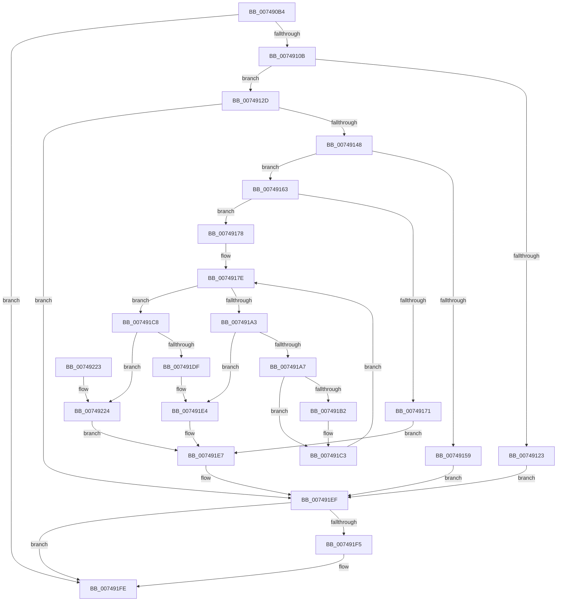

# KsepDbQueryRegistryDeviceDataList

- RVA: `0x007490B4`–`0x00749235` (길이 `385` bytes)
- VA: `0x00000001407490B4`
- 실행 섹션: `PAGE`
- PDB 이름 있음: `예`; PDB Function 태그: `아니요`
- unwind 정보 RVA: `0x000CB39C`
- 디코드: `114`개 명령, `385/385` bytes 표시
- 미해석 바이트: `0` (있으면 어셈블리에 `.byte`로 보존)

> 이 문서는 커널 이미지의 기계어와 PDB 기호를 분석해 생성했습니다. 4번과 5번은 함수 원형과 자료형을 바이너리 사용 방식에서 추정한 C 해석이며 원본 소스 복구 결과는 아닙니다.

## 1. Dependencies

- 직접 호출 지점: **10**; 고유 호출 대상: **9**
- 직접 호출자로 확인된 함수: **1**
- RIP 상대 이미지 참조: **1**

### Outgoing calls
- `0x007490FC` → [KsepStringTransform](../95/KsepStringTransform_function_0095B318.md) (function, `0x0095B318`)
- `0x0074911A` → [KsepRegistryOpenKey](../95/KsepRegistryOpenKey_function_0095A79C.md) (function, `0x0095A79C`)
- `0x00749139` → [KsepRegistryQueryKeyInformation](KsepRegistryQueryKeyInformation_function_0074B498.md) (function, `0x0074B498`)
- `0x0074914C` → [KsepPoolAllocatePaged](../../text/4A/KsepPoolAllocatePaged_function_004A9EFC.md) (function, `0x004A9EFC`)
- `0x00749167` → [KsepPoolAllocatePaged](../../text/4A/KsepPoolAllocatePaged_function_004A9EFC.md) (function, `0x004A9EFC`)
- `0x00749195` → [KsepRegistryEnumValue](KsepRegistryEnumValue_function_0074B24C.md) (function, `0x0074B24C`)
- `0x007491BB` → [memcpy](../../text/6C/memcpy_function_006C6840.md) (function, `0x006C6840`)
- `0x007491EA` → [KsepPoolFreePaged](../../text/4B/KsepPoolFreePaged_function_004B0E10.md) (function, `0x004B0E10`)
- `0x007491F9` → [KsepRegistryCloseKey](../95/KsepRegistryCloseKey_function_00959500.md) (function, `0x00959500`)
- `0x00749202` → [KsepStringFree](../95/KsepStringFree_function_0095A1B8.md) (function, `0x0095A1B8`)

### Direct callers
- [KseQueryDeviceDataList](../95/KseQueryDeviceDataList_function_00959390.md) at `0x0095940D`

### Static image references
- `0x00749113` → RVA `0x00B006E0` (` ?? ::NNGAKEGL::`string'`; read)

## 2. Other-region calls and transfers

- 다른 실행 섹션으로 향하는 call: **4**
  - `0x0074914C` → [KsepPoolAllocatePaged](../../text/4A/KsepPoolAllocatePaged_function_004A9EFC.md) (`PAGE` → `.text`)
  - `0x00749167` → [KsepPoolAllocatePaged](../../text/4A/KsepPoolAllocatePaged_function_004A9EFC.md) (`PAGE` → `.text`)
  - `0x007491BB` → [memcpy](../../text/6C/memcpy_function_006C6840.md) (`PAGE` → `.text`)
  - `0x007491EA` → [KsepPoolFreePaged](../../text/4B/KsepPoolFreePaged_function_004B0E10.md) (`PAGE` → `.text`)
- 별도 외부 분기/꼬리 이동을 확인하지 못했습니다.

## 3. Assembly (complete function range)

```asm
007490B4  48 8B C4                        mov rax, rsp
007490B7  48 89 58 08                     mov qword ptr [rax + 8], rbx
007490BB  48 89 78 10                     mov qword ptr [rax + 0x10], rdi
007490BF  4C 89 48 20                     mov qword ptr [rax + 0x20], r9
007490C3  44 89 40 18                     mov dword ptr [rax + 0x18], r8d
007490C7  55                              push rbp
007490C8  41 54                           push r12
007490CA  41 55                           push r13
007490CC  41 56                           push r14
007490CE  41 57                           push r15
007490D0  48 8B EC                        mov rbp, rsp
007490D3  48 83 EC 60                     sub rsp, 0x60
007490D7  45 33 FF                        xor r15d, r15d
007490DA  4C 8B EA                        mov r13, rdx
007490DD  48 8B D1                        mov rdx, rcx
007490E0  4C 89 7D F0                     mov qword ptr [rbp - 0x10], r15
007490E4  48 8D 4D F0                     lea rcx, [rbp - 0x10]
007490E8  4C 89 7D F8                     mov qword ptr [rbp - 8], r15
007490EC  4C 89 7D D0                     mov qword ptr [rbp - 0x30], r15
007490F0  4C 89 7D D8                     mov qword ptr [rbp - 0x28], r15
007490F4  4C 89 7D E0                     mov qword ptr [rbp - 0x20], r15
007490F8  4C 89 7D E8                     mov qword ptr [rbp - 0x18], r15
007490FC  E8 17 22 21 00                  call 0x14095b318
00749101  8B D8                           mov ebx, eax
00749103  85 C0                           test eax, eax
00749105  0F 88 F3 00 00 00               js 0x1407491fe
0074910B  48 8B 55 F8                     mov rdx, qword ptr [rbp - 8]
0074910F  4C 8D 45 D0                     lea r8, [rbp - 0x30]
00749113  48 8D 0D C6 75 3B 00            lea rcx, [rip + 0x3b75c6]
0074911A  E8 7D 16 21 00                  call 0x14095a79c
0074911F  85 C0                           test eax, eax
00749121  79 0A                           jns 0x14074912d
00749123  BB 25 02 00 C0                  mov ebx, 0xc0000225
00749128  E9 C2 00 00 00                  jmp 0x1407491ef
0074912D  48 8B 4D D0                     mov rcx, qword ptr [rbp - 0x30]
00749131  4C 8D 45 E0                     lea r8, [rbp - 0x20]
00749135  48 8D 55 D8                     lea rdx, [rbp - 0x28]
00749139  E8 5A 23 00 00                  call 0x14074b498
0074913E  8B D8                           mov ebx, eax
00749140  85 C0                           test eax, eax
00749142  0F 88 A7 00 00 00               js 0x1407491ef
00749148  48 8B 4D D8                     mov rcx, qword ptr [rbp - 0x28]
0074914C  E8 AB 0D D6 FF                  call 0x1404a9efc
00749151  4C 8B F0                        mov r14, rax
00749154  48 85 C0                        test rax, rax
00749157  75 0A                           jne 0x140749163
00749159  BB 17 00 00 C0                  mov ebx, 0xc0000017
0074915E  E9 8C 00 00 00                  jmp 0x1407491ef
00749163  48 8B 4D E0                     mov rcx, qword ptr [rbp - 0x20]
00749167  E8 90 0D D6 FF                  call 0x1404a9efc
0074916C  48 85 C0                        test rax, rax
0074916F  75 07                           jne 0x140749178
00749171  BB 17 00 00 C0                  mov ebx, 0xc0000017
00749176  EB 6F                           jmp 0x1407491e7
00749178  41 8B FF                        mov edi, r15d
0074917B  4D 8B E5                        mov r12, r13
0074917E  4C 8B 45 D8                     mov r8, qword ptr [rbp - 0x28]
00749182  48 8D 45 E8                     lea rax, [rbp - 0x18]
00749186  48 8B 4D D0                     mov rcx, qword ptr [rbp - 0x30]
0074918A  4D 8B CE                        mov r9, r14
0074918D  41 8B D7                        mov edx, r15d
00749190  48 89 44 24 20                  mov qword ptr [rsp + 0x20], rax
00749195  E8 B2 20 00 00                  call 0x14074b24c
0074919A  8B D8                           mov ebx, eax
0074919C  3D 1A 00 00 80                  cmp eax, 0x8000001a
007491A1  74 25                           je 0x1407491c8
007491A3  85 C0                           test eax, eax
007491A5  78 3D                           js 0x1407491e4
007491A7  48 8B 5D E8                     mov rbx, qword ptr [rbp - 0x18]
007491AB  03 FB                           add edi, ebx
007491AD  3B 7D 40                        cmp edi, dword ptr [rbp + 0x40]
007491B0  77 11                           ja 0x1407491c3
007491B2  4C 8B C3                        mov r8, rbx
007491B5  49 8B D6                        mov rdx, r14
007491B8  49 8B CC                        mov rcx, r12
007491BB  E8 80 D6 F7 FF                  call 0x1406c6840
007491C0  4C 03 E3                        add r12, rbx
007491C3  41 FF C7                        inc r15d
007491C6  EB B6                           jmp 0x14074917e
007491C8  48 8B 4D 48                     mov rcx, qword ptr [rbp + 0x48]
007491CC  8D 47 02                        lea eax, [rdi + 2]
007491CF  8B D7                           mov edx, edi
007491D1  89 01                           mov dword ptr [rcx], eax
007491D3  8B 45 40                        mov eax, dword ptr [rbp + 0x40]
007491D6  48 8D 4A 02                     lea rcx, [rdx + 2]
007491DA  48 3B C8                        cmp rcx, rax
007491DD  76 45                           jbe 0x140749224
007491DF  BB 23 00 00 C0                  mov ebx, 0xc0000023
007491E4  45 33 FF                        xor r15d, r15d
007491E7  49 8B CE                        mov rcx, r14
007491EA  E8 21 7C D6 FF                  call 0x1404b0e10
007491EF  4C 39 7D D0                     cmp qword ptr [rbp - 0x30], r15
007491F3  74 09                           je 0x1407491fe
007491F5  48 8B 4D D0                     mov rcx, qword ptr [rbp - 0x30]
007491F9  E8 02 03 21 00                  call 0x140959500
007491FE  48 8D 4D F0                     lea rcx, [rbp - 0x10]
00749202  E8 B1 0F 21 00                  call 0x14095a1b8
00749207  4C 8D 5C 24 60                  lea r11, [rsp + 0x60]
0074920C  8B C3                           mov eax, ebx
0074920E  49 8B 5B 30                     mov rbx, qword ptr [r11 + 0x30]
00749212  49 8B 7B 38                     mov rdi, qword ptr [r11 + 0x38]
00749216  49 8B E3                        mov rsp, r11
00749219  41 5F                           pop r15
0074921B  41 5E                           pop r14
0074921D  41 5D                           pop r13
0074921F  41 5C                           pop r12
00749221  5D                              pop rbp
00749222  C3                              ret
00749223  CC                              int3
00749224  48 D1 EA                        shr rdx, 1
00749227  45 33 FF                        xor r15d, r15d
0074922A  41 8B DF                        mov ebx, r15d
0074922D  66 45 89 7C 55 00               mov word ptr [r13 + rdx*2], r15w
00749233  EB B2                           jmp 0x1407491e7
```

## 4. C-style interpretation (structured pseudocode)

```c
__int64 __fastcall KsepDbQueryRegistryDeviceDataList(__int64 a1, __int64 a2, int a3, __int64 a4)
{
    __int64 result;
    __int64 v_r12;
    __int64 v_r15;
    __int64 v_rdi;
    __int64 v_rsp;
    unsigned __int64 v_stack_m28;
    unsigned __int64 v_stack_m30;
    unsigned __int64 v_stack_m38;
    unsigned __int64 v_stack_m40;
    unsigned __int64 v_stack_m48;
    unsigned __int64 v_stack_m50;
    unsigned __int64 v_stack_m58;
    unsigned __int64 v_stack_m68;
    unsigned int v_stack_p18;
    unsigned __int64 v_stack_p20;

    *(unsigned __int64 *)(v_rsp + 8) = v_rbx;
    *(unsigned __int64 *)(v_rsp + 16) = v_rdi;
    *(unsigned __int64 *)(v_rsp + 32) = a4;
    *(unsigned int *)(v_rsp + 24) = a3;
    v_rsp = (v_rsp) - (96);
    v_r15 = 0;
    v_stack_m38 = 0;
    v_stack_m30 = 0;
    v_stack_m58 = 0;
    v_stack_m50 = 0;
    v_stack_m48 = 0;
    v_stack_m40 = 0;
    result = KsepStringTransform(v_stack_m38, a1, a3, a4);
    if (sign_flag) goto loc_007491FE;
    result = KsepRegistryOpenKey(v_rip + 3896774, v_stack_m30, v_stack_m58, a4);
    if (!sign_flag) goto loc_0074912D;
    goto loc_007491EF;
loc_0074912D:
    result = KsepRegistryQueryKeyInformation(v_stack_m58, v_stack_m50, v_stack_m48, a4);
    if (sign_flag) goto loc_007491EF;
    result = KsepPoolAllocatePaged(v_stack_m50, v_stack_m50, v_stack_m48, a4);
    if (result != 0) goto loc_00749163;
    goto loc_007491EF;
loc_00749163:
    result = KsepPoolAllocatePaged(v_stack_m48, v_stack_m50, v_stack_m48, a4);
    if (result != 0) goto loc_00749178;
    goto loc_007491E7;
loc_00749178:
loc_0074917E:
    v_stack_m68 = v_stack_m40;
    result = KsepRegistryEnumValue(v_stack_m58, 0, v_stack_m50, result);
    if (((unsigned int)(result)) == 0x8000001AULL) goto loc_007491C8;
    if (sign_flag) goto loc_007491E4;
    v_rdi = (unsigned int)((0) + ((unsigned int)(v_stack_m40)));
    v_r12 = a2;
    if (((unsigned int)(v_rdi)) <= v_stack_p18) {
        a3 = v_stack_m40;
        a2 = result;
        a1 = a2;
        result = memcpy(a1, a2, a3, result);
        v_r12 = (a2) + (v_stack_m40);
    }
    v_r15 = (unsigned int)((v_r15) + 1);
    goto loc_0074917E;
loc_007491C8:
    *(unsigned int *)(v_stack_p20) = (unsigned int)(v_rdi + 2);
    if (((unsigned int)((unsigned int)(v_rdi)) + 2) <= ((unsigned int)(v_stack_p18))) goto loc_00749224;
loc_007491E4:
    v_r15 = 0;
loc_007491E7:
    result = KsepPoolFreePaged(result, (unsigned int)((unsigned int)(v_rdi)), a3, result);
loc_007491EF:
    if (v_stack_m58 != 0) {
        a1 = v_stack_m58;
        result = KsepRegistryCloseKey(a1, (unsigned int)((unsigned int)(v_rdi)), a3, result);
    }
    result = KsepStringFree(v_stack_m38, (unsigned int)((unsigned int)(v_rdi)), a3, result);
    return (unsigned int)((unsigned int)((unsigned int)(0xC0000023ULL)));
loc_00749224:
    a2 = ((unsigned int)((unsigned int)(v_rdi))) >> (1);
    v_r15 = 0;
    *(unsigned __int16 *)(a2 + a2 * 2) = 0;
    goto loc_007491E7;
}
```

## 5. (Beta) C Style

```c
int64_t KsepDbQueryRegistryDeviceDataList(int64_t Arg1, void *Arg2, int32_t Arg3, int64_t Arg4)
{
    uint8_t *arg2 = (uint8_t *)Arg2;

    int64_t result;
    int64_t local_r12;
    int64_t local_r15;
    int64_t local_rdi;
    int64_t local_rsp;
    uint64_t v_stack_m28;
    uint64_t v_stack_m30;
    uint64_t v_stack_m38;
    uint64_t v_stack_m40;
    uint64_t v_stack_m48;
    uint64_t v_stack_m50;
    uint64_t v_stack_m58;
    uint64_t v_stack_m68;
    uint32_t v_stack_p18;
    uint64_t v_stack_p20;

    *(uint64_t *)(local_rsp + 0x8) = local_rbx;
    *(uint64_t *)(local_rsp + 0x10) = local_rdi;
    *(uint64_t *)(local_rsp + 0x20) = Arg4;
    *(uint32_t *)(local_rsp + 0x18) = Arg3;
    local_rsp = (local_rsp) - (96);
    local_r15 = 0;
    v_stack_m38 = 0;
    v_stack_m30 = 0;
    v_stack_m58 = 0;
    v_stack_m50 = 0;
    v_stack_m48 = 0;
    v_stack_m40 = 0;
    result = KsepStringTransform(v_stack_m38, Arg1, Arg3, Arg4);
    if (sign_flag) goto loc_007491FE;
    result = KsepRegistryOpenKey(v_rip + 3896774, v_stack_m30, v_stack_m58, Arg4);
    if (!sign_flag) goto loc_0074912D;
    goto loc_007491EF;
loc_0074912D:
    result = KsepRegistryQueryKeyInformation(v_stack_m58, v_stack_m50, v_stack_m48, Arg4);
    if (sign_flag) goto loc_007491EF;
    result = KsepPoolAllocatePaged(v_stack_m50, v_stack_m50, v_stack_m48, Arg4);
    if (result != 0) goto loc_00749163;
    goto loc_007491EF;
loc_00749163:
    result = KsepPoolAllocatePaged(v_stack_m48, v_stack_m50, v_stack_m48, Arg4);
    if (result != 0) goto loc_00749178;
    goto loc_007491E7;
loc_00749178:
loc_0074917E:
    v_stack_m68 = v_stack_m40;
    result = KsepRegistryEnumValue(v_stack_m58, 0, v_stack_m50, result);
    if (((uint32_t)(result)) == 0x8000001AULL) goto loc_007491C8;
    if (sign_flag) goto loc_007491E4;
    local_rdi = (uint32_t)((0) + ((uint32_t)(v_stack_m40)));
    local_r12 = Arg2;
    if (((uint32_t)(local_rdi)) <= v_stack_p18) {
        Arg3 = v_stack_m40;
        Arg2 = result;
        Arg1 = Arg2;
        result = memcpy(Arg1, Arg2, Arg3, result);
        local_r12 = (Arg2) + (v_stack_m40);
    }
    local_r15 = (uint32_t)((local_r15) + 1);
    goto loc_0074917E;
loc_007491C8:
    *(uint32_t *)(v_stack_p20) = (uint32_t)(local_rdi + 2);
    if (((uint32_t)((uint32_t)(local_rdi)) + 2) <= ((uint32_t)(v_stack_p18))) goto loc_00749224;
loc_007491E4:
    local_r15 = 0;
loc_007491E7:
    result = KsepPoolFreePaged(result, (uint32_t)((uint32_t)(local_rdi)), Arg3, result);
loc_007491EF:
    if (v_stack_m58 != 0) {
        Arg1 = v_stack_m58;
        result = KsepRegistryCloseKey(Arg1, (uint32_t)((uint32_t)(local_rdi)), Arg3, result);
    }
    result = KsepStringFree(v_stack_m38, (uint32_t)((uint32_t)(local_rdi)), Arg3, result);
    return (uint32_t)((uint32_t)((uint32_t)(0xC0000023ULL)));
loc_00749224:
    Arg2 = ((uint32_t)((uint32_t)(local_rdi))) >> (1);
    local_r15 = 0;
    *(uint16_t *)(arg2 + arg2 * 2) = 0;
    goto loc_007491E7;
}
```

### 관측된 메모리 오프셋

구조체 형식이 확인되지 않은 접근은 인자 기준의 오프셋으로만 기록했습니다.

| 기준 인자 | 오프셋 표현 | 폭 (bit) | 접근 |
|---|---:|---:|---|
| `Arg2` | `+ 0x0 + rdx*2` | `16` | `W` |

## 6. Execution-region graph

[열기: 2D/3D 그래프와 함수 탐색 컨트롤 패널](../../../control-panel.html?section=page&rva=0x007490B4&view=graph)

- 2D 그래프는 위에서 아래로 흐르고, 3D 그래프는 빈 공간을 드래그해 회전합니다. Shift+드래그는 이동, 휠은 확대·축소, 함수 노드 선택은 대상 보고서 이동입니다.

### Static fallback


