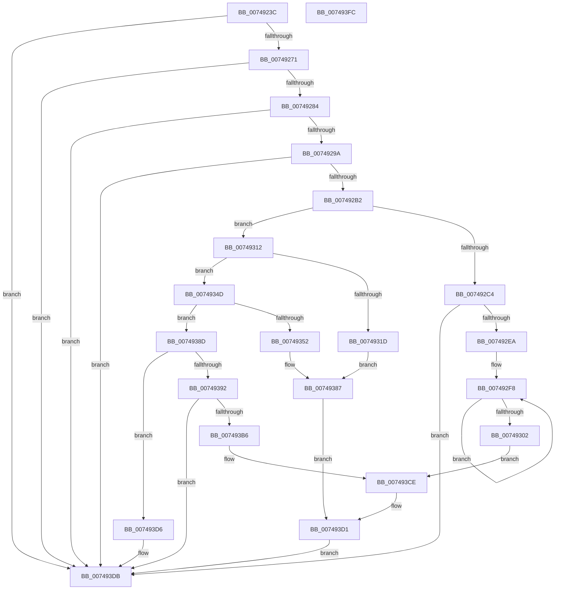

# KsepDbReadKData

- RVA: `0x0074923C`–`0x007493FD` (길이 `449` bytes)
- VA: `0x000000014074923C`
- 실행 섹션: `PAGE`
- PDB 이름 있음: `예`; PDB Function 태그: `아니요`
- unwind 정보 RVA: `0x0005FEF8`
- 디코드: `125`개 명령, `449/449` bytes 표시
- 미해석 바이트: `0` (있으면 어셈블리에 `.byte`로 보존)

> 이 문서는 커널 이미지의 기계어와 PDB 기호를 분석해 생성했습니다. 4번과 5번은 함수 원형과 자료형을 바이너리 사용 방식에서 추정한 C 해석이며 원본 소스 복구 결과는 아닙니다.

## 1. Dependencies

- 직접 호출 지점: **13**; 고유 호출 대상: **6**
- 직접 호출자로 확인된 함수: **1**
- RIP 상대 이미지 참조: **0**

### Outgoing calls
- `0x00749277` → [SdbFindFirstTag](../95/SdbFindFirstTag_function_0095E34C.md) (function, `0x0095E34C`)
- `0x00749289` → [SdbGetStringTagPtr](../95/SdbGetStringTagPtr_function_0095DDA8.md) (function, `0x0095DDA8`)
- `0x007492A5` → [SdbFindFirstTag](../95/SdbFindFirstTag_function_0095E34C.md) (function, `0x0095E34C`)
- `0x007492BA` → [SdbReadDWORDTag](../95/SdbReadDWORDTag_function_0095D408.md) (function, `0x0095D408`)
- `0x007492CF` → [SdbFindFirstTag](../95/SdbFindFirstTag_function_0095E34C.md) (function, `0x0095E34C`)
- `0x007492D9` → [SdbGetStringTagPtr](../95/SdbGetStringTagPtr_function_0095DDA8.md) (function, `0x0095DDA8`)
- `0x00749328` → [SdbFindFirstTag](../95/SdbFindFirstTag_function_0095E34C.md) (function, `0x0095E34C`)
- `0x00749344` → [SdbReadDWORDTag](../95/SdbReadDWORDTag_function_0095D408.md) (function, `0x0095D408`)
- `0x0074935D` → [SdbFindFirstTag](../95/SdbFindFirstTag_function_0095E34C.md) (function, `0x0095E34C`)
- `0x0074937F` → [SdbReadQWORDTag](../81/SdbReadQWORDTag_function_0081706C.md) (function, `0x0081706C`)
- `0x0074939D` → [SdbFindFirstTag](../95/SdbFindFirstTag_function_0095E34C.md) (function, `0x0095E34C`)
- `0x007493A9` → [SdbpGetMappedTagData](../95/SdbpGetMappedTagData_function_0095DD24.md) (function, `0x0095DD24`)
- `0x007493C5` → [SdbGetTagDataSize](../95/SdbGetTagDataSize_function_0095E230.md) (function, `0x0095E230`)

### Direct callers
- [sub_00B2789A](../B2/Unknown_function_00B2789A.md) at `0x00B27906`

### Static image references
- 디코드된 RIP-relative 메모리 참조가 없습니다.

## 2. Other-region calls and transfers

- 다른 실행 섹션으로 향하는 call: **0**
- 별도 외부 분기/꼬리 이동을 확인하지 못했습니다.

## 3. Assembly (complete function range)

```asm
0074923C  48 8B C4                        mov rax, rsp
0074923F  48 89 58 08                     mov qword ptr [rax + 8], rbx
00749243  48 89 68 10                     mov qword ptr [rax + 0x10], rbp
00749247  48 89 70 18                     mov qword ptr [rax + 0x18], rsi
0074924B  48 89 78 20                     mov qword ptr [rax + 0x20], rdi
0074924F  41 54                           push r12
00749251  41 56                           push r14
00749253  41 57                           push r15
00749255  48 83 EC 20                     sub rsp, 0x20
00749259  45 33 E4                        xor r12d, r12d
0074925C  49 8B F8                        mov rdi, r8
0074925F  8B EA                           mov ebp, edx
00749261  48 8B F1                        mov rsi, rcx
00749264  BB 01 00 00 C0                  mov ebx, 0xc0000001
00749269  85 D2                           test edx, edx
0074926B  0F 84 6A 01 00 00               je 0x1407493db
00749271  41 B8 01 60 00 00               mov r8d, 0x6001
00749277  E8 D0 50 21 00                  call 0x14095e34c
0074927C  85 C0                           test eax, eax
0074927E  0F 84 57 01 00 00               je 0x1407493db
00749284  8B D0                           mov edx, eax
00749286  48 8B CE                        mov rcx, rsi
00749289  E8 1A 4B 21 00                  call 0x14095dda8
0074928E  4C 8B F0                        mov r14, rax
00749291  48 85 C0                        test rax, rax
00749294  0F 84 41 01 00 00               je 0x1407493db
0074929A  41 B8 18 40 00 00               mov r8d, 0x4018
007492A0  8B D5                           mov edx, ebp
007492A2  48 8B CE                        mov rcx, rsi
007492A5  E8 A2 50 21 00                  call 0x14095e34c
007492AA  85 C0                           test eax, eax
007492AC  0F 84 29 01 00 00               je 0x1407493db
007492B2  45 33 C0                        xor r8d, r8d
007492B5  8B D0                           mov edx, eax
007492B7  48 8B CE                        mov rcx, rsi
007492BA  E8 49 41 21 00                  call 0x14095d408
007492BF  83 F8 01                        cmp eax, 1
007492C2  75 4E                           jne 0x140749312
007492C4  41 B8 1E 60 00 00               mov r8d, 0x601e
007492CA  8B D5                           mov edx, ebp
007492CC  48 8B CE                        mov rcx, rsi
007492CF  E8 78 50 21 00                  call 0x14095e34c
007492D4  8B D0                           mov edx, eax
007492D6  48 8B CE                        mov rcx, rsi
007492D9  E8 CA 4A 21 00                  call 0x14095dda8
007492DE  48 8B C8                        mov rcx, rax
007492E1  48 85 C0                        test rax, rax
007492E4  0F 84 F1 00 00 00               je 0x1407493db
007492EA  4C 89 37                        mov qword ptr [rdi], r14
007492ED  48 83 C8 FF                     or rax, 0xffffffffffffffff
007492F1  C7 47 08 01 00 00 00            mov dword ptr [rdi + 8], 1
007492F8  48 FF C0                        inc rax
007492FB  66 44 39 24 41                  cmp word ptr [rcx + rax*2], r12w
00749300  75 F6                           jne 0x1407492f8
00749302  8D 04 45 02 00 00 00            lea eax, [rax*2 + 2]
00749309  48 89 4F 10                     mov qword ptr [rdi + 0x10], rcx
0074930D  E9 BC 00 00 00                  jmp 0x1407493ce
00749312  41 BF 04 00 00 00               mov r15d, 4
00749318  41 3B C7                        cmp eax, r15d
0074931B  75 30                           jne 0x14074934d
0074931D  41 B8 19 40 00 00               mov r8d, 0x4019
00749323  8B D5                           mov edx, ebp
00749325  48 8B CE                        mov rcx, rsi
00749328  E8 1F 50 21 00                  call 0x14095e34c
0074932D  45 33 C0                        xor r8d, r8d
00749330  4C 89 37                        mov qword ptr [rdi], r14
00749333  8B D0                           mov edx, eax
00749335  44 89 7F 08                     mov dword ptr [rdi + 8], r15d
00749339  48 8B CE                        mov rcx, rsi
0074933C  44 89 7F 0C                     mov dword ptr [rdi + 0xc], r15d
00749340  48 8D 5F 18                     lea rbx, [rdi + 0x18]
00749344  E8 BF 40 21 00                  call 0x14095d408
00749349  89 03                           mov dword ptr [rbx], eax
0074934B  EB 3A                           jmp 0x140749387
0074934D  83 F8 0B                        cmp eax, 0xb
00749350  75 3B                           jne 0x14074938d
00749352  41 B8 07 50 00 00               mov r8d, 0x5007
00749358  8B D5                           mov edx, ebp
0074935A  48 8B CE                        mov rcx, rsi
0074935D  E8 EA 4F 21 00                  call 0x14095e34c
00749362  45 33 C0                        xor r8d, r8d
00749365  4C 89 37                        mov qword ptr [rdi], r14
00749368  8B D0                           mov edx, eax
0074936A  C7 47 08 0B 00 00 00            mov dword ptr [rdi + 8], 0xb
00749371  48 8B CE                        mov rcx, rsi
00749374  C7 47 0C 08 00 00 00            mov dword ptr [rdi + 0xc], 8
0074937B  48 8D 5F 20                     lea rbx, [rdi + 0x20]
0074937F  E8 E8 DC 0C 00                  call 0x14081706c
00749384  48 89 03                        mov qword ptr [rbx], rax
00749387  48 89 5F 10                     mov qword ptr [rdi + 0x10], rbx
0074938B  EB 44                           jmp 0x1407493d1
0074938D  83 F8 03                        cmp eax, 3
00749390  75 44                           jne 0x1407493d6
00749392  41 B8 05 90 00 00               mov r8d, 0x9005
00749398  8B D5                           mov edx, ebp
0074939A  48 8B CE                        mov rcx, rsi
0074939D  E8 AA 4F 21 00                  call 0x14095e34c
007493A2  8B D0                           mov edx, eax
007493A4  48 8B CE                        mov rcx, rsi
007493A7  8B E8                           mov ebp, eax
007493A9  E8 76 49 21 00                  call 0x14095dd24
007493AE  4C 8B F8                        mov r15, rax
007493B1  48 85 C0                        test rax, rax
007493B4  74 25                           je 0x1407493db
007493B6  8B D5                           mov edx, ebp
007493B8  4C 89 37                        mov qword ptr [rdi], r14
007493BB  48 8B CE                        mov rcx, rsi
007493BE  C7 47 08 03 00 00 00            mov dword ptr [rdi + 8], 3
007493C5  E8 66 4E 21 00                  call 0x14095e230
007493CA  4C 89 7F 10                     mov qword ptr [rdi + 0x10], r15
007493CE  89 47 0C                        mov dword ptr [rdi + 0xc], eax
007493D1  41 8B DC                        mov ebx, r12d
007493D4  EB 05                           jmp 0x1407493db
007493D6  BB 0D 00 00 C0                  mov ebx, 0xc000000d
007493DB  48 8B 6C 24 48                  mov rbp, qword ptr [rsp + 0x48]
007493E0  8B C3                           mov eax, ebx
007493E2  48 8B 5C 24 40                  mov rbx, qword ptr [rsp + 0x40]
007493E7  48 8B 74 24 50                  mov rsi, qword ptr [rsp + 0x50]
007493EC  48 8B 7C 24 58                  mov rdi, qword ptr [rsp + 0x58]
007493F1  48 83 C4 20                     add rsp, 0x20
007493F5  41 5F                           pop r15
007493F7  41 5E                           pop r14
007493F9  41 5C                           pop r12
007493FB  C3                              ret
007493FC  CC                              int3
```

## 4. C-style interpretation (structured pseudocode)

```c
__int64 __fastcall KsepDbReadKData(__int64 a1, int a2, __int64 a3)
{
    __int64 result;
    __int64 v_r12;
    __int64 v_rsp;
    unsigned __int64 v_stack_p10;
    unsigned __int64 v_stack_p18;
    unsigned __int64 v_stack_p20;
    unsigned __int64 v_stack_p8;

    *(unsigned __int64 *)(v_rsp + 8) = v_rbx;
    *(unsigned __int64 *)(v_rsp + 16) = v_rbp;
    *(unsigned __int64 *)(v_rsp + 24) = v_rsi;
    *(unsigned __int64 *)(v_rsp + 32) = v_rdi;
    v_rsp = (v_rsp) - (32);
    v_r12 = 0;
    if (a2 == 0) goto loc_007493DB;
    result = SdbFindFirstTag(a1, a2, (unsigned int)(0x6001ULL), a4);
    if ((unsigned int)(result) == 0) goto loc_007493DB;
    result = SdbGetStringTagPtr(a1, (unsigned int)((unsigned int)(result)), (unsigned int)(0x6001ULL), a4);
    if (result == 0) goto loc_007493DB;
    result = SdbFindFirstTag(a1, (unsigned int)((unsigned int)((unsigned int)(a2))), (unsigned int)(0x4018ULL), a4);
    if ((unsigned int)(result) == 0) goto loc_007493DB;
    a3 = 0;
    result = SdbReadDWORDTag(a1, (unsigned int)((unsigned int)(result)), a3, a4);
    if (((unsigned int)(result)) != 1) goto loc_00749312;
    result = SdbFindFirstTag(a1, (unsigned int)((unsigned int)((unsigned int)(a2))), (unsigned int)(0x601EULL), a4);
    result = SdbGetStringTagPtr(a1, (unsigned int)((unsigned int)(result)), (unsigned int)(0x601EULL), a4);
    if (result == 0) goto loc_007493DB;
    *(unsigned __int64 *)(a3) = result;
    result = (result) | (-1);
    *(unsigned int *)(a3 + 8) = 1;
loc_007492F8:
    result = (result) + 1;
    if ((*(unsigned __int16 *)(result + result * 2)) != 0) goto loc_007492F8;
    *(unsigned __int64 *)(a3 + 16) = result;
    goto loc_007493CE;
loc_00749312:
    if (((unsigned int)(result * 2 + 2)) != 4) goto loc_0074934D;
    result = SdbFindFirstTag(a1, (unsigned int)((unsigned int)((unsigned int)(a2))), (unsigned int)(0x4019ULL), a4);
    a3 = 0;
    *(unsigned __int64 *)(a3) = result;
    *(unsigned int *)(a3 + 8) = 4;
    *(unsigned int *)(a3 + 12) = 4;
    result = SdbReadDWORDTag(a1, (unsigned int)((unsigned int)(result)), a3, a4);
    *(unsigned int *)(a3 + 24) = (unsigned int)(result);
    goto loc_00749387;
loc_0074934D:
    if (((unsigned int)(result)) != 11) goto loc_0074938D;
    result = SdbFindFirstTag(a1, (unsigned int)((unsigned int)((unsigned int)(a2))), (unsigned int)(0x5007ULL), a4);
    a3 = 0;
    *(unsigned __int64 *)(a3) = result;
    *(unsigned int *)(a3 + 8) = 11;
    *(unsigned int *)(a3 + 12) = 8;
    result = SdbReadQWORDTag(a1, (unsigned int)((unsigned int)(result)), a3, a4);
    *(unsigned __int64 *)(a3 + 32) = result;
loc_00749387:
    *(unsigned __int64 *)(a3 + 16) = a3 + 32;
    goto loc_007493D1;
loc_0074938D:
    if (((unsigned int)(result)) != 3) goto loc_007493D6;
    result = SdbFindFirstTag(a1, (unsigned int)((unsigned int)((unsigned int)(a2))), (unsigned int)(0x9005ULL), a4);
    result = SdbpGetMappedTagData(a1, (unsigned int)((unsigned int)(result)), (unsigned int)(0x9005ULL), a4);
    if (result == 0) goto loc_007493DB;
    *(unsigned __int64 *)(a3) = result;
    *(unsigned int *)(a3 + 8) = 3;
    result = SdbGetTagDataSize(a1, (unsigned int)((unsigned int)((unsigned int)((unsigned int)(result)))), (unsigned int)(0x9005ULL), a4);
    *(unsigned __int64 *)(a3 + 16) = result;
loc_007493CE:
    *(unsigned int *)(a3 + 12) = (unsigned int)(result);
loc_007493D1:
    goto loc_007493DB;
loc_007493D6:
loc_007493DB:
    v_rsp = (v_rsp) + (32);
    return (unsigned int)((unsigned int)((unsigned int)(0xC000000DULL)));
}
```

## 5. (Beta) C Style

```c
int64_t KsepDbReadKData(int64_t Arg1, int32_t Arg2, void *Arg3)
{
    uint8_t *arg3 = (uint8_t *)Arg3;

    int64_t result;
    int64_t local_r12;
    int64_t local_rsp;
    uint64_t v_stack_p10;
    uint64_t v_stack_p18;
    uint64_t v_stack_p20;
    uint64_t v_stack_p8;

    *(uint64_t *)(local_rsp + 0x8) = local_rbx;
    *(uint64_t *)(local_rsp + 0x10) = local_rbp;
    *(uint64_t *)(local_rsp + 0x18) = local_rsi;
    *(uint64_t *)(local_rsp + 0x20) = local_rdi;
    local_rsp = (local_rsp) - (32);
    local_r12 = 0;
    if (Arg2 == 0) goto loc_007493DB;
    result = SdbFindFirstTag(Arg1, Arg2, (uint32_t)(0x6001ULL), a4);
    if ((uint32_t)(result) == 0) goto loc_007493DB;
    result = SdbGetStringTagPtr(Arg1, (uint32_t)((uint32_t)(result)), (uint32_t)(0x6001ULL), a4);
    if (result == 0) goto loc_007493DB;
    result = SdbFindFirstTag(Arg1, (uint32_t)((uint32_t)((uint32_t)(Arg2))), (uint32_t)(0x4018ULL), a4);
    if ((uint32_t)(result) == 0) goto loc_007493DB;
    Arg3 = 0;
    result = SdbReadDWORDTag(Arg1, (uint32_t)((uint32_t)(result)), Arg3, a4);
    if (((uint32_t)(result)) != 1) goto loc_00749312;
    result = SdbFindFirstTag(Arg1, (uint32_t)((uint32_t)((uint32_t)(Arg2))), (uint32_t)(0x601EULL), a4);
    result = SdbGetStringTagPtr(Arg1, (uint32_t)((uint32_t)(result)), (uint32_t)(0x601EULL), a4);
    if (result == 0) goto loc_007493DB;
    *(uint64_t *)(arg3) = result;
    result = (result) | (-1);
    *(uint32_t *)(arg3 + 0x8) = 1;
loc_007492F8:
    result = (result) + 1;
    if ((*(uint16_t *)(result + result * 2)) != 0) goto loc_007492F8;
    *(uint64_t *)(arg3 + 0x10) = result;
    goto loc_007493CE;
loc_00749312:
    if (((uint32_t)(result * 2 + 2)) != 4) goto loc_0074934D;
    result = SdbFindFirstTag(Arg1, (uint32_t)((uint32_t)((uint32_t)(Arg2))), (uint32_t)(0x4019ULL), a4);
    Arg3 = 0;
    *(uint64_t *)(arg3) = result;
    *(uint32_t *)(arg3 + 0x8) = 4;
    *(uint32_t *)(arg3 + 0xC) = 4;
    result = SdbReadDWORDTag(Arg1, (uint32_t)((uint32_t)(result)), Arg3, a4);
    *(uint32_t *)(arg3 + 0x18) = (uint32_t)(result);
    goto loc_00749387;
loc_0074934D:
    if (((uint32_t)(result)) != 11) goto loc_0074938D;
    result = SdbFindFirstTag(Arg1, (uint32_t)((uint32_t)((uint32_t)(Arg2))), (uint32_t)(0x5007ULL), a4);
    Arg3 = 0;
    *(uint64_t *)(arg3) = result;
    *(uint32_t *)(arg3 + 0x8) = 11;
    *(uint32_t *)(arg3 + 0xC) = 8;
    result = SdbReadQWORDTag(Arg1, (uint32_t)((uint32_t)(result)), Arg3, a4);
    *(uint64_t *)(arg3 + 0x20) = result;
loc_00749387:
    *(void **)(arg3 + 0x10) = Arg3 + 32;
    goto loc_007493D1;
loc_0074938D:
    if (((uint32_t)(result)) != 3) goto loc_007493D6;
    result = SdbFindFirstTag(Arg1, (uint32_t)((uint32_t)((uint32_t)(Arg2))), (uint32_t)(0x9005ULL), a4);
    result = SdbpGetMappedTagData(Arg1, (uint32_t)((uint32_t)(result)), (uint32_t)(0x9005ULL), a4);
    if (result == 0) goto loc_007493DB;
    *(uint64_t *)(arg3) = result;
    *(uint32_t *)(arg3 + 0x8) = 3;
    result = SdbGetTagDataSize(Arg1, (uint32_t)((uint32_t)((uint32_t)((uint32_t)(result)))), (uint32_t)(0x9005ULL), a4);
    *(uint64_t *)(arg3 + 0x10) = result;
loc_007493CE:
    *(uint32_t *)(arg3 + 0xC) = (uint32_t)(result);
loc_007493D1:
    goto loc_007493DB;
loc_007493D6:
loc_007493DB:
    local_rsp = (local_rsp) + (32);
    return (uint32_t)((uint32_t)((uint32_t)(0xC000000DULL)));
}
```

### 관측된 메모리 오프셋

구조체 형식이 확인되지 않은 접근은 인자 기준의 오프셋으로만 기록했습니다.

| 기준 인자 | 오프셋 표현 | 폭 (bit) | 접근 |
|---|---:|---:|---|
| `Arg3` | `+ 0x0` | `32` | `W` |
| `Arg3` | `+ 0x0` | `64` | `W` |
| `Arg3` | `+ 0x8` | `32` | `W` |
| `Arg3` | `+ 0xC` | `32` | `W` |
| `Arg3` | `+ 0x10` | `64` | `W` |
| `Arg3` | `+ 0x18` | `64` | `R` |
| `Arg3` | `+ 0x20` | `64` | `R` |

## 6. Execution-region graph

[열기: 2D/3D 그래프와 함수 탐색 컨트롤 패널](../../../control-panel.html?section=page&rva=0x0074923C&view=graph)

- 2D 그래프는 위에서 아래로 흐르고, 3D 그래프는 빈 공간을 드래그해 회전합니다. Shift+드래그는 이동, 휠은 확대·축소, 함수 노드 선택은 대상 보고서 이동입니다.

### Static fallback


