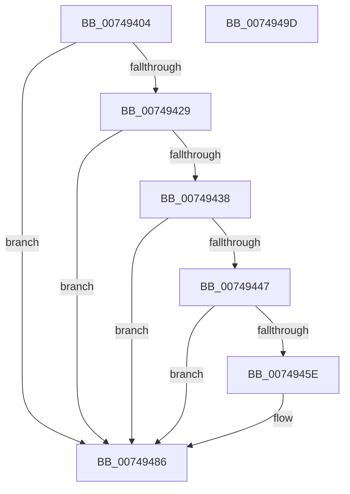

# KsepDbReadKFlag

- RVA: `0x00749404`–`0x0074949E` (길이 `154` bytes)
- VA: `0x0000000140749404`
- 실행 섹션: `PAGE`
- PDB 이름 있음: `예`; PDB Function 태그: `아니요`
- unwind 정보 RVA: `0x0005C954`
- 디코드: `45`개 명령, `154/154` bytes 표시
- 미해석 바이트: `0` (있으면 어셈블리에 `.byte`로 보존)

> 이 문서는 커널 이미지의 기계어와 PDB 기호를 분석해 생성했습니다. 4번과 5번은 함수 원형과 자료형을 바이너리 사용 방식에서 추정한 C 해석이며 원본 소스 복구 결과는 아닙니다.

## 1. Dependencies

- 직접 호출 지점: **4**; 고유 호출 대상: **3**
- 직접 호출자로 확인된 함수: **1**
- RIP 상대 이미지 참조: **0**

### Outgoing calls
- `0x0074942F` → [SdbFindFirstTag](../95/SdbFindFirstTag_function_0095E34C.md) (function, `0x0095E34C`)
- `0x0074943D` → [SdbGetStringTagPtr](../95/SdbGetStringTagPtr_function_0095DDA8.md) (function, `0x0095DDA8`)
- `0x00749455` → [SdbFindFirstTag](../95/SdbFindFirstTag_function_0095E34C.md) (function, `0x0095E34C`)
- `0x00749471` → [SdbReadQWORDTag](../81/SdbReadQWORDTag_function_0081706C.md) (function, `0x0081706C`)

### Direct callers
- [sub_00B2789A](../B2/Unknown_function_00B2789A.md) at `0x00B278A9`

### Static image references
- 디코드된 RIP-relative 메모리 참조가 없습니다.

## 2. Other-region calls and transfers

- 다른 실행 섹션으로 향하는 call: **0**
- 별도 외부 분기/꼬리 이동을 확인하지 못했습니다.

## 3. Assembly (complete function range)

```asm
00749404  48 89 5C 24 08                  mov qword ptr [rsp + 8], rbx
00749409  48 89 6C 24 10                  mov qword ptr [rsp + 0x10], rbp
0074940E  48 89 74 24 18                  mov qword ptr [rsp + 0x18], rsi
00749413  57                              push rdi
00749414  48 83 EC 20                     sub rsp, 0x20
00749418  49 8B F0                        mov rsi, r8
0074941B  8B DA                           mov ebx, edx
0074941D  48 8B F9                        mov rdi, rcx
00749420  BD 01 00 00 C0                  mov ebp, 0xc0000001
00749425  85 D2                           test edx, edx
00749427  74 5D                           je 0x140749486
00749429  41 B8 01 60 00 00               mov r8d, 0x6001
0074942F  E8 18 4F 21 00                  call 0x14095e34c
00749434  85 C0                           test eax, eax
00749436  74 4E                           je 0x140749486
00749438  8B D0                           mov edx, eax
0074943A  48 8B CF                        mov rcx, rdi
0074943D  E8 66 49 21 00                  call 0x14095dda8
00749442  48 85 C0                        test rax, rax
00749445  74 3F                           je 0x140749486
00749447  41 B8 05 50 00 00               mov r8d, 0x5005
0074944D  48 89 06                        mov qword ptr [rsi], rax
00749450  8B D3                           mov edx, ebx
00749452  48 8B CF                        mov rcx, rdi
00749455  E8 F2 4E 21 00                  call 0x14095e34c
0074945A  85 C0                           test eax, eax
0074945C  74 28                           je 0x140749486
0074945E  45 33 C0                        xor r8d, r8d
00749461  C7 46 08 0B 00 00 00            mov dword ptr [rsi + 8], 0xb
00749468  8B D0                           mov edx, eax
0074946A  48 8D 5E 20                     lea rbx, [rsi + 0x20]
0074946E  48 8B CF                        mov rcx, rdi
00749471  E8 F6 DB 0C 00                  call 0x14081706c
00749476  48 89 03                        mov qword ptr [rbx], rax
00749479  33 ED                           xor ebp, ebp
0074947B  48 89 5E 10                     mov qword ptr [rsi + 0x10], rbx
0074947F  C7 46 0C 08 00 00 00            mov dword ptr [rsi + 0xc], 8
00749486  48 8B 5C 24 30                  mov rbx, qword ptr [rsp + 0x30]
0074948B  8B C5                           mov eax, ebp
0074948D  48 8B 6C 24 38                  mov rbp, qword ptr [rsp + 0x38]
00749492  48 8B 74 24 40                  mov rsi, qword ptr [rsp + 0x40]
00749497  48 83 C4 20                     add rsp, 0x20
0074949B  5F                              pop rdi
0074949C  C3                              ret
0074949D  CC                              int3
```

## 4. C-style interpretation (structured pseudocode)

```c
__int64 __fastcall KsepDbReadKFlag(__int64 a1, int a2, __int64 a3)
{
    __int64 result;
    __int64 v_rbp;
    __int64 v_rbx;
    __int64 v_rsp;
    unsigned __int64 v_stack_p10;
    unsigned __int64 v_stack_p18;
    unsigned __int64 v_stack_p8;

    v_stack_p8 = v_rbx;
    v_stack_p10 = v_rbp;
    v_stack_p18 = v_rsi;
    v_rsp = (v_rsp) - (32);
    if (a2 == 0) goto loc_00749486;
    result = SdbFindFirstTag(a1, a2, (unsigned int)(0x6001ULL), a4);
    if ((unsigned int)(result) == 0) goto loc_00749486;
    result = SdbGetStringTagPtr(a1, (unsigned int)((unsigned int)(result)), (unsigned int)(0x6001ULL), a4);
    if (result == 0) goto loc_00749486;
    *(unsigned __int64 *)(a3) = result;
    result = SdbFindFirstTag(a1, (unsigned int)((unsigned int)((unsigned int)(a2))), (unsigned int)(0x5005ULL), a4);
    v_rbx = (unsigned int)(a2);
    v_rbp = (unsigned int)(0xC0000001ULL);
    if ((unsigned int)(result) != 0) {
        a3 = 0;
        *(unsigned int *)(a3 + 8) = 11;
        a2 = (unsigned int)(result);
        v_rbx = a3 + 32;
        a1 = a1;
        result = SdbReadQWORDTag(a1, a2, a3, a4);
        *(unsigned __int64 *)(v_rbx) = result;
        v_rbp = 0;
        *(unsigned __int64 *)(a3 + 16) = v_rbx;
        *(unsigned int *)(a3 + 12) = 8;
    }
    v_rsp = (v_rsp) + (32);
    return 0;
}
```

## 5. (Beta) C Style

```c
int64_t KsepDbReadKFlag(int64_t Arg1, int32_t Arg2, void *Arg3)
{
    uint8_t *arg3 = (uint8_t *)Arg3;

    int64_t result;
    int64_t local_rbp;
    int64_t local_rbx;
    int64_t local_rsp;
    uint64_t v_stack_p10;
    uint64_t v_stack_p18;
    uint64_t v_stack_p8;

    v_stack_p8 = local_rbx;
    v_stack_p10 = local_rbp;
    v_stack_p18 = local_rsi;
    local_rsp = (local_rsp) - (32);
    if (Arg2 == 0) goto loc_00749486;
    result = SdbFindFirstTag(Arg1, Arg2, (uint32_t)(0x6001ULL), a4);
    if ((uint32_t)(result) == 0) goto loc_00749486;
    result = SdbGetStringTagPtr(Arg1, (uint32_t)((uint32_t)(result)), (uint32_t)(0x6001ULL), a4);
    if (result == 0) goto loc_00749486;
    *(uint64_t *)(arg3) = result;
    result = SdbFindFirstTag(Arg1, (uint32_t)((uint32_t)((uint32_t)(Arg2))), (uint32_t)(0x5005ULL), a4);
    local_rbx = (uint32_t)(Arg2);
    local_rbp = (uint32_t)(0xC0000001ULL);
    if ((uint32_t)(result) != 0) {
        Arg3 = 0;
        *(uint32_t *)(arg3 + 0x8) = 11;
        Arg2 = (uint32_t)(result);
        local_rbx = Arg3 + 32;
        Arg1 = Arg1;
        result = SdbReadQWORDTag(Arg1, Arg2, Arg3, a4);
        *(uint64_t *)(local_rbx) = result;
        local_rbp = 0;
        *(uint64_t *)(arg3 + 0x10) = local_rbx;
        *(uint32_t *)(arg3 + 0xC) = 8;
    }
    local_rsp = (local_rsp) + (32);
    return 0;
}
```

### 관측된 메모리 오프셋

구조체 형식이 확인되지 않은 접근은 인자 기준의 오프셋으로만 기록했습니다.

| 기준 인자 | 오프셋 표현 | 폭 (bit) | 접근 |
|---|---:|---:|---|
| `Arg3` | `+ 0x0` | `64` | `W` |
| `Arg3` | `+ 0x8` | `32` | `W` |
| `Arg3` | `+ 0xC` | `32` | `W` |
| `Arg3` | `+ 0x10` | `64` | `W` |
| `Arg3` | `+ 0x20` | `64` | `R` |

## 6. Execution-region graph

[열기: 2D/3D 그래프와 함수 탐색 컨트롤 패널](../../../control-panel.html?section=page&rva=0x00749404&view=graph)

- 2D 그래프는 위에서 아래로 흐르고, 3D 그래프는 빈 공간을 드래그해 회전합니다. Shift+드래그는 이동, 휠은 확대·축소, 함수 노드 선택은 대상 보고서 이동입니다.

### Static fallback


