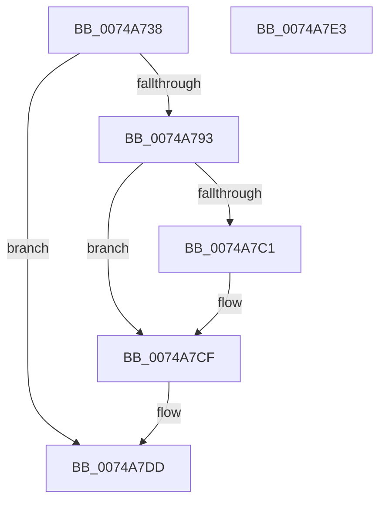

# KsepDeletePatchSdb

- RVA: `0x0074A738`–`0x0074A7E4` (길이 `172` bytes)
- VA: `0x000000014074A738`
- 실행 섹션: `PAGE`
- PDB 이름 있음: `예`; PDB Function 태그: `아니요`
- unwind 정보 RVA: `0x0008A308`
- 디코드: `43`개 명령, `172/172` bytes 표시
- 미해석 바이트: `0` (있으면 어셈블리에 `.byte`로 보존)

> 이 문서는 커널 이미지의 기계어와 PDB 기호를 분석해 생성했습니다. 4번과 5번은 함수 원형과 자료형을 바이너리 사용 방식에서 추정한 C 해석이며 원본 소스 복구 결과는 아닙니다.

## 1. Dependencies

- 직접 호출 지점: **4**; 고유 호출 대상: **4**
- 직접 호출자로 확인된 함수: **1**
- RIP 상대 이미지 참조: **5**

### Outgoing calls
- `0x0074A75E` → [RtlInitUnicodeString](../../text/42/RtlInitUnicodeString_function_0042A780.md) (function, `0x0042A780`)
- `0x0074A78A` → [ZwDeleteFile](../../text/6A/ZwDeleteFile_function_006AEC30.md) (function, `0x006AEC30`)
- `0x0074A7CA` → [KsepDebugPrint](../../text/4D/KsepDebugPrint_function_004DCFF0.md) (function, `0x004DCFF0`)
- `0x0074A7D8` → [KsepLogError](../../text/49/KsepLogError_function_00499A98.md) (function, `0x00499A98`)

### Direct callers
- [KseShimDatabaseOpen](../95/KseShimDatabaseOpen_function_0095AD7C.md) at `0x0095AEEF`

### Static image references
- `0x0074A743` → RVA `0x0001BFC0` (`.rdata`; read)
- `0x0074A798` → RVA `0x00F101C0` (`.data`; read/write)
- `0x0074A7A2` → RVA `0x00F101E0` (`.data`; read)
- `0x0074A7B0` → RVA `0x00E66CE8` (`.data`; read)
- `0x0074A7C1` → RVA `0x00B00F70` (` ?? ::NNGAKEGL::`string'`; read)

## 2. Other-region calls and transfers

- 다른 실행 섹션으로 향하는 call: **4**
  - `0x0074A75E` → [RtlInitUnicodeString](../../text/42/RtlInitUnicodeString_function_0042A780.md) (`PAGE` → `.text`)
  - `0x0074A78A` → [ZwDeleteFile](../../text/6A/ZwDeleteFile_function_006AEC30.md) (`PAGE` → `.text`)
  - `0x0074A7CA` → [KsepDebugPrint](../../text/4D/KsepDebugPrint_function_004DCFF0.md) (`PAGE` → `.text`)
  - `0x0074A7D8` → [KsepLogError](../../text/49/KsepLogError_function_00499A98.md) (`PAGE` → `.text`)
- 별도 외부 분기/꼬리 이동을 확인하지 못했습니다.

## 3. Assembly (complete function range)

```asm
0074A738  40 55                           push rbp
0074A73A  48 8B EC                        mov rbp, rsp
0074A73D  48 83 EC 60                     sub rsp, 0x60
0074A741  33 C0                           xor eax, eax
0074A743  48 8D 15 76 18 8D FF            lea rdx, [rip - 0x72e78a]
0074A74A  21 45 EC                        and dword ptr [rbp - 0x14], eax
0074A74D  48 8D 4D C0                     lea rcx, [rbp - 0x40]
0074A751  0F 57 C0                        xorps xmm0, xmm0
0074A754  89 45 D4                        mov dword ptr [rbp - 0x2c], eax
0074A757  21 45 D4                        and dword ptr [rbp - 0x2c], eax
0074A75A  0F 11 45 C0                     movups xmmword ptr [rbp - 0x40], xmm0
0074A75E  E8 1D 00 CE FF                  call 0x14042a780
0074A763  48 83 65 D8 00                  and qword ptr [rbp - 0x28], 0
0074A768  48 8D 45 C0                     lea rax, [rbp - 0x40]
0074A76C  0F 57 C0                        xorps xmm0, xmm0
0074A76F  48 89 45 E0                     mov qword ptr [rbp - 0x20], rax
0074A773  48 8D 4D D0                     lea rcx, [rbp - 0x30]
0074A777  C7 45 D0 30 00 00 00            mov dword ptr [rbp - 0x30], 0x30
0074A77E  F3 0F 7F 45 F0                  movdqu xmmword ptr [rbp - 0x10], xmm0
0074A783  C7 45 E8 40 02 00 00            mov dword ptr [rbp - 0x18], 0x240
0074A78A  E8 A1 44 F6 FF                  call 0x1406aec30
0074A78F  85 C0                           test eax, eax
0074A791  79 4A                           jns 0x14074a7dd
0074A793  B9 01 00 00 00                  mov ecx, 1
0074A798  F0 0F C1 0D 20 5A 7C 00         lock xadd dword ptr [rip + 0x7c5a20], ecx
0074A7A0  FF C1                           inc ecx
0074A7A2  48 8D 15 37 5A 7C 00            lea rdx, [rip + 0x7c5a37]
0074A7A9  83 E1 3F                        and ecx, 0x3f
0074A7AC  89 44 CA 04                     mov dword ptr [rdx + rcx*8 + 4], eax
0074A7B0  8B 05 32 C5 71 00               mov eax, dword ptr [rip + 0x71c532]
0074A7B6  C7 04 CA 24 02 09 00            mov dword ptr [rdx + rcx*8], 0x90224
0074A7BD  A8 02                           test al, 2
0074A7BF  74 0E                           je 0x14074a7cf
0074A7C1  48 8D 15 A8 67 3B 00            lea rdx, [rip + 0x3b67a8]
0074A7C8  33 C9                           xor ecx, ecx
0074A7CA  E8 21 28 D9 FF                  call 0x1404dcff0
0074A7CF  48 8D 15 9A 67 3B 00            lea rdx, [rip + 0x3b679a]
0074A7D6  33 C9                           xor ecx, ecx
0074A7D8  E8 BB F2 D4 FF                  call 0x140499a98
0074A7DD  48 83 C4 60                     add rsp, 0x60
0074A7E1  5D                              pop rbp
0074A7E2  C3                              ret
0074A7E3  CC                              int3
```

## 4. C-style interpretation (structured pseudocode)

```c
__int64 __fastcall KsepDeletePatchSdb(void)
{
    __int64 result;
    __int64 v_rsp;
    unsigned __int64 v_stack_m18;
    unsigned int v_stack_m1C;
    unsigned int v_stack_m20;
    unsigned __int64 v_stack_m28;
    unsigned __int64 v_stack_m30;
    unsigned int v_stack_m34;
    unsigned __int64 v_stack_m38;
    unsigned __int64 v_stack_m48;

    v_rsp = (v_rsp) - (96);
    result = 0;
    v_stack_m34 = 0;
    v_stack_m48 = v_xmm0;
    result = RtlInitUnicodeString(v_stack_m48, v_rip - 7530378, a3, a4);
    v_stack_m28 = v_stack_m48;
    v_stack_m38 = 48;
    v_stack_m18 = v_xmm0;
    v_stack_m20 = 576;
    result = ZwDeleteFile(v_stack_m38, v_rip - 7530378, a3, a4);
    if (!sign_flag) goto loc_0074A7DD;
    a1 = (unsigned int)((1) + 1);
    a1 = (unsigned int)((a1) & (63));
    *(unsigned int *)(v_rip + 8149559 + a1 * 8 + 4) = (unsigned int)(result);
    *(unsigned int *)(v_rip + 8149559 + a1 * 8) = 0x90224ULL;
    result = (unsigned int)(*(unsigned int *)(v_rip + 7456050));
    if ((((unsigned __int8)((unsigned int)(*(unsigned int *)(v_rip + 7456050)))) & (2)) != 0) {
        a2 = v_rip + 3893160;
        a1 = 0;
        result = KsepDebugPrint(a1, a2, a3, a4);
    }
    a1 = 0;
    result = KsepLogError(a1, v_rip + 3893146, a3, a4);
loc_0074A7DD:
    v_rsp = (v_rsp) + (96);
    return result;
}
```

## 5. (Beta) C Style

```c
void KsepDeletePatchSdb(void)
{
    int64_t result;
    int64_t local_rsp;
    uint64_t v_stack_m18;
    uint32_t v_stack_m1C;
    uint32_t v_stack_m20;
    uint64_t v_stack_m28;
    uint64_t v_stack_m30;
    uint32_t v_stack_m34;
    uint64_t v_stack_m38;
    uint64_t v_stack_m48;

    local_rsp = (local_rsp) - (96);
    result = 0;
    v_stack_m34 = 0;
    v_stack_m48 = v_xmm0;
    result = RtlInitUnicodeString(v_stack_m48, v_rip - 7530378, a3, a4);
    v_stack_m28 = v_stack_m48;
    v_stack_m38 = 48;
    v_stack_m18 = v_xmm0;
    v_stack_m20 = 576;
    result = ZwDeleteFile(v_stack_m38, v_rip - 7530378, a3, a4);
    if (!sign_flag) goto loc_0074A7DD;
    a1 = (uint32_t)((1) + 1);
    a1 = (uint32_t)((a1) & (63));
    *(uint32_t *)(v_rip + 0x7C5A37 + a1 * 8 + 0x4) = (uint32_t)(result);
    *(uint32_t *)(v_rip + 0x7C5A37 + a1 * 8) = 0x90224ULL;
    result = (uint32_t)(*(uint32_t *)(v_rip + 0x71C532));
    if ((((uint8_t)((uint32_t)(*(uint32_t *)(v_rip + 0x71C532)))) & (2)) != 0) {
        a2 = v_rip + 3893160;
        a1 = 0;
        result = KsepDebugPrint(a1, a2, a3, a4);
    }
    a1 = 0;
    result = KsepLogError(a1, v_rip + 3893146, a3, a4);
loc_0074A7DD:
    local_rsp = (local_rsp) + (96);
    return result;
}
```

## 6. Execution-region graph

[열기: 2D/3D 그래프와 함수 탐색 컨트롤 패널](../../../control-panel.html?section=page&rva=0x0074A738&view=graph)

- 2D 그래프는 위에서 아래로 흐르고, 3D 그래프는 빈 공간을 드래그해 회전합니다. Shift+드래그는 이동, 휠은 확대·축소, 함수 노드 선택은 대상 보고서 이동입니다.

### Static fallback


