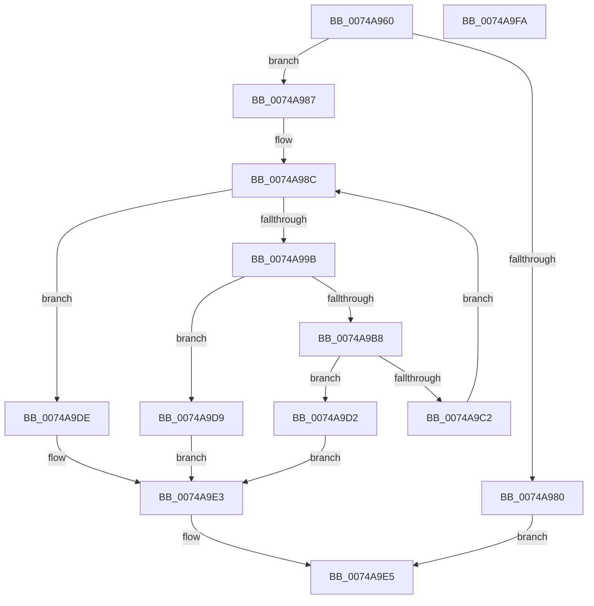

# KsepGetLoadedModulesList

- RVA: `0x0074A960`–`0x0074A9FB` (길이 `155` bytes)
- VA: `0x000000014074A960`
- 실행 섹션: `PAGE`
- PDB 이름 있음: `예`; PDB Function 태그: `아니요`
- unwind 정보 RVA: `0x0006C8E8`
- 디코드: `47`개 명령, `155/155` bytes 표시
- 미해석 바이트: `0` (있으면 어셈블리에 `.byte`로 보존)

> 이 문서는 커널 이미지의 기계어와 PDB 기호를 분석해 생성했습니다. 4번과 5번은 함수 원형과 자료형을 바이너리 사용 방식에서 추정한 C 해석이며 원본 소스 복구 결과는 아닙니다.

## 1. Dependencies

- 직접 호출 지점: **4**; 고유 호출 대상: **3**
- 직접 호출자로 확인된 함수: **2**
- RIP 상대 이미지 참조: **0**

### Outgoing calls
- `0x0074A98E` → [KsepPoolAllocatePaged](../../text/4A/KsepPoolAllocatePaged_function_004A9EFC.md) (function, `0x004A9EFC`)
- `0x0074A9AB` → [ZwQuerySystemInformation](../../text/6A/ZwQuerySystemInformation_function_006AD790.md) (function, `0x006AD790`)
- `0x0074A9C2` → [KsepPoolFreePaged](../../text/4B/KsepPoolFreePaged_function_004B0E10.md) (function, `0x004B0E10`)
- `0x0074A9D2` → [KsepPoolFreePaged](../../text/4B/KsepPoolFreePaged_function_004B0E10.md) (function, `0x004B0E10`)

### Direct callers
- [KseRegisterShimEx](KseRegisterShimEx_function_007494D0.md) at `0x00749525`
- [KsepResolveApplicableShimsForDriver](KsepResolveApplicableShimsForDriver_function_0074A168.md) at `0x0074A467`

### Static image references
- 디코드된 RIP-relative 메모리 참조가 없습니다.

## 2. Other-region calls and transfers

- 다른 실행 섹션으로 향하는 call: **4**
  - `0x0074A98E` → [KsepPoolAllocatePaged](../../text/4A/KsepPoolAllocatePaged_function_004A9EFC.md) (`PAGE` → `.text`)
  - `0x0074A9AB` → [ZwQuerySystemInformation](../../text/6A/ZwQuerySystemInformation_function_006AD790.md) (`PAGE` → `.text`)
  - `0x0074A9C2` → [KsepPoolFreePaged](../../text/4B/KsepPoolFreePaged_function_004B0E10.md) (`PAGE` → `.text`)
  - `0x0074A9D2` → [KsepPoolFreePaged](../../text/4B/KsepPoolFreePaged_function_004B0E10.md) (`PAGE` → `.text`)
- 별도 외부 분기/꼬리 이동을 확인하지 못했습니다.

## 3. Assembly (complete function range)

```asm
0074A960  48 8B C4                        mov rax, rsp
0074A963  48 89 58 10                     mov qword ptr [rax + 0x10], rbx
0074A967  48 89 68 18                     mov qword ptr [rax + 0x18], rbp
0074A96B  48 89 70 20                     mov qword ptr [rax + 0x20], rsi
0074A96F  57                              push rdi
0074A970  48 83 EC 20                     sub rsp, 0x20
0074A974  83 60 08 00                     and dword ptr [rax + 8], 0
0074A978  48 8B F1                        mov rsi, rcx
0074A97B  48 85 C9                        test rcx, rcx
0074A97E  75 07                           jne 0x14074a987
0074A980  B8 0D 00 00 C0                  mov eax, 0xc000000d
0074A985  EB 5E                           jmp 0x14074a9e5
0074A987  BF 30 01 00 00                  mov edi, 0x130
0074A98C  8B CF                           mov ecx, edi
0074A98E  E8 69 F5 D5 FF                  call 0x1404a9efc
0074A993  48 8B D8                        mov rbx, rax
0074A996  48 85 C0                        test rax, rax
0074A999  74 43                           je 0x14074a9de
0074A99B  4C 8D 4C 24 30                  lea r9, [rsp + 0x30]
0074A9A0  44 8B C7                        mov r8d, edi
0074A9A3  48 8B D0                        mov rdx, rax
0074A9A6  B9 0B 00 00 00                  mov ecx, 0xb
0074A9AB  E8 E0 2D F6 FF                  call 0x1406ad790
0074A9B0  8B 2B                           mov ebp, dword ptr [rbx]
0074A9B2  8B F8                           mov edi, eax
0074A9B4  85 C0                           test eax, eax
0074A9B6  79 21                           jns 0x14074a9d9
0074A9B8  48 8B CB                        mov rcx, rbx
0074A9BB  3D 04 00 00 C0                  cmp eax, 0xc0000004
0074A9C0  75 10                           jne 0x14074a9d2
0074A9C2  E8 49 64 D6 FF                  call 0x1404b0e10
0074A9C7  69 FD 28 01 00 00               imul edi, ebp, 0x128
0074A9CD  83 C7 08                        add edi, 8
0074A9D0  EB BA                           jmp 0x14074a98c
0074A9D2  E8 39 64 D6 FF                  call 0x1404b0e10
0074A9D7  EB 0A                           jmp 0x14074a9e3
0074A9D9  48 89 1E                        mov qword ptr [rsi], rbx
0074A9DC  EB 05                           jmp 0x14074a9e3
0074A9DE  BF 9A 00 00 C0                  mov edi, 0xc000009a
0074A9E3  8B C7                           mov eax, edi
0074A9E5  48 8B 5C 24 38                  mov rbx, qword ptr [rsp + 0x38]
0074A9EA  48 8B 6C 24 40                  mov rbp, qword ptr [rsp + 0x40]
0074A9EF  48 8B 74 24 48                  mov rsi, qword ptr [rsp + 0x48]
0074A9F4  48 83 C4 20                     add rsp, 0x20
0074A9F8  5F                              pop rdi
0074A9F9  C3                              ret
0074A9FA  CC                              int3
```

## 4. C-style interpretation (structured pseudocode)

```c
__int64 __fastcall KsepGetLoadedModulesList(__int64 a1)
{
    __int64 result;
    __int64 v_rdi;
    __int64 v_rsp;
    unsigned __int64 v_stack_p10;
    unsigned __int64 v_stack_p18;
    unsigned __int64 v_stack_p20;
    unsigned __int64 v_stack_p8;

    *(unsigned __int64 *)(v_rsp + 16) = v_rbx;
    *(unsigned __int64 *)(v_rsp + 24) = v_rbp;
    *(unsigned __int64 *)(v_rsp + 32) = v_rsi;
    v_rsp = (v_rsp) - (32);
    if (a1 != 0) goto loc_0074A987;
    goto loc_0074A9E5;
loc_0074A987:
loc_0074A98C:
    result = KsepPoolAllocatePaged(304, a2, a3, a4);
    if (result == 0) goto loc_0074A9DE;
    result = ZwQuerySystemInformation(11, result, 304, v_stack_p8);
    if (!sign_flag) goto loc_0074A9D9;
    if (((unsigned int)(result)) != 0xC0000004ULL) goto loc_0074A9D2;
    result = KsepPoolFreePaged(result, result, 304, v_stack_p8);
    v_rdi = (unsigned int)(((unsigned int)((unsigned int)(result))) * ((unsigned int)((unsigned int)(*(unsigned int *)(result)))));
    v_rdi = (unsigned int)((v_rdi) + (8));
    goto loc_0074A98C;
loc_0074A9D2:
    result = KsepPoolFreePaged(result, result, 304, v_stack_p8);
    goto loc_0074A9E3;
loc_0074A9D9:
    *(unsigned __int64 *)(a1) = result;
    goto loc_0074A9E3;
loc_0074A9DE:
loc_0074A9E3:
loc_0074A9E5:
    v_rsp = (v_rsp) + (32);
    return (unsigned int)((unsigned int)((unsigned int)(0xC000009AULL)));
}
```

## 5. (Beta) C Style

```c
int64_t KsepGetLoadedModulesList(void *Arg1)
{
    uint8_t *arg1 = (uint8_t *)Arg1;

    int64_t result;
    int64_t local_rdi;
    int64_t local_rsp;
    uint64_t v_stack_p10;
    uint64_t v_stack_p18;
    uint64_t v_stack_p20;
    uint64_t v_stack_p8;

    *(uint64_t *)(local_rsp + 0x10) = local_rbx;
    *(uint64_t *)(local_rsp + 0x18) = local_rbp;
    *(uint64_t *)(local_rsp + 0x20) = local_rsi;
    local_rsp = (local_rsp) - (32);
    if (Arg1 != NULL) goto loc_0074A987;
    goto loc_0074A9E5;
loc_0074A987:
loc_0074A98C:
    result = KsepPoolAllocatePaged(304, a2, a3, a4);
    if (result == 0) goto loc_0074A9DE;
    result = ZwQuerySystemInformation(11, result, 304, v_stack_p8);
    if (!sign_flag) goto loc_0074A9D9;
    if (((uint32_t)(result)) != 0xC0000004ULL) goto loc_0074A9D2;
    result = KsepPoolFreePaged(result, result, 304, v_stack_p8);
    local_rdi = (uint32_t)(((uint32_t)((uint32_t)(result))) * ((uint32_t)((uint32_t)(*(uint32_t *)(result)))));
    local_rdi = (uint32_t)((local_rdi) + (8));
    goto loc_0074A98C;
loc_0074A9D2:
    result = KsepPoolFreePaged(result, result, 304, v_stack_p8);
    goto loc_0074A9E3;
loc_0074A9D9:
    *(uint64_t *)(arg1) = result;
    goto loc_0074A9E3;
loc_0074A9DE:
loc_0074A9E3:
loc_0074A9E5:
    local_rsp = (local_rsp) + (32);
    return (uint32_t)((uint32_t)((uint32_t)(0xC000009AULL)));
}
```

### 관측된 메모리 오프셋

구조체 형식이 확인되지 않은 접근은 인자 기준의 오프셋으로만 기록했습니다.

| 기준 인자 | 오프셋 표현 | 폭 (bit) | 접근 |
|---|---:|---:|---|
| `Arg1` | `+ 0x0` | `64` | `W` |

## 6. Execution-region graph

[열기: 2D/3D 그래프와 함수 탐색 컨트롤 패널](../../../control-panel.html?section=page&rva=0x0074A960&view=graph)

- 2D 그래프는 위에서 아래로 흐르고, 3D 그래프는 빈 공간을 드래그해 회전합니다. Shift+드래그는 이동, 휠은 확대·축소, 함수 노드 선택은 대상 보고서 이동입니다.

### Static fallback


