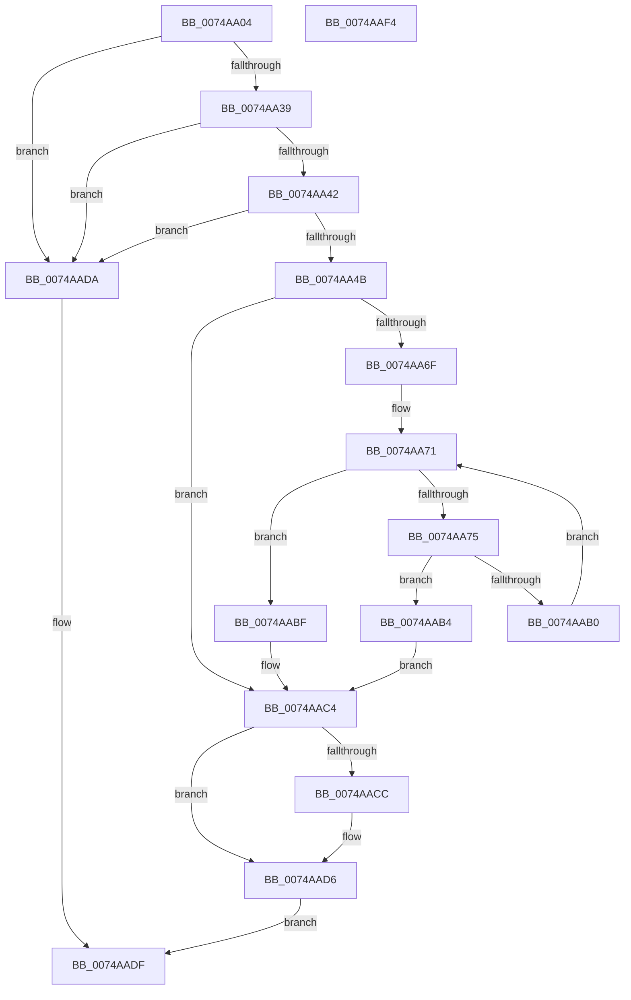

# KsepGetModuleInfoByName

- RVA: `0x0074AA04`–`0x0074AAF5` (길이 `241` bytes)
- VA: `0x000000014074AA04`
- 실행 섹션: `PAGE`
- PDB 이름 있음: `예`; PDB Function 태그: `아니요`
- unwind 정보 RVA: `0x0006F874`
- 디코드: `68`개 명령, `241/241` bytes 표시
- 미해석 바이트: `0` (있으면 어셈블리에 `.byte`로 보존)

> 이 문서는 커널 이미지의 기계어와 PDB 기호를 분석해 생성했습니다. 4번과 5번은 함수 원형과 자료형을 바이너리 사용 방식에서 추정한 C 해석이며 원본 소스 복구 결과는 아닙니다.

## 1. Dependencies

- 직접 호출 지점: **5**; 고유 호출 대상: **5**
- 직접 호출자로 확인된 함수: **1**
- RIP 상대 이미지 참조: **0**

### Outgoing calls
- `0x0074AA52` → [RtlInitUnicodeString](../../text/42/RtlInitUnicodeString_function_0042A780.md) (function, `0x0042A780`)
- `0x0074AA64` → [RtlUnicodeStringToAnsiString](../90/RtlUnicodeStringToAnsiString_function_0090D1F0.md) (function, `0x0090D1F0`)
- `0x0074AA95` → [RtlInitAnsiString](../../text/47/RtlInitAnsiString_function_00470F40.md) (function, `0x00470F40`)
- `0x0074AAA7` → [RtlCompareString](../90/RtlCompareString_function_0090E880.md) (function, `0x0090E880`)
- `0x0074AAD1` → [RtlFreeAnsiString](../9C/RtlFreeAnsiString_function_009C0800.md) (function, `0x009C0800`)

### Direct callers
- [KsepResolveShimHooks](KsepResolveShimHooks_function_00749A9C.md) at `0x00749B11`

### Static image references
- 디코드된 RIP-relative 메모리 참조가 없습니다.

## 2. Other-region calls and transfers

- 다른 실행 섹션으로 향하는 call: **2**
  - `0x0074AA52` → [RtlInitUnicodeString](../../text/42/RtlInitUnicodeString_function_0042A780.md) (`PAGE` → `.text`)
  - `0x0074AA95` → [RtlInitAnsiString](../../text/47/RtlInitAnsiString_function_00470F40.md) (`PAGE` → `.text`)
- 별도 외부 분기/꼬리 이동을 확인하지 못했습니다.

## 3. Assembly (complete function range)

```asm
0074AA04  48 8B C4                        mov rax, rsp
0074AA07  48 89 58 08                     mov qword ptr [rax + 8], rbx
0074AA0B  48 89 68 10                     mov qword ptr [rax + 0x10], rbp
0074AA0F  48 89 70 18                     mov qword ptr [rax + 0x18], rsi
0074AA13  57                              push rdi
0074AA14  48 83 EC 50                     sub rsp, 0x50
0074AA18  0F 57 C0                        xorps xmm0, xmm0
0074AA1B  0F 57 C9                        xorps xmm1, xmm1
0074AA1E  49 8B F0                        mov rsi, r8
0074AA21  48 8B FA                        mov rdi, rdx
0074AA24  0F 11 40 C8                     movups xmmword ptr [rax - 0x38], xmm0
0074AA28  0F 11 48 E8                     movups xmmword ptr [rax - 0x18], xmm1
0074AA2C  0F 11 40 D8                     movups xmmword ptr [rax - 0x28], xmm0
0074AA30  48 85 C9                        test rcx, rcx
0074AA33  0F 84 A1 00 00 00               je 0x14074aada
0074AA39  4D 85 C0                        test r8, r8
0074AA3C  0F 84 98 00 00 00               je 0x14074aada
0074AA42  48 85 D2                        test rdx, rdx
0074AA45  0F 84 8F 00 00 00               je 0x14074aada
0074AA4B  48 8B D1                        mov rdx, rcx
0074AA4E  48 8D 48 D8                     lea rcx, [rax - 0x28]
0074AA52  E8 29 FD CD FF                  call 0x14042a780
0074AA57  41 B0 01                        mov r8b, 1
0074AA5A  48 8D 54 24 30                  lea rdx, [rsp + 0x30]
0074AA5F  48 8D 4C 24 20                  lea rcx, [rsp + 0x20]
0074AA64  E8 87 27 1C 00                  call 0x14090d1f0
0074AA69  8B D8                           mov ebx, eax
0074AA6B  85 C0                           test eax, eax
0074AA6D  78 55                           js 0x14074aac4
0074AA6F  33 DB                           xor ebx, ebx
0074AA71  3B 1F                           cmp ebx, dword ptr [rdi]
0074AA73  73 4A                           jae 0x14074aabf
0074AA75  8B C3                           mov eax, ebx
0074AA77  48 8D 4C 24 40                  lea rcx, [rsp + 0x40]
0074AA7C  48 69 E8 28 01 00 00            imul rbp, rax, 0x128
0074AA83  48 83 C5 08                     add rbp, 8
0074AA87  48 03 EF                        add rbp, rdi
0074AA8A  0F B7 55 26                     movzx edx, word ptr [rbp + 0x26]
0074AA8E  48 83 C2 28                     add rdx, 0x28
0074AA92  48 03 D5                        add rdx, rbp
0074AA95  E8 A6 64 D2 FF                  call 0x140470f40
0074AA9A  41 B0 01                        mov r8b, 1
0074AA9D  48 8D 54 24 20                  lea rdx, [rsp + 0x20]
0074AAA2  48 8D 4C 24 40                  lea rcx, [rsp + 0x40]
0074AAA7  E8 D4 3D 1C 00                  call 0x14090e880
0074AAAC  85 C0                           test eax, eax
0074AAAE  74 04                           je 0x14074aab4
0074AAB0  FF C3                           inc ebx
0074AAB2  EB BD                           jmp 0x14074aa71
0074AAB4  48 8B 45 10                     mov rax, qword ptr [rbp + 0x10]
0074AAB8  33 DB                           xor ebx, ebx
0074AABA  48 89 06                        mov qword ptr [rsi], rax
0074AABD  EB 05                           jmp 0x14074aac4
0074AABF  BB 25 02 00 C0                  mov ebx, 0xc0000225
0074AAC4  48 83 7C 24 28 00               cmp qword ptr [rsp + 0x28], 0
0074AACA  74 0A                           je 0x14074aad6
0074AACC  48 8D 4C 24 20                  lea rcx, [rsp + 0x20]
0074AAD1  E8 2A 5D 27 00                  call 0x1409c0800
0074AAD6  8B C3                           mov eax, ebx
0074AAD8  EB 05                           jmp 0x14074aadf
0074AADA  B8 0D 00 00 C0                  mov eax, 0xc000000d
0074AADF  48 8B 5C 24 60                  mov rbx, qword ptr [rsp + 0x60]
0074AAE4  48 8B 6C 24 68                  mov rbp, qword ptr [rsp + 0x68]
0074AAE9  48 8B 74 24 70                  mov rsi, qword ptr [rsp + 0x70]
0074AAEE  48 83 C4 50                     add rsp, 0x50
0074AAF2  5F                              pop rdi
0074AAF3  C3                              ret
0074AAF4  CC                              int3
```

## 4. C-style interpretation (structured pseudocode)

```c
__int64 __fastcall KsepGetModuleInfoByName(__int64 a1, __int64 a2, __int64 a3)
{
    __int64 result;
    __int64 v_rbp;
    __int64 v_rbx;
    __int64 v_rsp;
    unsigned __int64 v_stack_m18;
    unsigned __int64 v_stack_m28;
    unsigned __int64 v_stack_m30;
    unsigned __int64 v_stack_m38;
    unsigned __int64 v_stack_p10;
    unsigned __int64 v_stack_p18;
    unsigned __int64 v_stack_p8;

    *(unsigned __int64 *)(v_rsp + 8) = v_rbx;
    *(unsigned __int64 *)(v_rsp + 16) = v_rbp;
    *(unsigned __int64 *)(v_rsp + 24) = v_rsi;
    v_rsp = (v_rsp) - (80);
    *(unsigned __int64 *)(v_rsp - 56) = v_xmm0;
    *(unsigned __int64 *)(v_rsp - 24) = v_xmm1;
    *(unsigned __int64 *)(v_rsp - 40) = v_xmm0;
    if (a1 == 0) goto loc_0074AADA;
    if (a3 == 0) goto loc_0074AADA;
    if (a2 == 0) goto loc_0074AADA;
    result = RtlInitUnicodeString(v_rsp - 40, a1, a3, a4);
    result = RtlUnicodeStringToAnsiString(v_stack_m38, v_stack_m28, 1, a4);
    if (sign_flag) goto loc_0074AAC4;
    v_rbx = 0;
loc_0074AA71:
    if (0 >= (*(unsigned int *)(a2))) goto loc_0074AABF;
    v_rbp = (v_rbp) * (0);
    v_rbp = (v_rbp) + (8);
    v_rbp = (v_rbp) + (a2);
    a2 = (*(unsigned __int16 *)(v_rbp + 38)) + (40);
    a2 = (a2) + (v_rbp);
    result = RtlInitAnsiString(v_stack_m18, a2, 1, a4);
    result = RtlCompareString(v_stack_m18, v_stack_m38, 1, a4);
    if ((unsigned int)(result) == 0) goto loc_0074AAB4;
    v_rbx = (unsigned int)((v_rbx) + 1);
    goto loc_0074AA71;
loc_0074AAB4:
    v_rbx = 0;
    *(unsigned __int64 *)(a3) = *(unsigned __int64 *)(v_rbp + 16);
    goto loc_0074AAC4;
loc_0074AABF:
loc_0074AAC4:
    result = *(unsigned __int64 *)(v_rbp + 16);
    if (v_stack_m30 != 0) {
        a1 = v_stack_m38;
        result = RtlFreeAnsiString(a1, v_stack_m38, 1, a4);
    }
    goto loc_0074AADF;
loc_0074AADA:
loc_0074AADF:
    v_rsp = (v_rsp) + (80);
    return (unsigned int)(0xC000000DULL);
}
```

## 5. (Beta) C Style

```c
int64_t KsepGetModuleInfoByName(int64_t Arg1, void *Arg2, void *Arg3)
{
    uint8_t *arg2 = (uint8_t *)Arg2;
    uint8_t *arg3 = (uint8_t *)Arg3;

    int64_t result;
    int64_t local_rbp;
    int64_t local_rbx;
    int64_t local_rsp;
    uint64_t v_stack_m18;
    uint64_t v_stack_m28;
    uint64_t v_stack_m30;
    uint64_t v_stack_m38;
    uint64_t v_stack_p10;
    uint64_t v_stack_p18;
    uint64_t v_stack_p8;

    *(uint64_t *)(local_rsp + 0x8) = local_rbx;
    *(uint64_t *)(local_rsp + 0x10) = local_rbp;
    *(uint64_t *)(local_rsp + 0x18) = local_rsi;
    local_rsp = (local_rsp) - (80);
    *(uint64_t *)(local_rsp - 0x38) = v_xmm0;
    *(uint64_t *)(local_rsp - 0x18) = v_xmm1;
    *(uint64_t *)(local_rsp - 0x28) = v_xmm0;
    if (Arg1 == 0) goto loc_0074AADA;
    if (Arg3 == NULL) goto loc_0074AADA;
    if (Arg2 == NULL) goto loc_0074AADA;
    result = RtlInitUnicodeString(local_rsp - 40, Arg1, Arg3, a4);
    result = RtlUnicodeStringToAnsiString(v_stack_m38, v_stack_m28, 1, a4);
    if (sign_flag) goto loc_0074AAC4;
    local_rbx = 0;
loc_0074AA71:
    if (0 >= (*(uint32_t *)(arg2))) goto loc_0074AABF;
    local_rbp = (local_rbp) * (0);
    local_rbp = (local_rbp) + (8);
    local_rbp = (local_rbp) + (Arg2);
    Arg2 = (*(uint16_t *)(local_rbp + 0x26)) + (40);
    Arg2 = (Arg2) + (local_rbp);
    result = RtlInitAnsiString(v_stack_m18, Arg2, 1, a4);
    result = RtlCompareString(v_stack_m18, v_stack_m38, 1, a4);
    if ((uint32_t)(result) == 0) goto loc_0074AAB4;
    local_rbx = (uint32_t)((local_rbx) + 1);
    goto loc_0074AA71;
loc_0074AAB4:
    local_rbx = 0;
    *(uint64_t *)(arg3) = *(uint64_t *)(local_rbp + 0x10);
    goto loc_0074AAC4;
loc_0074AABF:
loc_0074AAC4:
    result = *(uint64_t *)(local_rbp + 0x10);
    if (v_stack_m30 != 0) {
        Arg1 = v_stack_m38;
        result = RtlFreeAnsiString(Arg1, v_stack_m38, 1, a4);
    }
    goto loc_0074AADF;
loc_0074AADA:
loc_0074AADF:
    local_rsp = (local_rsp) + (80);
    return (uint32_t)(0xC000000DULL);
}
```

### 관측된 메모리 오프셋

구조체 형식이 확인되지 않은 접근은 인자 기준의 오프셋으로만 기록했습니다.

| 기준 인자 | 오프셋 표현 | 폭 (bit) | 접근 |
|---|---:|---:|---|
| `Arg2` | `+ 0x0` | `32` | `R` |
| `Arg3` | `+ 0x0` | `64` | `W` |

## 6. Execution-region graph

[열기: 2D/3D 그래프와 함수 탐색 컨트롤 패널](../../../control-panel.html?section=page&rva=0x0074AA04&view=graph)

- 2D 그래프는 위에서 아래로 흐르고, 3D 그래프는 빈 공간을 드래그해 회전합니다. Shift+드래그는 이동, 휠은 확대·축소, 함수 노드 선택은 대상 보고서 이동입니다.

### Static fallback


