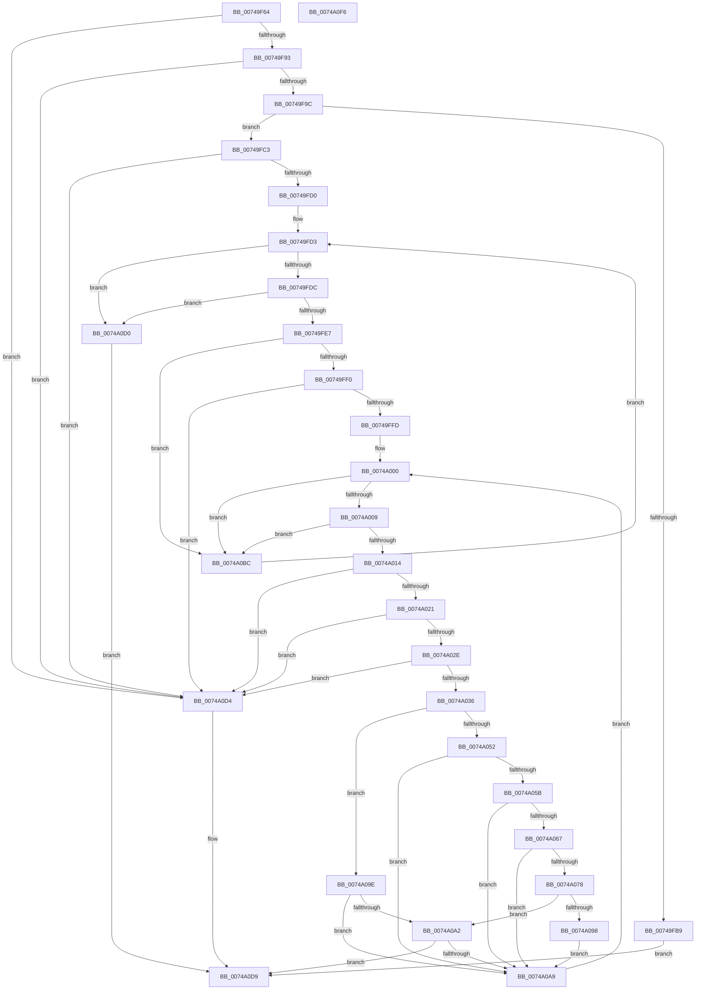

# KsepPatchDriverImportsTable

- RVA: `0x00749F64`–`0x0074A0F7` (길이 `403` bytes)
- VA: `0x0000000140749F64`
- 실행 섹션: `PAGE`
- PDB 이름 있음: `예`; PDB Function 태그: `아니요`
- unwind 정보 RVA: `0x0008C2BC`
- 디코드: `113`개 명령, `403/403` bytes 표시
- 미해석 바이트: `0` (있으면 어셈블리에 `.byte`로 보존)

> 이 문서는 커널 이미지의 기계어와 PDB 기호를 분석해 생성했습니다. 4번과 5번은 함수 원형과 자료형을 바이너리 사용 방식에서 추정한 C 해석이며 원본 소스 복구 결과는 아닙니다.

## 1. Dependencies

- 직접 호출 지점: **6**; 고유 호출 대상: **5**
- 직접 호출자로 확인된 함수: **1**
- RIP 상대 이미지 참조: **0**

### Outgoing calls
- `0x00749FAC` → [RtlImageDirectoryEntryToData](../../text/43/RtlImageDirectoryEntryToData_function_004328D0.md) (function, `0x004328D0`)
- `0x0074A046` → [KsepPatchImportTableEntry](KsepPatchImportTableEntry_function_0074A100.md) (function, `0x0074A100`)
- `0x0074A052` → [VfIsVerifierEnabled](../../text/4C/VfIsVerifierEnabled_function_004C72F0.md) (function, `0x004C72F0`)
- `0x0074A05E` → [VfIsVerificationEnabledForImage](../../text/61/VfIsVerificationEnabledForImage_function_006121D0.md) (function, `0x006121D0`)
- `0x0074A06B` → [VfGetHookAddressForOriginal](../../pagevrfy/B9/VfGetHookAddressForOriginal_function_00B9A658.md) (function, `0x00B9A658`)
- `0x0074A08F` → [KsepPatchImportTableEntry](KsepPatchImportTableEntry_function_0074A100.md) (function, `0x0074A100`)

### Direct callers
- [KsepApplyShimsToDriver](KsepApplyShimsToDriver_function_00749C84.md) at `0x00749D40`

### Static image references
- 디코드된 RIP-relative 메모리 참조가 없습니다.

## 2. Other-region calls and transfers

- 다른 실행 섹션으로 향하는 call: **4**
  - `0x00749FAC` → [RtlImageDirectoryEntryToData](../../text/43/RtlImageDirectoryEntryToData_function_004328D0.md) (`PAGE` → `.text`)
  - `0x0074A052` → [VfIsVerifierEnabled](../../text/4C/VfIsVerifierEnabled_function_004C72F0.md) (`PAGE` → `.text`)
  - `0x0074A05E` → [VfIsVerificationEnabledForImage](../../text/61/VfIsVerificationEnabledForImage_function_006121D0.md) (`PAGE` → `.text`)
  - `0x0074A06B` → [VfGetHookAddressForOriginal](../../pagevrfy/B9/VfGetHookAddressForOriginal_function_00B9A658.md) (`PAGE` → `PAGEVRFY`)
- 별도 외부 분기/꼬리 이동을 확인하지 못했습니다.

## 3. Assembly (complete function range)

```asm
00749F64  48 8B C4                        mov rax, rsp
00749F67  48 89 58 10                     mov qword ptr [rax + 0x10], rbx
00749F6B  48 89 68 18                     mov qword ptr [rax + 0x18], rbp
00749F6F  48 89 70 20                     mov qword ptr [rax + 0x20], rsi
00749F73  57                              push rdi
00749F74  41 54                           push r12
00749F76  41 55                           push r13
00749F78  41 56                           push r14
00749F7A  41 57                           push r15
00749F7C  48 83 EC 30                     sub rsp, 0x30
00749F80  83 60 08 00                     and dword ptr [rax + 8], 0
00749F84  4C 8B F2                        mov r14, rdx
00749F87  48 8B F1                        mov rsi, rcx
00749F8A  48 85 C9                        test rcx, rcx
00749F8D  0F 84 41 01 00 00               je 0x14074a0d4
00749F93  48 85 D2                        test rdx, rdx
00749F96  0F 84 38 01 00 00               je 0x14074a0d4
00749F9C  48 8B 49 30                     mov rcx, qword ptr [rcx + 0x30]
00749FA0  4C 8D 48 08                     lea r9, [rax + 8]
00749FA4  41 B8 0C 00 00 00               mov r8d, 0xc
00749FAA  B2 01                           mov dl, 1
00749FAC  E8 1F 89 CE FF                  call 0x1404328d0
00749FB1  4C 8B E8                        mov r13, rax
00749FB4  48 85 C0                        test rax, rax
00749FB7  75 0A                           jne 0x140749fc3
00749FB9  B8 01 00 00 C0                  mov eax, 0xc0000001
00749FBE  E9 16 01 00 00                  jmp 0x14074a0d9
00749FC3  49 8B 7E 30                     mov rdi, qword ptr [r14 + 0x30]
00749FC7  48 85 FF                        test rdi, rdi
00749FCA  0F 84 04 01 00 00               je 0x14074a0d4
00749FD0  45 33 E4                        xor r12d, r12d
00749FD3  48 85 FF                        test rdi, rdi
00749FD6  0F 84 F4 00 00 00               je 0x14074a0d0
00749FDC  8B 07                           mov eax, dword ptr [rdi]
00749FDE  83 F8 04                        cmp eax, 4
00749FE1  0F 84 E9 00 00 00               je 0x14074a0d0
00749FE7  83 F8 02                        cmp eax, 2
00749FEA  0F 87 CC 00 00 00               ja 0x14074a0bc
00749FF0  48 8B 5F 10                     mov rbx, qword ptr [rdi + 0x10]
00749FF4  48 85 DB                        test rbx, rbx
00749FF7  0F 84 D7 00 00 00               je 0x14074a0d4
00749FFD  45 33 FF                        xor r15d, r15d
0074A000  48 85 DB                        test rbx, rbx
0074A003  0F 84 B3 00 00 00               je 0x14074a0bc
0074A009  8B 03                           mov eax, dword ptr [rbx]
0074A00B  83 F8 02                        cmp eax, 2
0074A00E  0F 84 A8 00 00 00               je 0x14074a0bc
0074A014  48 8B 4B 10                     mov rcx, qword ptr [rbx + 0x10]
0074A018  48 85 C9                        test rcx, rcx
0074A01B  0F 84 B3 00 00 00               je 0x14074a0d4
0074A021  4C 8B 4B 18                     mov r9, qword ptr [rbx + 0x18]
0074A025  4D 85 C9                        test r9, r9
0074A028  0F 84 A6 00 00 00               je 0x14074a0d4
0074A02E  85 C0                           test eax, eax
0074A030  0F 85 9E 00 00 00               jne 0x14074a0d4
0074A036  44 8B 44 24 60                  mov r8d, dword ptr [rsp + 0x60]
0074A03B  49 8B D5                        mov rdx, r13
0074A03E  48 89 4C 24 20                  mov qword ptr [rsp + 0x20], rcx
0074A043  48 8B CE                        mov rcx, rsi
0074A046  E8 B5 00 00 00                  call 0x14074a100
0074A04B  3D 25 02 00 C0                  cmp eax, 0xc0000225
0074A050  75 4C                           jne 0x14074a09e
0074A052  E8 99 D2 D7 FF                  call 0x1404c72f0
0074A057  85 C0                           test eax, eax
0074A059  74 4E                           je 0x14074a0a9
0074A05B  48 8B CE                        mov rcx, rsi
0074A05E  E8 6D 81 EC FF                  call 0x1406121d0
0074A063  85 C0                           test eax, eax
0074A065  74 42                           je 0x14074a0a9
0074A067  48 8B 4B 08                     mov rcx, qword ptr [rbx + 8]
0074A06B  E8 E8 05 45 00                  call 0x140b9a658
0074A070  48 8B E8                        mov rbp, rax
0074A073  48 85 C0                        test rax, rax
0074A076  74 31                           je 0x14074a0a9
0074A078  48 8B 4B 10                     mov rcx, qword ptr [rbx + 0x10]
0074A07C  4C 8B C8                        mov r9, rax
0074A07F  44 8B 44 24 60                  mov r8d, dword ptr [rsp + 0x60]
0074A084  49 8B D5                        mov rdx, r13
0074A087  48 89 4C 24 20                  mov qword ptr [rsp + 0x20], rcx
0074A08C  48 8B CE                        mov rcx, rsi
0074A08F  E8 6C 00 00 00                  call 0x14074a100
0074A094  85 C0                           test eax, eax
0074A096  78 0A                           js 0x14074a0a2
0074A098  48 89 6B 18                     mov qword ptr [rbx + 0x18], rbp
0074A09C  EB 0B                           jmp 0x14074a0a9
0074A09E  85 C0                           test eax, eax
0074A0A0  79 07                           jns 0x14074a0a9
0074A0A2  3D 25 02 00 C0                  cmp eax, 0xc0000225
0074A0A7  75 30                           jne 0x14074a0d9
0074A0A9  41 FF C7                        inc r15d
0074A0AC  41 8B DF                        mov ebx, r15d
0074A0AF  48 C1 E3 05                     shl rbx, 5
0074A0B3  48 03 5F 10                     add rbx, qword ptr [rdi + 0x10]
0074A0B7  E9 44 FF FF FF                  jmp 0x14074a000
0074A0BC  49 8B 46 30                     mov rax, qword ptr [r14 + 0x30]
0074A0C0  41 FF C4                        inc r12d
0074A0C3  4B 8D 0C 64                     lea rcx, [r12 + r12*2]
0074A0C7  48 8D 3C C8                     lea rdi, [rax + rcx*8]
0074A0CB  E9 03 FF FF FF                  jmp 0x140749fd3
0074A0D0  33 C0                           xor eax, eax
0074A0D2  EB 05                           jmp 0x14074a0d9
0074A0D4  B8 0D 00 00 C0                  mov eax, 0xc000000d
0074A0D9  48 8B 5C 24 68                  mov rbx, qword ptr [rsp + 0x68]
0074A0DE  48 8B 6C 24 70                  mov rbp, qword ptr [rsp + 0x70]
0074A0E3  48 8B 74 24 78                  mov rsi, qword ptr [rsp + 0x78]
0074A0E8  48 83 C4 30                     add rsp, 0x30
0074A0EC  41 5F                           pop r15
0074A0EE  41 5E                           pop r14
0074A0F0  41 5D                           pop r13
0074A0F2  41 5C                           pop r12
0074A0F4  5F                              pop rdi
0074A0F5  C3                              ret
0074A0F6  CC                              int3
```

## 4. C-style interpretation (structured pseudocode)

```c
__int64 __fastcall KsepPatchDriverImportsTable(__int64 a1, __int64 a2)
{
    __int64 result;
    __int64 v_r12;
    __int64 v_r15;
    __int64 v_rbx;
    __int64 v_rsp;
    unsigned __int64 v_stack_m38;
    unsigned __int64 v_stack_p10;
    unsigned __int64 v_stack_p18;
    unsigned __int64 v_stack_p20;
    unsigned int v_stack_p8;

    *(unsigned __int64 *)(v_rsp + 16) = v_rbx;
    *(unsigned __int64 *)(v_rsp + 24) = v_rbp;
    *(unsigned __int64 *)(v_rsp + 32) = v_rsi;
    v_rsp = (v_rsp) - (48);
    if (a1 == 0) goto loc_0074A0D4;
    if (a2 == 0) goto loc_0074A0D4;
    result = RtlImageDirectoryEntryToData(*(unsigned __int64 *)(a1 + 48), 1, 12, v_rsp + 8);
    if (result != 0) goto loc_00749FC3;
    goto loc_0074A0D9;
loc_00749FC3:
    if (*(unsigned __int64 *)(a2 + 48) == 0) goto loc_0074A0D4;
    v_r12 = 0;
loc_00749FD3:
    if (*(unsigned __int64 *)(a2 + 48) == 0) goto loc_0074A0D0;
    if (((unsigned int)((unsigned int)(*(unsigned int *)(*(unsigned __int64 *)(a2 + 48))))) == 4) goto loc_0074A0D0;
    if (((unsigned int)((unsigned int)(*(unsigned int *)(*(unsigned __int64 *)(a2 + 48))))) > 2) goto loc_0074A0BC;
    if (*(unsigned __int64 *)(*(unsigned __int64 *)(a2 + 48) + 16) == 0) goto loc_0074A0D4;
    v_r15 = 0;
loc_0074A000:
    if (*(unsigned __int64 *)(*(unsigned __int64 *)(a2 + 48) + 16) == 0) goto loc_0074A0BC;
    if (((unsigned int)((unsigned int)(*(unsigned int *)(*(unsigned __int64 *)(*(unsigned __int64 *)(a2 + 48) + 16))))) == 2) goto loc_0074A0BC;
    if (*(unsigned __int64 *)(*(unsigned __int64 *)(*(unsigned __int64 *)(a2 + 48) + 16) + 16) == 0) goto loc_0074A0D4;
    if (*(unsigned __int64 *)(*(unsigned __int64 *)(*(unsigned __int64 *)(a2 + 48) + 16) + 24) == 0) goto loc_0074A0D4;
    if ((unsigned int)((unsigned int)(*(unsigned int *)(*(unsigned __int64 *)(*(unsigned __int64 *)(a2 + 48) + 16)))) != 0) goto loc_0074A0D4;
    v_stack_m38 = *(unsigned __int64 *)(*(unsigned __int64 *)(*(unsigned __int64 *)(a2 + 48) + 16) + 16);
    result = KsepPatchImportTableEntry(a1, result, (unsigned int)(v_stack_p8), *(unsigned __int64 *)(*(unsigned __int64 *)(*(unsigned __int64 *)(a2 + 48) + 16) + 24));
    if (((unsigned int)(result)) != 0xC0000225ULL) goto loc_0074A09E;
    result = VfIsVerifierEnabled(a1, result, (unsigned int)(v_stack_p8), *(unsigned __int64 *)(*(unsigned __int64 *)(*(unsigned __int64 *)(a2 + 48) + 16) + 24));
    if ((unsigned int)(result) == 0) goto loc_0074A0A9;
    result = VfIsVerificationEnabledForImage(a1, result, (unsigned int)(v_stack_p8), *(unsigned __int64 *)(*(unsigned __int64 *)(*(unsigned __int64 *)(a2 + 48) + 16) + 24));
    if ((unsigned int)(result) == 0) goto loc_0074A0A9;
    result = VfGetHookAddressForOriginal(*(unsigned __int64 *)(*(unsigned __int64 *)(*(unsigned __int64 *)(a2 + 48) + 16) + 8), result, (unsigned int)(v_stack_p8), *(unsigned __int64 *)(*(unsigned __int64 *)(*(unsigned __int64 *)(a2 + 48) + 16) + 24));
    if (result == 0) goto loc_0074A0A9;
    v_stack_m38 = *(unsigned __int64 *)(*(unsigned __int64 *)(*(unsigned __int64 *)(a2 + 48) + 16) + 16);
    result = KsepPatchImportTableEntry(a1, result, (unsigned int)(v_stack_p8), result);
    if (sign_flag) goto loc_0074A0A2;
    *(unsigned __int64 *)(*(unsigned __int64 *)(*(unsigned __int64 *)(a2 + 48) + 16) + 24) = result;
    goto loc_0074A0A9;
loc_0074A09E:
    if (!sign_flag) goto loc_0074A0A9;
loc_0074A0A2:
    if (((unsigned int)(result)) != 0xC0000225ULL) goto loc_0074A0D9;
loc_0074A0A9:
    v_r15 = (unsigned int)((v_r15) + 1);
    v_rbx = ((unsigned int)((unsigned int)(v_r15))) << (5);
    v_rbx = (v_rbx) + (*(unsigned __int64 *)(*(unsigned __int64 *)(a2 + 48) + 16));
    goto loc_0074A000;
loc_0074A0BC:
    v_r12 = (unsigned int)((v_r12) + 1);
    goto loc_00749FD3;
loc_0074A0D0:
    result = 0;
    goto loc_0074A0D9;
loc_0074A0D4:
loc_0074A0D9:
    v_rsp = (v_rsp) + (48);
    return (unsigned int)(0xC000000DULL);
}
```

## 5. (Beta) C Style

```c
int64_t KsepPatchDriverImportsTable(int64_t Arg1, void *Arg2)
{
    uint8_t *arg2 = (uint8_t *)Arg2;

    int64_t result;
    int64_t local_r12;
    int64_t local_r15;
    int64_t local_rbx;
    int64_t local_rsp;
    uint64_t v_stack_m38;
    uint64_t v_stack_p10;
    uint64_t v_stack_p18;
    uint64_t v_stack_p20;
    uint32_t v_stack_p8;

    *(uint64_t *)(local_rsp + 0x10) = local_rbx;
    *(uint64_t *)(local_rsp + 0x18) = local_rbp;
    *(uint64_t *)(local_rsp + 0x20) = local_rsi;
    local_rsp = (local_rsp) - (48);
    if (Arg1 == 0) goto loc_0074A0D4;
    if (Arg2 == NULL) goto loc_0074A0D4;
    result = RtlImageDirectoryEntryToData(*(uint64_t *)(Arg1 + 0x30), 1, 12, local_rsp + 8);
    if (result != 0) goto loc_00749FC3;
    goto loc_0074A0D9;
loc_00749FC3:
    if (*(uint64_t *)(arg2 + 0x30) == 0) goto loc_0074A0D4;
    local_r12 = 0;
loc_00749FD3:
    if (*(uint64_t *)(arg2 + 0x30) == 0) goto loc_0074A0D0;
    if (((uint32_t)((uint32_t)(*(uint32_t *)(*(uint64_t *)(arg2 + 0x30))))) == 4) goto loc_0074A0D0;
    if (((uint32_t)((uint32_t)(*(uint32_t *)(*(uint64_t *)(arg2 + 0x30))))) > 2) goto loc_0074A0BC;
    if (*(uint64_t *)(*(uint64_t *)(arg2 + 0x30) + 0x10) == 0) goto loc_0074A0D4;
    local_r15 = 0;
loc_0074A000:
    if (*(uint64_t *)(*(uint64_t *)(arg2 + 0x30) + 0x10) == 0) goto loc_0074A0BC;
    if (((uint32_t)((uint32_t)(*(uint32_t *)(*(uint64_t *)(*(uint64_t *)(arg2 + 0x30) + 0x10))))) == 2) goto loc_0074A0BC;
    if (*(uint64_t *)(*(uint64_t *)(*(uint64_t *)(arg2 + 0x30) + 0x10) + 0x10) == 0) goto loc_0074A0D4;
    if (*(uint64_t *)(*(uint64_t *)(*(uint64_t *)(arg2 + 0x30) + 0x10) + 0x18) == 0) goto loc_0074A0D4;
    if ((uint32_t)((uint32_t)(*(uint32_t *)(*(uint64_t *)(*(uint64_t *)(arg2 + 0x30) + 0x10)))) != 0) goto loc_0074A0D4;
    v_stack_m38 = *(uint64_t *)(*(uint64_t *)(*(uint64_t *)(arg2 + 0x30) + 0x10) + 0x10);
    result = KsepPatchImportTableEntry(Arg1, result, (uint32_t)(v_stack_p8), *(uint64_t *)(*(uint64_t *)(*(uint64_t *)(arg2 + 0x30) + 0x10) + 0x18));
    if (((uint32_t)(result)) != 0xC0000225ULL) goto loc_0074A09E;
    result = VfIsVerifierEnabled(Arg1, result, (uint32_t)(v_stack_p8), *(uint64_t *)(*(uint64_t *)(*(uint64_t *)(arg2 + 0x30) + 0x10) + 0x18));
    if ((uint32_t)(result) == 0) goto loc_0074A0A9;
    result = VfIsVerificationEnabledForImage(Arg1, result, (uint32_t)(v_stack_p8), *(uint64_t *)(*(uint64_t *)(*(uint64_t *)(arg2 + 0x30) + 0x10) + 0x18));
    if ((uint32_t)(result) == 0) goto loc_0074A0A9;
    result = VfGetHookAddressForOriginal(*(uint64_t *)(*(uint64_t *)(*(uint64_t *)(arg2 + 0x30) + 0x10) + 0x8), result, (uint32_t)(v_stack_p8), *(uint64_t *)(*(uint64_t *)(*(uint64_t *)(arg2 + 0x30) + 0x10) + 0x18));
    if (result == 0) goto loc_0074A0A9;
    v_stack_m38 = *(uint64_t *)(*(uint64_t *)(*(uint64_t *)(arg2 + 0x30) + 0x10) + 0x10);
    result = KsepPatchImportTableEntry(Arg1, result, (uint32_t)(v_stack_p8), result);
    if (sign_flag) goto loc_0074A0A2;
    *(uint64_t *)(*(uint64_t *)(*(uint64_t *)(arg2 + 0x30) + 0x10) + 0x18) = result;
    goto loc_0074A0A9;
loc_0074A09E:
    if (!sign_flag) goto loc_0074A0A9;
loc_0074A0A2:
    if (((uint32_t)(result)) != 0xC0000225ULL) goto loc_0074A0D9;
loc_0074A0A9:
    local_r15 = (uint32_t)((local_r15) + 1);
    local_rbx = ((uint32_t)((uint32_t)(local_r15))) << (5);
    local_rbx = (local_rbx) + (*(uint64_t *)(*(uint64_t *)(arg2 + 0x30) + 0x10));
    goto loc_0074A000;
loc_0074A0BC:
    local_r12 = (uint32_t)((local_r12) + 1);
    goto loc_00749FD3;
loc_0074A0D0:
    result = 0;
    goto loc_0074A0D9;
loc_0074A0D4:
loc_0074A0D9:
    local_rsp = (local_rsp) + (48);
    return (uint32_t)(0xC000000DULL);
}
```

### 관측된 메모리 오프셋

구조체 형식이 확인되지 않은 접근은 인자 기준의 오프셋으로만 기록했습니다.

| 기준 인자 | 오프셋 표현 | 폭 (bit) | 접근 |
|---|---:|---:|---|
| `Arg2` | `+ 0x30` | `64` | `R` |

## 6. Execution-region graph

[열기: 2D/3D 그래프와 함수 탐색 컨트롤 패널](../../../control-panel.html?section=page&rva=0x00749F64&view=graph)

- 2D 그래프는 위에서 아래로 흐르고, 3D 그래프는 빈 공간을 드래그해 회전합니다. Shift+드래그는 이동, 휠은 확대·축소, 함수 노드 선택은 대상 보고서 이동입니다.

### Static fallback


