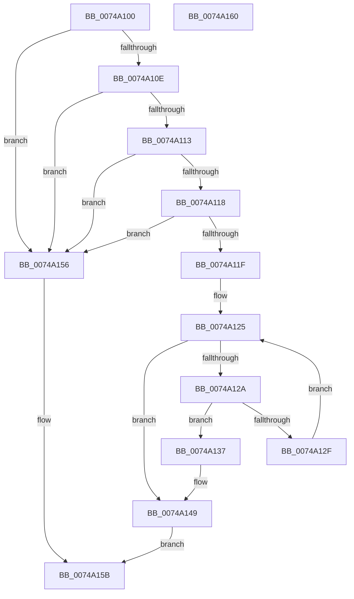

# KsepPatchImportTableEntry

- RVA: `0x0074A100`–`0x0074A161` (길이 `97` bytes)
- VA: `0x000000014074A100`
- 실행 섹션: `PAGE`
- PDB 이름 있음: `예`; PDB Function 태그: `아니요`
- unwind 정보 RVA: `0x0005C788`
- 디코드: `33`개 명령, `97/97` bytes 표시
- 미해석 바이트: `0` (있으면 어셈블리에 `.byte`로 보존)

> 이 문서는 커널 이미지의 기계어와 PDB 기호를 분석해 생성했습니다. 4번과 5번은 함수 원형과 자료형을 바이너리 사용 방식에서 추정한 C 해석이며 원본 소스 복구 결과는 아닙니다.

## 1. Dependencies

- 직접 호출 지점: **1**; 고유 호출 대상: **1**
- 직접 호출자로 확인된 함수: **1**
- RIP 상대 이미지 참조: **0**

### Outgoing calls
- `0x0074A13F` → [MmReplaceImportEntry](../../text/67/MmReplaceImportEntry_function_0067175C.md) (function, `0x0067175C`)

### Direct callers
- [KsepPatchDriverImportsTable](KsepPatchDriverImportsTable_function_00749F64.md) at `0x0074A046`
- [KsepPatchDriverImportsTable](KsepPatchDriverImportsTable_function_00749F64.md) at `0x0074A08F`

### Static image references
- 디코드된 RIP-relative 메모리 참조가 없습니다.

## 2. Other-region calls and transfers

- 다른 실행 섹션으로 향하는 call: **1**
  - `0x0074A13F` → [MmReplaceImportEntry](../../text/67/MmReplaceImportEntry_function_0067175C.md) (`PAGE` → `.text`)
- 별도 외부 분기/꼬리 이동을 확인하지 못했습니다.

## 3. Assembly (complete function range)

```asm
0074A100  48 83 EC 28                     sub rsp, 0x28
0074A104  33 C0                           xor eax, eax
0074A106  4C 8B D1                        mov r10, rcx
0074A109  48 85 D2                        test rdx, rdx
0074A10C  74 48                           je 0x14074a156
0074A10E  45 85 C0                        test r8d, r8d
0074A111  74 43                           je 0x14074a156
0074A113  4D 85 C9                        test r9, r9
0074A116  74 3E                           je 0x14074a156
0074A118  48 39 44 24 50                  cmp qword ptr [rsp + 0x50], rax
0074A11D  74 37                           je 0x14074a156
0074A11F  41 C1 E8 03                     shr r8d, 3
0074A123  8B C8                           mov ecx, eax
0074A125  41 3B C8                        cmp ecx, r8d
0074A128  73 1F                           jae 0x14074a149
0074A12A  4C 39 0A                        cmp qword ptr [rdx], r9
0074A12D  74 08                           je 0x14074a137
0074A12F  FF C1                           inc ecx
0074A131  48 83 C2 08                     add rdx, 8
0074A135  EB EE                           jmp 0x14074a125
0074A137  4C 8B 44 24 50                  mov r8, qword ptr [rsp + 0x50]
0074A13C  49 8B CA                        mov rcx, r10
0074A13F  E8 18 76 F2 FF                  call 0x14067175c
0074A144  B8 01 00 00 00                  mov eax, 1
0074A149  F7 D8                           neg eax
0074A14B  1B C0                           sbb eax, eax
0074A14D  F7 D0                           not eax
0074A14F  25 25 02 00 C0                  and eax, 0xc0000225
0074A154  EB 05                           jmp 0x14074a15b
0074A156  B8 0D 00 00 C0                  mov eax, 0xc000000d
0074A15B  48 83 C4 28                     add rsp, 0x28
0074A15F  C3                              ret
0074A160  CC                              int3
```

## 4. C-style interpretation (structured pseudocode)

```c
__int64 __fastcall KsepPatchImportTableEntry(__int64 a1, __int64 a2, int a3, __int64 a4, __int64 a5)
{
    __int64 result;
    __int64 v_rsp;

    v_rsp = (v_rsp) - (40);
    result = 0;
    if (a2 == 0) goto loc_0074A156;
    if (a3 == 0) goto loc_0074A156;
    if (a4 == 0) goto loc_0074A156;
    if (a5 == 0) goto loc_0074A156;
    a3 = (unsigned int)((a3) >> (3));
loc_0074A125:
    if (0 >= a3) goto loc_0074A149;
    if ((*(unsigned __int64 *)(a2)) == a4) goto loc_0074A137;
    a1 = (unsigned int)((0) + 1);
    a2 = (a2) + (8);
    goto loc_0074A125;
loc_0074A137:
    result = MmReplaceImportEntry(a1, a2, a5, a4);
loc_0074A149:
    result = (unsigned int)(-(1));
    result = (unsigned int)(~(result));
    result = (unsigned int)((result) & (0xC0000225ULL));
    goto loc_0074A15B;
loc_0074A156:
loc_0074A15B:
    v_rsp = (v_rsp) + (40);
    return (unsigned int)(0xC000000DULL);
}
```

## 5. (Beta) C Style

```c
int64_t KsepPatchImportTableEntry(int64_t Arg1, int64_t Arg2, int32_t Arg3, int64_t Arg4, int64_t Arg5)
{
    int64_t result;
    int64_t local_rsp;

    local_rsp = (local_rsp) - (40);
    result = 0;
    if (Arg2 == 0) goto loc_0074A156;
    if (Arg3 == 0) goto loc_0074A156;
    if (Arg4 == 0) goto loc_0074A156;
    if (Arg5 == 0) goto loc_0074A156;
    Arg3 = (uint32_t)((Arg3) >> (3));
loc_0074A125:
    if (0 >= Arg3) goto loc_0074A149;
    if ((*(uint64_t *)(Arg2)) == Arg4) goto loc_0074A137;
    Arg1 = (uint32_t)((0) + 1);
    Arg2 = (Arg2) + (8);
    goto loc_0074A125;
loc_0074A137:
    result = MmReplaceImportEntry(Arg1, Arg2, Arg5, Arg4);
loc_0074A149:
    result = (uint32_t)(-(1));
    result = (uint32_t)(~(result));
    result = (uint32_t)((result) & (0xC0000225ULL));
    goto loc_0074A15B;
loc_0074A156:
loc_0074A15B:
    local_rsp = (local_rsp) + (40);
    return (uint32_t)(0xC000000DULL);
}
```

## 6. Execution-region graph

[열기: 2D/3D 그래프와 함수 탐색 컨트롤 패널](../../../control-panel.html?section=page&rva=0x0074A100&view=graph)

- 2D 그래프는 위에서 아래로 흐르고, 3D 그래프는 빈 공간을 드래그해 회전합니다. Shift+드래그는 이동, 휠은 확대·축소, 함수 노드 선택은 대상 보고서 이동입니다.

### Static fallback


