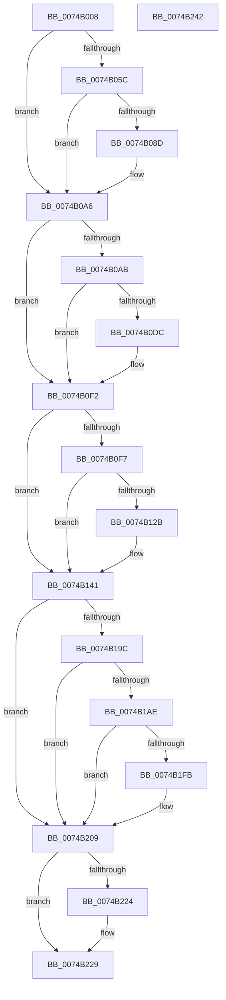

# KsepRegistryCreateKey

- RVA: `0x0074B008`–`0x0074B243` (길이 `571` bytes)
- VA: `0x000000014074B008`
- 실행 섹션: `PAGE`
- PDB 이름 있음: `예`; PDB Function 태그: `아니요`
- unwind 정보 RVA: `0x000CB53C`
- 디코드: `140`개 명령, `571/571` bytes 표시
- 미해석 바이트: `0` (있으면 어셈블리에 `.byte`로 보존)

> 이 문서는 커널 이미지의 기계어와 PDB 기호를 분석해 생성했습니다. 4번과 5번은 함수 원형과 자료형을 바이너리 사용 방식에서 추정한 C 해석이며 원본 소스 복구 결과는 아닙니다.

## 1. Dependencies

- 직접 호출 지점: **10**; 고유 호출 대상: **5**
- 직접 호출자로 확인된 함수: **1**
- RIP 상대 이미지 참조: **8**

### Outgoing calls
- `0x0074B09E` → [RtlAssert](../../text/5E/RtlAssert_function_005E75E0.md) (function, `0x005E75E0`)
- `0x0074B0ED` → [RtlAssert](../../text/5E/RtlAssert_function_005E75E0.md) (function, `0x005E75E0`)
- `0x0074B13C` → [RtlAssert](../../text/5E/RtlAssert_function_005E75E0.md) (function, `0x005E75E0`)
- `0x0074B148` → [KsepStringDuplicate](../95/KsepStringDuplicate_function_0095B454.md) (function, `0x0095B454`)
- `0x0074B191` → [ZwCreateKey](../../text/6A/ZwCreateKey_function_006AD470.md) (function, `0x006AD470`)
- `0x0074B1A3` → [KsepStringDuplicate](../95/KsepStringDuplicate_function_0095B454.md) (function, `0x0095B454`)
- `0x0074B1F0` → [ZwCreateKey](../../text/6A/ZwCreateKey_function_006AD470.md) (function, `0x006AD470`)
- `0x0074B20D` → [KsepStringFree](../95/KsepStringFree_function_0095A1B8.md) (function, `0x0095A1B8`)
- `0x0074B216` → [KsepStringFree](../95/KsepStringFree_function_0095A1B8.md) (function, `0x0095A1B8`)
- `0x0074B224` → [ZwClose](../../text/6A/ZwClose_function_006AD2B0.md) (function, `0x006AD2B0`)

### Direct callers
- [KseSetDeviceFlags](KseSetDeviceFlags_function_00748B20.md) at `0x00748BA1`
- [KseSetDeviceFlags](KseSetDeviceFlags_function_00748B20.md) at `0x00748BC1`
- [KseSetDeviceFlags](KseSetDeviceFlags_function_00748B20.md) at `0x00748BE8`

### Static image references
- `0x0074B023` → RVA `0x00F101E0` (`.data`; read)
- `0x0074B05F` → RVA `0x00F101C0` (`.data`; read/write)
- `0x0074B083` → RVA `0x00E66CE8` (`.data`; read)
- `0x0074B090` → RVA `0x00B011C0` (` ?? ::NNGAKEGL::`string'`; read)
- `0x0074B097` → RVA `0x00B01310` (` ?? ::NNGAKEGL::`string'`; read)
- `0x0074B0E6` → RVA `0x00B012D0` (` ?? ::NNGAKEGL::`string'`; read)
- `0x0074B135` → RVA `0x00B01330` (` ?? ::NNGAKEGL::`string'`; read)
- `0x0074B202` → RVA `0x00F10178` (`.data`; read/write)

## 2. Other-region calls and transfers

- 다른 실행 섹션으로 향하는 call: **6**
  - `0x0074B09E` → [RtlAssert](../../text/5E/RtlAssert_function_005E75E0.md) (`PAGE` → `.text`)
  - `0x0074B0ED` → [RtlAssert](../../text/5E/RtlAssert_function_005E75E0.md) (`PAGE` → `.text`)
  - `0x0074B13C` → [RtlAssert](../../text/5E/RtlAssert_function_005E75E0.md) (`PAGE` → `.text`)
  - `0x0074B191` → [ZwCreateKey](../../text/6A/ZwCreateKey_function_006AD470.md) (`PAGE` → `.text`)
  - `0x0074B1F0` → [ZwCreateKey](../../text/6A/ZwCreateKey_function_006AD470.md) (`PAGE` → `.text`)
  - `0x0074B224` → [ZwClose](../../text/6A/ZwClose_function_006AD2B0.md) (`PAGE` → `.text`)
- 별도 외부 분기/꼬리 이동을 확인하지 못했습니다.

## 3. Assembly (complete function range)

```asm
0074B008  48 89 5C 24 18                  mov qword ptr [rsp + 0x18], rbx
0074B00D  55                              push rbp
0074B00E  56                              push rsi
0074B00F  57                              push rdi
0074B010  41 54                           push r12
0074B012  41 56                           push r14
0074B014  48 8D 6C 24 C9                  lea rbp, [rsp - 0x37]
0074B019  48 81 EC 90 00 00 00            sub rsp, 0x90
0074B020  45 33 F6                        xor r14d, r14d
0074B023  4C 8D 25 B6 51 7C 00            lea r12, [rip + 0x7c51b6]
0074B02A  48 8B D9                        mov rbx, rcx
0074B02D  44 89 75 0B                     mov dword ptr [rbp + 0xb], r14d
0074B031  44 89 75 23                     mov dword ptr [rbp + 0x23], r14d
0074B035  49 8B F8                        mov rdi, r8
0074B038  4C 89 75 E7                     mov qword ptr [rbp - 0x19], r14
0074B03C  48 8B F2                        mov rsi, rdx
0074B03F  4C 89 75 EF                     mov qword ptr [rbp - 0x11], r14
0074B043  41 8D 4E 04                     lea ecx, [r14 + 4]
0074B047  4C 89 75 F7                     mov qword ptr [rbp - 9], r14
0074B04B  4C 89 75 FF                     mov qword ptr [rbp - 1], r14
0074B04F  4C 89 75 67                     mov qword ptr [rbp + 0x67], r14
0074B053  4C 89 75 6F                     mov qword ptr [rbp + 0x6f], r14
0074B057  48 85 DB                        test rbx, rbx
0074B05A  75 4A                           jne 0x14074b0a6
0074B05C  8D 41 FD                        lea eax, [rcx - 3]
0074B05F  F0 0F C1 05 59 51 7C 00         lock xadd dword ptr [rip + 0x7c5159], eax
0074B067  FF C0                           inc eax
0074B069  41 B8 F7 01 00 00               mov r8d, 0x1f7
0074B06F  83 E0 3F                        and eax, 0x3f
0074B072  41 C7 44 C4 04 20 04 00 C0      mov dword ptr [r12 + rax*8 + 4], 0xc0000420
0074B07B  41 C7 04 C4 F7 01 04 00         mov dword ptr [r12 + rax*8], 0x401f7
0074B083  8B 05 5F BC 71 00               mov eax, dword ptr [rip + 0x71bc5f]
0074B089  84 C1                           test cl, al
0074B08B  74 19                           je 0x14074b0a6
0074B08D  45 33 C9                        xor r9d, r9d
0074B090  48 8D 15 29 61 3B 00            lea rdx, [rip + 0x3b6129]
0074B097  48 8D 0D 72 62 3B 00            lea rcx, [rip + 0x3b6272]
0074B09E  E8 3D C5 E9 FF                  call 0x1405e75e0
0074B0A3  8D 4B 04                        lea ecx, [rbx + 4]
0074B0A6  48 85 F6                        test rsi, rsi
0074B0A9  75 47                           jne 0x14074b0f2
0074B0AB  8D 46 01                        lea eax, [rsi + 1]
0074B0AE  F0 0F C1 05 0A 51 7C 00         lock xadd dword ptr [rip + 0x7c510a], eax
0074B0B6  FF C0                           inc eax
0074B0B8  41 B8 F8 01 00 00               mov r8d, 0x1f8
0074B0BE  83 E0 3F                        and eax, 0x3f
0074B0C1  41 C7 44 C4 04 20 04 00 C0      mov dword ptr [r12 + rax*8 + 4], 0xc0000420
0074B0CA  41 C7 04 C4 F8 01 04 00         mov dword ptr [r12 + rax*8], 0x401f8
0074B0D2  8B 05 10 BC 71 00               mov eax, dword ptr [rip + 0x71bc10]
0074B0D8  84 C1                           test cl, al
0074B0DA  74 16                           je 0x14074b0f2
0074B0DC  45 33 C9                        xor r9d, r9d
0074B0DF  48 8D 15 DA 60 3B 00            lea rdx, [rip + 0x3b60da]
0074B0E6  48 8D 0D E3 61 3B 00            lea rcx, [rip + 0x3b61e3]
0074B0ED  E8 EE C4 E9 FF                  call 0x1405e75e0
0074B0F2  48 85 FF                        test rdi, rdi
0074B0F5  75 4A                           jne 0x14074b141
0074B0F7  8D 47 01                        lea eax, [rdi + 1]
0074B0FA  F0 0F C1 05 BE 50 7C 00         lock xadd dword ptr [rip + 0x7c50be], eax
0074B102  FF C0                           inc eax
0074B104  8D 4F 04                        lea ecx, [rdi + 4]
0074B107  83 E0 3F                        and eax, 0x3f
0074B10A  41 B8 F9 01 00 00               mov r8d, 0x1f9
0074B110  41 C7 44 C4 04 20 04 00 C0      mov dword ptr [r12 + rax*8 + 4], 0xc0000420
0074B119  41 C7 04 C4 F9 01 04 00         mov dword ptr [r12 + rax*8], 0x401f9
0074B121  8B 05 C1 BB 71 00               mov eax, dword ptr [rip + 0x71bbc1]
0074B127  84 C1                           test cl, al
0074B129  74 16                           je 0x14074b141
0074B12B  45 33 C9                        xor r9d, r9d
0074B12E  48 8D 15 8B 60 3B 00            lea rdx, [rip + 0x3b608b]
0074B135  48 8D 0D F4 61 3B 00            lea rcx, [rip + 0x3b61f4]
0074B13C  E8 9F C4 E9 FF                  call 0x1405e75e0
0074B141  48 8B D3                        mov rdx, rbx
0074B144  48 8D 4D E7                     lea rcx, [rbp - 0x19]
0074B148  E8 07 03 21 00                  call 0x14095b454
0074B14D  48 8D 45 E7                     lea rax, [rbp - 0x19]
0074B151  4C 89 74 24 30                  mov qword ptr [rsp + 0x30], r14
0074B156  0F 57 C0                        xorps xmm0, xmm0
0074B159  44 89 74 24 28                  mov dword ptr [rsp + 0x28], r14d
0074B15E  41 BC 30 00 00 00               mov r12d, 0x30
0074B164  48 89 45 17                     mov qword ptr [rbp + 0x17], rax
0074B168  45 33 C9                        xor r9d, r9d
0074B16B  44 89 65 07                     mov dword ptr [rbp + 7], r12d
0074B16F  4C 8D 45 07                     lea r8, [rbp + 7]
0074B173  4C 89 75 0F                     mov qword ptr [rbp + 0xf], r14
0074B177  BA 1F 00 02 00                  mov edx, 0x2001f
0074B17C  C7 45 1F 40 02 00 00            mov dword ptr [rbp + 0x1f], 0x240
0074B183  48 8D 4D 67                     lea rcx, [rbp + 0x67]
0074B187  4C 89 74 24 20                  mov qword ptr [rsp + 0x20], r14
0074B18C  F3 0F 7F 45 27                  movdqu xmmword ptr [rbp + 0x27], xmm0
0074B191  E8 DA 22 F6 FF                  call 0x1406ad470
0074B196  8B D8                           mov ebx, eax
0074B198  85 C0                           test eax, eax
0074B19A  78 6D                           js 0x14074b209
0074B19C  48 8B D6                        mov rdx, rsi
0074B19F  48 8D 4D F7                     lea rcx, [rbp - 9]
0074B1A3  E8 AC 02 21 00                  call 0x14095b454
0074B1A8  8B D8                           mov ebx, eax
0074B1AA  85 C0                           test eax, eax
0074B1AC  78 5B                           js 0x14074b209
0074B1AE  48 8B 45 67                     mov rax, qword ptr [rbp + 0x67]
0074B1B2  4C 8D 45 07                     lea r8, [rbp + 7]
0074B1B6  48 89 45 0F                     mov qword ptr [rbp + 0xf], rax
0074B1BA  48 8D 4D 6F                     lea rcx, [rbp + 0x6f]
0074B1BE  48 8D 45 F7                     lea rax, [rbp - 9]
0074B1C2  4C 89 74 24 30                  mov qword ptr [rsp + 0x30], r14
0074B1C7  0F 57 C0                        xorps xmm0, xmm0
0074B1CA  44 89 74 24 28                  mov dword ptr [rsp + 0x28], r14d
0074B1CF  45 33 C9                        xor r9d, r9d
0074B1D2  48 89 45 17                     mov qword ptr [rbp + 0x17], rax
0074B1D6  BA 1F 00 02 00                  mov edx, 0x2001f
0074B1DB  44 89 65 07                     mov dword ptr [rbp + 7], r12d
0074B1DF  C7 45 1F 40 02 00 00            mov dword ptr [rbp + 0x1f], 0x240
0074B1E6  F3 0F 7F 45 27                  movdqu xmmword ptr [rbp + 0x27], xmm0
0074B1EB  4C 89 74 24 20                  mov qword ptr [rsp + 0x20], r14
0074B1F0  E8 7B 22 F6 FF                  call 0x1406ad470
0074B1F5  8B D8                           mov ebx, eax
0074B1F7  85 C0                           test eax, eax
0074B1F9  78 0E                           js 0x14074b209
0074B1FB  48 8B 45 6F                     mov rax, qword ptr [rbp + 0x6f]
0074B1FF  48 89 07                        mov qword ptr [rdi], rax
0074B202  F0 FF 05 6F 4F 7C 00            lock inc dword ptr [rip + 0x7c4f6f]
0074B209  48 8D 4D E7                     lea rcx, [rbp - 0x19]
0074B20D  E8 A6 EF 20 00                  call 0x14095a1b8
0074B212  48 8D 4D F7                     lea rcx, [rbp - 9]
0074B216  E8 9D EF 20 00                  call 0x14095a1b8
0074B21B  48 8B 4D 67                     mov rcx, qword ptr [rbp + 0x67]
0074B21F  48 85 C9                        test rcx, rcx
0074B222  74 05                           je 0x14074b229
0074B224  E8 87 20 F6 FF                  call 0x1406ad2b0
0074B229  8B C3                           mov eax, ebx
0074B22B  48 8B 9C 24 D0 00 00 00         mov rbx, qword ptr [rsp + 0xd0]
0074B233  48 81 C4 90 00 00 00            add rsp, 0x90
0074B23A  41 5E                           pop r14
0074B23C  41 5C                           pop r12
0074B23E  5F                              pop rdi
0074B23F  5E                              pop rsi
0074B240  5D                              pop rbp
0074B241  C3                              ret
0074B242  CC                              int3
```

## 4. C-style interpretation (structured pseudocode)

```c
__int64 __fastcall KsepRegistryCreateKey(__int64 a1, __int64 a2, __int64 a3, int a4)
{
    __int64 result;
    __int64 v_r14;
    __int64 v_rsp;
    unsigned __int64 v_stack_m38;
    unsigned int v_stack_m3C;
    unsigned int v_stack_m40;
    unsigned __int64 v_stack_m48;
    unsigned __int64 v_stack_m50;
    unsigned int v_stack_m54;
    unsigned int v_stack_m58;
    unsigned __int64 v_stack_m5F;
    unsigned __int64 v_stack_m60;
    unsigned __int64 v_stack_m68;
    unsigned __int64 v_stack_m70;
    unsigned __int64 v_stack_m78;
    unsigned __int64 v_stack_m88;
    unsigned int v_stack_m90;
    unsigned __int64 v_stack_m98;
    unsigned __int64 v_stack_p10;
    unsigned __int64 v_stack_p18;
    unsigned __int64 v_stack_p8;

    v_stack_p18 = v_rbx;
    v_rsp = (v_rsp) - (144);
    v_r14 = 0;
    v_stack_m54 = 0;
    v_stack_m3C = 0;
    v_stack_m78 = 0;
    v_stack_m70 = 0;
    v_stack_m68 = 0;
    v_stack_m60 = 0;
    v_stack_p8 = 0;
    v_stack_p10 = 0;
    if (a1 != 0) goto loc_0074B0A6;
    result = (unsigned int)((v_r14 + 4 - 3) + 1);
    result = (unsigned int)((result) & (63));
    *(unsigned int *)(v_rip + 8147382 + result * 8 + 4) = 0xC0000420ULL;
    *(unsigned int *)(v_rip + 8147382 + result * 8) = 0x401F7ULL;
    result = (unsigned int)(*(unsigned int *)(v_rip + 7453791));
    if ((((unsigned __int8)(v_r14 + 4)) & ((unsigned __int8)((unsigned int)(*(unsigned int *)(v_rip + 7453791))))) != 0) {
        a4 = 0;
        a2 = v_rip + 3891497;
        a1 = v_rip + 3891826;
        result = RtlAssert(a1, a2, 503, a4);
        a1 = a1 + 4;
    }
    if (a2 != 0) goto loc_0074B0F2;
    result = (unsigned int)((a2 + 1) + 1);
    result = (unsigned int)((result) & (63));
    *(unsigned int *)(v_rip + 8147382 + result * 8 + 4) = 0xC0000420ULL;
    *(unsigned int *)(v_rip + 8147382 + result * 8) = 0x401F8ULL;
    result = (unsigned int)(*(unsigned int *)(v_rip + 7453712));
    if ((((unsigned __int8)(a1)) & ((unsigned __int8)((unsigned int)(*(unsigned int *)(v_rip + 7453712))))) != 0) {
        a4 = 0;
        a2 = v_rip + 3891418;
        a1 = v_rip + 3891683;
        result = RtlAssert(a1, a2, 504, a4);
    }
    if (a3 != 0) goto loc_0074B141;
    result = (unsigned int)((a3 + 1) + 1);
    result = (unsigned int)((result) & (63));
    *(unsigned int *)(v_rip + 8147382 + result * 8 + 4) = 0xC0000420ULL;
    *(unsigned int *)(v_rip + 8147382 + result * 8) = 0x401F9ULL;
    result = (unsigned int)(*(unsigned int *)(v_rip + 7453633));
    if ((((unsigned __int8)(a3 + 4)) & ((unsigned __int8)((unsigned int)(*(unsigned int *)(v_rip + 7453633))))) != 0) {
        a4 = 0;
        a2 = v_rip + 3891339;
        a1 = v_rip + 3891700;
        result = RtlAssert(a1, a2, 505, a4);
    }
    result = KsepStringDuplicate(v_stack_m78, a1, 505, a4);
    v_stack_m88 = 0;
    v_stack_m90 = 0;
    v_stack_m48 = v_stack_m78;
    a4 = 0;
    v_stack_m58 = 48;
    v_stack_m50 = 0;
    v_stack_m40 = 576;
    v_stack_m98 = 0;
    v_stack_m38 = v_xmm0;
    result = ZwCreateKey(v_stack_p8, (unsigned int)(0x2001FULL), v_stack_m58, a4);
    if (sign_flag) goto loc_0074B209;
    result = KsepStringDuplicate(v_stack_m68, a2, v_stack_m58, a4);
    if (sign_flag) goto loc_0074B209;
    v_stack_m50 = v_stack_p8;
    v_stack_m88 = 0;
    v_stack_m90 = 0;
    a4 = 0;
    v_stack_m48 = v_stack_m68;
    v_stack_m58 = 48;
    v_stack_m40 = 576;
    v_stack_m38 = v_xmm0;
    v_stack_m98 = 0;
    result = ZwCreateKey(v_stack_p10, (unsigned int)(0x2001FULL), v_stack_m58, a4);
    if (!(sign_flag)) {
        result = v_stack_p10;
        *(unsigned __int64 *)(a3) = result;
    }
    result = KsepStringFree(v_stack_m78, (unsigned int)(0x2001FULL), v_stack_m58, a4);
    result = KsepStringFree(v_stack_m68, (unsigned int)(0x2001FULL), v_stack_m58, a4);
    if (v_stack_p8 != 0) {
        result = ZwClose(v_stack_p8, (unsigned int)(0x2001FULL), v_stack_m58, a4);
    }
    v_rsp = (v_rsp) + (144);
    return (unsigned int)((unsigned int)((unsigned int)((unsigned int)(result))));
}
```

## 5. (Beta) C Style

```c
int64_t KsepRegistryCreateKey(int64_t Arg1, int64_t Arg2, int64_t Arg3, int32_t Arg4)
{
    int64_t result;
    int64_t local_r14;
    int64_t local_rsp;
    uint64_t v_stack_m38;
    uint32_t v_stack_m3C;
    uint32_t v_stack_m40;
    uint64_t v_stack_m48;
    uint64_t v_stack_m50;
    uint32_t v_stack_m54;
    uint32_t v_stack_m58;
    uint64_t v_stack_m5F;
    uint64_t v_stack_m60;
    uint64_t v_stack_m68;
    uint64_t v_stack_m70;
    uint64_t v_stack_m78;
    uint64_t v_stack_m88;
    uint32_t v_stack_m90;
    uint64_t v_stack_m98;
    uint64_t v_stack_p10;
    uint64_t v_stack_p18;
    uint64_t v_stack_p8;

    v_stack_p18 = local_rbx;
    local_rsp = (local_rsp) - (144);
    local_r14 = 0;
    v_stack_m54 = 0;
    v_stack_m3C = 0;
    v_stack_m78 = 0;
    v_stack_m70 = 0;
    v_stack_m68 = 0;
    v_stack_m60 = 0;
    v_stack_p8 = 0;
    v_stack_p10 = 0;
    if (Arg1 != 0) goto loc_0074B0A6;
    result = (uint32_t)((local_r14 + 4 - 3) + 1);
    result = (uint32_t)((result) & (63));
    *(uint32_t *)(v_rip + 0x7C51B6 + result * 8 + 0x4) = 0xC0000420ULL;
    *(uint32_t *)(v_rip + 0x7C51B6 + result * 8) = 0x401F7ULL;
    result = (uint32_t)(*(uint32_t *)(v_rip + 0x71BC5F));
    if ((((uint8_t)(local_r14 + 4)) & ((uint8_t)((uint32_t)(*(uint32_t *)(v_rip + 0x71BC5F))))) != 0) {
        Arg4 = 0;
        Arg2 = v_rip + 3891497;
        Arg1 = v_rip + 3891826;
        result = RtlAssert(Arg1, Arg2, 503, Arg4);
        Arg1 = Arg1 + 4;
    }
    if (Arg2 != 0) goto loc_0074B0F2;
    result = (uint32_t)((Arg2 + 1) + 1);
    result = (uint32_t)((result) & (63));
    *(uint32_t *)(v_rip + 0x7C51B6 + result * 8 + 0x4) = 0xC0000420ULL;
    *(uint32_t *)(v_rip + 0x7C51B6 + result * 8) = 0x401F8ULL;
    result = (uint32_t)(*(uint32_t *)(v_rip + 0x71BC10));
    if ((((uint8_t)(Arg1)) & ((uint8_t)((uint32_t)(*(uint32_t *)(v_rip + 0x71BC10))))) != 0) {
        Arg4 = 0;
        Arg2 = v_rip + 3891418;
        Arg1 = v_rip + 3891683;
        result = RtlAssert(Arg1, Arg2, 504, Arg4);
    }
    if (Arg3 != 0) goto loc_0074B141;
    result = (uint32_t)((Arg3 + 1) + 1);
    result = (uint32_t)((result) & (63));
    *(uint32_t *)(v_rip + 0x7C51B6 + result * 8 + 0x4) = 0xC0000420ULL;
    *(uint32_t *)(v_rip + 0x7C51B6 + result * 8) = 0x401F9ULL;
    result = (uint32_t)(*(uint32_t *)(v_rip + 0x71BBC1));
    if ((((uint8_t)(Arg3 + 4)) & ((uint8_t)((uint32_t)(*(uint32_t *)(v_rip + 0x71BBC1))))) != 0) {
        Arg4 = 0;
        Arg2 = v_rip + 3891339;
        Arg1 = v_rip + 3891700;
        result = RtlAssert(Arg1, Arg2, 505, Arg4);
    }
    result = KsepStringDuplicate(v_stack_m78, Arg1, 505, Arg4);
    v_stack_m88 = 0;
    v_stack_m90 = 0;
    v_stack_m48 = v_stack_m78;
    Arg4 = 0;
    v_stack_m58 = 48;
    v_stack_m50 = 0;
    v_stack_m40 = 576;
    v_stack_m98 = 0;
    v_stack_m38 = v_xmm0;
    result = ZwCreateKey(v_stack_p8, (uint32_t)(0x2001FULL), v_stack_m58, Arg4);
    if (sign_flag) goto loc_0074B209;
    result = KsepStringDuplicate(v_stack_m68, Arg2, v_stack_m58, Arg4);
    if (sign_flag) goto loc_0074B209;
    v_stack_m50 = v_stack_p8;
    v_stack_m88 = 0;
    v_stack_m90 = 0;
    Arg4 = 0;
    v_stack_m48 = v_stack_m68;
    v_stack_m58 = 48;
    v_stack_m40 = 576;
    v_stack_m38 = v_xmm0;
    v_stack_m98 = 0;
    result = ZwCreateKey(v_stack_p10, (uint32_t)(0x2001FULL), v_stack_m58, Arg4);
    if (!(sign_flag)) {
        result = v_stack_p10;
        *(uint64_t *)(Arg3) = result;
    }
    result = KsepStringFree(v_stack_m78, (uint32_t)(0x2001FULL), v_stack_m58, Arg4);
    result = KsepStringFree(v_stack_m68, (uint32_t)(0x2001FULL), v_stack_m58, Arg4);
    if (v_stack_p8 != 0) {
        result = ZwClose(v_stack_p8, (uint32_t)(0x2001FULL), v_stack_m58, Arg4);
    }
    local_rsp = (local_rsp) + (144);
    return (uint32_t)((uint32_t)((uint32_t)((uint32_t)(result))));
}
```

## 6. Execution-region graph

[열기: 2D/3D 그래프와 함수 탐색 컨트롤 패널](../../../control-panel.html?section=page&rva=0x0074B008&view=graph)

- 2D 그래프는 위에서 아래로 흐르고, 3D 그래프는 빈 공간을 드래그해 회전합니다. Shift+드래그는 이동, 휠은 확대·축소, 함수 노드 선택은 대상 보고서 이동입니다.

### Static fallback


