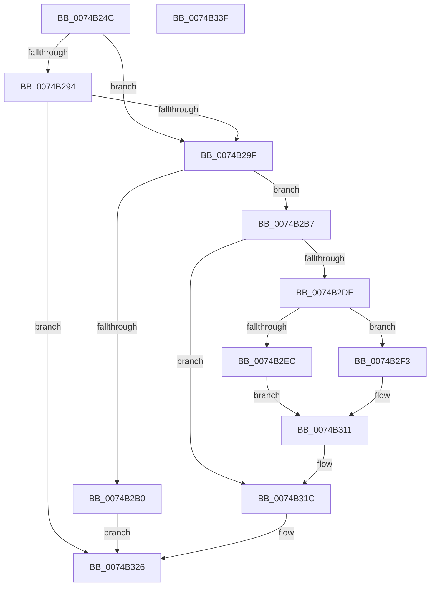

# KsepRegistryEnumValue

- RVA: `0x0074B24C`–`0x0074B340` (길이 `244` bytes)
- VA: `0x000000014074B24C`
- 실행 섹션: `PAGE`
- PDB 이름 있음: `예`; PDB Function 태그: `아니요`
- unwind 정보 RVA: `0x00093E28`
- 디코드: `71`개 명령, `244/244` bytes 표시
- 미해석 바이트: `0` (있으면 어셈블리에 `.byte`로 보존)

> 이 문서는 커널 이미지의 기계어와 PDB 기호를 분석해 생성했습니다. 4번과 5번은 함수 원형과 자료형을 바이너리 사용 방식에서 추정한 C 해석이며 원본 소스 복구 결과는 아닙니다.

## 1. Dependencies

- 직접 호출 지점: **5**; 고유 호출 대상: **4**
- 직접 호출자로 확인된 함수: **1**
- RIP 상대 이미지 참조: **0**

### Outgoing calls
- `0x0074B288` → [ZwEnumerateValueKey](../../text/6A/ZwEnumerateValueKey_function_006AD330.md) (function, `0x006AD330`)
- `0x0074B2A3` → [KsepPoolAllocatePaged](../../text/4A/KsepPoolAllocatePaged_function_004A9EFC.md) (function, `0x004A9EFC`)
- `0x0074B2D4` → [ZwEnumerateValueKey](../../text/6A/ZwEnumerateValueKey_function_006AD330.md) (function, `0x006AD330`)
- `0x0074B2FA` → [memcpy](../../text/6C/memcpy_function_006C6840.md) (function, `0x006C6840`)
- `0x0074B31F` → [KsepPoolFreePaged](../../text/4B/KsepPoolFreePaged_function_004B0E10.md) (function, `0x004B0E10`)

### Direct callers
- [KsepDbQueryRegistryDeviceDataList](KsepDbQueryRegistryDeviceDataList_function_007490B4.md) at `0x00749195`

### Static image references
- 디코드된 RIP-relative 메모리 참조가 없습니다.

## 2. Other-region calls and transfers

- 다른 실행 섹션으로 향하는 call: **5**
  - `0x0074B288` → [ZwEnumerateValueKey](../../text/6A/ZwEnumerateValueKey_function_006AD330.md) (`PAGE` → `.text`)
  - `0x0074B2A3` → [KsepPoolAllocatePaged](../../text/4A/KsepPoolAllocatePaged_function_004A9EFC.md) (`PAGE` → `.text`)
  - `0x0074B2D4` → [ZwEnumerateValueKey](../../text/6A/ZwEnumerateValueKey_function_006AD330.md) (`PAGE` → `.text`)
  - `0x0074B2FA` → [memcpy](../../text/6C/memcpy_function_006C6840.md) (`PAGE` → `.text`)
  - `0x0074B31F` → [KsepPoolFreePaged](../../text/4B/KsepPoolFreePaged_function_004B0E10.md) (`PAGE` → `.text`)
- 별도 외부 분기/꼬리 이동을 확인하지 못했습니다.

## 3. Assembly (complete function range)

```asm
0074B24C  4C 8B DC                        mov r11, rsp
0074B24F  49 89 5B 08                     mov qword ptr [r11 + 8], rbx
0074B253  49 89 6B 10                     mov qword ptr [r11 + 0x10], rbp
0074B257  49 89 73 18                     mov qword ptr [r11 + 0x18], rsi
0074B25B  57                              push rdi
0074B25C  41 56                           push r14
0074B25E  41 57                           push r15
0074B260  48 83 EC 40                     sub rsp, 0x40
0074B264  49 8D 43 D8                     lea rax, [r11 - 0x28]
0074B268  49 8B F1                        mov rsi, r9
0074B26B  4D 8B F0                        mov r14, r8
0074B26E  49 89 43 D0                     mov qword ptr [r11 - 0x30], rax
0074B272  45 33 FF                        xor r15d, r15d
0074B275  45 33 C9                        xor r9d, r9d
0074B278  45 33 C0                        xor r8d, r8d
0074B27B  45 89 7B C8                     mov dword ptr [r11 - 0x38], r15d
0074B27F  8B FA                           mov edi, edx
0074B281  45 89 7B D8                     mov dword ptr [r11 - 0x28], r15d
0074B285  48 8B E9                        mov rbp, rcx
0074B288  E8 A3 20 F6 FF                  call 0x1406ad330
0074B28D  3D 23 00 00 C0                  cmp eax, 0xc0000023
0074B292  74 0B                           je 0x14074b29f
0074B294  3D 05 00 00 80                  cmp eax, 0x80000005
0074B299  0F 85 87 00 00 00               jne 0x14074b326
0074B29F  8B 4C 24 30                     mov ecx, dword ptr [rsp + 0x30]
0074B2A3  E8 54 EC D5 FF                  call 0x1404a9efc
0074B2A8  48 8B D8                        mov rbx, rax
0074B2AB  48 85 C0                        test rax, rax
0074B2AE  75 07                           jne 0x14074b2b7
0074B2B0  B8 17 00 00 C0                  mov eax, 0xc0000017
0074B2B5  EB 6F                           jmp 0x14074b326
0074B2B7  48 8D 44 24 30                  lea rax, [rsp + 0x30]
0074B2BC  4C 8B CB                        mov r9, rbx
0074B2BF  48 89 44 24 28                  mov qword ptr [rsp + 0x28], rax
0074B2C4  45 33 C0                        xor r8d, r8d
0074B2C7  8B 44 24 30                     mov eax, dword ptr [rsp + 0x30]
0074B2CB  8B D7                           mov edx, edi
0074B2CD  48 8B CD                        mov rcx, rbp
0074B2D0  89 44 24 20                     mov dword ptr [rsp + 0x20], eax
0074B2D4  E8 57 20 F6 FF                  call 0x1406ad330
0074B2D9  8B F8                           mov edi, eax
0074B2DB  85 C0                           test eax, eax
0074B2DD  75 3D                           jne 0x14074b31c
0074B2DF  44 8B 43 08                     mov r8d, dword ptr [rbx + 8]
0074B2E3  49 8D 48 02                     lea rcx, [r8 + 2]
0074B2E7  49 3B CE                        cmp rcx, r14
0074B2EA  76 07                           jbe 0x14074b2f3
0074B2EC  BF 23 00 00 C0                  mov edi, 0xc0000023
0074B2F1  EB 1E                           jmp 0x14074b311
0074B2F3  48 8D 53 0C                     lea rdx, [rbx + 0xc]
0074B2F7  48 8B CE                        mov rcx, rsi
0074B2FA  E8 41 B5 F7 FF                  call 0x1406c6840
0074B2FF  8B 43 08                        mov eax, dword ptr [rbx + 8]
0074B302  48 D1 E8                        shr rax, 1
0074B305  66 44 89 3C 46                  mov word ptr [rsi + rax*2], r15w
0074B30A  8B 4B 08                        mov ecx, dword ptr [rbx + 8]
0074B30D  48 83 C1 02                     add rcx, 2
0074B311  48 8B 84 24 80 00 00 00         mov rax, qword ptr [rsp + 0x80]
0074B319  48 89 08                        mov qword ptr [rax], rcx
0074B31C  48 8B CB                        mov rcx, rbx
0074B31F  E8 EC 5A D6 FF                  call 0x1404b0e10
0074B324  8B C7                           mov eax, edi
0074B326  48 8B 5C 24 60                  mov rbx, qword ptr [rsp + 0x60]
0074B32B  48 8B 6C 24 68                  mov rbp, qword ptr [rsp + 0x68]
0074B330  48 8B 74 24 70                  mov rsi, qword ptr [rsp + 0x70]
0074B335  48 83 C4 40                     add rsp, 0x40
0074B339  41 5F                           pop r15
0074B33B  41 5E                           pop r14
0074B33D  5F                              pop rdi
0074B33E  C3                              ret
0074B33F  CC                              int3
```

## 4. C-style interpretation (structured pseudocode)

```c
__int64 __fastcall KsepRegistryEnumValue(__int64 a1, int a2, __int64 a3, __int64 a4, __int64 a5)
{
    __int64 result;
    __int64 v_r15;
    __int64 v_rsp;
    unsigned int v_stack_m28;
    unsigned __int64 v_stack_m30;
    unsigned int v_stack_m38;
    unsigned __int64 v_stack_p10;
    unsigned __int64 v_stack_p18;
    unsigned __int64 v_stack_p8;

    *(unsigned __int64 *)(v_rsp + 8) = v_rbx;
    *(unsigned __int64 *)(v_rsp + 16) = v_rbp;
    *(unsigned __int64 *)(v_rsp + 24) = v_rsi;
    v_rsp = (v_rsp) - (64);
    *(unsigned __int64 *)(v_rsp - 48) = v_rsp - 40;
    v_r15 = 0;
    a4 = 0;
    a3 = 0;
    *(unsigned int *)(v_rsp - 56) = 0;
    *(unsigned int *)(v_rsp - 40) = 0;
    result = ZwEnumerateValueKey(a1, a2, a3, a4);
    if (((unsigned int)(result)) == 0xC0000023ULL) goto loc_0074B29F;
    if (((unsigned int)(result)) != 0x80000005ULL) goto loc_0074B326;
loc_0074B29F:
    result = KsepPoolAllocatePaged((unsigned int)(v_stack_m28), a2, a3, a4);
    if (result != 0) goto loc_0074B2B7;
    goto loc_0074B326;
loc_0074B2B7:
    v_stack_m30 = v_stack_m28;
    a3 = 0;
    v_stack_m38 = (unsigned int)((unsigned int)(v_stack_m28));
    result = ZwEnumerateValueKey(a1, (unsigned int)((unsigned int)((unsigned int)(a2))), a3, result);
    if ((unsigned int)(result) != 0) goto loc_0074B31C;
    if (((unsigned int)(*(unsigned int *)(result + 8)) + 2) <= 0) goto loc_0074B2F3;
    goto loc_0074B311;
loc_0074B2F3:
    result = memcpy(0, result + 12, (unsigned int)(*(unsigned int *)(result + 8)), result);
    result = ((unsigned int)(*(unsigned int *)(result + 8))) >> (1);
    *(unsigned __int16 *)(a4 + result * 2) = 0;
    a1 = ((unsigned int)(*(unsigned int *)(result + 8))) + (2);
loc_0074B311:
    *(unsigned __int64 *)(a5) = a1;
loc_0074B31C:
    result = KsepPoolFreePaged(result, result + 12, (unsigned int)(*(unsigned int *)(result + 8)), result);
loc_0074B326:
    v_rsp = (v_rsp) + (64);
    return (unsigned int)((unsigned int)((unsigned int)(0xC0000023ULL)));
}
```

## 5. (Beta) C Style

```c
int64_t KsepRegistryEnumValue(int64_t Arg1, int32_t Arg2, int64_t Arg3, void *Arg4, void *Arg5)
{
    uint8_t *arg4 = (uint8_t *)Arg4;
    uint8_t *arg5 = (uint8_t *)Arg5;

    int64_t result;
    int64_t local_r15;
    int64_t local_rsp;
    uint32_t v_stack_m28;
    uint64_t v_stack_m30;
    uint32_t v_stack_m38;
    uint64_t v_stack_p10;
    uint64_t v_stack_p18;
    uint64_t v_stack_p8;

    *(uint64_t *)(local_rsp + 0x8) = local_rbx;
    *(uint64_t *)(local_rsp + 0x10) = local_rbp;
    *(uint64_t *)(local_rsp + 0x18) = local_rsi;
    local_rsp = (local_rsp) - (64);
    *(uint64_t *)(local_rsp - 0x30) = local_rsp - 40;
    local_r15 = 0;
    Arg4 = 0;
    Arg3 = 0;
    *(uint32_t *)(local_rsp - 0x38) = 0;
    *(uint32_t *)(local_rsp - 0x28) = 0;
    result = ZwEnumerateValueKey(Arg1, Arg2, Arg3, Arg4);
    if (((uint32_t)(result)) == 0xC0000023ULL) goto loc_0074B29F;
    if (((uint32_t)(result)) != 0x80000005ULL) goto loc_0074B326;
loc_0074B29F:
    result = KsepPoolAllocatePaged((uint32_t)(v_stack_m28), Arg2, Arg3, Arg4);
    if (result != 0) goto loc_0074B2B7;
    goto loc_0074B326;
loc_0074B2B7:
    v_stack_m30 = v_stack_m28;
    Arg3 = 0;
    v_stack_m38 = (uint32_t)((uint32_t)(v_stack_m28));
    result = ZwEnumerateValueKey(Arg1, (uint32_t)((uint32_t)((uint32_t)(Arg2))), Arg3, result);
    if ((uint32_t)(result) != 0) goto loc_0074B31C;
    if (((uint32_t)(*(uint32_t *)(result + 0x8)) + 2) <= 0) goto loc_0074B2F3;
    goto loc_0074B311;
loc_0074B2F3:
    result = memcpy(0, result + 12, (uint32_t)(*(uint32_t *)(result + 0x8)), result);
    result = ((uint32_t)(*(uint32_t *)(result + 0x8))) >> (1);
    *(uint16_t *)(arg4 + result * 2) = 0;
    Arg1 = ((uint32_t)(*(uint32_t *)(result + 0x8))) + (2);
loc_0074B311:
    *(uint64_t *)(arg5) = Arg1;
loc_0074B31C:
    result = KsepPoolFreePaged(result, result + 12, (uint32_t)(*(uint32_t *)(result + 0x8)), result);
loc_0074B326:
    local_rsp = (local_rsp) + (64);
    return (uint32_t)((uint32_t)((uint32_t)(0xC0000023ULL)));
}
```

### 관측된 메모리 오프셋

구조체 형식이 확인되지 않은 접근은 인자 기준의 오프셋으로만 기록했습니다.

| 기준 인자 | 오프셋 표현 | 폭 (bit) | 접근 |
|---|---:|---:|---|
| `Arg4` | `+ 0x0 + rax*2` | `16` | `W` |
| `Arg5` | `+ 0x0` | `64` | `W` |

## 6. Execution-region graph

[열기: 2D/3D 그래프와 함수 탐색 컨트롤 패널](../../../control-panel.html?section=page&rva=0x0074B24C&view=graph)

- 2D 그래프는 위에서 아래로 흐르고, 3D 그래프는 빈 공간을 드래그해 회전합니다. Shift+드래그는 이동, 휠은 확대·축소, 함수 노드 선택은 대상 보고서 이동입니다.

### Static fallback


