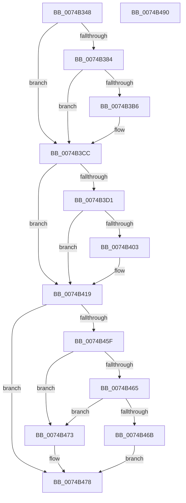

# KsepRegistryQueryDWORD

- RVA: `0x0074B348`–`0x0074B491` (길이 `329` bytes)
- VA: `0x000000014074B348`
- 실행 섹션: `PAGE`
- PDB 이름 있음: `예`; PDB Function 태그: `아니요`
- unwind 정보 RVA: `0x000CB4D4`
- 디코드: `83`개 명령, `329/329` bytes 표시
- 미해석 바이트: `0` (있으면 어셈블리에 `.byte`로 보존)

> 이 문서는 커널 이미지의 기계어와 PDB 기호를 분석해 생성했습니다. 4번과 5번은 함수 원형과 자료형을 바이너리 사용 방식에서 추정한 C 해석이며 원본 소스 복구 결과는 아닙니다.

## 1. Dependencies

- 직접 호출 지점: **5**; 고유 호출 대상: **4**
- 직접 호출자로 확인된 함수: **1**
- RIP 상대 이미지 참조: **7**

### Outgoing calls
- `0x0074B3C7` → [RtlAssert](../../text/5E/RtlAssert_function_005E75E0.md) (function, `0x005E75E0`)
- `0x0074B414` → [RtlAssert](../../text/5E/RtlAssert_function_005E75E0.md) (function, `0x005E75E0`)
- `0x0074B42C` → [RtlInitUnicodeString](../../text/42/RtlInitUnicodeString_function_0042A780.md) (function, `0x0042A780`)
- `0x0074B456` → [ZwQueryValueKey](../../text/6A/ZwQueryValueKey_function_006AD3B0.md) (function, `0x006AD3B0`)
- `0x0074B480` → [_security_check_cookie](../../text/6A/_security_check_cookie_function_006AC640.md) (function, `0x006AC640`)

### Direct callers
- [KsepEngineReadFlags](../../init/C3/KsepEngineReadFlags_function_00C3C310.md) at `0x00C3C3C0`
- [KsepEngineReadFlags](../../init/C3/KsepEngineReadFlags_function_00C3C310.md) at `0x00C3C3E4`
- [KsepEngineReadFlags](../../init/C3/KsepEngineReadFlags_function_00C3C310.md) at `0x00C3C4F7`

### Static image references
- `0x0074B353` → RVA `0x00E0A740` (`.data`; read)
- `0x0074B362` → RVA `0x00F101E0` (`.data`; read)
- `0x0074B387` → RVA `0x00F101C0` (`.data`; read/write)
- `0x0074B3AB` → RVA `0x00E66CE8` (`.data`; read)
- `0x0074B3B9` → RVA `0x00B011C0` (` ?? ::NNGAKEGL::`string'`; read)
- `0x0074B3C0` → RVA `0x00B012F0` (` ?? ::NNGAKEGL::`string'`; read)
- `0x0074B40D` → RVA `0x00B012C0` (` ?? ::NNGAKEGL::`string'`; read)

## 2. Other-region calls and transfers

- 다른 실행 섹션으로 향하는 call: **5**
  - `0x0074B3C7` → [RtlAssert](../../text/5E/RtlAssert_function_005E75E0.md) (`PAGE` → `.text`)
  - `0x0074B414` → [RtlAssert](../../text/5E/RtlAssert_function_005E75E0.md) (`PAGE` → `.text`)
  - `0x0074B42C` → [RtlInitUnicodeString](../../text/42/RtlInitUnicodeString_function_0042A780.md) (`PAGE` → `.text`)
  - `0x0074B456` → [ZwQueryValueKey](../../text/6A/ZwQueryValueKey_function_006AD3B0.md) (`PAGE` → `.text`)
  - `0x0074B480` → [_security_check_cookie](../../text/6A/_security_check_cookie_function_006AC640.md) (`PAGE` → `.text`)
- 별도 외부 분기/꼬리 이동을 확인하지 못했습니다.

## 3. Assembly (complete function range)

```asm
0074B348  40 53                           push rbx
0074B34A  55                              push rbp
0074B34B  56                              push rsi
0074B34C  57                              push rdi
0074B34D  41 56                           push r14
0074B34F  48 83 EC 70                     sub rsp, 0x70
0074B353  48 8B 05 E6 F3 6B 00            mov rax, qword ptr [rip + 0x6bf3e6]
0074B35A  48 33 C4                        xor rax, rsp
0074B35D  48 89 44 24 60                  mov qword ptr [rsp + 0x60], rax
0074B362  4C 8D 35 77 4E 7C 00            lea r14, [rip + 0x7c4e77]
0074B369  0F 57 C0                        xorps xmm0, xmm0
0074B36C  49 8B D8                        mov rbx, r8
0074B36F  48 8B F2                        mov rsi, rdx
0074B372  48 8B F9                        mov rdi, rcx
0074B375  BD 04 00 00 00                  mov ebp, 4
0074B37A  0F 11 44 24 38                  movups xmmword ptr [rsp + 0x38], xmm0
0074B37F  48 85 C9                        test rcx, rcx
0074B382  75 48                           jne 0x14074b3cc
0074B384  8D 41 01                        lea eax, [rcx + 1]
0074B387  F0 0F C1 05 31 4E 7C 00         lock xadd dword ptr [rip + 0x7c4e31], eax
0074B38F  FF C0                           inc eax
0074B391  41 B8 86 02 00 00               mov r8d, 0x286
0074B397  83 E0 3F                        and eax, 0x3f
0074B39A  41 C7 44 C6 04 20 04 00 C0      mov dword ptr [r14 + rax*8 + 4], 0xc0000420
0074B3A3  41 C7 04 C6 86 02 04 00         mov dword ptr [r14 + rax*8], 0x40286
0074B3AB  8B 05 37 B9 71 00               mov eax, dword ptr [rip + 0x71b937]
0074B3B1  40 84 C5                        test bpl, al
0074B3B4  74 16                           je 0x14074b3cc
0074B3B6  45 33 C9                        xor r9d, r9d
0074B3B9  48 8D 15 00 5E 3B 00            lea rdx, [rip + 0x3b5e00]
0074B3C0  48 8D 0D 29 5F 3B 00            lea rcx, [rip + 0x3b5f29]
0074B3C7  E8 14 C2 E9 FF                  call 0x1405e75e0
0074B3CC  48 85 DB                        test rbx, rbx
0074B3CF  75 48                           jne 0x14074b419
0074B3D1  8D 43 01                        lea eax, [rbx + 1]
0074B3D4  F0 0F C1 05 E4 4D 7C 00         lock xadd dword ptr [rip + 0x7c4de4], eax
0074B3DC  FF C0                           inc eax
0074B3DE  41 B8 87 02 00 00               mov r8d, 0x287
0074B3E4  83 E0 3F                        and eax, 0x3f
0074B3E7  41 C7 44 C6 04 20 04 00 C0      mov dword ptr [r14 + rax*8 + 4], 0xc0000420
0074B3F0  41 C7 04 C6 87 02 04 00         mov dword ptr [r14 + rax*8], 0x40287
0074B3F8  8B 05 EA B8 71 00               mov eax, dword ptr [rip + 0x71b8ea]
0074B3FE  40 84 C5                        test bpl, al
0074B401  74 16                           je 0x14074b419
0074B403  45 33 C9                        xor r9d, r9d
0074B406  48 8D 15 B3 5D 3B 00            lea rdx, [rip + 0x3b5db3]
0074B40D  48 8D 0D AC 5E 3B 00            lea rcx, [rip + 0x3b5eac]
0074B414  E8 C7 C1 E9 FF                  call 0x1405e75e0
0074B419  83 23 00                        and dword ptr [rbx], 0
0074B41C  48 8D 4C 24 38                  lea rcx, [rsp + 0x38]
0074B421  48 8B D6                        mov rdx, rsi
0074B424  C7 44 24 30 14 00 00 00         mov dword ptr [rsp + 0x30], 0x14
0074B42C  E8 4F F3 CD FF                  call 0x14042a780
0074B431  48 8D 44 24 30                  lea rax, [rsp + 0x30]
0074B436  41 B8 02 00 00 00               mov r8d, 2
0074B43C  48 89 44 24 28                  mov qword ptr [rsp + 0x28], rax
0074B441  4C 8D 4C 24 48                  lea r9, [rsp + 0x48]
0074B446  8B 44 24 30                     mov eax, dword ptr [rsp + 0x30]
0074B44A  48 8D 54 24 38                  lea rdx, [rsp + 0x38]
0074B44F  48 8B CF                        mov rcx, rdi
0074B452  89 44 24 20                     mov dword ptr [rsp + 0x20], eax
0074B456  E8 55 1F F6 FF                  call 0x1406ad3b0
0074B45B  85 C0                           test eax, eax
0074B45D  75 19                           jne 0x14074b478
0074B45F  39 6C 24 50                     cmp dword ptr [rsp + 0x50], ebp
0074B463  75 0E                           jne 0x14074b473
0074B465  39 6C 24 4C                     cmp dword ptr [rsp + 0x4c], ebp
0074B469  75 08                           jne 0x14074b473
0074B46B  8B 4C 24 54                     mov ecx, dword ptr [rsp + 0x54]
0074B46F  89 0B                           mov dword ptr [rbx], ecx
0074B471  EB 05                           jmp 0x14074b478
0074B473  B8 24 00 00 C0                  mov eax, 0xc0000024
0074B478  48 8B 4C 24 60                  mov rcx, qword ptr [rsp + 0x60]
0074B47D  48 33 CC                        xor rcx, rsp
0074B480  E8 BB 11 F6 FF                  call 0x1406ac640
0074B485  48 83 C4 70                     add rsp, 0x70
0074B489  41 5E                           pop r14
0074B48B  5F                              pop rdi
0074B48C  5E                              pop rsi
0074B48D  5D                              pop rbp
0074B48E  5B                              pop rbx
0074B48F  C3                              ret
0074B490  CC                              int3
```

## 4. C-style interpretation (structured pseudocode)

```c
__int64 __fastcall KsepRegistryQueryDWORD(__int64 a1, __int64 a2, __int64 a3, int a4)
{
    __int64 result;
    __int64 v_rsp;
    unsigned __int64 v_stack_m38;
    unsigned int v_stack_m44;
    unsigned int v_stack_m48;
    unsigned int v_stack_m4C;
    unsigned __int64 v_stack_m50;
    unsigned __int64 v_stack_m60;
    unsigned int v_stack_m68;
    unsigned __int64 v_stack_m70;
    unsigned int v_stack_m78;

    v_rsp = (v_rsp) - (112);
    result = (*(unsigned __int64 *)(v_rip + 7074790)) ^ (v_rsp);
    v_stack_m38 = result;
    v_stack_m60 = v_xmm0;
    if (a1 != 0) goto loc_0074B3CC;
    result = (unsigned int)((a1 + 1) + 1);
    result = (unsigned int)((result) & (63));
    *(unsigned int *)(v_rip + 8146551 + result * 8 + 4) = 0xC0000420ULL;
    *(unsigned int *)(v_rip + 8146551 + result * 8) = 0x40286ULL;
    result = (unsigned int)(*(unsigned int *)(v_rip + 7452983));
    if (((4) & ((unsigned __int8)((unsigned int)(*(unsigned int *)(v_rip + 7452983))))) != 0) {
        a4 = 0;
        a2 = v_rip + 3890688;
        a1 = v_rip + 3890985;
        result = RtlAssert(a1, a2, 646, a4);
    }
    if (a3 != 0) goto loc_0074B419;
    result = (unsigned int)((a3 + 1) + 1);
    result = (unsigned int)((result) & (63));
    *(unsigned int *)(v_rip + 8146551 + result * 8 + 4) = 0xC0000420ULL;
    *(unsigned int *)(v_rip + 8146551 + result * 8) = 0x40287ULL;
    result = (unsigned int)(*(unsigned int *)(v_rip + 7452906));
    if (((4) & ((unsigned __int8)((unsigned int)(*(unsigned int *)(v_rip + 7452906))))) != 0) {
        a4 = 0;
        a2 = v_rip + 3890611;
        a1 = v_rip + 3890860;
        result = RtlAssert(a1, a2, 647, a4);
    }
    v_stack_m68 = 20;
    result = RtlInitUnicodeString(v_stack_m60, a2, 647, a4);
    v_stack_m70 = v_stack_m68;
    v_stack_m78 = (unsigned int)((unsigned int)(v_stack_m68));
    result = ZwQueryValueKey(a1, v_stack_m60, 2, v_stack_m50);
    if ((unsigned int)(result) != 0) goto loc_0074B478;
    if (v_stack_m48 != 4) goto loc_0074B473;
    if (v_stack_m4C != 4) goto loc_0074B473;
    *(unsigned int *)(a3) = (unsigned int)((unsigned int)(v_stack_m44));
    goto loc_0074B478;
loc_0074B473:
loc_0074B478:
    a1 = (v_stack_m38) ^ (v_rsp);
    result = _security_check_cookie(a1, v_stack_m60, 2, v_stack_m50);
    v_rsp = (v_rsp) + (112);
    return result;
}
```

## 5. (Beta) C Style

```c
int64_t KsepRegistryQueryDWORD(int64_t Arg1, int64_t Arg2, int64_t Arg3, int32_t Arg4)
{
    int64_t result;
    int64_t local_rsp;
    uint64_t v_stack_m38;
    uint32_t v_stack_m44;
    uint32_t v_stack_m48;
    uint32_t v_stack_m4C;
    uint64_t v_stack_m50;
    uint64_t v_stack_m60;
    uint32_t v_stack_m68;
    uint64_t v_stack_m70;
    uint32_t v_stack_m78;

    local_rsp = (local_rsp) - (112);
    result = (*(uint64_t *)(v_rip + 0x6BF3E6)) ^ (local_rsp);
    v_stack_m38 = result;
    v_stack_m60 = v_xmm0;
    if (Arg1 != 0) goto loc_0074B3CC;
    result = (uint32_t)((Arg1 + 1) + 1);
    result = (uint32_t)((result) & (63));
    *(uint32_t *)(v_rip + 0x7C4E77 + result * 8 + 0x4) = 0xC0000420ULL;
    *(uint32_t *)(v_rip + 0x7C4E77 + result * 8) = 0x40286ULL;
    result = (uint32_t)(*(uint32_t *)(v_rip + 0x71B937));
    if (((4) & ((uint8_t)((uint32_t)(*(uint32_t *)(v_rip + 0x71B937))))) != 0) {
        Arg4 = 0;
        Arg2 = v_rip + 3890688;
        Arg1 = v_rip + 3890985;
        result = RtlAssert(Arg1, Arg2, 646, Arg4);
    }
    if (Arg3 != 0) goto loc_0074B419;
    result = (uint32_t)((Arg3 + 1) + 1);
    result = (uint32_t)((result) & (63));
    *(uint32_t *)(v_rip + 0x7C4E77 + result * 8 + 0x4) = 0xC0000420ULL;
    *(uint32_t *)(v_rip + 0x7C4E77 + result * 8) = 0x40287ULL;
    result = (uint32_t)(*(uint32_t *)(v_rip + 0x71B8EA));
    if (((4) & ((uint8_t)((uint32_t)(*(uint32_t *)(v_rip + 0x71B8EA))))) != 0) {
        Arg4 = 0;
        Arg2 = v_rip + 3890611;
        Arg1 = v_rip + 3890860;
        result = RtlAssert(Arg1, Arg2, 647, Arg4);
    }
    v_stack_m68 = 20;
    result = RtlInitUnicodeString(v_stack_m60, Arg2, 647, Arg4);
    v_stack_m70 = v_stack_m68;
    v_stack_m78 = (uint32_t)((uint32_t)(v_stack_m68));
    result = ZwQueryValueKey(Arg1, v_stack_m60, 2, v_stack_m50);
    if ((uint32_t)(result) != 0) goto loc_0074B478;
    if (v_stack_m48 != 4) goto loc_0074B473;
    if (v_stack_m4C != 4) goto loc_0074B473;
    *(uint32_t *)(Arg3) = (uint32_t)((uint32_t)(v_stack_m44));
    goto loc_0074B478;
loc_0074B473:
loc_0074B478:
    Arg1 = (v_stack_m38) ^ (local_rsp);
    result = _security_check_cookie(Arg1, v_stack_m60, 2, v_stack_m50);
    local_rsp = (local_rsp) + (112);
    return result;
}
```

## 6. Execution-region graph

[열기: 2D/3D 그래프와 함수 탐색 컨트롤 패널](../../../control-panel.html?section=page&rva=0x0074B348&view=graph)

- 2D 그래프는 위에서 아래로 흐르고, 3D 그래프는 빈 공간을 드래그해 회전합니다. Shift+드래그는 이동, 휠은 확대·축소, 함수 노드 선택은 대상 보고서 이동입니다.

### Static fallback


