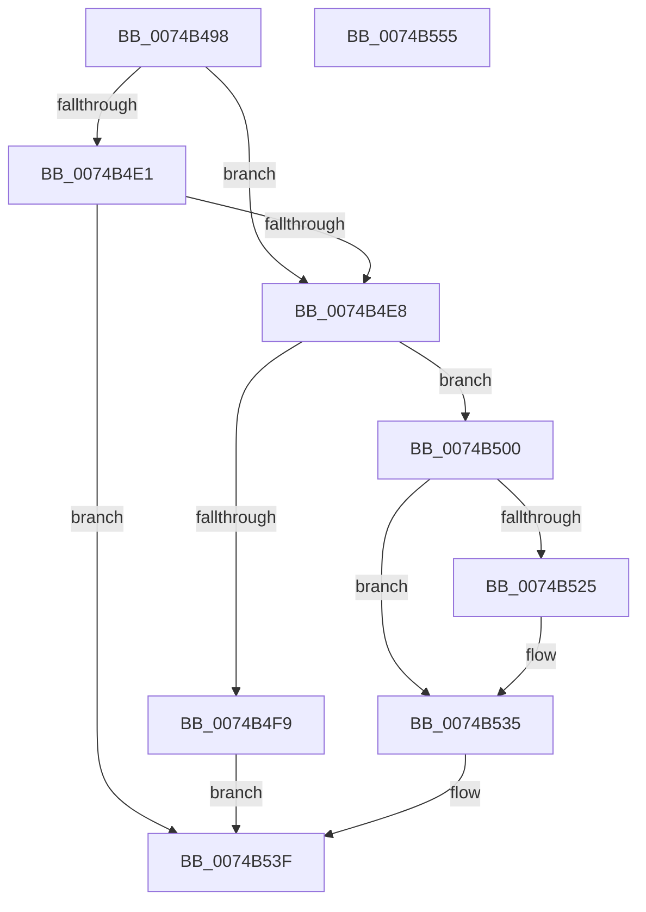

# KsepRegistryQueryKeyInformation

- RVA: `0x0074B498`–`0x0074B556` (길이 `190` bytes)
- VA: `0x000000014074B498`
- 실행 섹션: `PAGE`
- PDB 이름 있음: `예`; PDB Function 태그: `아니요`
- unwind 정보 RVA: `0x000CB524`
- 디코드: `54`개 명령, `190/190` bytes 표시
- 미해석 바이트: `0` (있으면 어셈블리에 `.byte`로 보존)

> 이 문서는 커널 이미지의 기계어와 PDB 기호를 분석해 생성했습니다. 4번과 5번은 함수 원형과 자료형을 바이너리 사용 방식에서 추정한 C 해석이며 원본 소스 복구 결과는 아닙니다.

## 1. Dependencies

- 직접 호출 지점: **4**; 고유 호출 대상: **3**
- 직접 호출자로 확인된 함수: **1**
- RIP 상대 이미지 참조: **0**

### Outgoing calls
- `0x0074B4D5` → [ZwQueryKey](../../text/6A/ZwQueryKey_function_006AD390.md) (function, `0x006AD390`)
- `0x0074B4EC` → [KsepPoolAllocatePaged](../../text/4A/KsepPoolAllocatePaged_function_004A9EFC.md) (function, `0x004A9EFC`)
- `0x0074B51A` → [ZwQueryKey](../../text/6A/ZwQueryKey_function_006AD390.md) (function, `0x006AD390`)
- `0x0074B538` → [KsepPoolFreePaged](../../text/4B/KsepPoolFreePaged_function_004B0E10.md) (function, `0x004B0E10`)

### Direct callers
- [KsepDbQueryRegistryDeviceDataList](KsepDbQueryRegistryDeviceDataList_function_007490B4.md) at `0x00749139`

### Static image references
- 디코드된 RIP-relative 메모리 참조가 없습니다.

## 2. Other-region calls and transfers

- 다른 실행 섹션으로 향하는 call: **4**
  - `0x0074B4D5` → [ZwQueryKey](../../text/6A/ZwQueryKey_function_006AD390.md) (`PAGE` → `.text`)
  - `0x0074B4EC` → [KsepPoolAllocatePaged](../../text/4A/KsepPoolAllocatePaged_function_004A9EFC.md) (`PAGE` → `.text`)
  - `0x0074B51A` → [ZwQueryKey](../../text/6A/ZwQueryKey_function_006AD390.md) (`PAGE` → `.text`)
  - `0x0074B538` → [KsepPoolFreePaged](../../text/4B/KsepPoolFreePaged_function_004B0E10.md) (`PAGE` → `.text`)
- 별도 외부 분기/꼬리 이동을 확인하지 못했습니다.

## 3. Assembly (complete function range)

```asm
0074B498  48 8B C4                        mov rax, rsp
0074B49B  48 89 58 08                     mov qword ptr [rax + 8], rbx
0074B49F  48 89 70 18                     mov qword ptr [rax + 0x18], rsi
0074B4A3  48 89 78 20                     mov qword ptr [rax + 0x20], rdi
0074B4A7  41 56                           push r14
0074B4A9  48 83 EC 30                     sub rsp, 0x30
0074B4AD  83 60 10 00                     and dword ptr [rax + 0x10], 0
0074B4B1  48 8D 40 10                     lea rax, [rax + 0x10]
0074B4B5  48 83 22 00                     and qword ptr [rdx], 0
0074B4B9  45 33 C9                        xor r9d, r9d
0074B4BC  49 83 20 00                     and qword ptr [r8], 0
0074B4C0  49 8B F0                        mov rsi, r8
0074B4C3  4C 8B F2                        mov r14, rdx
0074B4C6  48 89 44 24 20                  mov qword ptr [rsp + 0x20], rax
0074B4CB  45 33 C0                        xor r8d, r8d
0074B4CE  48 8B F9                        mov rdi, rcx
0074B4D1  41 8D 51 02                     lea edx, [r9 + 2]
0074B4D5  E8 B6 1E F6 FF                  call 0x1406ad390
0074B4DA  3D 05 00 00 80                  cmp eax, 0x80000005
0074B4DF  74 07                           je 0x14074b4e8
0074B4E1  3D 23 00 00 C0                  cmp eax, 0xc0000023
0074B4E6  75 57                           jne 0x14074b53f
0074B4E8  8B 4C 24 48                     mov ecx, dword ptr [rsp + 0x48]
0074B4EC  E8 0B EA D5 FF                  call 0x1404a9efc
0074B4F1  48 8B D8                        mov rbx, rax
0074B4F4  48 85 C0                        test rax, rax
0074B4F7  75 07                           jne 0x14074b500
0074B4F9  B8 17 00 00 C0                  mov eax, 0xc0000017
0074B4FE  EB 3F                           jmp 0x14074b53f
0074B500  44 8B 4C 24 48                  mov r9d, dword ptr [rsp + 0x48]
0074B505  48 8D 44 24 48                  lea rax, [rsp + 0x48]
0074B50A  4C 8B C3                        mov r8, rbx
0074B50D  48 89 44 24 20                  mov qword ptr [rsp + 0x20], rax
0074B512  BA 02 00 00 00                  mov edx, 2
0074B517  48 8B CF                        mov rcx, rdi
0074B51A  E8 71 1E F6 FF                  call 0x1406ad390
0074B51F  8B F8                           mov edi, eax
0074B521  85 C0                           test eax, eax
0074B523  78 10                           js 0x14074b535
0074B525  8B 4B 24                        mov ecx, dword ptr [rbx + 0x24]
0074B528  48 83 C1 02                     add rcx, 2
0074B52C  49 89 0E                        mov qword ptr [r14], rcx
0074B52F  8B 4B 28                        mov ecx, dword ptr [rbx + 0x28]
0074B532  48 89 0E                        mov qword ptr [rsi], rcx
0074B535  48 8B CB                        mov rcx, rbx
0074B538  E8 D3 58 D6 FF                  call 0x1404b0e10
0074B53D  8B C7                           mov eax, edi
0074B53F  48 8B 5C 24 40                  mov rbx, qword ptr [rsp + 0x40]
0074B544  48 8B 74 24 50                  mov rsi, qword ptr [rsp + 0x50]
0074B549  48 8B 7C 24 58                  mov rdi, qword ptr [rsp + 0x58]
0074B54E  48 83 C4 30                     add rsp, 0x30
0074B552  41 5E                           pop r14
0074B554  C3                              ret
0074B555  CC                              int3
```

## 4. C-style interpretation (structured pseudocode)

```c
__int64 __fastcall KsepRegistryQueryKeyInformation(__int64 a1, __int64 a2, __int64 a3, int a4)
{
    __int64 result;
    __int64 v_rsp;
    unsigned __int64 v_stack_m18;
    unsigned int v_stack_p10;
    unsigned __int64 v_stack_p18;
    unsigned __int64 v_stack_p20;
    unsigned __int64 v_stack_p8;

    *(unsigned __int64 *)(v_rsp + 8) = v_rbx;
    *(unsigned __int64 *)(v_rsp + 24) = v_rsi;
    *(unsigned __int64 *)(v_rsp + 32) = v_rdi;
    v_rsp = (v_rsp) - (48);
    a4 = 0;
    v_stack_m18 = v_rsp + 16;
    a3 = 0;
    result = ZwQueryKey(a1, a4 + 2, a3, a4);
    if (((unsigned int)(result)) == 0x80000005ULL) goto loc_0074B4E8;
    if (((unsigned int)(result)) != 0xC0000023ULL) goto loc_0074B53F;
loc_0074B4E8:
    result = KsepPoolAllocatePaged((unsigned int)(v_stack_p10), a4 + 2, a3, a4);
    if (result != 0) goto loc_0074B500;
    goto loc_0074B53F;
loc_0074B500:
    v_stack_m18 = v_stack_p10;
    result = ZwQueryKey(a1, 2, result, (unsigned int)(v_stack_p10));
    if (!(sign_flag)) {
        a1 = *(unsigned int *)(result + 36);
        a1 = (a1) + (2);
        *(unsigned __int64 *)(a2) = a1;
        a1 = *(unsigned int *)(result + 40);
        *(unsigned __int64 *)(a3) = a1;
    }
    result = KsepPoolFreePaged(result, 2, result, (unsigned int)(v_stack_p10));
loc_0074B53F:
    v_rsp = (v_rsp) + (48);
    return (unsigned int)((unsigned int)((unsigned int)((unsigned int)(result))));
}
```

## 5. (Beta) C Style

```c
int64_t KsepRegistryQueryKeyInformation(int64_t Arg1, void *Arg2, void *Arg3, int32_t Arg4)
{
    uint8_t *arg2 = (uint8_t *)Arg2;
    uint8_t *arg3 = (uint8_t *)Arg3;

    int64_t result;
    int64_t local_rsp;
    uint64_t v_stack_m18;
    uint32_t v_stack_p10;
    uint64_t v_stack_p18;
    uint64_t v_stack_p20;
    uint64_t v_stack_p8;

    *(uint64_t *)(local_rsp + 0x8) = local_rbx;
    *(uint64_t *)(local_rsp + 0x18) = local_rsi;
    *(uint64_t *)(local_rsp + 0x20) = local_rdi;
    local_rsp = (local_rsp) - (48);
    Arg4 = 0;
    v_stack_m18 = local_rsp + 16;
    Arg3 = 0;
    result = ZwQueryKey(Arg1, Arg4 + 2, Arg3, Arg4);
    if (((uint32_t)(result)) == 0x80000005ULL) goto loc_0074B4E8;
    if (((uint32_t)(result)) != 0xC0000023ULL) goto loc_0074B53F;
loc_0074B4E8:
    result = KsepPoolAllocatePaged((uint32_t)(v_stack_p10), Arg4 + 2, Arg3, Arg4);
    if (result != 0) goto loc_0074B500;
    goto loc_0074B53F;
loc_0074B500:
    v_stack_m18 = v_stack_p10;
    result = ZwQueryKey(Arg1, 2, result, (uint32_t)(v_stack_p10));
    if (!(sign_flag)) {
        Arg1 = *(uint32_t *)(result + 0x24);
        Arg1 = (Arg1) + (2);
        *(uint64_t *)(arg2) = Arg1;
        Arg1 = *(uint32_t *)(result + 0x28);
        *(uint64_t *)(arg3) = Arg1;
    }
    result = KsepPoolFreePaged(result, 2, result, (uint32_t)(v_stack_p10));
loc_0074B53F:
    local_rsp = (local_rsp) + (48);
    return (uint32_t)((uint32_t)((uint32_t)((uint32_t)(result))));
}
```

### 관측된 메모리 오프셋

구조체 형식이 확인되지 않은 접근은 인자 기준의 오프셋으로만 기록했습니다.

| 기준 인자 | 오프셋 표현 | 폭 (bit) | 접근 |
|---|---:|---:|---|
| `Arg2` | `+ 0x0` | `64` | `R/W` |
| `Arg2` | `+ 0x0` | `64` | `W` |
| `Arg3` | `+ 0x0` | `64` | `R/W` |
| `Arg3` | `+ 0x0` | `64` | `W` |

## 6. Execution-region graph

[열기: 2D/3D 그래프와 함수 탐색 컨트롤 패널](../../../control-panel.html?section=page&rva=0x0074B498&view=graph)

- 2D 그래프는 위에서 아래로 흐르고, 3D 그래프는 빈 공간을 드래그해 회전합니다. Shift+드래그는 이동, 휠은 확대·축소, 함수 노드 선택은 대상 보고서 이동입니다.

### Static fallback


