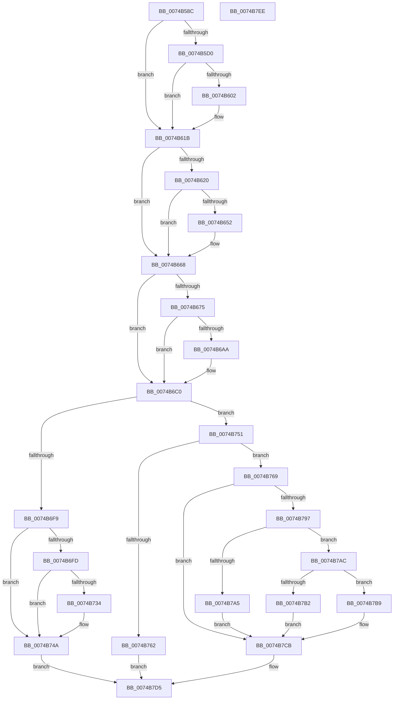

# KsepRegistryQuerySZ

- RVA: `0x0074B58C`–`0x0074B7EF` (길이 `611` bytes)
- VA: `0x000000014074B58C`
- 실행 섹션: `PAGE`
- PDB 이름 있음: `예`; PDB Function 태그: `아니요`
- unwind 정보 RVA: `0x000CB4F0`
- 디코드: `150`개 명령, `611/611` bytes 표시
- 미해석 바이트: `0` (있으면 어셈블리에 `.byte`로 보존)

> 이 문서는 커널 이미지의 기계어와 PDB 기호를 분석해 생성했습니다. 4번과 5번은 함수 원형과 자료형을 바이너리 사용 방식에서 추정한 C 해석이며 원본 소스 복구 결과는 아닙니다.

## 1. Dependencies

- 직접 호출 지점: **10**; 고유 호출 대상: **6**
- 직접 호출자로 확인된 함수: **3**
- RIP 상대 이미지 참조: **8**

### Outgoing calls
- `0x0074B613` → [RtlAssert](../../text/5E/RtlAssert_function_005E75E0.md) (function, `0x005E75E0`)
- `0x0074B663` → [RtlAssert](../../text/5E/RtlAssert_function_005E75E0.md) (function, `0x005E75E0`)
- `0x0074B6BB` → [RtlAssert](../../text/5E/RtlAssert_function_005E75E0.md) (function, `0x005E75E0`)
- `0x0074B6C8` → [RtlInitUnicodeString](../../text/42/RtlInitUnicodeString_function_0042A780.md) (function, `0x0042A780`)
- `0x0074B6EB` → [ZwQueryValueKey](../../text/6A/ZwQueryValueKey_function_006AD3B0.md) (function, `0x006AD3B0`)
- `0x0074B745` → [RtlAssert](../../text/5E/RtlAssert_function_005E75E0.md) (function, `0x005E75E0`)
- `0x0074B755` → [KsepPoolAllocatePaged](../../text/4A/KsepPoolAllocatePaged_function_004A9EFC.md) (function, `0x004A9EFC`)
- `0x0074B78C` → [ZwQueryValueKey](../../text/6A/ZwQueryValueKey_function_006AD3B0.md) (function, `0x006AD3B0`)
- `0x0074B7C0` → [memcpy](../../text/6C/memcpy_function_006C6840.md) (function, `0x006C6840`)
- `0x0074B7CE` → [KsepPoolFreePaged](../../text/4B/KsepPoolFreePaged_function_004B0E10.md) (function, `0x004B0E10`)

### Direct callers
- [KsepRegistryQueryMULTISZ](KsepRegistryQueryMULTISZ_function_0074B55C.md) at `0x0074B578`
- [KsepRegistryQueryDriverShims](../95/KsepRegistryQueryDriverShims_function_00959524.md) at `0x00959648`
- [KsepMatchInitBiosInfo](../../init/C3/KsepMatchInitBiosInfo_function_00C3BCB0.md) at `0x00C3BD5B`

### Static image references
- `0x0074B5A7` → RVA `0x00F101E0` (`.data`; read)
- `0x0074B5D3` → RVA `0x00F101C0` (`.data`; read/write)
- `0x0074B5F8` → RVA `0x00E66CE8` (`.data`; read)
- `0x0074B605` → RVA `0x00B011C0` (` ?? ::NNGAKEGL::`string'`; read)
- `0x0074B60C` → RVA `0x00B012F0` (` ?? ::NNGAKEGL::`string'`; read)
- `0x0074B65C` → RVA `0x00B01280` (` ?? ::NNGAKEGL::`string'`; read)
- `0x0074B6B4` → RVA `0x00B012A0` (` ?? ::NNGAKEGL::`string'`; read)
- `0x0074B73E` → RVA `0x00B01340` (` ?? ::NNGAKEGL::`string'`; read)

## 2. Other-region calls and transfers

- 다른 실행 섹션으로 향하는 call: **10**
  - `0x0074B613` → [RtlAssert](../../text/5E/RtlAssert_function_005E75E0.md) (`PAGE` → `.text`)
  - `0x0074B663` → [RtlAssert](../../text/5E/RtlAssert_function_005E75E0.md) (`PAGE` → `.text`)
  - `0x0074B6BB` → [RtlAssert](../../text/5E/RtlAssert_function_005E75E0.md) (`PAGE` → `.text`)
  - `0x0074B6C8` → [RtlInitUnicodeString](../../text/42/RtlInitUnicodeString_function_0042A780.md) (`PAGE` → `.text`)
  - `0x0074B6EB` → [ZwQueryValueKey](../../text/6A/ZwQueryValueKey_function_006AD3B0.md) (`PAGE` → `.text`)
  - `0x0074B745` → [RtlAssert](../../text/5E/RtlAssert_function_005E75E0.md) (`PAGE` → `.text`)
  - `0x0074B755` → [KsepPoolAllocatePaged](../../text/4A/KsepPoolAllocatePaged_function_004A9EFC.md) (`PAGE` → `.text`)
  - `0x0074B78C` → [ZwQueryValueKey](../../text/6A/ZwQueryValueKey_function_006AD3B0.md) (`PAGE` → `.text`)
  - `0x0074B7C0` → [memcpy](../../text/6C/memcpy_function_006C6840.md) (`PAGE` → `.text`)
  - `0x0074B7CE` → [KsepPoolFreePaged](../../text/4B/KsepPoolFreePaged_function_004B0E10.md) (`PAGE` → `.text`)
- 별도 외부 분기/꼬리 이동을 확인하지 못했습니다.

## 3. Assembly (complete function range)

```asm
0074B58C  48 8B C4                        mov rax, rsp
0074B58F  48 89 58 10                     mov qword ptr [rax + 0x10], rbx
0074B593  48 89 68 18                     mov qword ptr [rax + 0x18], rbp
0074B597  56                              push rsi
0074B598  57                              push rdi
0074B599  41 55                           push r13
0074B59B  41 56                           push r14
0074B59D  41 57                           push r15
0074B59F  48 83 EC 40                     sub rsp, 0x40
0074B5A3  83 60 08 00                     and dword ptr [rax + 8], 0
0074B5A7  4C 8D 3D 32 4C 7C 00            lea r15, [rip + 0x7c4c32]
0074B5AE  48 8B F9                        mov rdi, rcx
0074B5B1  41 BD 01 00 00 00               mov r13d, 1
0074B5B7  0F 57 C0                        xorps xmm0, xmm0
0074B5BA  49 8B E9                        mov rbp, r9
0074B5BD  45 8B F0                        mov r14d, r8d
0074B5C0  48 8B DA                        mov rbx, rdx
0074B5C3  0F 11 40 C8                     movups xmmword ptr [rax - 0x38], xmm0
0074B5C7  41 8D 4D 03                     lea ecx, [r13 + 3]
0074B5CB  48 85 FF                        test rdi, rdi
0074B5CE  75 4B                           jne 0x14074b61b
0074B5D0  41 8B C5                        mov eax, r13d
0074B5D3  F0 0F C1 05 E5 4B 7C 00         lock xadd dword ptr [rip + 0x7c4be5], eax
0074B5DB  41 03 C5                        add eax, r13d
0074B5DE  41 B8 51 03 00 00               mov r8d, 0x351
0074B5E4  83 E0 3F                        and eax, 0x3f
0074B5E7  41 C7 44 C7 04 20 04 00 C0      mov dword ptr [r15 + rax*8 + 4], 0xc0000420
0074B5F0  41 C7 04 C7 51 03 04 00         mov dword ptr [r15 + rax*8], 0x40351
0074B5F8  8B 05 EA B6 71 00               mov eax, dword ptr [rip + 0x71b6ea]
0074B5FE  84 C1                           test cl, al
0074B600  74 19                           je 0x14074b61b
0074B602  45 33 C9                        xor r9d, r9d
0074B605  48 8D 15 B4 5B 3B 00            lea rdx, [rip + 0x3b5bb4]
0074B60C  48 8D 0D DD 5C 3B 00            lea rcx, [rip + 0x3b5cdd]
0074B613  E8 C8 BF E9 FF                  call 0x1405e75e0
0074B618  8D 4F 04                        lea ecx, [rdi + 4]
0074B61B  48 85 ED                        test rbp, rbp
0074B61E  75 48                           jne 0x14074b668
0074B620  41 8B C5                        mov eax, r13d
0074B623  F0 0F C1 05 95 4B 7C 00         lock xadd dword ptr [rip + 0x7c4b95], eax
0074B62B  41 03 C5                        add eax, r13d
0074B62E  41 B8 52 03 00 00               mov r8d, 0x352
0074B634  83 E0 3F                        and eax, 0x3f
0074B637  41 C7 44 C7 04 20 04 00 C0      mov dword ptr [r15 + rax*8 + 4], 0xc0000420
0074B640  41 C7 04 C7 52 03 04 00         mov dword ptr [r15 + rax*8], 0x40352
0074B648  8B 05 9A B6 71 00               mov eax, dword ptr [rip + 0x71b69a]
0074B64E  84 C1                           test cl, al
0074B650  74 16                           je 0x14074b668
0074B652  45 33 C9                        xor r9d, r9d
0074B655  48 8D 15 64 5B 3B 00            lea rdx, [rip + 0x3b5b64]
0074B65C  48 8D 0D 1D 5C 3B 00            lea rcx, [rip + 0x3b5c1d]
0074B663  E8 78 BF E9 FF                  call 0x1405e75e0
0074B668  48 8B B4 24 98 00 00 00         mov rsi, qword ptr [rsp + 0x98]
0074B670  48 85 F6                        test rsi, rsi
0074B673  75 4B                           jne 0x14074b6c0
0074B675  41 8B C5                        mov eax, r13d
0074B678  F0 0F C1 05 40 4B 7C 00         lock xadd dword ptr [rip + 0x7c4b40], eax
0074B680  41 03 C5                        add eax, r13d
0074B683  8D 4E 04                        lea ecx, [rsi + 4]
0074B686  83 E0 3F                        and eax, 0x3f
0074B689  41 B8 53 03 00 00               mov r8d, 0x353
0074B68F  41 C7 44 C7 04 20 04 00 C0      mov dword ptr [r15 + rax*8 + 4], 0xc0000420
0074B698  41 C7 04 C7 53 03 04 00         mov dword ptr [r15 + rax*8], 0x40353
0074B6A0  8B 05 42 B6 71 00               mov eax, dword ptr [rip + 0x71b642]
0074B6A6  84 C1                           test cl, al
0074B6A8  74 16                           je 0x14074b6c0
0074B6AA  45 33 C9                        xor r9d, r9d
0074B6AD  48 8D 15 0C 5B 3B 00            lea rdx, [rip + 0x3b5b0c]
0074B6B4  48 8D 0D E5 5B 3B 00            lea rcx, [rip + 0x3b5be5]
0074B6BB  E8 20 BF E9 FF                  call 0x1405e75e0
0074B6C0  48 8B D3                        mov rdx, rbx
0074B6C3  48 8D 4C 24 30                  lea rcx, [rsp + 0x30]
0074B6C8  E8 B3 F0 CD FF                  call 0x14042a780
0074B6CD  45 33 C9                        xor r9d, r9d
0074B6D0  48 8D 44 24 70                  lea rax, [rsp + 0x70]
0074B6D5  48 89 44 24 28                  mov qword ptr [rsp + 0x28], rax
0074B6DA  48 8D 54 24 30                  lea rdx, [rsp + 0x30]
0074B6DF  83 64 24 20 00                  and dword ptr [rsp + 0x20], 0
0074B6E4  48 8B CF                        mov rcx, rdi
0074B6E7  45 8D 41 02                     lea r8d, [r9 + 2]
0074B6EB  E8 C0 1C F6 FF                  call 0x1406ad3b0
0074B6F0  8B D8                           mov ebx, eax
0074B6F2  3D 23 00 00 C0                  cmp eax, 0xc0000023
0074B6F7  74 58                           je 0x14074b751
0074B6F9  85 C0                           test eax, eax
0074B6FB  78 4D                           js 0x14074b74a
0074B6FD  41 8B CD                        mov ecx, r13d
0074B700  F0 0F C1 0D B8 4A 7C 00         lock xadd dword ptr [rip + 0x7c4ab8], ecx
0074B708  8B 05 DA B5 71 00               mov eax, dword ptr [rip + 0x71b5da]
0074B70E  41 03 CD                        add ecx, r13d
0074B711  83 E1 3F                        and ecx, 0x3f
0074B714  BA 04 00 00 00                  mov edx, 4
0074B719  41 B8 65 03 00 00               mov r8d, 0x365
0074B71F  41 C7 44 CF 04 20 04 00 C0      mov dword ptr [r15 + rcx*8 + 4], 0xc0000420
0074B728  41 C7 04 CF 65 03 04 00         mov dword ptr [r15 + rcx*8], 0x40365
0074B730  84 C2                           test dl, al
0074B732  74 16                           je 0x14074b74a
0074B734  45 33 C9                        xor r9d, r9d
0074B737  48 8D 15 82 5A 3B 00            lea rdx, [rip + 0x3b5a82]
0074B73E  48 8D 0D FB 5B 3B 00            lea rcx, [rip + 0x3b5bfb]
0074B745  E8 96 BE E9 FF                  call 0x1405e75e0
0074B74A  8B C3                           mov eax, ebx
0074B74C  E9 84 00 00 00                  jmp 0x14074b7d5
0074B751  8B 4C 24 70                     mov ecx, dword ptr [rsp + 0x70]
0074B755  E8 A2 E7 D5 FF                  call 0x1404a9efc
0074B75A  48 8B D8                        mov rbx, rax
0074B75D  48 85 C0                        test rax, rax
0074B760  75 07                           jne 0x14074b769
0074B762  B8 17 00 00 C0                  mov eax, 0xc0000017
0074B767  EB 6C                           jmp 0x14074b7d5
0074B769  48 8D 44 24 70                  lea rax, [rsp + 0x70]
0074B76E  4C 8B CB                        mov r9, rbx
0074B771  48 89 44 24 28                  mov qword ptr [rsp + 0x28], rax
0074B776  48 8D 54 24 30                  lea rdx, [rsp + 0x30]
0074B77B  8B 44 24 70                     mov eax, dword ptr [rsp + 0x70]
0074B77F  41 B8 02 00 00 00               mov r8d, 2
0074B785  48 8B CF                        mov rcx, rdi
0074B788  89 44 24 20                     mov dword ptr [rsp + 0x20], eax
0074B78C  E8 1F 1C F6 FF                  call 0x1406ad3b0
0074B791  8B F8                           mov edi, eax
0074B793  85 C0                           test eax, eax
0074B795  75 34                           jne 0x14074b7cb
0074B797  44 8B 43 08                     mov r8d, dword ptr [rbx + 8]
0074B79B  4C 3B 84 24 90 00 00 00         cmp r8, qword ptr [rsp + 0x90]
0074B7A3  76 07                           jbe 0x14074b7ac
0074B7A5  BF 23 00 00 C0                  mov edi, 0xc0000023
0074B7AA  EB 1F                           jmp 0x14074b7cb
0074B7AC  44 39 73 04                     cmp dword ptr [rbx + 4], r14d
0074B7B0  74 07                           je 0x14074b7b9
0074B7B2  BF 24 00 00 C0                  mov edi, 0xc0000024
0074B7B7  EB 12                           jmp 0x14074b7cb
0074B7B9  48 8D 53 0C                     lea rdx, [rbx + 0xc]
0074B7BD  48 8B CD                        mov rcx, rbp
0074B7C0  E8 7B B0 F7 FF                  call 0x1406c6840
0074B7C5  8B 43 08                        mov eax, dword ptr [rbx + 8]
0074B7C8  48 89 06                        mov qword ptr [rsi], rax
0074B7CB  48 8B CB                        mov rcx, rbx
0074B7CE  E8 3D 56 D6 FF                  call 0x1404b0e10
0074B7D3  8B C7                           mov eax, edi
0074B7D5  4C 8D 5C 24 40                  lea r11, [rsp + 0x40]
0074B7DA  49 8B 5B 38                     mov rbx, qword ptr [r11 + 0x38]
0074B7DE  49 8B 6B 40                     mov rbp, qword ptr [r11 + 0x40]
0074B7E2  49 8B E3                        mov rsp, r11
0074B7E5  41 5F                           pop r15
0074B7E7  41 5E                           pop r14
0074B7E9  41 5D                           pop r13
0074B7EB  5F                              pop rdi
0074B7EC  5E                              pop rsi
0074B7ED  C3                              ret
0074B7EE  CC                              int3
```

## 4. C-style interpretation (structured pseudocode)

```c
__int64 __fastcall KsepRegistryQuerySZ(__int64 a1, __int64 a2, int a3, __int64 a4, __int64 a5, __int64 a6)
{
    __int64 result;
    __int64 v_rsp;
    unsigned __int64 v_stack_m28;
    unsigned __int64 v_stack_m38;
    unsigned __int64 v_stack_m40;
    unsigned int v_stack_m48;
    unsigned __int64 v_stack_p8;

    *(unsigned __int64 *)(v_rsp + 16) = v_rbx;
    *(unsigned __int64 *)(v_rsp + 24) = v_rbp;
    v_rsp = (v_rsp) - (64);
    *(unsigned __int64 *)(v_rsp - 56) = v_xmm0;
    if (a1 != 0) goto loc_0074B61B;
    result = (unsigned int)((1) + (1));
    result = (unsigned int)((result) & (63));
    *(unsigned int *)(v_rip + 8145970 + result * 8 + 4) = 0xC0000420ULL;
    *(unsigned int *)(v_rip + 8145970 + result * 8) = 0x40351ULL;
    result = (unsigned int)(*(unsigned int *)(v_rip + 7452394));
    if ((((unsigned __int8)(1 + 3)) & ((unsigned __int8)((unsigned int)(*(unsigned int *)(v_rip + 7452394))))) != 0) {
        a4 = 0;
        a2 = v_rip + 3890100;
        a1 = v_rip + 3890397;
        result = RtlAssert(a1, a2, 849, a4);
        a1 = a1 + 4;
    }
    if (0 != 0) goto loc_0074B668;
    result = (unsigned int)((1) + (1));
    result = (unsigned int)((result) & (63));
    *(unsigned int *)(v_rip + 8145970 + result * 8 + 4) = 0xC0000420ULL;
    *(unsigned int *)(v_rip + 8145970 + result * 8) = 0x40352ULL;
    result = (unsigned int)(*(unsigned int *)(v_rip + 7452314));
    if ((((unsigned __int8)(a1)) & ((unsigned __int8)((unsigned int)(*(unsigned int *)(v_rip + 7452314))))) != 0) {
        a4 = 0;
        a2 = v_rip + 3890020;
        a1 = v_rip + 3890205;
        result = RtlAssert(a1, a2, 850, a4);
    }
    if (a6 != 0) goto loc_0074B6C0;
    result = (unsigned int)((1) + (1));
    result = (unsigned int)((result) & (63));
    *(unsigned int *)(v_rip + 8145970 + result * 8 + 4) = 0xC0000420ULL;
    *(unsigned int *)(v_rip + 8145970 + result * 8) = 0x40353ULL;
    result = (unsigned int)(*(unsigned int *)(v_rip + 7452226));
    if ((((unsigned __int8)(a6 + 4)) & ((unsigned __int8)((unsigned int)(*(unsigned int *)(v_rip + 7452226))))) != 0) {
        a4 = 0;
        a2 = v_rip + 3889932;
        a1 = v_rip + 3890149;
        result = RtlAssert(a1, a2, 851, a4);
    }
    result = RtlInitUnicodeString(v_stack_m38, a2, 851, a4);
    a4 = 0;
    v_stack_m40 = v_stack_p8;
    result = ZwQueryValueKey(a1, v_stack_m38, a4 + 2, a4);
    if (((unsigned int)(result)) == 0xC0000023ULL) goto loc_0074B751;
    if (sign_flag) goto loc_0074B74A;
    a1 = (unsigned int)((1) + (1));
    a1 = (unsigned int)((a1) & (63));
    *(unsigned int *)(v_rip + 8145970 + a1 * 8 + 4) = 0xC0000420ULL;
    *(unsigned int *)(v_rip + 8145970 + a1 * 8) = 0x40365ULL;
    result = (unsigned int)(*(unsigned int *)(v_rip + 7452122));
    if (((4) & ((unsigned __int8)((unsigned int)(*(unsigned int *)(v_rip + 7452122))))) != 0) {
        a4 = 0;
        a2 = v_rip + 3889794;
        a1 = v_rip + 3890171;
        result = RtlAssert(a1, a2, 869, a4);
    }
    goto loc_0074B7D5;
loc_0074B751:
    result = KsepPoolAllocatePaged((unsigned int)(v_stack_p8), a2, 869, a4);
    if (result != 0) goto loc_0074B769;
    goto loc_0074B7D5;
loc_0074B769:
    v_stack_m40 = v_stack_p8;
    v_stack_m48 = (unsigned int)((unsigned int)(v_stack_p8));
    result = ZwQueryValueKey(a1, v_stack_m38, 2, result);
    if ((unsigned int)(result) != 0) goto loc_0074B7CB;
    if (((unsigned int)(*(unsigned int *)(result + 8))) <= a5) goto loc_0074B7AC;
    goto loc_0074B7CB;
loc_0074B7AC:
    if ((*(unsigned int *)(result + 4)) == ((unsigned int)((unsigned int)(a3)))) goto loc_0074B7B9;
    goto loc_0074B7CB;
loc_0074B7B9:
    result = memcpy(0, result + 12, (unsigned int)(*(unsigned int *)(result + 8)), result);
    *(unsigned __int64 *)(a6) = (unsigned int)(*(unsigned int *)(result + 8));
loc_0074B7CB:
    result = KsepPoolFreePaged(result, result + 12, (unsigned int)(*(unsigned int *)(result + 8)), result);
loc_0074B7D5:
    return (unsigned int)((unsigned int)((unsigned int)(0xC0000024ULL)));
}
```

## 5. (Beta) C Style

```c
int64_t KsepRegistryQuerySZ(int64_t Arg1, int64_t Arg2, int32_t Arg3, int64_t Arg4, int64_t Arg5, int64_t Arg6)
{
    int64_t result;
    int64_t local_rsp;
    uint64_t v_stack_m28;
    uint64_t v_stack_m38;
    uint64_t v_stack_m40;
    uint32_t v_stack_m48;
    uint64_t v_stack_p8;

    *(uint64_t *)(local_rsp + 0x10) = local_rbx;
    *(uint64_t *)(local_rsp + 0x18) = local_rbp;
    local_rsp = (local_rsp) - (64);
    *(uint64_t *)(local_rsp - 0x38) = v_xmm0;
    if (Arg1 != 0) goto loc_0074B61B;
    result = (uint32_t)((1) + (1));
    result = (uint32_t)((result) & (63));
    *(uint32_t *)(v_rip + 0x7C4C32 + result * 8 + 0x4) = 0xC0000420ULL;
    *(uint32_t *)(v_rip + 0x7C4C32 + result * 8) = 0x40351ULL;
    result = (uint32_t)(*(uint32_t *)(v_rip + 0x71B6EA));
    if ((((uint8_t)(1 + 3)) & ((uint8_t)((uint32_t)(*(uint32_t *)(v_rip + 0x71B6EA))))) != 0) {
        Arg4 = 0;
        Arg2 = v_rip + 3890100;
        Arg1 = v_rip + 3890397;
        result = RtlAssert(Arg1, Arg2, 849, Arg4);
        Arg1 = Arg1 + 4;
    }
    if (0 != 0) goto loc_0074B668;
    result = (uint32_t)((1) + (1));
    result = (uint32_t)((result) & (63));
    *(uint32_t *)(v_rip + 0x7C4C32 + result * 8 + 0x4) = 0xC0000420ULL;
    *(uint32_t *)(v_rip + 0x7C4C32 + result * 8) = 0x40352ULL;
    result = (uint32_t)(*(uint32_t *)(v_rip + 0x71B69A));
    if ((((uint8_t)(Arg1)) & ((uint8_t)((uint32_t)(*(uint32_t *)(v_rip + 0x71B69A))))) != 0) {
        Arg4 = 0;
        Arg2 = v_rip + 3890020;
        Arg1 = v_rip + 3890205;
        result = RtlAssert(Arg1, Arg2, 850, Arg4);
    }
    if (Arg6 != 0) goto loc_0074B6C0;
    result = (uint32_t)((1) + (1));
    result = (uint32_t)((result) & (63));
    *(uint32_t *)(v_rip + 0x7C4C32 + result * 8 + 0x4) = 0xC0000420ULL;
    *(uint32_t *)(v_rip + 0x7C4C32 + result * 8) = 0x40353ULL;
    result = (uint32_t)(*(uint32_t *)(v_rip + 0x71B642));
    if ((((uint8_t)(Arg6 + 4)) & ((uint8_t)((uint32_t)(*(uint32_t *)(v_rip + 0x71B642))))) != 0) {
        Arg4 = 0;
        Arg2 = v_rip + 3889932;
        Arg1 = v_rip + 3890149;
        result = RtlAssert(Arg1, Arg2, 851, Arg4);
    }
    result = RtlInitUnicodeString(v_stack_m38, Arg2, 851, Arg4);
    Arg4 = 0;
    v_stack_m40 = v_stack_p8;
    result = ZwQueryValueKey(Arg1, v_stack_m38, Arg4 + 2, Arg4);
    if (((uint32_t)(result)) == 0xC0000023ULL) goto loc_0074B751;
    if (sign_flag) goto loc_0074B74A;
    Arg1 = (uint32_t)((1) + (1));
    Arg1 = (uint32_t)((Arg1) & (63));
    *(uint32_t *)(v_rip + 0x7C4C32 + Arg1 * 8 + 0x4) = 0xC0000420ULL;
    *(uint32_t *)(v_rip + 0x7C4C32 + Arg1 * 8) = 0x40365ULL;
    result = (uint32_t)(*(uint32_t *)(v_rip + 0x71B5DA));
    if (((4) & ((uint8_t)((uint32_t)(*(uint32_t *)(v_rip + 0x71B5DA))))) != 0) {
        Arg4 = 0;
        Arg2 = v_rip + 3889794;
        Arg1 = v_rip + 3890171;
        result = RtlAssert(Arg1, Arg2, 869, Arg4);
    }
    goto loc_0074B7D5;
loc_0074B751:
    result = KsepPoolAllocatePaged((uint32_t)(v_stack_p8), Arg2, 869, Arg4);
    if (result != 0) goto loc_0074B769;
    goto loc_0074B7D5;
loc_0074B769:
    v_stack_m40 = v_stack_p8;
    v_stack_m48 = (uint32_t)((uint32_t)(v_stack_p8));
    result = ZwQueryValueKey(Arg1, v_stack_m38, 2, result);
    if ((uint32_t)(result) != 0) goto loc_0074B7CB;
    if (((uint32_t)(*(uint32_t *)(result + 0x8))) <= Arg5) goto loc_0074B7AC;
    goto loc_0074B7CB;
loc_0074B7AC:
    if ((*(uint32_t *)(result + 0x4)) == ((uint32_t)((uint32_t)(Arg3)))) goto loc_0074B7B9;
    goto loc_0074B7CB;
loc_0074B7B9:
    result = memcpy(0, result + 12, (uint32_t)(*(uint32_t *)(result + 0x8)), result);
    *(uint64_t *)(Arg6) = (uint32_t)(*(uint32_t *)(result + 0x8));
loc_0074B7CB:
    result = KsepPoolFreePaged(result, result + 12, (uint32_t)(*(uint32_t *)(result + 0x8)), result);
loc_0074B7D5:
    return (uint32_t)((uint32_t)((uint32_t)(0xC0000024ULL)));
}
```

## 6. Execution-region graph

[열기: 2D/3D 그래프와 함수 탐색 컨트롤 패널](../../../control-panel.html?section=page&rva=0x0074B58C&view=graph)

- 2D 그래프는 위에서 아래로 흐르고, 3D 그래프는 빈 공간을 드래그해 회전합니다. Shift+드래그는 이동, 휠은 확대·축소, 함수 노드 선택은 대상 보고서 이동입니다.

### Static fallback


