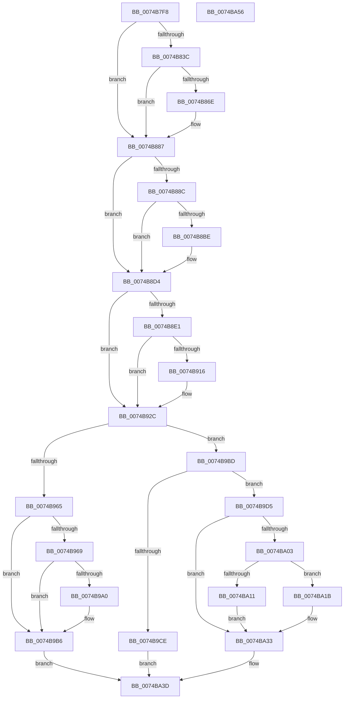

# KsepRegistryQueryValue

- RVA: `0x0074B7F8`–`0x0074BA57` (길이 `607` bytes)
- VA: `0x000000014074B7F8`
- 실행 섹션: `PAGE`
- PDB 이름 있음: `예`; PDB Function 태그: `아니요`
- unwind 정보 RVA: `0x000CB4F0`
- 디코드: `149`개 명령, `607/607` bytes 표시
- 미해석 바이트: `0` (있으면 어셈블리에 `.byte`로 보존)

> 이 문서는 커널 이미지의 기계어와 PDB 기호를 분석해 생성했습니다. 4번과 5번은 함수 원형과 자료형을 바이너리 사용 방식에서 추정한 C 해석이며 원본 소스 복구 결과는 아닙니다.

## 1. Dependencies

- 직접 호출 지점: **10**; 고유 호출 대상: **6**
- 직접 호출자로 확인된 함수: **1**
- RIP 상대 이미지 참조: **8**

### Outgoing calls
- `0x0074B87F` → [RtlAssert](../../text/5E/RtlAssert_function_005E75E0.md) (function, `0x005E75E0`)
- `0x0074B8CF` → [RtlAssert](../../text/5E/RtlAssert_function_005E75E0.md) (function, `0x005E75E0`)
- `0x0074B927` → [RtlAssert](../../text/5E/RtlAssert_function_005E75E0.md) (function, `0x005E75E0`)
- `0x0074B934` → [RtlInitUnicodeString](../../text/42/RtlInitUnicodeString_function_0042A780.md) (function, `0x0042A780`)
- `0x0074B957` → [ZwQueryValueKey](../../text/6A/ZwQueryValueKey_function_006AD3B0.md) (function, `0x006AD3B0`)
- `0x0074B9B1` → [RtlAssert](../../text/5E/RtlAssert_function_005E75E0.md) (function, `0x005E75E0`)
- `0x0074B9C1` → [KsepPoolAllocatePaged](../../text/4A/KsepPoolAllocatePaged_function_004A9EFC.md) (function, `0x004A9EFC`)
- `0x0074B9F8` → [ZwQueryValueKey](../../text/6A/ZwQueryValueKey_function_006AD3B0.md) (function, `0x006AD3B0`)
- `0x0074BA22` → [memcpy](../../text/6C/memcpy_function_006C6840.md) (function, `0x006C6840`)
- `0x0074BA36` → [KsepPoolFreePaged](../../text/4B/KsepPoolFreePaged_function_004B0E10.md) (function, `0x004B0E10`)

### Direct callers
- [KsepDbQueryRegistryDeviceData](../95/KsepDbQueryRegistryDeviceData_function_0095B174.md) at `0x0095B2DD`

### Static image references
- `0x0074B813` → RVA `0x00F101E0` (`.data`; read)
- `0x0074B83F` → RVA `0x00F101C0` (`.data`; read/write)
- `0x0074B864` → RVA `0x00E66CE8` (`.data`; read)
- `0x0074B871` → RVA `0x00B011C0` (` ?? ::NNGAKEGL::`string'`; read)
- `0x0074B878` → RVA `0x00B012F0` (` ?? ::NNGAKEGL::`string'`; read)
- `0x0074B8C8` → RVA `0x00B01280` (` ?? ::NNGAKEGL::`string'`; read)
- `0x0074B920` → RVA `0x00B012A0` (` ?? ::NNGAKEGL::`string'`; read)
- `0x0074B9AA` → RVA `0x00B01340` (` ?? ::NNGAKEGL::`string'`; read)

## 2. Other-region calls and transfers

- 다른 실행 섹션으로 향하는 call: **10**
  - `0x0074B87F` → [RtlAssert](../../text/5E/RtlAssert_function_005E75E0.md) (`PAGE` → `.text`)
  - `0x0074B8CF` → [RtlAssert](../../text/5E/RtlAssert_function_005E75E0.md) (`PAGE` → `.text`)
  - `0x0074B927` → [RtlAssert](../../text/5E/RtlAssert_function_005E75E0.md) (`PAGE` → `.text`)
  - `0x0074B934` → [RtlInitUnicodeString](../../text/42/RtlInitUnicodeString_function_0042A780.md) (`PAGE` → `.text`)
  - `0x0074B957` → [ZwQueryValueKey](../../text/6A/ZwQueryValueKey_function_006AD3B0.md) (`PAGE` → `.text`)
  - `0x0074B9B1` → [RtlAssert](../../text/5E/RtlAssert_function_005E75E0.md) (`PAGE` → `.text`)
  - `0x0074B9C1` → [KsepPoolAllocatePaged](../../text/4A/KsepPoolAllocatePaged_function_004A9EFC.md) (`PAGE` → `.text`)
  - `0x0074B9F8` → [ZwQueryValueKey](../../text/6A/ZwQueryValueKey_function_006AD3B0.md) (`PAGE` → `.text`)
  - `0x0074BA22` → [memcpy](../../text/6C/memcpy_function_006C6840.md) (`PAGE` → `.text`)
  - `0x0074BA36` → [KsepPoolFreePaged](../../text/4B/KsepPoolFreePaged_function_004B0E10.md) (`PAGE` → `.text`)
- 별도 외부 분기/꼬리 이동을 확인하지 못했습니다.

## 3. Assembly (complete function range)

```asm
0074B7F8  48 8B C4                        mov rax, rsp
0074B7FB  48 89 58 10                     mov qword ptr [rax + 0x10], rbx
0074B7FF  48 89 68 18                     mov qword ptr [rax + 0x18], rbp
0074B803  56                              push rsi
0074B804  57                              push rdi
0074B805  41 55                           push r13
0074B807  41 56                           push r14
0074B809  41 57                           push r15
0074B80B  48 83 EC 40                     sub rsp, 0x40
0074B80F  83 60 08 00                     and dword ptr [rax + 8], 0
0074B813  4C 8D 3D C6 49 7C 00            lea r15, [rip + 0x7c49c6]
0074B81A  48 8B F9                        mov rdi, rcx
0074B81D  41 BD 01 00 00 00               mov r13d, 1
0074B823  0F 57 C0                        xorps xmm0, xmm0
0074B826  49 8B E9                        mov rbp, r9
0074B829  4D 8B F0                        mov r14, r8
0074B82C  48 8B DA                        mov rbx, rdx
0074B82F  0F 11 40 C8                     movups xmmword ptr [rax - 0x38], xmm0
0074B833  41 8D 4D 03                     lea ecx, [r13 + 3]
0074B837  48 85 FF                        test rdi, rdi
0074B83A  75 4B                           jne 0x14074b887
0074B83C  41 8B C5                        mov eax, r13d
0074B83F  F0 0F C1 05 79 49 7C 00         lock xadd dword ptr [rip + 0x7c4979], eax
0074B847  41 03 C5                        add eax, r13d
0074B84A  41 B8 C9 03 00 00               mov r8d, 0x3c9
0074B850  83 E0 3F                        and eax, 0x3f
0074B853  41 C7 44 C7 04 20 04 00 C0      mov dword ptr [r15 + rax*8 + 4], 0xc0000420
0074B85C  41 C7 04 C7 C9 03 04 00         mov dword ptr [r15 + rax*8], 0x403c9
0074B864  8B 05 7E B4 71 00               mov eax, dword ptr [rip + 0x71b47e]
0074B86A  84 C1                           test cl, al
0074B86C  74 19                           je 0x14074b887
0074B86E  45 33 C9                        xor r9d, r9d
0074B871  48 8D 15 48 59 3B 00            lea rdx, [rip + 0x3b5948]
0074B878  48 8D 0D 71 5A 3B 00            lea rcx, [rip + 0x3b5a71]
0074B87F  E8 5C BD E9 FF                  call 0x1405e75e0
0074B884  8D 4F 04                        lea ecx, [rdi + 4]
0074B887  48 85 ED                        test rbp, rbp
0074B88A  75 48                           jne 0x14074b8d4
0074B88C  41 8B C5                        mov eax, r13d
0074B88F  F0 0F C1 05 29 49 7C 00         lock xadd dword ptr [rip + 0x7c4929], eax
0074B897  41 03 C5                        add eax, r13d
0074B89A  41 B8 CA 03 00 00               mov r8d, 0x3ca
0074B8A0  83 E0 3F                        and eax, 0x3f
0074B8A3  41 C7 44 C7 04 20 04 00 C0      mov dword ptr [r15 + rax*8 + 4], 0xc0000420
0074B8AC  41 C7 04 C7 CA 03 04 00         mov dword ptr [r15 + rax*8], 0x403ca
0074B8B4  8B 05 2E B4 71 00               mov eax, dword ptr [rip + 0x71b42e]
0074B8BA  84 C1                           test cl, al
0074B8BC  74 16                           je 0x14074b8d4
0074B8BE  45 33 C9                        xor r9d, r9d
0074B8C1  48 8D 15 F8 58 3B 00            lea rdx, [rip + 0x3b58f8]
0074B8C8  48 8D 0D B1 59 3B 00            lea rcx, [rip + 0x3b59b1]
0074B8CF  E8 0C BD E9 FF                  call 0x1405e75e0
0074B8D4  48 8B B4 24 98 00 00 00         mov rsi, qword ptr [rsp + 0x98]
0074B8DC  48 85 F6                        test rsi, rsi
0074B8DF  75 4B                           jne 0x14074b92c
0074B8E1  41 8B C5                        mov eax, r13d
0074B8E4  F0 0F C1 05 D4 48 7C 00         lock xadd dword ptr [rip + 0x7c48d4], eax
0074B8EC  41 03 C5                        add eax, r13d
0074B8EF  8D 4E 04                        lea ecx, [rsi + 4]
0074B8F2  83 E0 3F                        and eax, 0x3f
0074B8F5  41 B8 CB 03 00 00               mov r8d, 0x3cb
0074B8FB  41 C7 44 C7 04 20 04 00 C0      mov dword ptr [r15 + rax*8 + 4], 0xc0000420
0074B904  41 C7 04 C7 CB 03 04 00         mov dword ptr [r15 + rax*8], 0x403cb
0074B90C  8B 05 D6 B3 71 00               mov eax, dword ptr [rip + 0x71b3d6]
0074B912  84 C1                           test cl, al
0074B914  74 16                           je 0x14074b92c
0074B916  45 33 C9                        xor r9d, r9d
0074B919  48 8D 15 A0 58 3B 00            lea rdx, [rip + 0x3b58a0]
0074B920  48 8D 0D 79 59 3B 00            lea rcx, [rip + 0x3b5979]
0074B927  E8 B4 BC E9 FF                  call 0x1405e75e0
0074B92C  48 8B D3                        mov rdx, rbx
0074B92F  48 8D 4C 24 30                  lea rcx, [rsp + 0x30]
0074B934  E8 47 EE CD FF                  call 0x14042a780
0074B939  45 33 C9                        xor r9d, r9d
0074B93C  48 8D 44 24 70                  lea rax, [rsp + 0x70]
0074B941  48 89 44 24 28                  mov qword ptr [rsp + 0x28], rax
0074B946  48 8D 54 24 30                  lea rdx, [rsp + 0x30]
0074B94B  83 64 24 20 00                  and dword ptr [rsp + 0x20], 0
0074B950  48 8B CF                        mov rcx, rdi
0074B953  45 8D 41 02                     lea r8d, [r9 + 2]
0074B957  E8 54 1A F6 FF                  call 0x1406ad3b0
0074B95C  8B D8                           mov ebx, eax
0074B95E  3D 23 00 00 C0                  cmp eax, 0xc0000023
0074B963  74 58                           je 0x14074b9bd
0074B965  85 C0                           test eax, eax
0074B967  78 4D                           js 0x14074b9b6
0074B969  41 8B CD                        mov ecx, r13d
0074B96C  F0 0F C1 0D 4C 48 7C 00         lock xadd dword ptr [rip + 0x7c484c], ecx
0074B974  8B 05 6E B3 71 00               mov eax, dword ptr [rip + 0x71b36e]
0074B97A  41 03 CD                        add ecx, r13d
0074B97D  83 E1 3F                        and ecx, 0x3f
0074B980  BA 04 00 00 00                  mov edx, 4
0074B985  41 B8 DD 03 00 00               mov r8d, 0x3dd
0074B98B  41 C7 44 CF 04 20 04 00 C0      mov dword ptr [r15 + rcx*8 + 4], 0xc0000420
0074B994  41 C7 04 CF DD 03 04 00         mov dword ptr [r15 + rcx*8], 0x403dd
0074B99C  84 C2                           test dl, al
0074B99E  74 16                           je 0x14074b9b6
0074B9A0  45 33 C9                        xor r9d, r9d
0074B9A3  48 8D 15 16 58 3B 00            lea rdx, [rip + 0x3b5816]
0074B9AA  48 8D 0D 8F 59 3B 00            lea rcx, [rip + 0x3b598f]
0074B9B1  E8 2A BC E9 FF                  call 0x1405e75e0
0074B9B6  8B C3                           mov eax, ebx
0074B9B8  E9 80 00 00 00                  jmp 0x14074ba3d
0074B9BD  8B 4C 24 70                     mov ecx, dword ptr [rsp + 0x70]
0074B9C1  E8 36 E5 D5 FF                  call 0x1404a9efc
0074B9C6  48 8B D8                        mov rbx, rax
0074B9C9  48 85 C0                        test rax, rax
0074B9CC  75 07                           jne 0x14074b9d5
0074B9CE  B8 17 00 00 C0                  mov eax, 0xc0000017
0074B9D3  EB 68                           jmp 0x14074ba3d
0074B9D5  48 8D 44 24 70                  lea rax, [rsp + 0x70]
0074B9DA  4C 8B CB                        mov r9, rbx
0074B9DD  48 89 44 24 28                  mov qword ptr [rsp + 0x28], rax
0074B9E2  48 8D 54 24 30                  lea rdx, [rsp + 0x30]
0074B9E7  8B 44 24 70                     mov eax, dword ptr [rsp + 0x70]
0074B9EB  41 B8 02 00 00 00               mov r8d, 2
0074B9F1  48 8B CF                        mov rcx, rdi
0074B9F4  89 44 24 20                     mov dword ptr [rsp + 0x20], eax
0074B9F8  E8 B3 19 F6 FF                  call 0x1406ad3b0
0074B9FD  8B F8                           mov edi, eax
0074B9FF  85 C0                           test eax, eax
0074BA01  75 30                           jne 0x14074ba33
0074BA03  44 8B 43 08                     mov r8d, dword ptr [rbx + 8]
0074BA07  4C 3B 84 24 90 00 00 00         cmp r8, qword ptr [rsp + 0x90]
0074BA0F  76 0A                           jbe 0x14074ba1b
0074BA11  4C 89 06                        mov qword ptr [rsi], r8
0074BA14  BF 23 00 00 C0                  mov edi, 0xc0000023
0074BA19  EB 18                           jmp 0x14074ba33
0074BA1B  48 8D 53 0C                     lea rdx, [rbx + 0xc]
0074BA1F  48 8B CD                        mov rcx, rbp
0074BA22  E8 19 AE F7 FF                  call 0x1406c6840
0074BA27  8B 43 04                        mov eax, dword ptr [rbx + 4]
0074BA2A  41 89 06                        mov dword ptr [r14], eax
0074BA2D  8B 43 08                        mov eax, dword ptr [rbx + 8]
0074BA30  48 89 06                        mov qword ptr [rsi], rax
0074BA33  48 8B CB                        mov rcx, rbx
0074BA36  E8 D5 53 D6 FF                  call 0x1404b0e10
0074BA3B  8B C7                           mov eax, edi
0074BA3D  4C 8D 5C 24 40                  lea r11, [rsp + 0x40]
0074BA42  49 8B 5B 38                     mov rbx, qword ptr [r11 + 0x38]
0074BA46  49 8B 6B 40                     mov rbp, qword ptr [r11 + 0x40]
0074BA4A  49 8B E3                        mov rsp, r11
0074BA4D  41 5F                           pop r15
0074BA4F  41 5E                           pop r14
0074BA51  41 5D                           pop r13
0074BA53  5F                              pop rdi
0074BA54  5E                              pop rsi
0074BA55  C3                              ret
0074BA56  CC                              int3
```

## 4. C-style interpretation (structured pseudocode)

```c
__int64 __fastcall KsepRegistryQueryValue(__int64 a1, __int64 a2, __int64 a3, __int64 a4, __int64 a5, __int64 a6)
{
    __int64 result;
    __int64 v_rsp;
    unsigned __int64 v_stack_m28;
    unsigned __int64 v_stack_m38;
    unsigned __int64 v_stack_m40;
    unsigned int v_stack_m48;
    unsigned __int64 v_stack_p8;

    *(unsigned __int64 *)(v_rsp + 16) = v_rbx;
    *(unsigned __int64 *)(v_rsp + 24) = v_rbp;
    v_rsp = (v_rsp) - (64);
    *(unsigned __int64 *)(v_rsp - 56) = v_xmm0;
    if (a1 != 0) goto loc_0074B887;
    result = (unsigned int)((1) + (1));
    result = (unsigned int)((result) & (63));
    *(unsigned int *)(v_rip + 8145350 + result * 8 + 4) = 0xC0000420ULL;
    *(unsigned int *)(v_rip + 8145350 + result * 8) = 0x403C9ULL;
    result = (unsigned int)(*(unsigned int *)(v_rip + 7451774));
    if ((((unsigned __int8)(1 + 3)) & ((unsigned __int8)((unsigned int)(*(unsigned int *)(v_rip + 7451774))))) != 0) {
        a4 = 0;
        a2 = v_rip + 3889480;
        a1 = v_rip + 3889777;
        result = RtlAssert(a1, a2, 969, a4);
        a1 = a1 + 4;
    }
    if (0 != 0) goto loc_0074B8D4;
    result = (unsigned int)((1) + (1));
    result = (unsigned int)((result) & (63));
    *(unsigned int *)(v_rip + 8145350 + result * 8 + 4) = 0xC0000420ULL;
    *(unsigned int *)(v_rip + 8145350 + result * 8) = 0x403CAULL;
    result = (unsigned int)(*(unsigned int *)(v_rip + 7451694));
    if ((((unsigned __int8)(a1)) & ((unsigned __int8)((unsigned int)(*(unsigned int *)(v_rip + 7451694))))) != 0) {
        a4 = 0;
        a2 = v_rip + 3889400;
        a1 = v_rip + 3889585;
        result = RtlAssert(a1, a2, 970, a4);
    }
    if (a6 != 0) goto loc_0074B92C;
    result = (unsigned int)((1) + (1));
    result = (unsigned int)((result) & (63));
    *(unsigned int *)(v_rip + 8145350 + result * 8 + 4) = 0xC0000420ULL;
    *(unsigned int *)(v_rip + 8145350 + result * 8) = 0x403CBULL;
    result = (unsigned int)(*(unsigned int *)(v_rip + 7451606));
    if ((((unsigned __int8)(a6 + 4)) & ((unsigned __int8)((unsigned int)(*(unsigned int *)(v_rip + 7451606))))) != 0) {
        a4 = 0;
        a2 = v_rip + 3889312;
        a1 = v_rip + 3889529;
        result = RtlAssert(a1, a2, 971, a4);
    }
    result = RtlInitUnicodeString(v_stack_m38, a2, 971, a4);
    a4 = 0;
    v_stack_m40 = v_stack_p8;
    result = ZwQueryValueKey(a1, v_stack_m38, a4 + 2, a4);
    if (((unsigned int)(result)) == 0xC0000023ULL) goto loc_0074B9BD;
    if (sign_flag) goto loc_0074B9B6;
    a1 = (unsigned int)((1) + (1));
    a1 = (unsigned int)((a1) & (63));
    *(unsigned int *)(v_rip + 8145350 + a1 * 8 + 4) = 0xC0000420ULL;
    *(unsigned int *)(v_rip + 8145350 + a1 * 8) = 0x403DDULL;
    result = (unsigned int)(*(unsigned int *)(v_rip + 7451502));
    if (((4) & ((unsigned __int8)((unsigned int)(*(unsigned int *)(v_rip + 7451502))))) != 0) {
        a4 = 0;
        a2 = v_rip + 3889174;
        a1 = v_rip + 3889551;
        result = RtlAssert(a1, a2, 989, a4);
    }
    goto loc_0074BA3D;
loc_0074B9BD:
    result = KsepPoolAllocatePaged((unsigned int)(v_stack_p8), a2, 989, a4);
    if (result != 0) goto loc_0074B9D5;
    goto loc_0074BA3D;
loc_0074B9D5:
    v_stack_m40 = v_stack_p8;
    v_stack_m48 = (unsigned int)((unsigned int)(v_stack_p8));
    result = ZwQueryValueKey(a1, v_stack_m38, 2, result);
    if ((unsigned int)(result) != 0) goto loc_0074BA33;
    if (((unsigned int)(*(unsigned int *)(result + 8))) <= a5) goto loc_0074BA1B;
    *(unsigned __int64 *)(a6) = (unsigned int)(*(unsigned int *)(result + 8));
    goto loc_0074BA33;
loc_0074BA1B:
    result = memcpy(0, result + 12, (unsigned int)(*(unsigned int *)(result + 8)), result);
    *(unsigned int *)(a3) = (unsigned int)((unsigned int)(*(unsigned int *)(result + 4)));
    *(unsigned __int64 *)(a6) = (unsigned int)(*(unsigned int *)(result + 8));
loc_0074BA33:
    result = KsepPoolFreePaged(result, result + 12, (unsigned int)(*(unsigned int *)(result + 8)), result);
loc_0074BA3D:
    return (unsigned int)((unsigned int)((unsigned int)(0xC0000023ULL)));
}
```

## 5. (Beta) C Style

```c
int64_t KsepRegistryQueryValue(int64_t Arg1, int64_t Arg2, void *Arg3, int64_t Arg4, int64_t Arg5, int64_t Arg6)
{
    uint8_t *arg3 = (uint8_t *)Arg3;

    int64_t result;
    int64_t local_rsp;
    uint64_t v_stack_m28;
    uint64_t v_stack_m38;
    uint64_t v_stack_m40;
    uint32_t v_stack_m48;
    uint64_t v_stack_p8;

    *(uint64_t *)(local_rsp + 0x10) = local_rbx;
    *(uint64_t *)(local_rsp + 0x18) = local_rbp;
    local_rsp = (local_rsp) - (64);
    *(uint64_t *)(local_rsp - 0x38) = v_xmm0;
    if (Arg1 != 0) goto loc_0074B887;
    result = (uint32_t)((1) + (1));
    result = (uint32_t)((result) & (63));
    *(uint32_t *)(v_rip + 0x7C49C6 + result * 8 + 0x4) = 0xC0000420ULL;
    *(uint32_t *)(v_rip + 0x7C49C6 + result * 8) = 0x403C9ULL;
    result = (uint32_t)(*(uint32_t *)(v_rip + 0x71B47E));
    if ((((uint8_t)(1 + 3)) & ((uint8_t)((uint32_t)(*(uint32_t *)(v_rip + 0x71B47E))))) != 0) {
        Arg4 = 0;
        Arg2 = v_rip + 3889480;
        Arg1 = v_rip + 3889777;
        result = RtlAssert(Arg1, Arg2, 969, Arg4);
        Arg1 = Arg1 + 4;
    }
    if (0 != 0) goto loc_0074B8D4;
    result = (uint32_t)((1) + (1));
    result = (uint32_t)((result) & (63));
    *(uint32_t *)(v_rip + 0x7C49C6 + result * 8 + 0x4) = 0xC0000420ULL;
    *(uint32_t *)(v_rip + 0x7C49C6 + result * 8) = 0x403CAULL;
    result = (uint32_t)(*(uint32_t *)(v_rip + 0x71B42E));
    if ((((uint8_t)(Arg1)) & ((uint8_t)((uint32_t)(*(uint32_t *)(v_rip + 0x71B42E))))) != 0) {
        Arg4 = 0;
        Arg2 = v_rip + 3889400;
        Arg1 = v_rip + 3889585;
        result = RtlAssert(Arg1, Arg2, 970, Arg4);
    }
    if (Arg6 != 0) goto loc_0074B92C;
    result = (uint32_t)((1) + (1));
    result = (uint32_t)((result) & (63));
    *(uint32_t *)(v_rip + 0x7C49C6 + result * 8 + 0x4) = 0xC0000420ULL;
    *(uint32_t *)(v_rip + 0x7C49C6 + result * 8) = 0x403CBULL;
    result = (uint32_t)(*(uint32_t *)(v_rip + 0x71B3D6));
    if ((((uint8_t)(Arg6 + 4)) & ((uint8_t)((uint32_t)(*(uint32_t *)(v_rip + 0x71B3D6))))) != 0) {
        Arg4 = 0;
        Arg2 = v_rip + 3889312;
        Arg1 = v_rip + 3889529;
        result = RtlAssert(Arg1, Arg2, 971, Arg4);
    }
    result = RtlInitUnicodeString(v_stack_m38, Arg2, 971, Arg4);
    Arg4 = 0;
    v_stack_m40 = v_stack_p8;
    result = ZwQueryValueKey(Arg1, v_stack_m38, Arg4 + 2, Arg4);
    if (((uint32_t)(result)) == 0xC0000023ULL) goto loc_0074B9BD;
    if (sign_flag) goto loc_0074B9B6;
    Arg1 = (uint32_t)((1) + (1));
    Arg1 = (uint32_t)((Arg1) & (63));
    *(uint32_t *)(v_rip + 0x7C49C6 + Arg1 * 8 + 0x4) = 0xC0000420ULL;
    *(uint32_t *)(v_rip + 0x7C49C6 + Arg1 * 8) = 0x403DDULL;
    result = (uint32_t)(*(uint32_t *)(v_rip + 0x71B36E));
    if (((4) & ((uint8_t)((uint32_t)(*(uint32_t *)(v_rip + 0x71B36E))))) != 0) {
        Arg4 = 0;
        Arg2 = v_rip + 3889174;
        Arg1 = v_rip + 3889551;
        result = RtlAssert(Arg1, Arg2, 989, Arg4);
    }
    goto loc_0074BA3D;
loc_0074B9BD:
    result = KsepPoolAllocatePaged((uint32_t)(v_stack_p8), Arg2, 989, Arg4);
    if (result != 0) goto loc_0074B9D5;
    goto loc_0074BA3D;
loc_0074B9D5:
    v_stack_m40 = v_stack_p8;
    v_stack_m48 = (uint32_t)((uint32_t)(v_stack_p8));
    result = ZwQueryValueKey(Arg1, v_stack_m38, 2, result);
    if ((uint32_t)(result) != 0) goto loc_0074BA33;
    if (((uint32_t)(*(uint32_t *)(result + 0x8))) <= Arg5) goto loc_0074BA1B;
    *(uint64_t *)(Arg6) = (uint32_t)(*(uint32_t *)(result + 0x8));
    goto loc_0074BA33;
loc_0074BA1B:
    result = memcpy(0, result + 12, (uint32_t)(*(uint32_t *)(result + 0x8)), result);
    *(uint32_t *)(arg3) = (uint32_t)((uint32_t)(*(uint32_t *)(result + 0x4)));
    *(uint64_t *)(Arg6) = (uint32_t)(*(uint32_t *)(result + 0x8));
loc_0074BA33:
    result = KsepPoolFreePaged(result, result + 12, (uint32_t)(*(uint32_t *)(result + 0x8)), result);
loc_0074BA3D:
    return (uint32_t)((uint32_t)((uint32_t)(0xC0000023ULL)));
}
```

### 관측된 메모리 오프셋

구조체 형식이 확인되지 않은 접근은 인자 기준의 오프셋으로만 기록했습니다.

| 기준 인자 | 오프셋 표현 | 폭 (bit) | 접근 |
|---|---:|---:|---|
| `Arg3` | `+ 0x0` | `32` | `W` |

## 6. Execution-region graph

[열기: 2D/3D 그래프와 함수 탐색 컨트롤 패널](../../../control-panel.html?section=page&rva=0x0074B7F8&view=graph)

- 2D 그래프는 위에서 아래로 흐르고, 3D 그래프는 빈 공간을 드래그해 회전합니다. Shift+드래그는 이동, 휠은 확대·축소, 함수 노드 선택은 대상 보고서 이동입니다.

### Static fallback


