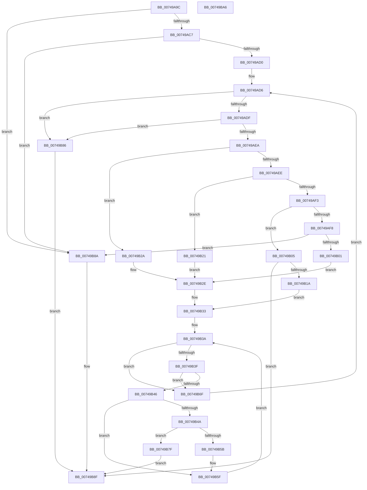

# KsepResolveShimHooks

- RVA: `0x00749A9C`–`0x00749BA7` (길이 `267` bytes)
- VA: `0x0000000140749A9C`
- 실행 섹션: `PAGE`
- PDB 이름 있음: `예`; PDB Function 태그: `아니요`
- unwind 정보 RVA: `0x00083688`
- 디코드: `83`개 명령, `267/267` bytes 표시
- 미해석 바이트: `0` (있으면 어셈블리에 `.byte`로 보존)

> 이 문서는 커널 이미지의 기계어와 PDB 기호를 분석해 생성했습니다. 4번과 5번은 함수 원형과 자료형을 바이너리 사용 방식에서 추정한 C 해석이며 원본 소스 복구 결과는 아닙니다.

## 1. Dependencies

- 직접 호출 지점: **2**; 고유 호출 대상: **2**
- 직접 호출자로 확인된 함수: **1**
- RIP 상대 이미지 참조: **0**

### Outgoing calls
- `0x00749B11` → [KsepGetModuleInfoByName](KsepGetModuleInfoByName_function_0074AA04.md) (function, `0x0074AA04`)
- `0x00749B51` → [RtlFindExportedRoutineByName](../90/RtlFindExportedRoutineByName_function_0090F0A0.md) (function, `0x0090F0A0`)

### Direct callers
- [KsepResolveApplicableShimsForDriver](KsepResolveApplicableShimsForDriver_function_0074A168.md) at `0x0074A4E0`

### Static image references
- 디코드된 RIP-relative 메모리 참조가 없습니다.

## 2. Other-region calls and transfers

- 다른 실행 섹션으로 향하는 call: **0**
- 별도 외부 분기/꼬리 이동을 확인하지 못했습니다.

## 3. Assembly (complete function range)

```asm
00749A9C  48 89 5C 24 10                  mov qword ptr [rsp + 0x10], rbx
00749AA1  48 89 6C 24 18                  mov qword ptr [rsp + 0x18], rbp
00749AA6  56                              push rsi
00749AA7  57                              push rdi
00749AA8  41 54                           push r12
00749AAA  41 56                           push r14
00749AAC  41 57                           push r15
00749AAE  48 83 EC 20                     sub rsp, 0x20
00749AB2  48 83 64 24 50 00               and qword ptr [rsp + 0x50], 0
00749AB8  4C 8B F2                        mov r14, rdx
00749ABB  48 8B E9                        mov rbp, rcx
00749ABE  48 85 C9                        test rcx, rcx
00749AC1  0F 84 C3 00 00 00               je 0x140749b8a
00749AC7  48 85 D2                        test rdx, rdx
00749ACA  0F 84 BA 00 00 00               je 0x140749b8a
00749AD0  45 33 FF                        xor r15d, r15d
00749AD3  48 8B F2                        mov rsi, rdx
00749AD6  48 85 F6                        test rsi, rsi
00749AD9  0F 84 A7 00 00 00               je 0x140749b86
00749ADF  8B 0E                           mov ecx, dword ptr [rsi]
00749AE1  83 F9 04                        cmp ecx, 4
00749AE4  0F 84 9C 00 00 00               je 0x140749b86
00749AEA  85 C9                           test ecx, ecx
00749AEC  74 3C                           je 0x140749b2a
00749AEE  83 E9 01                        sub ecx, 1
00749AF1  74 2E                           je 0x140749b21
00749AF3  83 E9 01                        sub ecx, 1
00749AF6  74 0D                           je 0x140749b05
00749AF8  83 F9 01                        cmp ecx, 1
00749AFB  0F 85 89 00 00 00               jne 0x140749b8a
00749B01  33 DB                           xor ebx, ebx
00749B03  EB 29                           jmp 0x140749b2e
00749B05  48 8B 4E 08                     mov rcx, qword ptr [rsi + 8]
00749B09  4C 8D 44 24 50                  lea r8, [rsp + 0x50]
00749B0E  48 8B D5                        mov rdx, rbp
00749B11  E8 EE 0E 00 00                  call 0x14074aa04
00749B16  85 C0                           test eax, eax
00749B18  78 75                           js 0x140749b8f
00749B1A  48 8B 5C 24 50                  mov rbx, qword ptr [rsp + 0x50]
00749B1F  EB 12                           jmp 0x140749b33
00749B21  48 8B 9D 40 01 00 00            mov rbx, qword ptr [rbp + 0x140]
00749B28  EB 04                           jmp 0x140749b2e
00749B2A  48 8B 5D 18                     mov rbx, qword ptr [rbp + 0x18]
00749B2E  48 89 5C 24 50                  mov qword ptr [rsp + 0x50], rbx
00749B33  48 8B 7E 10                     mov rdi, qword ptr [rsi + 0x10]
00749B37  45 33 E4                        xor r12d, r12d
00749B3A  48 85 FF                        test rdi, rdi
00749B3D  74 30                           je 0x140749b6f
00749B3F  8B 07                           mov eax, dword ptr [rdi]
00749B41  83 F8 02                        cmp eax, 2
00749B44  74 29                           je 0x140749b6f
00749B46  85 C0                           test eax, eax
00749B48  75 15                           jne 0x140749b5f
00749B4A  48 8B 57 08                     mov rdx, qword ptr [rdi + 8]
00749B4E  48 8B CB                        mov rcx, rbx
00749B51  E8 4A 55 1C 00                  call 0x14090f0a0
00749B56  48 85 C0                        test rax, rax
00749B59  74 24                           je 0x140749b7f
00749B5B  48 89 47 18                     mov qword ptr [rdi + 0x18], rax
00749B5F  41 FF C4                        inc r12d
00749B62  41 8B FC                        mov edi, r12d
00749B65  48 C1 E7 05                     shl rdi, 5
00749B69  48 03 7E 10                     add rdi, qword ptr [rsi + 0x10]
00749B6D  EB CB                           jmp 0x140749b3a
00749B6F  41 FF C7                        inc r15d
00749B72  4B 8D 0C 7F                     lea rcx, [r15 + r15*2]
00749B76  49 8D 34 CE                     lea rsi, [r14 + rcx*8]
00749B7A  E9 57 FF FF FF                  jmp 0x140749ad6
00749B7F  B8 01 00 00 C0                  mov eax, 0xc0000001
00749B84  EB 09                           jmp 0x140749b8f
00749B86  33 C0                           xor eax, eax
00749B88  EB 05                           jmp 0x140749b8f
00749B8A  B8 0D 00 00 C0                  mov eax, 0xc000000d
00749B8F  48 8B 5C 24 58                  mov rbx, qword ptr [rsp + 0x58]
00749B94  48 8B 6C 24 60                  mov rbp, qword ptr [rsp + 0x60]
00749B99  48 83 C4 20                     add rsp, 0x20
00749B9D  41 5F                           pop r15
00749B9F  41 5E                           pop r14
00749BA1  41 5C                           pop r12
00749BA3  5F                              pop rdi
00749BA4  5E                              pop rsi
00749BA5  C3                              ret
00749BA6  CC                              int3
```

## 4. C-style interpretation (structured pseudocode)

```c
__int64 __fastcall KsepResolveShimHooks(__int64 a1, __int64 a2)
{
    __int64 result;
    __int64 v_r12;
    __int64 v_r15;
    __int64 v_rbx;
    __int64 v_rdi;
    __int64 v_rsp;
    unsigned __int64 v_stack_p10;
    unsigned __int64 v_stack_p18;
    unsigned __int64 v_stack_p8;

    v_stack_p10 = v_rbx;
    v_stack_p18 = v_rbp;
    v_rsp = (v_rsp) - (32);
    if (a1 == 0) goto loc_00749B8A;
    if (a2 == 0) goto loc_00749B8A;
    v_r15 = 0;
loc_00749AD6:
    if (a2 == 0) goto loc_00749B86;
    if (((unsigned int)((unsigned int)(*(unsigned int *)(a2)))) == 4) goto loc_00749B86;
    if ((unsigned int)((unsigned int)(*(unsigned int *)(a2))) == 0) goto loc_00749B2A;
    a1 = (unsigned int)(((unsigned int)(*(unsigned int *)(a2))) - (1));
    if (condition_is_equal) goto loc_00749B21;
    a1 = (unsigned int)((a1) - (1));
    if (condition_is_equal) goto loc_00749B05;
    if (((unsigned int)(a1)) != 1) goto loc_00749B8A;
    v_rbx = 0;
    goto loc_00749B2E;
loc_00749B05:
    result = KsepGetModuleInfoByName(*(unsigned __int64 *)(a2 + 8), a1, v_stack_p8, a4);
    if (sign_flag) goto loc_00749B8F;
    goto loc_00749B33;
loc_00749B21:
    goto loc_00749B2E;
loc_00749B2A:
loc_00749B2E:
    v_stack_p8 = *(unsigned __int64 *)(a1 + 24);
loc_00749B33:
    v_r12 = 0;
loc_00749B3A:
    if (*(unsigned __int64 *)(a2 + 16) == 0) goto loc_00749B6F;
    if (((unsigned int)((unsigned int)(*(unsigned int *)(*(unsigned __int64 *)(a2 + 16))))) == 2) goto loc_00749B6F;
    if ((unsigned int)((unsigned int)(*(unsigned int *)(*(unsigned __int64 *)(a2 + 16)))) != 0) goto loc_00749B5F;
    result = RtlFindExportedRoutineByName(*(unsigned __int64 *)(a1 + 24), *(unsigned __int64 *)(*(unsigned __int64 *)(a2 + 16) + 8), v_stack_p8, a4);
    if (result == 0) goto loc_00749B7F;
    *(unsigned __int64 *)(*(unsigned __int64 *)(a2 + 16) + 24) = result;
loc_00749B5F:
    v_r12 = (unsigned int)((v_r12) + 1);
    v_rdi = ((unsigned int)((unsigned int)(v_r12))) << (5);
    v_rdi = (v_rdi) + (*(unsigned __int64 *)(a2 + 16));
    goto loc_00749B3A;
loc_00749B6F:
    v_r15 = (unsigned int)((v_r15) + 1);
    goto loc_00749AD6;
loc_00749B7F:
    goto loc_00749B8F;
loc_00749B86:
    result = 0;
    goto loc_00749B8F;
loc_00749B8A:
loc_00749B8F:
    v_rsp = (v_rsp) + (32);
    return (unsigned int)(0xC000000DULL);
}
```

## 5. (Beta) C Style

```c
int64_t KsepResolveShimHooks(void *Arg1, void *Arg2)
{
    uint8_t *arg1 = (uint8_t *)Arg1;
    uint8_t *arg2 = (uint8_t *)Arg2;

    int64_t result;
    int64_t local_r12;
    int64_t local_r15;
    int64_t local_rbx;
    int64_t local_rdi;
    int64_t local_rsp;
    uint64_t v_stack_p10;
    uint64_t v_stack_p18;
    uint64_t v_stack_p8;

    v_stack_p10 = local_rbx;
    v_stack_p18 = local_rbp;
    local_rsp = (local_rsp) - (32);
    if (Arg1 == NULL) goto loc_00749B8A;
    if (Arg2 == NULL) goto loc_00749B8A;
    local_r15 = 0;
loc_00749AD6:
    if (Arg2 == NULL) goto loc_00749B86;
    if (((uint32_t)((uint32_t)(*(uint32_t *)(arg2)))) == 4) goto loc_00749B86;
    if ((uint32_t)((uint32_t)(*(uint32_t *)(arg2))) == 0) goto loc_00749B2A;
    Arg1 = (uint32_t)(((uint32_t)(*(uint32_t *)(arg2))) - (1));
    if (condition_is_equal) goto loc_00749B21;
    Arg1 = (uint32_t)((Arg1) - (1));
    if (condition_is_equal) goto loc_00749B05;
    if (((uint32_t)(Arg1)) != 1) goto loc_00749B8A;
    local_rbx = 0;
    goto loc_00749B2E;
loc_00749B05:
    result = KsepGetModuleInfoByName(*(uint64_t *)(arg2 + 0x8), Arg1, v_stack_p8, a4);
    if (sign_flag) goto loc_00749B8F;
    goto loc_00749B33;
loc_00749B21:
    goto loc_00749B2E;
loc_00749B2A:
loc_00749B2E:
    v_stack_p8 = *(uint64_t *)(arg1 + 0x18);
loc_00749B33:
    local_r12 = 0;
loc_00749B3A:
    if (*(uint64_t *)(arg2 + 0x10) == 0) goto loc_00749B6F;
    if (((uint32_t)((uint32_t)(*(uint32_t *)(*(uint64_t *)(arg2 + 0x10))))) == 2) goto loc_00749B6F;
    if ((uint32_t)((uint32_t)(*(uint32_t *)(*(uint64_t *)(arg2 + 0x10)))) != 0) goto loc_00749B5F;
    result = RtlFindExportedRoutineByName(*(uint64_t *)(arg1 + 0x18), *(uint64_t *)(*(uint64_t *)(arg2 + 0x10) + 0x8), v_stack_p8, a4);
    if (result == 0) goto loc_00749B7F;
    *(uint64_t *)(*(uint64_t *)(arg2 + 0x10) + 0x18) = result;
loc_00749B5F:
    local_r12 = (uint32_t)((local_r12) + 1);
    local_rdi = ((uint32_t)((uint32_t)(local_r12))) << (5);
    local_rdi = (local_rdi) + (*(uint64_t *)(arg2 + 0x10));
    goto loc_00749B3A;
loc_00749B6F:
    local_r15 = (uint32_t)((local_r15) + 1);
    goto loc_00749AD6;
loc_00749B7F:
    goto loc_00749B8F;
loc_00749B86:
    result = 0;
    goto loc_00749B8F;
loc_00749B8A:
loc_00749B8F:
    local_rsp = (local_rsp) + (32);
    return (uint32_t)(0xC000000DULL);
}
```

### 관측된 메모리 오프셋

구조체 형식이 확인되지 않은 접근은 인자 기준의 오프셋으로만 기록했습니다.

| 기준 인자 | 오프셋 표현 | 폭 (bit) | 접근 |
|---|---:|---:|---|
| `Arg1` | `+ 0x18` | `64` | `R` |
| `Arg1` | `+ 0x140` | `64` | `R` |
| `Arg2` | `+ 0x0 + rcx*8` | `64` | `R` |

## 6. Execution-region graph

[열기: 2D/3D 그래프와 함수 탐색 컨트롤 패널](../../../control-panel.html?section=page&rva=0x00749A9C&view=graph)

- 2D 그래프는 위에서 아래로 흐르고, 3D 그래프는 빈 공간을 드래그해 회전합니다. Shift+드래그는 이동, 휠은 확대·축소, 함수 노드 선택은 대상 보고서 이동입니다.

### Static fallback


