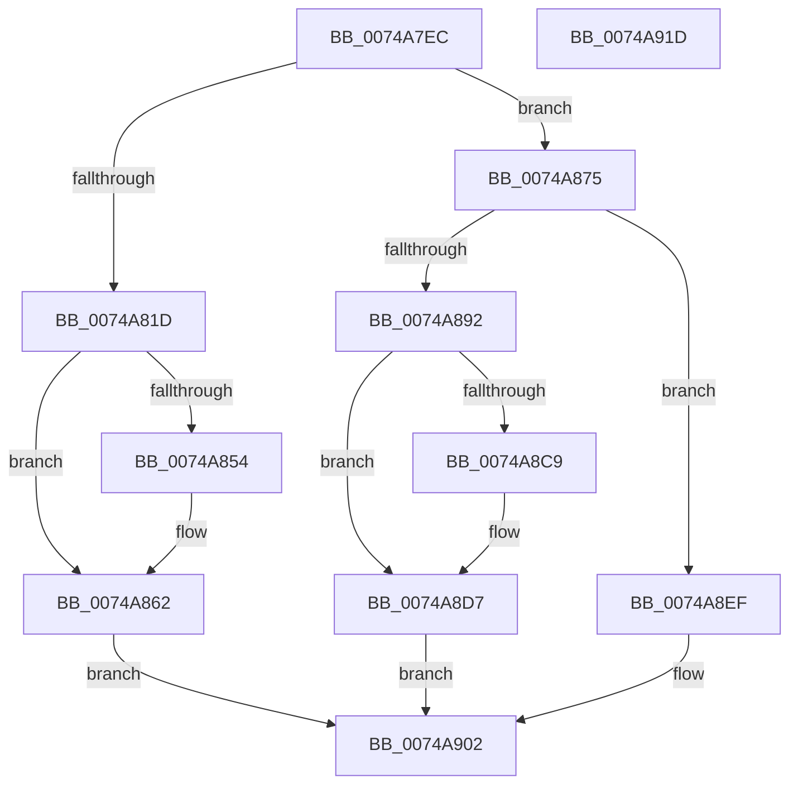

# KsepSdbBootInitialize

- RVA: `0x0074A7EC`–`0x0074A91E` (길이 `306` bytes)
- VA: `0x000000014074A7EC`
- 실행 섹션: `PAGE`
- PDB 이름 있음: `예`; PDB Function 태그: `아니요`
- unwind 정보 RVA: `0x00060300`
- 디코드: `80`개 명령, `306/306` bytes 표시
- 미해석 바이트: `0` (있으면 어셈블리에 `.byte`로 보존)

> 이 문서는 커널 이미지의 기계어와 PDB 기호를 분석해 생성했습니다. 4번과 5번은 함수 원형과 자료형을 바이너리 사용 방식에서 추정한 C 해석이며 원본 소스 복구 결과는 아닙니다.

## 1. Dependencies

- 직접 호출 지점: **9**; 고유 호출 대상: **7**
- 직접 호출자로 확인된 함수: **1**
- RIP 상대 이미지 참조: **5**

### Outgoing calls
- `0x0074A80E` → [KsepPoolAllocatePaged](../../text/4A/KsepPoolAllocatePaged_function_004A9EFC.md) (function, `0x004A9EFC`)
- `0x0074A85D` → [KsepDebugPrint](../../text/4D/KsepDebugPrint_function_004DCFF0.md) (function, `0x004DCFF0`)
- `0x0074A86B` → [KsepLogError](../../text/49/KsepLogError_function_00499A98.md) (function, `0x00499A98`)
- `0x0074A87E` → [memcpy](../../text/6C/memcpy_function_006C6840.md) (function, `0x006C6840`)
- `0x0074A888` → [SdbInitDatabaseInMemory](../95/SdbInitDatabaseInMemory_function_0095BC5C.md) (function, `0x0095BC5C`)
- `0x0074A8D2` → [KsepDebugPrint](../../text/4D/KsepDebugPrint_function_004DCFF0.md) (function, `0x004DCFF0`)
- `0x0074A8E0` → [KsepLogError](../../text/49/KsepLogError_function_00499A98.md) (function, `0x00499A98`)
- `0x0074A8E8` → [KsepPoolFreePaged](../../text/4B/KsepPoolFreePaged_function_004B0E10.md) (function, `0x004B0E10`)
- `0x0074A8FA` → [SdbGetDatabaseEdition](../95/SdbGetDatabaseEdition_function_0095BBE4.md) (function, `0x0095BBE4`)

### Direct callers
- [KseShimDatabaseBootInitialize](../../init/C3/KseShimDatabaseBootInitialize_function_00C3C124.md) at `0x00C3C241`
- [KseShimDatabaseBootInitialize](../../init/C3/KseShimDatabaseBootInitialize_function_00C3C124.md) at `0x00C3C265`

### Static image references
- `0x0074A827` → RVA `0x00F101C0` (`.data`; read/write)
- `0x0074A831` → RVA `0x00F101E0` (`.data`; read)
- `0x0074A84A` → RVA `0x00E66CE8` (`.data`; read)
- `0x0074A854` → RVA `0x00B00EA0` (` ?? ::NNGAKEGL::`string'`; read)
- `0x0074A8C9` → RVA `0x00B00EE0` (` ?? ::NNGAKEGL::`string'`; read)

## 2. Other-region calls and transfers

- 다른 실행 섹션으로 향하는 call: **7**
  - `0x0074A80E` → [KsepPoolAllocatePaged](../../text/4A/KsepPoolAllocatePaged_function_004A9EFC.md) (`PAGE` → `.text`)
  - `0x0074A85D` → [KsepDebugPrint](../../text/4D/KsepDebugPrint_function_004DCFF0.md) (`PAGE` → `.text`)
  - `0x0074A86B` → [KsepLogError](../../text/49/KsepLogError_function_00499A98.md) (`PAGE` → `.text`)
  - `0x0074A87E` → [memcpy](../../text/6C/memcpy_function_006C6840.md) (`PAGE` → `.text`)
  - `0x0074A8D2` → [KsepDebugPrint](../../text/4D/KsepDebugPrint_function_004DCFF0.md) (`PAGE` → `.text`)
  - `0x0074A8E0` → [KsepLogError](../../text/49/KsepLogError_function_00499A98.md) (`PAGE` → `.text`)
  - `0x0074A8E8` → [KsepPoolFreePaged](../../text/4B/KsepPoolFreePaged_function_004B0E10.md) (`PAGE` → `.text`)
- 별도 외부 분기/꼬리 이동을 확인하지 못했습니다.

## 3. Assembly (complete function range)

```asm
0074A7EC  48 89 5C 24 08                  mov qword ptr [rsp + 8], rbx
0074A7F1  48 89 6C 24 10                  mov qword ptr [rsp + 0x10], rbp
0074A7F6  48 89 74 24 18                  mov qword ptr [rsp + 0x18], rsi
0074A7FB  57                              push rdi
0074A7FC  41 56                           push r14
0074A7FE  41 57                           push r15
0074A800  48 83 EC 20                     sub rsp, 0x20
0074A804  4C 8B F9                        mov r15, rcx
0074A807  8B EA                           mov ebp, edx
0074A809  8B CA                           mov ecx, edx
0074A80B  49 8B F0                        mov rsi, r8
0074A80E  E8 E9 F6 D5 FF                  call 0x1404a9efc
0074A813  33 FF                           xor edi, edi
0074A815  48 8B D8                        mov rbx, rax
0074A818  48 85 C0                        test rax, rax
0074A81B  75 58                           jne 0x14074a875
0074A81D  8D 70 01                        lea esi, [rax + 1]
0074A820  BF 9A 00 00 C0                  mov edi, 0xc000009a
0074A825  8B C6                           mov eax, esi
0074A827  F0 0F C1 05 91 59 7C 00         lock xadd dword ptr [rip + 0x7c5991], eax
0074A82F  03 C6                           add eax, esi
0074A831  48 8D 0D A8 59 7C 00            lea rcx, [rip + 0x7c59a8]
0074A838  83 E0 3F                        and eax, 0x3f
0074A83B  C7 44 C1 04 9A 00 00 C0         mov dword ptr [rcx + rax*8 + 4], 0xc000009a
0074A843  C7 04 C1 A4 00 09 00            mov dword ptr [rcx + rax*8], 0x900a4
0074A84A  8B 05 98 C4 71 00               mov eax, dword ptr [rip + 0x71c498]
0074A850  A8 02                           test al, 2
0074A852  74 0E                           je 0x14074a862
0074A854  48 8D 15 45 66 3B 00            lea rdx, [rip + 0x3b6645]
0074A85B  33 C9                           xor ecx, ecx
0074A85D  E8 8E 27 D9 FF                  call 0x1404dcff0
0074A862  48 8D 15 37 66 3B 00            lea rdx, [rip + 0x3b6637]
0074A869  33 C9                           xor ecx, ecx
0074A86B  E8 28 F2 D4 FF                  call 0x140499a98
0074A870  E9 8D 00 00 00                  jmp 0x14074a902
0074A875  4C 8B C5                        mov r8, rbp
0074A878  49 8B D7                        mov rdx, r15
0074A87B  48 8B CB                        mov rcx, rbx
0074A87E  E8 BD BF F7 FF                  call 0x1406c6840
0074A883  8B D5                           mov edx, ebp
0074A885  48 8B CB                        mov rcx, rbx
0074A888  E8 CF 13 21 00                  call 0x14095bc5c
0074A88D  48 85 C0                        test rax, rax
0074A890  75 5D                           jne 0x14074a8ef
0074A892  8D 70 01                        lea esi, [rax + 1]
0074A895  BF 01 00 00 C0                  mov edi, 0xc0000001
0074A89A  8B C6                           mov eax, esi
0074A89C  F0 0F C1 05 1C 59 7C 00         lock xadd dword ptr [rip + 0x7c591c], eax
0074A8A4  03 C6                           add eax, esi
0074A8A6  48 8D 0D 33 59 7C 00            lea rcx, [rip + 0x7c5933]
0074A8AD  83 E0 3F                        and eax, 0x3f
0074A8B0  C7 44 C1 04 01 00 00 C0         mov dword ptr [rcx + rax*8 + 4], 0xc0000001
0074A8B8  C7 04 C1 B4 00 09 00            mov dword ptr [rcx + rax*8], 0x900b4
0074A8BF  8B 05 23 C4 71 00               mov eax, dword ptr [rip + 0x71c423]
0074A8C5  A8 02                           test al, 2
0074A8C7  74 0E                           je 0x14074a8d7
0074A8C9  48 8D 15 10 66 3B 00            lea rdx, [rip + 0x3b6610]
0074A8D0  8B CE                           mov ecx, esi
0074A8D2  E8 19 27 D9 FF                  call 0x1404dcff0
0074A8D7  48 8D 15 02 66 3B 00            lea rdx, [rip + 0x3b6602]
0074A8DE  8B CE                           mov ecx, esi
0074A8E0  E8 B3 F1 D4 FF                  call 0x140499a98
0074A8E5  48 8B CB                        mov rcx, rbx
0074A8E8  E8 23 65 D6 FF                  call 0x1404b0e10
0074A8ED  EB 13                           jmp 0x14074a902
0074A8EF  48 89 5E 08                     mov qword ptr [rsi + 8], rbx
0074A8F3  48 89 06                        mov qword ptr [rsi], rax
0074A8F6  48 8B 48 08                     mov rcx, qword ptr [rax + 8]
0074A8FA  E8 E5 12 21 00                  call 0x14095bbe4
0074A8FF  89 46 30                        mov dword ptr [rsi + 0x30], eax
0074A902  48 8B 5C 24 40                  mov rbx, qword ptr [rsp + 0x40]
0074A907  8B C7                           mov eax, edi
0074A909  48 8B 6C 24 48                  mov rbp, qword ptr [rsp + 0x48]
0074A90E  48 8B 74 24 50                  mov rsi, qword ptr [rsp + 0x50]
0074A913  48 83 C4 20                     add rsp, 0x20
0074A917  41 5F                           pop r15
0074A919  41 5E                           pop r14
0074A91B  5F                              pop rdi
0074A91C  C3                              ret
0074A91D  CC                              int3
```

## 4. C-style interpretation (structured pseudocode)

```c
__int64 __fastcall KsepSdbBootInitialize(__int64 a1, int a2, __int64 a3)
{
    __int64 result;
    __int64 v_rdi;
    __int64 v_rsp;
    unsigned __int64 v_stack_p10;
    unsigned __int64 v_stack_p18;
    unsigned __int64 v_stack_p8;

    v_stack_p8 = v_rbx;
    v_stack_p10 = v_rbp;
    v_stack_p18 = v_rsi;
    v_rsp = (v_rsp) - (32);
    result = KsepPoolAllocatePaged((unsigned int)(a2), a2, a3, a4);
    v_rdi = 0;
    if (result != 0) goto loc_0074A875;
    result = (unsigned int)(((unsigned int)((unsigned int)(result + 1))) + ((unsigned int)(result + 1)));
    result = (unsigned int)((result) & (63));
    *(unsigned int *)(v_rip + 8149416 + result * 8 + 4) = 0xC000009AULL;
    *(unsigned int *)(v_rip + 8149416 + result * 8) = 0x900A4ULL;
    result = (unsigned int)(*(unsigned int *)(v_rip + 7455896));
    if ((((unsigned __int8)((unsigned int)(*(unsigned int *)(v_rip + 7455896)))) & (2)) != 0) {
        a2 = v_rip + 3892805;
        a1 = 0;
        result = KsepDebugPrint(a1, a2, a3, a4);
    }
    a1 = 0;
    result = KsepLogError(a1, v_rip + 3892791, a3, a4);
    goto loc_0074A902;
loc_0074A875:
    result = memcpy(result, 0, (unsigned int)(a2), a4);
    result = SdbInitDatabaseInMemory(result, (unsigned int)((unsigned int)((unsigned int)(a2))), (unsigned int)(a2), a4);
    if (result != 0) goto loc_0074A8EF;
    result = (unsigned int)(((unsigned int)((unsigned int)(result + 1))) + ((unsigned int)(result + 1)));
    result = (unsigned int)((result) & (63));
    *(unsigned int *)(v_rip + 8149299 + result * 8 + 4) = 0xC0000001ULL;
    *(unsigned int *)(v_rip + 8149299 + result * 8) = 0x900B4ULL;
    result = (unsigned int)(*(unsigned int *)(v_rip + 7455779));
    if ((((unsigned __int8)((unsigned int)(*(unsigned int *)(v_rip + 7455779)))) & (2)) != 0) {
        a2 = v_rip + 3892752;
        a1 = (unsigned int)(result + 1);
        result = KsepDebugPrint(a1, a2, (unsigned int)(a2), a4);
    }
    result = KsepLogError((unsigned int)((unsigned int)(result + 1)), v_rip + 3892738, (unsigned int)(a2), a4);
    result = KsepPoolFreePaged(result, v_rip + 3892738, (unsigned int)(a2), a4);
    goto loc_0074A902;
loc_0074A8EF:
    *(unsigned __int64 *)(result + 1 + 8) = result;
    *(unsigned __int64 *)(result + 1) = result;
    result = SdbGetDatabaseEdition(*(unsigned __int64 *)(result + 8), v_rip + 3892738, (unsigned int)(a2), a4);
    *(unsigned int *)(result + 1 + 48) = (unsigned int)(result);
loc_0074A902:
    v_rsp = (v_rsp) + (32);
    return (unsigned int)((unsigned int)((unsigned int)(0xC0000001ULL)));
}
```

## 5. (Beta) C Style

```c
int64_t KsepSdbBootInitialize(int64_t Arg1, int32_t Arg2, void *Arg3)
{
    uint8_t *arg3 = (uint8_t *)Arg3;

    int64_t result;
    int64_t local_rdi;
    int64_t local_rsp;
    uint64_t v_stack_p10;
    uint64_t v_stack_p18;
    uint64_t v_stack_p8;

    v_stack_p8 = local_rbx;
    v_stack_p10 = local_rbp;
    v_stack_p18 = local_rsi;
    local_rsp = (local_rsp) - (32);
    result = KsepPoolAllocatePaged((uint32_t)(Arg2), Arg2, Arg3, a4);
    local_rdi = 0;
    if (result != 0) goto loc_0074A875;
    result = (uint32_t)(((uint32_t)((uint32_t)(result + 1))) + ((uint32_t)(result + 1)));
    result = (uint32_t)((result) & (63));
    *(uint32_t *)(v_rip + 0x7C59A8 + result * 8 + 0x4) = 0xC000009AULL;
    *(uint32_t *)(v_rip + 0x7C59A8 + result * 8) = 0x900A4ULL;
    result = (uint32_t)(*(uint32_t *)(v_rip + 0x71C498));
    if ((((uint8_t)((uint32_t)(*(uint32_t *)(v_rip + 0x71C498)))) & (2)) != 0) {
        Arg2 = v_rip + 3892805;
        Arg1 = 0;
        result = KsepDebugPrint(Arg1, Arg2, Arg3, a4);
    }
    Arg1 = 0;
    result = KsepLogError(Arg1, v_rip + 3892791, Arg3, a4);
    goto loc_0074A902;
loc_0074A875:
    result = memcpy(result, 0, (uint32_t)(Arg2), a4);
    result = SdbInitDatabaseInMemory(result, (uint32_t)((uint32_t)((uint32_t)(Arg2))), (uint32_t)(Arg2), a4);
    if (result != 0) goto loc_0074A8EF;
    result = (uint32_t)(((uint32_t)((uint32_t)(result + 1))) + ((uint32_t)(result + 1)));
    result = (uint32_t)((result) & (63));
    *(uint32_t *)(v_rip + 0x7C5933 + result * 8 + 0x4) = 0xC0000001ULL;
    *(uint32_t *)(v_rip + 0x7C5933 + result * 8) = 0x900B4ULL;
    result = (uint32_t)(*(uint32_t *)(v_rip + 0x71C423));
    if ((((uint8_t)((uint32_t)(*(uint32_t *)(v_rip + 0x71C423)))) & (2)) != 0) {
        Arg2 = v_rip + 3892752;
        Arg1 = (uint32_t)(result + 1);
        result = KsepDebugPrint(Arg1, Arg2, (uint32_t)(Arg2), a4);
    }
    result = KsepLogError((uint32_t)((uint32_t)(result + 1)), v_rip + 3892738, (uint32_t)(Arg2), a4);
    result = KsepPoolFreePaged(result, v_rip + 3892738, (uint32_t)(Arg2), a4);
    goto loc_0074A902;
loc_0074A8EF:
    *(uint64_t *)(result + 0x1 + 0x8) = result;
    *(uint64_t *)(result + 0x1) = result;
    result = SdbGetDatabaseEdition(*(uint64_t *)(result + 0x8), v_rip + 3892738, (uint32_t)(Arg2), a4);
    *(uint32_t *)(result + 0x1 + 0x30) = (uint32_t)(result);
loc_0074A902:
    local_rsp = (local_rsp) + (32);
    return (uint32_t)((uint32_t)((uint32_t)(0xC0000001ULL)));
}
```

### 관측된 메모리 오프셋

구조체 형식이 확인되지 않은 접근은 인자 기준의 오프셋으로만 기록했습니다.

| 기준 인자 | 오프셋 표현 | 폭 (bit) | 접근 |
|---|---:|---:|---|
| `Arg3` | `+ 0x0` | `64` | `W` |
| `Arg3` | `+ 0x8` | `64` | `W` |
| `Arg3` | `+ 0x30` | `32` | `W` |

## 6. Execution-region graph

[열기: 2D/3D 그래프와 함수 탐색 컨트롤 패널](../../../control-panel.html?section=page&rva=0x0074A7EC&view=graph)

- 2D 그래프는 위에서 아래로 흐르고, 3D 그래프는 빈 공간을 드래그해 회전합니다. Shift+드래그는 이동, 휠은 확대·축소, 함수 노드 선택은 대상 보고서 이동입니다.

### Static fallback


