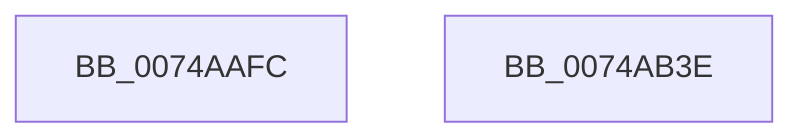

# KsepStringAnsiToUnicode

- RVA: `0x0074AAFC`–`0x0074AB3F` (길이 `67` bytes)
- VA: `0x000000014074AAFC`
- 실행 섹션: `PAGE`
- PDB 이름 있음: `예`; PDB Function 태그: `아니요`
- unwind 정보 RVA: `0x00082420`
- 디코드: `18`개 명령, `67/67` bytes 표시
- 미해석 바이트: `0` (있으면 어셈블리에 `.byte`로 보존)

> 이 문서는 커널 이미지의 기계어와 PDB 기호를 분석해 생성했습니다. 4번과 5번은 함수 원형과 자료형을 바이너리 사용 방식에서 추정한 C 해석이며 원본 소스 복구 결과는 아닙니다.

## 1. Dependencies

- 직접 호출 지점: **1**; 고유 호출 대상: **1**
- 직접 호출자로 확인된 함수: **2**
- RIP 상대 이미지 참조: **0**

### Outgoing calls
- `0x0074AB34` → [RtlAnsiStringToUnicodeString](../90/RtlAnsiStringToUnicodeString_function_0090BEA0.md) (function, `0x0090BEA0`)

### Direct callers
- [KsepMatchInitAcpiOemInfo](../../init/C3/KsepMatchInitAcpiOemInfo_function_00C3BB60.md) at `0x00C3BC03`
- [KsepMatchInitAcpiOemInfo](../../init/C3/KsepMatchInitAcpiOemInfo_function_00C3BB60.md) at `0x00C3BC25`
- [KsepMatchInitAcpiOemInfo](../../init/C3/KsepMatchInitAcpiOemInfo_function_00C3BB60.md) at `0x00C3BC47`
- [KsepMatchInitCpuInfo](../../init/C3/KsepMatchInitCpuInfo_function_00C3BF2C.md) at `0x00C3BF83`

### Static image references
- 디코드된 RIP-relative 메모리 참조가 없습니다.

## 2. Other-region calls and transfers

- 다른 실행 섹션으로 향하는 call: **0**
- 별도 외부 분기/꼬리 이동을 확인하지 못했습니다.

## 3. Assembly (complete function range)

```asm
0074AAFC  4C 8B DC                        mov r11, rsp
0074AAFF  48 83 EC 48                     sub rsp, 0x48
0074AB03  33 C0                           xor eax, eax
0074AB05  89 44 24 24                     mov dword ptr [rsp + 0x24], eax
0074AB09  89 44 24 34                     mov dword ptr [rsp + 0x34], eax
0074AB0D  49 89 4B F0                     mov qword ptr [r11 - 0x10], rcx
0074AB11  49 8D 4B E8                     lea rcx, [r11 - 0x18]
0074AB15  66 89 54 24 32                  mov word ptr [rsp + 0x32], dx
0074AB1A  49 8D 53 D8                     lea rdx, [r11 - 0x28]
0074AB1E  4D 89 43 E0                     mov qword ptr [r11 - 0x20], r8
0074AB22  45 33 C0                        xor r8d, r8d
0074AB25  66 89 44 24 30                  mov word ptr [rsp + 0x30], ax
0074AB2A  66 45 89 4B DA                  mov word ptr [r11 - 0x26], r9w
0074AB2F  66 45 89 4B D8                  mov word ptr [r11 - 0x28], r9w
0074AB34  E8 67 13 1C 00                  call 0x14090bea0
0074AB39  48 83 C4 48                     add rsp, 0x48
0074AB3D  C3                              ret
0074AB3E  CC                              int3
```

## 4. C-style interpretation (structured pseudocode)

```c
__int64 __fastcall KsepStringAnsiToUnicode(__int64 a1, unsigned __int16 a2, __int64 a3, unsigned __int16 a4)
{
    __int64 result;
    __int64 v_rsp;
    unsigned int v_stack_m14;
    unsigned __int16 v_stack_m16;
    unsigned __int16 v_stack_m18;
    unsigned int v_stack_m24;

    v_rsp = (v_rsp) - (72);
    result = 0;
    v_stack_m24 = 0;
    v_stack_m14 = 0;
    *(unsigned __int64 *)(v_rsp - 16) = a1;
    v_stack_m16 = a2;
    *(unsigned __int64 *)(v_rsp - 32) = a3;
    a3 = 0;
    v_stack_m18 = 0;
    *(unsigned __int16 *)(v_rsp - 38) = a4;
    *(unsigned __int16 *)(v_rsp - 40) = a4;
    result = RtlAnsiStringToUnicodeString(v_rsp - 24, v_rsp - 40, a3, a4);
    v_rsp = (v_rsp) + (72);
    return result;
}
```

## 5. (Beta) C Style

```c
int64_t KsepStringAnsiToUnicode(int64_t Arg1, uint16_t Arg2, int64_t Arg3, uint16_t Arg4)
{
    int64_t result;
    int64_t local_rsp;
    uint32_t v_stack_m14;
    uint16_t v_stack_m16;
    uint16_t v_stack_m18;
    uint32_t v_stack_m24;

    local_rsp = (local_rsp) - (72);
    result = 0;
    v_stack_m24 = 0;
    v_stack_m14 = 0;
    *(uint64_t *)(local_rsp - 0x10) = Arg1;
    v_stack_m16 = Arg2;
    *(uint64_t *)(local_rsp - 0x20) = Arg3;
    Arg3 = 0;
    v_stack_m18 = 0;
    *(uint16_t *)(local_rsp - 0x26) = Arg4;
    *(uint16_t *)(local_rsp - 0x28) = Arg4;
    result = RtlAnsiStringToUnicodeString(local_rsp - 24, local_rsp - 40, Arg3, Arg4);
    local_rsp = (local_rsp) + (72);
    return result;
}
```

## 6. Execution-region graph

[열기: 2D/3D 그래프와 함수 탐색 컨트롤 패널](../../../control-panel.html?section=page&rva=0x0074AAFC&view=graph)

- 2D 그래프는 위에서 아래로 흐르고, 3D 그래프는 빈 공간을 드래그해 회전합니다. Shift+드래그는 이동, 휠은 확대·축소, 함수 노드 선택은 대상 보고서 이동입니다.

### Static fallback


