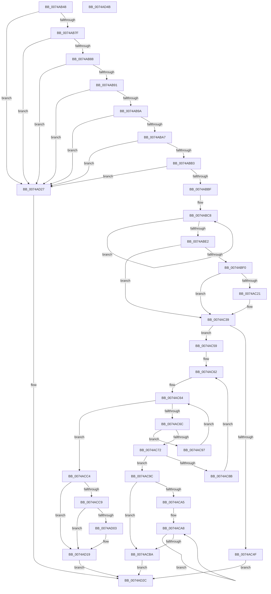

# KsepStringSplitMultiString

- RVA: `0x0074AB48`–`0x0074AD4C` (길이 `516` bytes)
- VA: `0x000000014074AB48`
- 실행 섹션: `PAGE`
- PDB 이름 있음: `예`; PDB Function 태그: `아니요`
- unwind 정보 RVA: `0x00075C18`
- 디코드: `140`개 명령, `516/516` bytes 표시
- 미해석 바이트: `0` (있으면 어셈블리에 `.byte`로 보존)

> 이 문서는 커널 이미지의 기계어와 PDB 기호를 분석해 생성했습니다. 4번과 5번은 함수 원형과 자료형을 바이너리 사용 방식에서 추정한 C 해석이며 원본 소스 복구 결과는 아닙니다.

## 1. Dependencies

- 직접 호출 지점: **6**; 고유 호출 대상: **5**
- 직접 호출자로 확인된 함수: **1**
- RIP 상대 이미지 참조: **6**

### Outgoing calls
- `0x0074AC32` → [RtlAssert](../../text/5E/RtlAssert_function_005E75E0.md) (function, `0x005E75E0`)
- `0x0074AC42` → [KsepPoolAllocatePaged](../../text/4A/KsepPoolAllocatePaged_function_004A9EFC.md) (function, `0x004A9EFC`)
- `0x0074AC82` → [KsepStringDuplicate](../95/KsepStringDuplicate_function_0095B454.md) (function, `0x0095B454`)
- `0x0074ACAB` → [KsepStringFree](../95/KsepStringFree_function_0095A1B8.md) (function, `0x0095A1B8`)
- `0x0074ACBD` → [KsepPoolFreePaged](../../text/4B/KsepPoolFreePaged_function_004B0E10.md) (function, `0x004B0E10`)
- `0x0074AD14` → [RtlAssert](../../text/5E/RtlAssert_function_005E75E0.md) (function, `0x005E75E0`)

### Direct callers
- [KsepEngineGetShimsFromRegistry](../95/KsepEngineGetShimsFromRegistry_function_0095907C.md) at `0x00959133`

### Static image references
- `0x0074ABE4` → RVA `0x00F101E0` (`.data`; read)
- `0x0074ABF5` → RVA `0x00F101C0` (`.data`; read/write)
- `0x0074AC17` → RVA `0x00E66CE8` (`.data`; read)
- `0x0074AC24` → RVA `0x00B01160` (` ?? ::NNGAKEGL::`string'`; read)
- `0x0074AC2B` → RVA `0x00B01180` (` ?? ::NNGAKEGL::`string'`; read)
- `0x0074AD0D` → RVA `0x00B01190` (` ?? ::NNGAKEGL::`string'`; read)

## 2. Other-region calls and transfers

- 다른 실행 섹션으로 향하는 call: **4**
  - `0x0074AC32` → [RtlAssert](../../text/5E/RtlAssert_function_005E75E0.md) (`PAGE` → `.text`)
  - `0x0074AC42` → [KsepPoolAllocatePaged](../../text/4A/KsepPoolAllocatePaged_function_004A9EFC.md) (`PAGE` → `.text`)
  - `0x0074ACBD` → [KsepPoolFreePaged](../../text/4B/KsepPoolFreePaged_function_004B0E10.md) (`PAGE` → `.text`)
  - `0x0074AD14` → [RtlAssert](../../text/5E/RtlAssert_function_005E75E0.md) (`PAGE` → `.text`)
- 별도 외부 분기/꼬리 이동을 확인하지 못했습니다.

## 3. Assembly (complete function range)

```asm
0074AB48  48 89 5C 24 08                  mov qword ptr [rsp + 8], rbx
0074AB4D  48 89 6C 24 10                  mov qword ptr [rsp + 0x10], rbp
0074AB52  48 89 74 24 18                  mov qword ptr [rsp + 0x18], rsi
0074AB57  57                              push rdi
0074AB58  41 54                           push r12
0074AB5A  41 55                           push r13
0074AB5C  41 56                           push r14
0074AB5E  41 57                           push r15
0074AB60  48 83 EC 20                     sub rsp, 0x20
0074AB64  48 8B DA                        mov rbx, rdx
0074AB67  45 33 F6                        xor r14d, r14d
0074AB6A  48 D1 EB                        shr rbx, 1
0074AB6D  4D 8B E1                        mov r12, r9
0074AB70  4D 8B E8                        mov r13, r8
0074AB73  48 8B F1                        mov rsi, rcx
0074AB76  48 85 C9                        test rcx, rcx
0074AB79  0F 84 A8 01 00 00               je 0x14074ad27
0074AB7F  F6 C2 01                        test dl, 1
0074AB82  0F 85 9F 01 00 00               jne 0x14074ad27
0074AB88  4D 85 C0                        test r8, r8
0074AB8B  0F 84 96 01 00 00               je 0x14074ad27
0074AB91  4D 85 C9                        test r9, r9
0074AB94  0F 84 8D 01 00 00               je 0x14074ad27
0074AB9A  45 8D 4E 03                     lea r9d, [r14 + 3]
0074AB9E  49 3B D9                        cmp rbx, r9
0074ABA1  0F 82 80 01 00 00               jb 0x14074ad27
0074ABA7  66 44 39 74 59 FE               cmp word ptr [rcx + rbx*2 - 2], r14w
0074ABAD  0F 85 74 01 00 00               jne 0x14074ad27
0074ABB3  66 44 39 74 59 FC               cmp word ptr [rcx + rbx*2 - 4], r14w
0074ABB9  0F 85 68 01 00 00               jne 0x14074ad27
0074ABBF  41 8B D6                        mov edx, r14d
0074ABC2  45 8B C6                        mov r8d, r14d
0074ABC5  41 8B C6                        mov eax, r14d
0074ABC8  0F B7 04 46                     movzx eax, word ptr [rsi + rax*2]
0074ABCC  8D 4A 01                        lea ecx, [rdx + 1]
0074ABCF  66 85 C0                        test ax, ax
0074ABD2  0F 45 CA                        cmovne ecx, edx
0074ABD5  41 FF C0                        inc r8d
0074ABD8  41 8B C0                        mov eax, r8d
0074ABDB  8B D1                           mov edx, ecx
0074ABDD  48 3B C3                        cmp rax, rbx
0074ABE0  72 E6                           jb 0x14074abc8
0074ABE2  8B F9                           mov edi, ecx
0074ABE4  48 8D 0D F5 55 7C 00            lea rcx, [rip + 0x7c55f5]
0074ABEB  83 FA 02                        cmp edx, 2
0074ABEE  73 49                           jae 0x14074ac39
0074ABF0  B8 01 00 00 00                  mov eax, 1
0074ABF5  F0 0F C1 05 C3 55 7C 00         lock xadd dword ptr [rip + 0x7c55c3], eax
0074ABFD  FF C0                           inc eax
0074ABFF  41 B8 B5 03 00 00               mov r8d, 0x3b5
0074AC05  83 E0 3F                        and eax, 0x3f
0074AC08  C7 44 C1 04 20 04 00 C0         mov dword ptr [rcx + rax*8 + 4], 0xc0000420
0074AC10  C7 04 C1 B5 03 03 00            mov dword ptr [rcx + rax*8], 0x303b5
0074AC17  8B 05 CB C0 71 00               mov eax, dword ptr [rip + 0x71c0cb]
0074AC1D  A8 04                           test al, 4
0074AC1F  74 18                           je 0x14074ac39
0074AC21  45 33 C9                        xor r9d, r9d
0074AC24  48 8D 15 35 65 3B 00            lea rdx, [rip + 0x3b6535]
0074AC2B  48 8D 0D 4E 65 3B 00            lea rcx, [rip + 0x3b654e]
0074AC32  E8 A9 C9 E9 FF                  call 0x1405e75e0
0074AC37  8B D7                           mov edx, edi
0074AC39  8D 6A FF                        lea ebp, [rdx - 1]
0074AC3C  8B CD                           mov ecx, ebp
0074AC3E  48 C1 E1 04                     shl rcx, 4
0074AC42  E8 B5 F2 D5 FF                  call 0x1404a9efc
0074AC47  48 8B F8                        mov rdi, rax
0074AC4A  48 85 C0                        test rax, rax
0074AC4D  75 0A                           jne 0x14074ac59
0074AC4F  BB 17 00 00 C0                  mov ebx, 0xc0000017
0074AC54  E9 D3 00 00 00                  jmp 0x14074ad2c
0074AC59  41 8B CE                        mov ecx, r14d
0074AC5C  45 8B FE                        mov r15d, r14d
0074AC5F  48 FF CB                        dec rbx
0074AC62  33 D2                           xor edx, edx
0074AC64  41 8B C6                        mov eax, r14d
0074AC67  48 3B C3                        cmp rax, rbx
0074AC6A  73 58                           jae 0x14074acc4
0074AC6C  66 39 14 46                     cmp word ptr [rsi + rax*2], dx
0074AC70  75 25                           jne 0x14074ac97
0074AC72  8B C1                           mov eax, ecx
0074AC74  41 8B CF                        mov ecx, r15d
0074AC77  48 C1 E1 04                     shl rcx, 4
0074AC7B  48 03 CF                        add rcx, rdi
0074AC7E  48 8D 14 46                     lea rdx, [rsi + rax*2]
0074AC82  E8 CD 07 21 00                  call 0x14095b454
0074AC87  85 C0                           test eax, eax
0074AC89  78 11                           js 0x14074ac9c
0074AC8B  41 8D 4E 01                     lea ecx, [r14 + 1]
0074AC8F  41 FF C7                        inc r15d
0074AC92  44 8B F1                        mov r14d, ecx
0074AC95  EB CB                           jmp 0x14074ac62
0074AC97  41 FF C6                        inc r14d
0074AC9A  EB C8                           jmp 0x14074ac64
0074AC9C  BB 17 00 00 C0                  mov ebx, 0xc0000017
0074ACA1  85 ED                           test ebp, ebp
0074ACA3  74 15                           je 0x14074acba
0074ACA5  48 8B F7                        mov rsi, rdi
0074ACA8  48 8B CE                        mov rcx, rsi
0074ACAB  E8 08 F5 20 00                  call 0x14095a1b8
0074ACB0  48 83 C6 10                     add rsi, 0x10
0074ACB4  48 83 ED 01                     sub rbp, 1
0074ACB8  75 EE                           jne 0x14074aca8
0074ACBA  48 8B CF                        mov rcx, rdi
0074ACBD  E8 4E 61 D6 FF                  call 0x1404b0e10
0074ACC2  EB 68                           jmp 0x14074ad2c
0074ACC4  44 3B FD                        cmp r15d, ebp
0074ACC7  74 50                           je 0x14074ad19
0074ACC9  B8 01 00 00 00                  mov eax, 1
0074ACCE  F0 0F C1 05 EA 54 7C 00         lock xadd dword ptr [rip + 0x7c54ea], eax
0074ACD6  FF C0                           inc eax
0074ACD8  4C 8D 0D 01 55 7C 00            lea r9, [rip + 0x7c5501]
0074ACDF  83 E0 3F                        and eax, 0x3f
0074ACE2  41 B8 DD 03 00 00               mov r8d, 0x3dd
0074ACE8  41 C7 44 C1 04 20 04 00 C0      mov dword ptr [r9 + rax*8 + 4], 0xc0000420
0074ACF1  41 C7 04 C1 DD 03 03 00         mov dword ptr [r9 + rax*8], 0x303dd
0074ACF9  8B 05 E9 BF 71 00               mov eax, dword ptr [rip + 0x71bfe9]
0074ACFF  A8 04                           test al, 4
0074AD01  74 16                           je 0x14074ad19
0074AD03  45 33 C9                        xor r9d, r9d
0074AD06  48 8D 15 53 64 3B 00            lea rdx, [rip + 0x3b6453]
0074AD0D  48 8D 0D 7C 64 3B 00            lea rcx, [rip + 0x3b647c]
0074AD14  E8 C7 C8 E9 FF                  call 0x1405e75e0
0074AD19  33 C0                           xor eax, eax
0074AD1B  49 89 7D 00                     mov qword ptr [r13], rdi
0074AD1F  8B D8                           mov ebx, eax
0074AD21  41 89 2C 24                     mov dword ptr [r12], ebp
0074AD25  EB 05                           jmp 0x14074ad2c
0074AD27  BB 0D 00 00 C0                  mov ebx, 0xc000000d
0074AD2C  48 8B 6C 24 58                  mov rbp, qword ptr [rsp + 0x58]
0074AD31  8B C3                           mov eax, ebx
0074AD33  48 8B 5C 24 50                  mov rbx, qword ptr [rsp + 0x50]
0074AD38  48 8B 74 24 60                  mov rsi, qword ptr [rsp + 0x60]
0074AD3D  48 83 C4 20                     add rsp, 0x20
0074AD41  41 5F                           pop r15
0074AD43  41 5E                           pop r14
0074AD45  41 5D                           pop r13
0074AD47  41 5C                           pop r12
0074AD49  5F                              pop rdi
0074AD4A  C3                              ret
0074AD4B  CC                              int3
```

## 4. C-style interpretation (structured pseudocode)

```c
__int64 __fastcall KsepStringSplitMultiString(__int64 a1, __int64 a2, __int64 a3, __int64 a4)
{
    __int64 result;
    __int64 v_r14;
    __int64 v_r15;
    __int64 v_rbp;
    __int64 v_rbx;
    __int64 v_rsi;
    __int64 v_rsp;
    unsigned __int64 v_stack_p10;
    unsigned __int64 v_stack_p18;
    unsigned __int64 v_stack_p8;

    v_stack_p8 = v_rbx;
    v_stack_p10 = v_rbp;
    v_stack_p18 = v_rsi;
    v_rsp = (v_rsp) - (32);
    v_r14 = 0;
    v_rbx = (a2) >> (1);
    if (a1 == 0) goto loc_0074AD27;
    if ((((unsigned __int8)(a2)) & (1)) != 0) goto loc_0074AD27;
    if (a3 == 0) goto loc_0074AD27;
    if (a4 == 0) goto loc_0074AD27;
    if (v_rbx < (v_r14 + 3)) goto loc_0074AD27;
    if ((*(unsigned __int16 *)(a1 + v_rbx * 2 - 2)) != 0) goto loc_0074AD27;
    if ((*(unsigned __int16 *)(a1 + v_rbx * 2 - 4)) != 0) goto loc_0074AD27;
loc_0074ABC8:
    a1 = 0 + 1;
    if ((unsigned __int16)(*(unsigned __int16 *)(a1 + 0 * 2)) != 0) { a1 = 0; }
    a3 = (unsigned int)((0) + 1);
    if (((unsigned int)((unsigned int)(a3))) < v_rbx) goto loc_0074ABC8;
    if (((unsigned int)((unsigned int)((unsigned int)(a1)))) >= 2) goto loc_0074AC39;
    result = (unsigned int)((1) + 1);
    result = (unsigned int)((result) & (63));
    *(unsigned int *)(v_rip + 8148469 + result * 8 + 4) = 0xC0000420ULL;
    *(unsigned int *)(v_rip + 8148469 + result * 8) = 0x303B5ULL;
    result = (unsigned int)(*(unsigned int *)(v_rip + 7454923));
    if ((((unsigned __int8)((unsigned int)(*(unsigned int *)(v_rip + 7454923)))) & (4)) != 0) {
        a4 = 0;
        a2 = v_rip + 3892533;
        a1 = v_rip + 3892558;
        result = RtlAssert(a1, a2, 949, a4);
        a2 = (unsigned int)((unsigned int)((unsigned int)(a1)));
    }
    a1 = ((unsigned int)((unsigned int)(a2 - 1))) << (4);
    result = KsepPoolAllocatePaged(a1, a2, 949, a4);
    if (result != 0) goto loc_0074AC59;
    goto loc_0074AD2C;
loc_0074AC59:
    v_rbx = ((unsigned int)(0xC0000017ULL)) - 1;
loc_0074AC62:
    a2 = 0;
loc_0074AC64:
    if (0 >= v_rbx) goto loc_0074ACC4;
    if ((*(unsigned __int16 *)(a1 + 0 * 2)) != 0) goto loc_0074AC97;
    a1 = (0) << (4);
    a1 = (a1) + (result);
    result = KsepStringDuplicate(a1, a1 + 0 * 2, 949, a4);
    if (sign_flag) goto loc_0074AC9C;
    v_r15 = (unsigned int)((0) + 1);
    goto loc_0074AC62;
loc_0074AC97:
    v_r14 = (unsigned int)(((unsigned int)((unsigned int)(v_r14 + 1))) + 1);
    goto loc_0074AC64;
loc_0074AC9C:
    if ((unsigned int)(a2 - 1) == 0) goto loc_0074ACBA;
loc_0074ACA8:
    result = KsepStringFree(result, a1 + 0 * 2, 949, a4);
    v_rsi = (result) + (16);
    v_rbp = (a2 - 1) - (1);
    if (condition_is_not_equal) goto loc_0074ACA8;
loc_0074ACBA:
    result = KsepPoolFreePaged(result, a1 + 0 * 2, 949, a4);
    goto loc_0074AD2C;
loc_0074ACC4:
    if (((unsigned int)(v_r15)) == ((unsigned int)(v_rbp))) goto loc_0074AD19;
    result = (unsigned int)((1) + 1);
    result = (unsigned int)((result) & (63));
    *(unsigned int *)(v_rip + 8148225 + result * 8 + 4) = 0xC0000420ULL;
    *(unsigned int *)(v_rip + 8148225 + result * 8) = 0x303DDULL;
    result = (unsigned int)(*(unsigned int *)(v_rip + 7454697));
    if ((((unsigned __int8)((unsigned int)(*(unsigned int *)(v_rip + 7454697)))) & (4)) != 0) {
        a4 = 0;
        a2 = v_rip + 3892307;
        a1 = v_rip + 3892348;
        result = RtlAssert(a1, a2, 989, a4);
    }
    result = 0;
    *(unsigned __int64 *)(a3) = 0;
    *(unsigned int *)(a4) = (unsigned int)(v_rbp);
    goto loc_0074AD2C;
loc_0074AD27:
loc_0074AD2C:
    v_rsp = (v_rsp) + (32);
    return (unsigned int)((unsigned int)((unsigned int)(0xC000000DULL)));
}
```

## 5. (Beta) C Style

```c
int64_t KsepStringSplitMultiString(void *Arg1, int64_t Arg2, void *Arg3, void *Arg4)
{
    uint8_t *arg1 = (uint8_t *)Arg1;
    uint8_t *arg3 = (uint8_t *)Arg3;
    uint8_t *arg4 = (uint8_t *)Arg4;

    int64_t result;
    int64_t local_r14;
    int64_t local_r15;
    int64_t local_rbp;
    int64_t local_rbx;
    int64_t local_rsi;
    int64_t local_rsp;
    uint64_t v_stack_p10;
    uint64_t v_stack_p18;
    uint64_t v_stack_p8;

    v_stack_p8 = local_rbx;
    v_stack_p10 = local_rbp;
    v_stack_p18 = local_rsi;
    local_rsp = (local_rsp) - (32);
    local_r14 = 0;
    local_rbx = (Arg2) >> (1);
    if (Arg1 == NULL) goto loc_0074AD27;
    if ((((uint8_t)(Arg2)) & (1)) != 0) goto loc_0074AD27;
    if (Arg3 == NULL) goto loc_0074AD27;
    if (Arg4 == NULL) goto loc_0074AD27;
    if (local_rbx < (local_r14 + 3)) goto loc_0074AD27;
    if ((*(uint16_t *)(arg1 + local_rbx * 2 - 0x2)) != 0) goto loc_0074AD27;
    if ((*(uint16_t *)(arg1 + local_rbx * 2 - 0x4)) != 0) goto loc_0074AD27;
loc_0074ABC8:
    Arg1 = 0 + 1;
    if ((uint16_t)(*(uint16_t *)(arg1 + 0x0 * 2)) != 0) { Arg1 = 0; }
    Arg3 = (uint32_t)((0) + 1);
    if (((uint32_t)((uint32_t)(Arg3))) < local_rbx) goto loc_0074ABC8;
    if (((uint32_t)((uint32_t)((uint32_t)(Arg1)))) >= 2) goto loc_0074AC39;
    result = (uint32_t)((1) + 1);
    result = (uint32_t)((result) & (63));
    *(uint32_t *)(v_rip + 0x7C55F5 + result * 8 + 0x4) = 0xC0000420ULL;
    *(uint32_t *)(v_rip + 0x7C55F5 + result * 8) = 0x303B5ULL;
    result = (uint32_t)(*(uint32_t *)(v_rip + 0x71C0CB));
    if ((((uint8_t)((uint32_t)(*(uint32_t *)(v_rip + 0x71C0CB)))) & (4)) != 0) {
        Arg4 = 0;
        Arg2 = v_rip + 3892533;
        Arg1 = v_rip + 3892558;
        result = RtlAssert(Arg1, Arg2, 949, Arg4);
        Arg2 = (uint32_t)((uint32_t)((uint32_t)(Arg1)));
    }
    Arg1 = ((uint32_t)((uint32_t)(Arg2 - 1))) << (4);
    result = KsepPoolAllocatePaged(Arg1, Arg2, 949, Arg4);
    if (result != 0) goto loc_0074AC59;
    goto loc_0074AD2C;
loc_0074AC59:
    local_rbx = ((uint32_t)(0xC0000017ULL)) - 1;
loc_0074AC62:
    Arg2 = 0;
loc_0074AC64:
    if (0 >= local_rbx) goto loc_0074ACC4;
    if ((*(uint16_t *)(arg1 + 0x0 * 2)) != 0) goto loc_0074AC97;
    Arg1 = (0) << (4);
    Arg1 = (Arg1) + (result);
    result = KsepStringDuplicate(Arg1, Arg1 + 0 * 2, 949, Arg4);
    if (sign_flag) goto loc_0074AC9C;
    local_r15 = (uint32_t)((0) + 1);
    goto loc_0074AC62;
loc_0074AC97:
    local_r14 = (uint32_t)(((uint32_t)((uint32_t)(local_r14 + 1))) + 1);
    goto loc_0074AC64;
loc_0074AC9C:
    if ((uint32_t)(Arg2 - 1) == 0) goto loc_0074ACBA;
loc_0074ACA8:
    result = KsepStringFree(result, Arg1 + 0 * 2, 949, Arg4);
    local_rsi = (result) + (16);
    local_rbp = (Arg2 - 1) - (1);
    if (condition_is_not_equal) goto loc_0074ACA8;
loc_0074ACBA:
    result = KsepPoolFreePaged(result, Arg1 + 0 * 2, 949, Arg4);
    goto loc_0074AD2C;
loc_0074ACC4:
    if (((uint32_t)(local_r15)) == ((uint32_t)(local_rbp))) goto loc_0074AD19;
    result = (uint32_t)((1) + 1);
    result = (uint32_t)((result) & (63));
    *(uint32_t *)(v_rip + 0x7C5501 + result * 8 + 0x4) = 0xC0000420ULL;
    *(uint32_t *)(v_rip + 0x7C5501 + result * 8) = 0x303DDULL;
    result = (uint32_t)(*(uint32_t *)(v_rip + 0x71BFE9));
    if ((((uint8_t)((uint32_t)(*(uint32_t *)(v_rip + 0x71BFE9)))) & (4)) != 0) {
        Arg4 = 0;
        Arg2 = v_rip + 3892307;
        Arg1 = v_rip + 3892348;
        result = RtlAssert(Arg1, Arg2, 989, Arg4);
    }
    result = 0;
    *(uint64_t *)(arg3) = 0;
    *(uint32_t *)(arg4) = (uint32_t)(local_rbp);
    goto loc_0074AD2C;
loc_0074AD27:
loc_0074AD2C:
    local_rsp = (local_rsp) + (32);
    return (uint32_t)((uint32_t)((uint32_t)(0xC000000DULL)));
}
```

### 관측된 메모리 오프셋

구조체 형식이 확인되지 않은 접근은 인자 기준의 오프셋으로만 기록했습니다.

| 기준 인자 | 오프셋 표현 | 폭 (bit) | 접근 |
|---|---:|---:|---|
| `Arg1` | `+ 0x0 + rax*2` | `16` | `R` |
| `Arg1` | `+ 0x0 + rax*2` | `64` | `R` |
| `Arg3` | `+ 0x0` | `64` | `W` |
| `Arg4` | `+ 0x0` | `32` | `W` |

## 6. Execution-region graph

[열기: 2D/3D 그래프와 함수 탐색 컨트롤 패널](../../../control-panel.html?section=page&rva=0x0074AB48&view=graph)

- 2D 그래프는 위에서 아래로 흐르고, 3D 그래프는 빈 공간을 드래그해 회전합니다. Shift+드래그는 이동, 휠은 확대·축소, 함수 노드 선택은 대상 보고서 이동입니다.

### Static fallback


