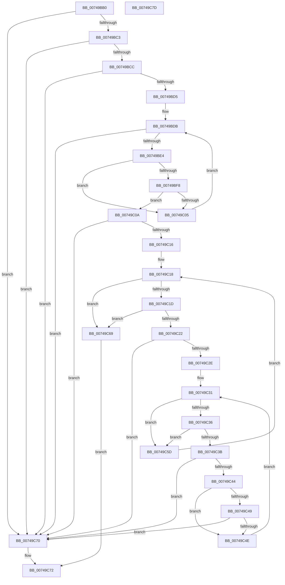

# KsepValidateShimProviderAndData

- RVA: `0x00749BB0`–`0x00749C7E` (길이 `206` bytes)
- VA: `0x0000000140749BB0`
- 실행 섹션: `PAGE`
- PDB 이름 있음: `예`; PDB Function 태그: `아니요`
- unwind 정보 RVA: `0x000950EC`
- 디코드: `64`개 명령, `206/206` bytes 표시
- 미해석 바이트: `0` (있으면 어셈블리에 `.byte`로 보존)

> 이 문서는 커널 이미지의 기계어와 PDB 기호를 분석해 생성했습니다. 4번과 5번은 함수 원형과 자료형을 바이너리 사용 방식에서 추정한 C 해석이며 원본 소스 복구 결과는 아닙니다.

## 1. Dependencies

- 직접 호출 지점: **0**; 고유 호출 대상: **0**
- 직접 호출자로 확인된 함수: **1**
- RIP 상대 이미지 참조: **0**

### Outgoing calls
- 직접 디코드된 call 명령이 없습니다.

### Direct callers
- [KseRegisterShimEx](KseRegisterShimEx_function_007494D0.md) at `0x00749541`

### Static image references
- 디코드된 RIP-relative 메모리 참조가 없습니다.

## 2. Other-region calls and transfers

- 다른 실행 섹션으로 향하는 call: **0**
- 별도 외부 분기/꼬리 이동을 확인하지 못했습니다.

## 3. Assembly (complete function range)

```asm
00749BB0  48 89 5C 24 08                  mov qword ptr [rsp + 8], rbx
00749BB5  48 89 7C 24 10                  mov qword ptr [rsp + 0x10], rdi
00749BBA  48 85 C9                        test rcx, rcx
00749BBD  0F 84 AD 00 00 00               je 0x140749c70
00749BC3  4D 85 C0                        test r8, r8
00749BC6  0F 84 A4 00 00 00               je 0x140749c70
00749BCC  48 85 D2                        test rdx, rdx
00749BCF  0F 84 9B 00 00 00               je 0x140749c70
00749BD5  44 8B 1A                        mov r11d, dword ptr [rdx]
00749BD8  45 33 C9                        xor r9d, r9d
00749BDB  45 3B CB                        cmp r9d, r11d
00749BDE  0F 83 8C 00 00 00               jae 0x140749c70
00749BE4  41 8B C1                        mov eax, r9d
00749BE7  4C 69 D0 28 01 00 00            imul r10, rax, 0x128
00749BEE  49 8B 5C 12 18                  mov rbx, qword ptr [r10 + rdx + 0x18]
00749BF3  48 3B CB                        cmp rcx, rbx
00749BF6  72 0D                           jb 0x140749c05
00749BF8  41 8B 7C 12 20                  mov edi, dword ptr [r10 + rdx + 0x20]
00749BFD  48 03 FB                        add rdi, rbx
00749C00  48 3B CF                        cmp rcx, rdi
00749C03  72 05                           jb 0x140749c0a
00749C05  41 FF C1                        inc r9d
00749C08  EB D1                           jmp 0x140749bdb
00749C0A  4D 8B 50 30                     mov r10, qword ptr [r8 + 0x30]
00749C0E  49 8B C2                        mov rax, r10
00749C11  4D 85 D2                        test r10, r10
00749C14  74 5A                           je 0x140749c70
00749C16  33 D2                           xor edx, edx
00749C18  48 85 C0                        test rax, rax
00749C1B  74 4C                           je 0x140749c69
00749C1D  83 38 04                        cmp dword ptr [rax], 4
00749C20  74 47                           je 0x140749c69
00749C22  4C 8B 48 10                     mov r9, qword ptr [rax + 0x10]
00749C26  49 8B C1                        mov rax, r9
00749C29  4D 85 C9                        test r9, r9
00749C2C  74 42                           je 0x140749c70
00749C2E  45 33 C0                        xor r8d, r8d
00749C31  48 85 C0                        test rax, rax
00749C34  74 27                           je 0x140749c5d
00749C36  83 38 02                        cmp dword ptr [rax], 2
00749C39  74 22                           je 0x140749c5d
00749C3B  48 8B 48 10                     mov rcx, qword ptr [rax + 0x10]
00749C3F  48 85 C9                        test rcx, rcx
00749C42  74 2C                           je 0x140749c70
00749C44  48 3B CB                        cmp rcx, rbx
00749C47  73 05                           jae 0x140749c4e
00749C49  48 3B CF                        cmp rcx, rdi
00749C4C  73 22                           jae 0x140749c70
00749C4E  41 FF C0                        inc r8d
00749C51  41 8B C0                        mov eax, r8d
00749C54  48 C1 E0 05                     shl rax, 5
00749C58  49 03 C1                        add rax, r9
00749C5B  EB D4                           jmp 0x140749c31
00749C5D  FF C2                           inc edx
00749C5F  48 8D 0C 52                     lea rcx, [rdx + rdx*2]
00749C63  49 8D 04 CA                     lea rax, [r10 + rcx*8]
00749C67  EB AF                           jmp 0x140749c18
00749C69  B8 01 00 00 00                  mov eax, 1
00749C6E  EB 02                           jmp 0x140749c72
00749C70  33 C0                           xor eax, eax
00749C72  48 8B 5C 24 08                  mov rbx, qword ptr [rsp + 8]
00749C77  48 8B 7C 24 10                  mov rdi, qword ptr [rsp + 0x10]
00749C7C  C3                              ret
00749C7D  CC                              int3
```

## 4. C-style interpretation (structured pseudocode)

```c
__int64 __fastcall KsepValidateShimProviderAndData(__int64 a1, __int64 a2, __int64 a3, int a4)
{
    __int64 result;
    __int64 v_r10;
    __int64 v_rdi;
    unsigned __int64 v_stack_p10;
    unsigned __int64 v_stack_p8;

    v_stack_p8 = v_rbx;
    v_stack_p10 = v_rdi;
    if (a1 == 0) goto loc_00749C70;
    if (a3 == 0) goto loc_00749C70;
    if (a2 == 0) goto loc_00749C70;
    a4 = 0;
loc_00749BDB:
    if (0 >= ((unsigned int)((unsigned int)(*(unsigned int *)(a2))))) goto loc_00749C70;
    v_r10 = (v_r10) * (0);
    if (a1 < (*(unsigned __int64 *)(v_r10 + a2 * 1 + 24))) goto loc_00749C05;
    v_rdi = ((unsigned int)(*(unsigned int *)(v_r10 + a2 * 1 + 32))) + (*(unsigned __int64 *)(v_r10 + a2 * 1 + 24));
    if (a1 < v_rdi) goto loc_00749C0A;
loc_00749C05:
    a4 = (unsigned int)((a4) + 1);
    goto loc_00749BDB;
loc_00749C0A:
    if (*(unsigned __int64 *)(a3 + 48) == 0) goto loc_00749C70;
    a2 = 0;
loc_00749C18:
    if (*(unsigned __int64 *)(a3 + 48) == 0) goto loc_00749C69;
    if ((*(unsigned int *)(*(unsigned __int64 *)(a3 + 48))) == 4) goto loc_00749C69;
    if (*(unsigned __int64 *)(*(unsigned __int64 *)(a3 + 48) + 16) == 0) goto loc_00749C70;
    a3 = 0;
loc_00749C31:
    if (*(unsigned __int64 *)(*(unsigned __int64 *)(a3 + 48) + 16) == 0) goto loc_00749C5D;
    if ((*(unsigned int *)(*(unsigned __int64 *)(*(unsigned __int64 *)(a3 + 48) + 16))) == 2) goto loc_00749C5D;
    if (*(unsigned __int64 *)(*(unsigned __int64 *)(*(unsigned __int64 *)(a3 + 48) + 16) + 16) == 0) goto loc_00749C70;
    if ((*(unsigned __int64 *)(*(unsigned __int64 *)(*(unsigned __int64 *)(a3 + 48) + 16) + 16)) >= (*(unsigned __int64 *)(v_r10 + a2 * 1 + 24))) goto loc_00749C4E;
    if ((*(unsigned __int64 *)(*(unsigned __int64 *)(*(unsigned __int64 *)(a3 + 48) + 16) + 16)) >= v_rdi) goto loc_00749C70;
loc_00749C4E:
    a3 = (unsigned int)((a3) + 1);
    result = ((unsigned int)((unsigned int)(a3))) << (5);
    result = (result) + (*(unsigned __int64 *)(*(unsigned __int64 *)(a3 + 48) + 16));
    goto loc_00749C31;
loc_00749C5D:
    a2 = (unsigned int)((a2) + 1);
    goto loc_00749C18;
loc_00749C69:
    goto loc_00749C72;
loc_00749C70:
    result = 0;
loc_00749C72:
    return result;
}
```

## 5. (Beta) C Style

```c
int64_t KsepValidateShimProviderAndData(int64_t Arg1, int64_t Arg2, int64_t Arg3, int32_t Arg4)
{
    int64_t result;
    int64_t local_r10;
    int64_t local_rdi;
    uint64_t v_stack_p10;
    uint64_t v_stack_p8;

    v_stack_p8 = local_rbx;
    v_stack_p10 = local_rdi;
    if (Arg1 == 0) goto loc_00749C70;
    if (Arg3 == 0) goto loc_00749C70;
    if (Arg2 == 0) goto loc_00749C70;
    Arg4 = 0;
loc_00749BDB:
    if (0 >= ((uint32_t)((uint32_t)(*(uint32_t *)(Arg2))))) goto loc_00749C70;
    local_r10 = (local_r10) * (0);
    if (Arg1 < (*(uint64_t *)(local_r10 + Arg2 * 1 + 0x18))) goto loc_00749C05;
    local_rdi = ((uint32_t)(*(uint32_t *)(local_r10 + Arg2 * 1 + 0x20))) + (*(uint64_t *)(local_r10 + Arg2 * 1 + 0x18));
    if (Arg1 < local_rdi) goto loc_00749C0A;
loc_00749C05:
    Arg4 = (uint32_t)((Arg4) + 1);
    goto loc_00749BDB;
loc_00749C0A:
    if (*(uint64_t *)(Arg3 + 0x30) == 0) goto loc_00749C70;
    Arg2 = 0;
loc_00749C18:
    if (*(uint64_t *)(Arg3 + 0x30) == 0) goto loc_00749C69;
    if ((*(uint32_t *)(*(uint64_t *)(Arg3 + 0x30))) == 4) goto loc_00749C69;
    if (*(uint64_t *)(*(uint64_t *)(Arg3 + 0x30) + 0x10) == 0) goto loc_00749C70;
    Arg3 = 0;
loc_00749C31:
    if (*(uint64_t *)(*(uint64_t *)(Arg3 + 0x30) + 0x10) == 0) goto loc_00749C5D;
    if ((*(uint32_t *)(*(uint64_t *)(*(uint64_t *)(Arg3 + 0x30) + 0x10))) == 2) goto loc_00749C5D;
    if (*(uint64_t *)(*(uint64_t *)(*(uint64_t *)(Arg3 + 0x30) + 0x10) + 0x10) == 0) goto loc_00749C70;
    if ((*(uint64_t *)(*(uint64_t *)(*(uint64_t *)(Arg3 + 0x30) + 0x10) + 0x10)) >= (*(uint64_t *)(local_r10 + Arg2 * 1 + 0x18))) goto loc_00749C4E;
    if ((*(uint64_t *)(*(uint64_t *)(*(uint64_t *)(Arg3 + 0x30) + 0x10) + 0x10)) >= local_rdi) goto loc_00749C70;
loc_00749C4E:
    Arg3 = (uint32_t)((Arg3) + 1);
    result = ((uint32_t)((uint32_t)(Arg3))) << (5);
    result = (result) + (*(uint64_t *)(*(uint64_t *)(Arg3 + 0x30) + 0x10));
    goto loc_00749C31;
loc_00749C5D:
    Arg2 = (uint32_t)((Arg2) + 1);
    goto loc_00749C18;
loc_00749C69:
    goto loc_00749C72;
loc_00749C70:
    result = 0;
loc_00749C72:
    return result;
}
```

## 6. Execution-region graph

[열기: 2D/3D 그래프와 함수 탐색 컨트롤 패널](../../../control-panel.html?section=page&rva=0x00749BB0&view=graph)

- 2D 그래프는 위에서 아래로 흐르고, 3D 그래프는 빈 공간을 드래그해 회전합니다. Shift+드래그는 이동, 휠은 확대·축소, 함수 노드 선택은 대상 보고서 이동입니다.

### Static fallback


