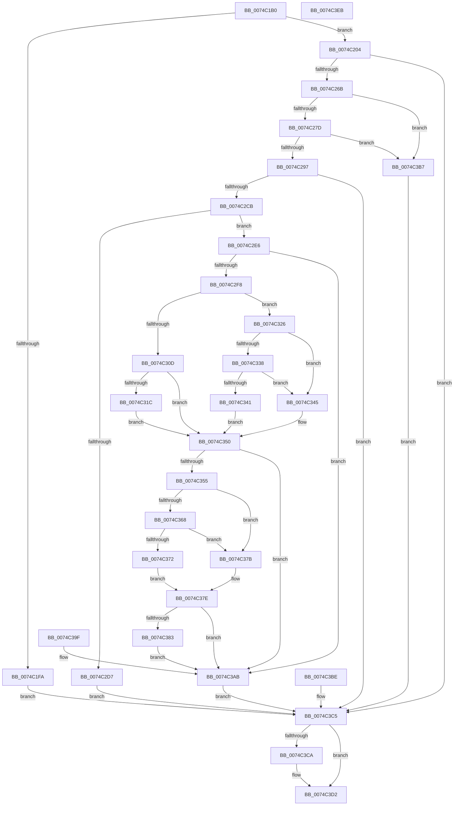

# NtAlpcImpersonateClientContainerOfPort

- RVA: `0x0074C1B0`–`0x0074C3EC` (길이 `572` bytes)
- VA: `0x000000014074C1B0`
- 실행 섹션: `PAGE`
- PDB 이름 있음: `예`; PDB Function 태그: `아니요`
- unwind 정보 RVA: `0x000CB6C8`
- 디코드: `137`개 명령, `572/572` bytes 표시
- 미해석 바이트: `0` (있으면 어셈블리에 `.byte`로 보존)

> 이 문서는 커널 이미지의 기계어와 PDB 기호를 분석해 생성했습니다. 4번과 5번은 함수 원형과 자료형을 바이너리 사용 방식에서 추정한 C 해석이며 원본 소스 복구 결과는 아닙니다.

## 1. Dependencies

- 직접 호출 지점: **14**; 고유 호출 대상: **12**
- 직접 호출자로 확인된 함수: **0**
- RIP 상대 이미지 참조: **1**

### Outgoing calls
- `0x0074C217` → [AlpcpCaptureIdMessage](../9D/AlpcpCaptureIdMessage_function_009DA680.md) (function, `0x009DA680`)
- `0x0074C252` → [ObReferenceObjectByHandle](../86/ObReferenceObjectByHandle_function_00868DB0.md) (function, `0x00868DB0`)
- `0x0074C2B5` → [AlpcpLookupMessage](../89/AlpcpLookupMessage_function_00895A40.md) (function, `0x00895A40`)
- `0x0074C2D7` → [AlpcpUnlockMessage](../89/AlpcpUnlockMessage_function_00897AE0.md) (function, `0x00897AE0`)
- `0x0074C300` → [PsGetWorkOnBehalfThread](../../text/43/PsGetWorkOnBehalfThread_function_00439560.md) (function, `0x00439560`)
- `0x0074C310` → [PsImpersonateContainerOfThread](../../text/49/PsImpersonateContainerOfThread_function_0049CC98.md) (function, `0x0049CC98`)
- `0x0074C31F` → [ObDereferenceObjectDeferDelete](../../text/3F/ObDereferenceObjectDeferDelete_function_003FCE40.md) (function, `0x003FCE40`)
- `0x0074C329` → [IoThreadToProcess](../../text/44/IoThreadToProcess_function_00448540.md) (function, `0x00448540`)
- `0x0074C338` → [PoEnergyEstimationEnabled](../../text/45/PoEnergyEstimationEnabled_function_00450000.md) (function, `0x00450000`)
- `0x0074C34B` → [PsImpersonateContainerOfThread](../../text/49/PsImpersonateContainerOfThread_function_0049CC98.md) (function, `0x0049CC98`)
- `0x0074C38B` → [PsEncodeThreadWorkOnBehalfTicket](../../text/44/PsEncodeThreadWorkOnBehalfTicket_function_0044BC70.md) (function, `0x0044BC70`)
- `0x0074C3B0` → [AlpcpUnlockMessage](../89/AlpcpUnlockMessage_function_00897AE0.md) (function, `0x00897AE0`)
- `0x0074C3CD` → [ObfDereferenceObject](../../text/2F/ObfDereferenceObject_function_002F9350.md) (function, `0x002F9350`)
- `0x0074C3D2` → [KeLeaveCriticalRegion](../../text/25/KeLeaveCriticalRegion_function_0025D8B0.md) (function, `0x0025D8B0`)

### Direct callers
- 이 함수 시작 RVA로 연결되는 직접 call은 확인되지 않았습니다. 간접 호출은 완전히 역산할 수 없습니다.

### Static image references
- `0x0074C22D` → RVA `0x00FC6C18` (`ALMOSTRO`; read)

## 2. Other-region calls and transfers

- 다른 실행 섹션으로 향하는 call: **9**
  - `0x0074C300` → [PsGetWorkOnBehalfThread](../../text/43/PsGetWorkOnBehalfThread_function_00439560.md) (`PAGE` → `.text`)
  - `0x0074C310` → [PsImpersonateContainerOfThread](../../text/49/PsImpersonateContainerOfThread_function_0049CC98.md) (`PAGE` → `.text`)
  - `0x0074C31F` → [ObDereferenceObjectDeferDelete](../../text/3F/ObDereferenceObjectDeferDelete_function_003FCE40.md) (`PAGE` → `.text`)
  - `0x0074C329` → [IoThreadToProcess](../../text/44/IoThreadToProcess_function_00448540.md) (`PAGE` → `.text`)
  - `0x0074C338` → [PoEnergyEstimationEnabled](../../text/45/PoEnergyEstimationEnabled_function_00450000.md) (`PAGE` → `.text`)
  - `0x0074C34B` → [PsImpersonateContainerOfThread](../../text/49/PsImpersonateContainerOfThread_function_0049CC98.md) (`PAGE` → `.text`)
  - `0x0074C38B` → [PsEncodeThreadWorkOnBehalfTicket](../../text/44/PsEncodeThreadWorkOnBehalfTicket_function_0044BC70.md) (`PAGE` → `.text`)
  - `0x0074C3CD` → [ObfDereferenceObject](../../text/2F/ObfDereferenceObject_function_002F9350.md) (`PAGE` → `.text`)
  - `0x0074C3D2` → [KeLeaveCriticalRegion](../../text/25/KeLeaveCriticalRegion_function_0025D8B0.md) (`PAGE` → `.text`)
- 별도 외부 분기/꼬리 이동을 확인하지 못했습니다.

## 3. Assembly (complete function range)

```asm
0074C1B0  48 8B C4                        mov rax, rsp
0074C1B3  48 89 70 08                     mov qword ptr [rax + 8], rsi
0074C1B7  57                              push rdi
0074C1B8  41 56                           push r14
0074C1BA  41 57                           push r15
0074C1BC  48 83 EC 60                     sub rsp, 0x60
0074C1C0  4C 8B CA                        mov r9, rdx
0074C1C3  48 8B F9                        mov rdi, rcx
0074C1C6  83 60 18 00                     and dword ptr [rax + 0x18], 0
0074C1CA  83 60 B8 00                     and dword ptr [rax - 0x48], 0
0074C1CE  48 83 60 C0 00                  and qword ptr [rax - 0x40], 0
0074C1D3  83 60 20 00                     and dword ptr [rax + 0x20], 0
0074C1D7  48 83 60 D8 00                  and qword ptr [rax - 0x28], 0
0074C1DC  65 48 8B 04 25 88 01 00 00      mov rax, qword ptr gs:[0x188]
0074C1E5  66 FF 88 E4 01 00 00            dec word ptr [rax + 0x1e4]
0074C1EC  90                              nop
0074C1ED  45 33 F6                        xor r14d, r14d
0074C1F0  4C 89 74 24 48                  mov qword ptr [rsp + 0x48], r14
0074C1F5  45 85 C0                        test r8d, r8d
0074C1F8  74 0A                           je 0x14074c204
0074C1FA  BF 0D 00 00 C0                  mov edi, 0xc000000d
0074C1FF  E9 C1 01 00 00                  jmp 0x14074c3c5
0074C204  4C 8D 84 24 90 00 00 00         lea r8, [rsp + 0x90]
0074C20C  48 8D 94 24 98 00 00 00         lea rdx, [rsp + 0x98]
0074C214  49 8B C9                        mov rcx, r9
0074C217  E8 64 E4 28 00                  call 0x1409da680
0074C21C  90                              nop
0074C21D  65 48 8B 04 25 88 01 00 00      mov rax, qword ptr gs:[0x188]
0074C226  44 8A 88 32 02 00 00            mov r9b, byte ptr [rax + 0x232]
0074C22D  4C 8B 05 E4 A9 87 00            mov r8, qword ptr [rip + 0x87a9e4]
0074C234  48 83 64 24 40 00               and qword ptr [rsp + 0x40], 0
0074C23A  48 83 64 24 28 00               and qword ptr [rsp + 0x28], 0
0074C240  48 8D 44 24 40                  lea rax, [rsp + 0x40]
0074C245  48 89 44 24 20                  mov qword ptr [rsp + 0x20], rax
0074C24A  BA 00 00 02 00                  mov edx, 0x20000
0074C24F  48 8B CF                        mov rcx, rdi
0074C252  E8 59 CB 11 00                  call 0x140868db0
0074C257  8B F8                           mov edi, eax
0074C259  4C 8B 74 24 40                  mov r14, qword ptr [rsp + 0x40]
0074C25E  4C 89 74 24 48                  mov qword ptr [rsp + 0x48], r14
0074C263  85 C0                           test eax, eax
0074C265  0F 88 5A 01 00 00               js 0x14074c3c5
0074C26B  41 8B 86 A0 01 00 00            mov eax, dword ptr [r14 + 0x1a0]
0074C272  83 E0 06                        and eax, 6
0074C275  3C 06                           cmp al, 6
0074C277  0F 85 3A 01 00 00               jne 0x14074c3b7
0074C27D  65 48 8B 04 25 88 01 00 00      mov rax, qword ptr gs:[0x188]
0074C286  48 8B 88 B8 00 00 00            mov rcx, qword ptr [rax + 0xb8]
0074C28D  49 3B 4E 18                     cmp rcx, qword ptr [r14 + 0x18]
0074C291  0F 85 20 01 00 00               jne 0x14074c3b7
0074C297  48 8D 44 24 38                  lea rax, [rsp + 0x38]
0074C29C  48 89 44 24 20                  mov qword ptr [rsp + 0x20], rax
0074C2A1  44 8B 84 24 90 00 00 00         mov r8d, dword ptr [rsp + 0x90]
0074C2A9  8B 94 24 98 00 00 00            mov edx, dword ptr [rsp + 0x98]
0074C2B0  48 8B 4C 24 40                  mov rcx, qword ptr [rsp + 0x40]
0074C2B5  E8 86 97 14 00                  call 0x140895a40
0074C2BA  8B F8                           mov edi, eax
0074C2BC  89 84 24 90 00 00 00            mov dword ptr [rsp + 0x90], eax
0074C2C3  85 C0                           test eax, eax
0074C2C5  0F 88 FA 00 00 00               js 0x14074c3c5
0074C2CB  48 8B 4C 24 38                  mov rcx, qword ptr [rsp + 0x38]
0074C2D0  8B 51 28                        mov edx, dword ptr [rcx + 0x28]
0074C2D3  84 D2                           test dl, dl
0074C2D5  79 0F                           jns 0x14074c2e6
0074C2D7  E8 04 B8 14 00                  call 0x140897ae0
0074C2DC  BF 03 07 00 C0                  mov edi, 0xc0000703
0074C2E1  E9 DF 00 00 00                  jmp 0x14074c3c5
0074C2E6  48 8B 44 24 38                  mov rax, qword ptr [rsp + 0x38]
0074C2EB  4C 8B 78 20                     mov r15, qword ptr [rax + 0x20]
0074C2EF  4D 85 FF                        test r15, r15
0074C2F2  0F 84 B3 00 00 00               je 0x14074c3ab
0074C2F8  48 8D 54 24 30                  lea rdx, [rsp + 0x30]
0074C2FD  49 8B CF                        mov rcx, r15
0074C300  E8 5B D2 CE FF                  call 0x140439560
0074C305  48 8B F0                        mov rsi, rax
0074C308  48 85 C0                        test rax, rax
0074C30B  74 19                           je 0x14074c326
0074C30D  48 8B C8                        mov rcx, rax
0074C310  E8 83 09 D5 FF                  call 0x14049cc98
0074C315  83 7C 24 30 00                  cmp dword ptr [rsp + 0x30], 0
0074C31A  74 34                           je 0x14074c350
0074C31C  48 8B CE                        mov rcx, rsi
0074C31F  E8 1C 0B CB FF                  call 0x1403fce40
0074C324  EB 2A                           jmp 0x14074c350
0074C326  49 8B CF                        mov rcx, r15
0074C329  E8 12 C2 CF FF                  call 0x140448540
0074C32E  48 83 B8 D8 06 00 00 00         cmp qword ptr [rax + 0x6d8], 0
0074C336  75 0D                           jne 0x14074c345
0074C338  E8 C3 3C D0 FF                  call 0x140450000
0074C33D  84 C0                           test al, al
0074C33F  75 04                           jne 0x14074c345
0074C341  33 F6                           xor esi, esi
0074C343  EB 0B                           jmp 0x14074c350
0074C345  49 8B F7                        mov rsi, r15
0074C348  49 8B CF                        mov rcx, r15
0074C34B  E8 48 09 D5 FF                  call 0x14049cc98
0074C350  48 85 F6                        test rsi, rsi
0074C353  74 56                           je 0x14074c3ab
0074C355  65 4C 8B 04 25 88 01 00 00      mov r8, qword ptr gs:[0x188]
0074C35E  41 F7 40 74 00 04 00 00         test dword ptr [r8 + 0x74], 0x400
0074C366  75 13                           jne 0x14074c37b
0074C368  41 80 B8 4A 02 00 00 01         cmp byte ptr [r8 + 0x24a], 1
0074C370  74 09                           je 0x14074c37b
0074C372  4D 8B 80 F0 00 00 00            mov r8, qword ptr [r8 + 0xf0]
0074C379  EB 03                           jmp 0x14074c37e
0074C37B  45 33 C0                        xor r8d, r8d
0074C37E  4D 85 C0                        test r8, r8
0074C381  74 28                           je 0x14074c3ab
0074C383  48 8D 54 24 50                  lea rdx, [rsp + 0x50]
0074C388  48 8B CE                        mov rcx, rsi
0074C38B  E8 E0 F8 CF FF                  call 0x14044bc70
0074C390  90                              nop
0074C391  48 8B 44 24 50                  mov rax, qword ptr [rsp + 0x50]
0074C396  49 89 80 B8 02 00 00            mov qword ptr [r8 + 0x2b8], rax
0074C39D  EB 0C                           jmp 0x14074c3ab
0074C39F  4C 8B 74 24 48                  mov r14, qword ptr [rsp + 0x48]
0074C3A4  8B BC 24 90 00 00 00            mov edi, dword ptr [rsp + 0x90]
0074C3AB  48 8B 4C 24 38                  mov rcx, qword ptr [rsp + 0x38]
0074C3B0  E8 2B B7 14 00                  call 0x140897ae0
0074C3B5  EB 0E                           jmp 0x14074c3c5
0074C3B7  BF 22 00 00 C0                  mov edi, 0xc0000022
0074C3BC  EB 07                           jmp 0x14074c3c5
0074C3BE  8B F8                           mov edi, eax
0074C3C0  4C 8B 74 24 48                  mov r14, qword ptr [rsp + 0x48]
0074C3C5  4D 85 F6                        test r14, r14
0074C3C8  74 08                           je 0x14074c3d2
0074C3CA  49 8B CE                        mov rcx, r14
0074C3CD  E8 7E CF BA FF                  call 0x1402f9350
0074C3D2  E8 D9 14 B1 FF                  call 0x14025d8b0
0074C3D7  8B C7                           mov eax, edi
0074C3D9  48 8B B4 24 80 00 00 00         mov rsi, qword ptr [rsp + 0x80]
0074C3E1  48 83 C4 60                     add rsp, 0x60
0074C3E5  41 5F                           pop r15
0074C3E7  41 5E                           pop r14
0074C3E9  5F                              pop rdi
0074C3EA  C3                              ret
0074C3EB  CC                              int3
```

## 4. C-style interpretation (structured pseudocode)

```c
__int64 __fastcall NtAlpcImpersonateClientContainerOfPort(__int64 a1, __int64 a2, int a3)
{
    __int64 result;
    __int64 v_r14;
    __int64 v_rsi;
    __int64 v_rsp;
    unsigned __int64 v_stack_m28;
    unsigned __int64 v_stack_m30;
    unsigned __int64 v_stack_m38;
    unsigned __int64 v_stack_m40;
    unsigned __int64 v_stack_m48;
    unsigned __int64 v_stack_m50;
    unsigned __int64 v_stack_m58;
    unsigned __int64 v_stack_p18;
    unsigned __int64 v_stack_p20;
    unsigned __int64 v_stack_p8;

    *(unsigned __int64 *)(v_rsp + 8) = v_rsi;
    v_rsp = (v_rsp) - (96);
    v_r14 = 0;
    v_stack_m30 = 0;
    if (a3 == 0) goto loc_0074C204;
    goto loc_0074C3C5;
loc_0074C204:
    result = AlpcpCaptureIdMessage(a2, v_stack_p20, v_stack_p18, a2);
    v_stack_m58 = v_stack_m38;
    result = ObReferenceObjectByHandle((unsigned int)(0xC000000DULL), (unsigned int)(0x20000ULL), *(unsigned __int64 *)(v_rip + 8890852), *(unsigned __int8 *)(*(unsigned __int64 *)(gs_base + (0 + 392)) + 562));
    v_stack_m30 = v_stack_m38;
    if (sign_flag) goto loc_0074C3C5;
    result = (unsigned int)(((unsigned int)(*(unsigned int *)(v_stack_m38 + 416))) & (6));
    if (((unsigned __int8)(result)) != 6) goto loc_0074C3B7;
    if ((*(unsigned __int64 *)(*(unsigned __int64 *)(gs_base + (0 + 392)) + 184)) != (*(unsigned __int64 *)(v_stack_m38 + 24))) goto loc_0074C3B7;
    v_stack_m58 = v_stack_m40;
    result = AlpcpLookupMessage(v_stack_m38, (unsigned int)(v_stack_p20), (unsigned int)(v_stack_p18), *(unsigned __int8 *)(*(unsigned __int64 *)(gs_base + (0 + 392)) + 562));
    v_stack_p18 = (unsigned int)(result);
    if (sign_flag) goto loc_0074C3C5;
    if (!sign_flag) goto loc_0074C2E6;
    result = AlpcpUnlockMessage(v_stack_m40, (unsigned int)(*(unsigned int *)(v_stack_m40 + 40)), (unsigned int)(v_stack_p18), *(unsigned __int8 *)(*(unsigned __int64 *)(gs_base + (0 + 392)) + 562));
    goto loc_0074C3C5;
loc_0074C2E6:
    if (*(unsigned __int64 *)(v_stack_m40 + 32) == 0) goto loc_0074C3AB;
    result = PsGetWorkOnBehalfThread(*(unsigned __int64 *)(v_stack_m40 + 32), v_stack_m48, (unsigned int)(v_stack_p18), *(unsigned __int8 *)(*(unsigned __int64 *)(gs_base + (0 + 392)) + 562));
    if (result == 0) goto loc_0074C326;
    result = PsImpersonateContainerOfThread(result, v_stack_m48, (unsigned int)(v_stack_p18), *(unsigned __int8 *)(*(unsigned __int64 *)(gs_base + (0 + 392)) + 562));
    if (v_stack_m48 == 0) goto loc_0074C350;
    result = ObDereferenceObjectDeferDelete(result, v_stack_m48, (unsigned int)(v_stack_p18), *(unsigned __int8 *)(*(unsigned __int64 *)(gs_base + (0 + 392)) + 562));
    goto loc_0074C350;
loc_0074C326:
    result = IoThreadToProcess(*(unsigned __int64 *)(v_stack_m40 + 32), v_stack_m48, (unsigned int)(v_stack_p18), *(unsigned __int8 *)(*(unsigned __int64 *)(gs_base + (0 + 392)) + 562));
    if ((*(unsigned __int64 *)(result + 1752)) != 0) goto loc_0074C345;
    result = PoEnergyEstimationEnabled(*(unsigned __int64 *)(v_stack_m40 + 32), v_stack_m48, (unsigned int)(v_stack_p18), *(unsigned __int8 *)(*(unsigned __int64 *)(gs_base + (0 + 392)) + 562));
    if ((unsigned __int8)(result) != 0) goto loc_0074C345;
    v_rsi = 0;
    goto loc_0074C350;
loc_0074C345:
    result = PsImpersonateContainerOfThread(*(unsigned __int64 *)(v_stack_m40 + 32), v_stack_m48, (unsigned int)(v_stack_p18), *(unsigned __int8 *)(*(unsigned __int64 *)(gs_base + (0 + 392)) + 562));
loc_0074C350:
    if (*(unsigned __int64 *)(v_stack_m40 + 32) == 0) goto loc_0074C3AB;
    if (((*(unsigned int *)(*(unsigned __int64 *)(gs_base + (0 + 392)) + 116)) & (0x400ULL)) != 0) goto loc_0074C37B;
    if ((*(unsigned __int8 *)(*(unsigned __int64 *)(gs_base + (0 + 392)) + 586)) == 1) goto loc_0074C37B;
    goto loc_0074C37E;
loc_0074C37B:
    a3 = 0;
loc_0074C37E:
    if (0 == 0) goto loc_0074C3AB;
    result = PsEncodeThreadWorkOnBehalfTicket(*(unsigned __int64 *)(v_stack_m40 + 32), v_stack_m28, a3, *(unsigned __int8 *)(*(unsigned __int64 *)(gs_base + (0 + 392)) + 562));
    *(unsigned __int64 *)(a3 + 696) = v_stack_m28;
    goto loc_0074C3AB;
loc_0074C3AB:
    result = AlpcpUnlockMessage(v_stack_m40, v_stack_m28, a3, *(unsigned __int8 *)(*(unsigned __int64 *)(gs_base + (0 + 392)) + 562));
    goto loc_0074C3C5;
loc_0074C3B7:
    goto loc_0074C3C5;
loc_0074C3C5:
    if (v_stack_m38 != 0) {
        a1 = v_stack_m38;
        result = ObfDereferenceObject(a1, v_stack_m28, a3, *(unsigned __int8 *)(*(unsigned __int64 *)(gs_base + (0 + 392)) + 562));
    }
    result = KeLeaveCriticalRegion(a1, v_stack_m28, a3, *(unsigned __int8 *)(*(unsigned __int64 *)(gs_base + (0 + 392)) + 562));
    v_rsp = (v_rsp) + (96);
    return (unsigned int)((unsigned int)((unsigned int)(0xC0000022ULL)));
}
```

## 5. (Beta) C Style

```c
int64_t NtAlpcImpersonateClientContainerOfPort(int64_t Arg1, int64_t Arg2, int32_t Arg3)
{
    int64_t result;
    int64_t local_r14;
    int64_t local_rsi;
    int64_t local_rsp;
    uint64_t v_stack_m28;
    uint64_t v_stack_m30;
    uint64_t v_stack_m38;
    uint64_t v_stack_m40;
    uint64_t v_stack_m48;
    uint64_t v_stack_m50;
    uint64_t v_stack_m58;
    uint64_t v_stack_p18;
    uint64_t v_stack_p20;
    uint64_t v_stack_p8;

    *(uint64_t *)(local_rsp + 0x8) = local_rsi;
    local_rsp = (local_rsp) - (96);
    local_r14 = 0;
    v_stack_m30 = 0;
    if (Arg3 == 0) goto loc_0074C204;
    goto loc_0074C3C5;
loc_0074C204:
    result = AlpcpCaptureIdMessage(Arg2, v_stack_p20, v_stack_p18, Arg2);
    v_stack_m58 = v_stack_m38;
    result = ObReferenceObjectByHandle((uint32_t)(0xC000000DULL), (uint32_t)(0x20000ULL), *(uint64_t *)(v_rip + 0x87A9E4), *(uint8_t *)(*(uint64_t *)(gs_base + (0 + 0x188)) + 0x232));
    v_stack_m30 = v_stack_m38;
    if (sign_flag) goto loc_0074C3C5;
    result = (uint32_t)(((uint32_t)(*(uint32_t *)(v_stack_m38 + 0x1A0))) & (6));
    if (((uint8_t)(result)) != 6) goto loc_0074C3B7;
    if ((*(uint64_t *)(*(uint64_t *)(gs_base + (0 + 0x188)) + 0xB8)) != (*(uint64_t *)(v_stack_m38 + 0x18))) goto loc_0074C3B7;
    v_stack_m58 = v_stack_m40;
    result = AlpcpLookupMessage(v_stack_m38, (uint32_t)(v_stack_p20), (uint32_t)(v_stack_p18), *(uint8_t *)(*(uint64_t *)(gs_base + (0 + 0x188)) + 0x232));
    v_stack_p18 = (uint32_t)(result);
    if (sign_flag) goto loc_0074C3C5;
    if (!sign_flag) goto loc_0074C2E6;
    result = AlpcpUnlockMessage(v_stack_m40, (uint32_t)(*(uint32_t *)(v_stack_m40 + 0x28)), (uint32_t)(v_stack_p18), *(uint8_t *)(*(uint64_t *)(gs_base + (0 + 0x188)) + 0x232));
    goto loc_0074C3C5;
loc_0074C2E6:
    if (*(uint64_t *)(v_stack_m40 + 0x20) == 0) goto loc_0074C3AB;
    result = PsGetWorkOnBehalfThread(*(uint64_t *)(v_stack_m40 + 0x20), v_stack_m48, (uint32_t)(v_stack_p18), *(uint8_t *)(*(uint64_t *)(gs_base + (0 + 0x188)) + 0x232));
    if (result == 0) goto loc_0074C326;
    result = PsImpersonateContainerOfThread(result, v_stack_m48, (uint32_t)(v_stack_p18), *(uint8_t *)(*(uint64_t *)(gs_base + (0 + 0x188)) + 0x232));
    if (v_stack_m48 == 0) goto loc_0074C350;
    result = ObDereferenceObjectDeferDelete(result, v_stack_m48, (uint32_t)(v_stack_p18), *(uint8_t *)(*(uint64_t *)(gs_base + (0 + 0x188)) + 0x232));
    goto loc_0074C350;
loc_0074C326:
    result = IoThreadToProcess(*(uint64_t *)(v_stack_m40 + 0x20), v_stack_m48, (uint32_t)(v_stack_p18), *(uint8_t *)(*(uint64_t *)(gs_base + (0 + 0x188)) + 0x232));
    if ((*(uint64_t *)(result + 0x6D8)) != 0) goto loc_0074C345;
    result = PoEnergyEstimationEnabled(*(uint64_t *)(v_stack_m40 + 0x20), v_stack_m48, (uint32_t)(v_stack_p18), *(uint8_t *)(*(uint64_t *)(gs_base + (0 + 0x188)) + 0x232));
    if ((uint8_t)(result) != 0) goto loc_0074C345;
    local_rsi = 0;
    goto loc_0074C350;
loc_0074C345:
    result = PsImpersonateContainerOfThread(*(uint64_t *)(v_stack_m40 + 0x20), v_stack_m48, (uint32_t)(v_stack_p18), *(uint8_t *)(*(uint64_t *)(gs_base + (0 + 0x188)) + 0x232));
loc_0074C350:
    if (*(uint64_t *)(v_stack_m40 + 0x20) == 0) goto loc_0074C3AB;
    if (((*(uint32_t *)(*(uint64_t *)(gs_base + (0 + 0x188)) + 0x74)) & (0x400ULL)) != 0) goto loc_0074C37B;
    if ((*(uint8_t *)(*(uint64_t *)(gs_base + (0 + 0x188)) + 0x24A)) == 1) goto loc_0074C37B;
    goto loc_0074C37E;
loc_0074C37B:
    Arg3 = 0;
loc_0074C37E:
    if (0 == 0) goto loc_0074C3AB;
    result = PsEncodeThreadWorkOnBehalfTicket(*(uint64_t *)(v_stack_m40 + 0x20), v_stack_m28, Arg3, *(uint8_t *)(*(uint64_t *)(gs_base + (0 + 0x188)) + 0x232));
    *(uint64_t *)(Arg3 + 0x2B8) = v_stack_m28;
    goto loc_0074C3AB;
loc_0074C3AB:
    result = AlpcpUnlockMessage(v_stack_m40, v_stack_m28, Arg3, *(uint8_t *)(*(uint64_t *)(gs_base + (0 + 0x188)) + 0x232));
    goto loc_0074C3C5;
loc_0074C3B7:
    goto loc_0074C3C5;
loc_0074C3C5:
    if (v_stack_m38 != 0) {
        Arg1 = v_stack_m38;
        result = ObfDereferenceObject(Arg1, v_stack_m28, Arg3, *(uint8_t *)(*(uint64_t *)(gs_base + (0 + 0x188)) + 0x232));
    }
    result = KeLeaveCriticalRegion(Arg1, v_stack_m28, Arg3, *(uint8_t *)(*(uint64_t *)(gs_base + (0 + 0x188)) + 0x232));
    local_rsp = (local_rsp) + (96);
    return (uint32_t)((uint32_t)((uint32_t)(0xC0000022ULL)));
}
```

## 6. Execution-region graph

[열기: 2D/3D 그래프와 함수 탐색 컨트롤 패널](../../../control-panel.html?section=page&rva=0x0074C1B0&view=graph)

- 2D 그래프는 위에서 아래로 흐르고, 3D 그래프는 빈 공간을 드래그해 회전합니다. Shift+드래그는 이동, 휠은 확대·축소, 함수 노드 선택은 대상 보고서 이동입니다.

### Static fallback


