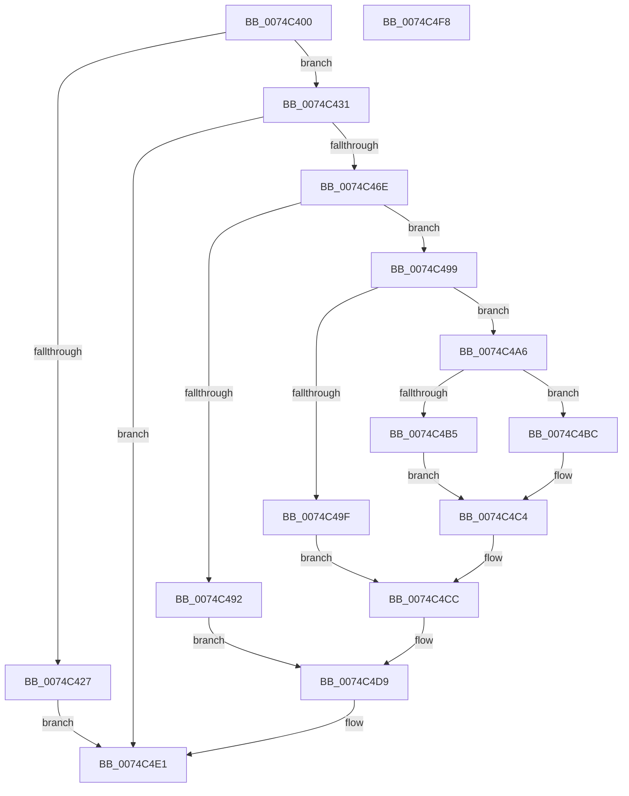

# NtAlpcRevokeSecurityContext

- RVA: `0x0074C400`–`0x0074C4F9` (길이 `249` bytes)
- VA: `0x000000014074C400`
- 실행 섹션: `PAGE`
- PDB 이름 있음: `예`; PDB Function 태그: `아니요`
- unwind 정보 RVA: `0x000794E0`
- 디코드: `64`개 명령, `249/249` bytes 표시
- 미해석 바이트: `0` (있으면 어셈블리에 `.byte`로 보존)

> 이 문서는 커널 이미지의 기계어와 PDB 기호를 분석해 생성했습니다. 4번과 5번은 함수 원형과 자료형을 바이너리 사용 방식에서 추정한 C 해석이며 원본 소스 복구 결과는 아닙니다.

## 1. Dependencies

- 직접 호출 지점: **7**; 고유 호출 대상: **7**
- 직접 호출자로 확인된 함수: **0**
- RIP 상대 이미지 참조: **2**

### Outgoing calls
- `0x0074C463` → [ObReferenceObjectByHandle](../86/ObReferenceObjectByHandle_function_00868DB0.md) (function, `0x00868DB0`)
- `0x0074C485` → [AlpcReferenceBlobByHandle](../88/AlpcReferenceBlobByHandle_function_00889F00.md) (function, `0x00889F00`)
- `0x0074C4A9` → [AlpcpLockBlobExclusive](../92/AlpcpLockBlobExclusive_function_009253A4.md) (function, `0x009253A4`)
- `0x0074C4C7` → [AlpcpUnlockBlobUncachedExclusive](../92/AlpcpUnlockBlobUncachedExclusive_function_0092536C.md) (function, `0x0092536C`)
- `0x0074C4D4` → [AlpcpDereferenceBlobEx](../88/AlpcpDereferenceBlobEx_function_0088AF00.md) (function, `0x0088AF00`)
- `0x0074C4DC` → [ObfDereferenceObject](../../text/2F/ObfDereferenceObject_function_002F9350.md) (function, `0x002F9350`)
- `0x0074C4E1` → [KeLeaveCriticalRegion](../../text/25/KeLeaveCriticalRegion_function_0025D8B0.md) (function, `0x0025D8B0`)

### Direct callers
- 이 함수 시작 RVA로 연결되는 직접 call은 확인되지 않았습니다. 간접 호출은 완전히 역산할 수 없습니다.

### Static image references
- `0x0074C43F` → RVA `0x00FC6C18` (`ALMOSTRO`; read)
- `0x0074C473` → RVA `0x00001418` (`.rdata`; read)

## 2. Other-region calls and transfers

- 다른 실행 섹션으로 향하는 call: **2**
  - `0x0074C4DC` → [ObfDereferenceObject](../../text/2F/ObfDereferenceObject_function_002F9350.md) (`PAGE` → `.text`)
  - `0x0074C4E1` → [KeLeaveCriticalRegion](../../text/25/KeLeaveCriticalRegion_function_0025D8B0.md) (`PAGE` → `.text`)
- 별도 외부 분기/꼬리 이동을 확인하지 못했습니다.

## 3. Assembly (complete function range)

```asm
0074C400  48 89 5C 24 08                  mov qword ptr [rsp + 8], rbx
0074C405  48 89 74 24 10                  mov qword ptr [rsp + 0x10], rsi
0074C40A  57                              push rdi
0074C40B  48 83 EC 30                     sub rsp, 0x30
0074C40F  65 48 8B 04 25 88 01 00 00      mov rax, qword ptr gs:[0x188]
0074C418  49 8B F8                        mov rdi, r8
0074C41B  66 FF 88 E4 01 00 00            dec word ptr [rax + 0x1e4]
0074C422  90                              nop
0074C423  85 D2                           test edx, edx
0074C425  74 0A                           je 0x14074c431
0074C427  BB 0D 00 00 C0                  mov ebx, 0xc000000d
0074C42C  E9 B0 00 00 00                  jmp 0x14074c4e1
0074C431  65 48 8B 04 25 88 01 00 00      mov rax, qword ptr gs:[0x188]
0074C43A  BA 01 00 00 00                  mov edx, 1
0074C43F  4C 8B 05 D2 A7 87 00            mov r8, qword ptr [rip + 0x87a7d2]
0074C446  48 83 64 24 28 00               and qword ptr [rsp + 0x28], 0
0074C44C  48 83 64 24 58 00               and qword ptr [rsp + 0x58], 0
0074C452  44 8A 88 32 02 00 00            mov r9b, byte ptr [rax + 0x232]
0074C459  48 8D 44 24 58                  lea rax, [rsp + 0x58]
0074C45E  48 89 44 24 20                  mov qword ptr [rsp + 0x20], rax
0074C463  E8 48 C9 11 00                  call 0x140868db0
0074C468  8B D8                           mov ebx, eax
0074C46A  85 C0                           test eax, eax
0074C46C  78 73                           js 0x14074c4e1
0074C46E  48 8B 74 24 58                  mov rsi, qword ptr [rsp + 0x58]
0074C473  4C 8D 05 9E 4F 8B FF            lea r8, [rip - 0x74b062]
0074C47A  48 8B D7                        mov rdx, rdi
0074C47D  48 8B 4E 10                     mov rcx, qword ptr [rsi + 0x10]
0074C481  48 83 C1 28                     add rcx, 0x28
0074C485  E8 76 DA 13 00                  call 0x140889f00
0074C48A  48 8B F8                        mov rdi, rax
0074C48D  48 85 C0                        test rax, rax
0074C490  75 07                           jne 0x14074c499
0074C492  BB 08 00 00 C0                  mov ebx, 0xc0000008
0074C497  EB 40                           jmp 0x14074c4d9
0074C499  48 3B 70 18                     cmp rsi, qword ptr [rax + 0x18]
0074C49D  74 07                           je 0x14074c4a6
0074C49F  BB 22 00 00 C0                  mov ebx, 0xc0000022
0074C4A4  EB 26                           jmp 0x14074c4cc
0074C4A6  48 8B CF                        mov rcx, rdi
0074C4A9  E8 F6 8E 1D 00                  call 0x1409253a4
0074C4AE  8B 47 68                        mov eax, dword ptr [rdi + 0x68]
0074C4B1  A8 02                           test al, 2
0074C4B3  74 07                           je 0x14074c4bc
0074C4B5  BB 01 00 00 C0                  mov ebx, 0xc0000001
0074C4BA  EB 08                           jmp 0x14074c4c4
0074C4BC  83 C8 01                        or eax, 1
0074C4BF  89 47 68                        mov dword ptr [rdi + 0x68], eax
0074C4C2  33 DB                           xor ebx, ebx
0074C4C4  48 8B CF                        mov rcx, rdi
0074C4C7  E8 A0 8E 1D 00                  call 0x14092536c
0074C4CC  BA 01 00 00 00                  mov edx, 1
0074C4D1  48 8B CF                        mov rcx, rdi
0074C4D4  E8 27 EA 13 00                  call 0x14088af00
0074C4D9  48 8B CE                        mov rcx, rsi
0074C4DC  E8 6F CE BA FF                  call 0x1402f9350
0074C4E1  E8 CA 13 B1 FF                  call 0x14025d8b0
0074C4E6  48 8B 74 24 48                  mov rsi, qword ptr [rsp + 0x48]
0074C4EB  8B C3                           mov eax, ebx
0074C4ED  48 8B 5C 24 40                  mov rbx, qword ptr [rsp + 0x40]
0074C4F2  48 83 C4 30                     add rsp, 0x30
0074C4F6  5F                              pop rdi
0074C4F7  C3                              ret
0074C4F8  CC                              int3
```

## 4. C-style interpretation (structured pseudocode)

```c
__int64 __fastcall NtAlpcRevokeSecurityContext(__int64 a1, int a2, __int64 a3)
{
    __int64 result;
    __int64 v_rbx;
    __int64 v_rsp;
    unsigned __int64 v_stack_m10;
    unsigned __int64 v_stack_m18;
    unsigned __int64 v_stack_p10;
    unsigned __int64 v_stack_p20;
    unsigned __int64 v_stack_p8;

    v_stack_p8 = v_rbx;
    v_stack_p10 = v_rsi;
    v_rsp = (v_rsp) - (48);
    if (a2 == 0) goto loc_0074C431;
    goto loc_0074C4E1;
loc_0074C431:
    v_stack_m18 = v_stack_p20;
    result = ObReferenceObjectByHandle(a1, 1, *(unsigned __int64 *)(v_rip + 8890322), *(unsigned __int8 *)(*(unsigned __int64 *)(gs_base + (0 + 392)) + 562));
    if (sign_flag) goto loc_0074C4E1;
    a1 = (*(unsigned __int64 *)(v_stack_p20 + 16)) + (40);
    result = AlpcReferenceBlobByHandle(a1, a3, v_rip - 7647330, *(unsigned __int8 *)(*(unsigned __int64 *)(gs_base + (0 + 392)) + 562));
    if (result != 0) goto loc_0074C499;
    goto loc_0074C4D9;
loc_0074C499:
    if (v_stack_p20 == (*(unsigned __int64 *)(result + 24))) goto loc_0074C4A6;
    goto loc_0074C4CC;
loc_0074C4A6:
    result = AlpcpLockBlobExclusive(result, a3, v_rip - 7647330, *(unsigned __int8 *)(*(unsigned __int64 *)(gs_base + (0 + 392)) + 562));
    if ((((unsigned __int8)((unsigned int)(*(unsigned int *)(result + 104)))) & (2)) == 0) goto loc_0074C4BC;
    goto loc_0074C4C4;
loc_0074C4BC:
    result = (unsigned int)(((unsigned int)(*(unsigned int *)(result + 104))) | (1));
    *(unsigned int *)(result + 104) = (unsigned int)(result);
    v_rbx = 0;
loc_0074C4C4:
    result = AlpcpUnlockBlobUncachedExclusive(result, a3, v_rip - 7647330, *(unsigned __int8 *)(*(unsigned __int64 *)(gs_base + (0 + 392)) + 562));
loc_0074C4CC:
    result = AlpcpDereferenceBlobEx(result, 1, v_rip - 7647330, *(unsigned __int8 *)(*(unsigned __int64 *)(gs_base + (0 + 392)) + 562));
loc_0074C4D9:
    result = ObfDereferenceObject(v_stack_p20, 1, v_rip - 7647330, *(unsigned __int8 *)(*(unsigned __int64 *)(gs_base + (0 + 392)) + 562));
loc_0074C4E1:
    result = KeLeaveCriticalRegion(v_stack_p20, 1, v_rip - 7647330, *(unsigned __int8 *)(*(unsigned __int64 *)(gs_base + (0 + 392)) + 562));
    v_rsp = (v_rsp) + (48);
    return 0;
}
```

## 5. (Beta) C Style

```c
int64_t NtAlpcRevokeSecurityContext(int64_t Arg1, int32_t Arg2, int64_t Arg3)
{
    int64_t result;
    int64_t local_rbx;
    int64_t local_rsp;
    uint64_t v_stack_m10;
    uint64_t v_stack_m18;
    uint64_t v_stack_p10;
    uint64_t v_stack_p20;
    uint64_t v_stack_p8;

    v_stack_p8 = local_rbx;
    v_stack_p10 = local_rsi;
    local_rsp = (local_rsp) - (48);
    if (Arg2 == 0) goto loc_0074C431;
    goto loc_0074C4E1;
loc_0074C431:
    v_stack_m18 = v_stack_p20;
    result = ObReferenceObjectByHandle(Arg1, 1, *(uint64_t *)(v_rip + 0x87A7D2), *(uint8_t *)(*(uint64_t *)(gs_base + (0 + 0x188)) + 0x232));
    if (sign_flag) goto loc_0074C4E1;
    Arg1 = (*(uint64_t *)(v_stack_p20 + 0x10)) + (40);
    result = AlpcReferenceBlobByHandle(Arg1, Arg3, v_rip - 7647330, *(uint8_t *)(*(uint64_t *)(gs_base + (0 + 0x188)) + 0x232));
    if (result != 0) goto loc_0074C499;
    goto loc_0074C4D9;
loc_0074C499:
    if (v_stack_p20 == (*(uint64_t *)(result + 0x18))) goto loc_0074C4A6;
    goto loc_0074C4CC;
loc_0074C4A6:
    result = AlpcpLockBlobExclusive(result, Arg3, v_rip - 7647330, *(uint8_t *)(*(uint64_t *)(gs_base + (0 + 0x188)) + 0x232));
    if ((((uint8_t)((uint32_t)(*(uint32_t *)(result + 0x68)))) & (2)) == 0) goto loc_0074C4BC;
    goto loc_0074C4C4;
loc_0074C4BC:
    result = (uint32_t)(((uint32_t)(*(uint32_t *)(result + 0x68))) | (1));
    *(uint32_t *)(result + 0x68) = (uint32_t)(result);
    local_rbx = 0;
loc_0074C4C4:
    result = AlpcpUnlockBlobUncachedExclusive(result, Arg3, v_rip - 7647330, *(uint8_t *)(*(uint64_t *)(gs_base + (0 + 0x188)) + 0x232));
loc_0074C4CC:
    result = AlpcpDereferenceBlobEx(result, 1, v_rip - 7647330, *(uint8_t *)(*(uint64_t *)(gs_base + (0 + 0x188)) + 0x232));
loc_0074C4D9:
    result = ObfDereferenceObject(v_stack_p20, 1, v_rip - 7647330, *(uint8_t *)(*(uint64_t *)(gs_base + (0 + 0x188)) + 0x232));
loc_0074C4E1:
    result = KeLeaveCriticalRegion(v_stack_p20, 1, v_rip - 7647330, *(uint8_t *)(*(uint64_t *)(gs_base + (0 + 0x188)) + 0x232));
    local_rsp = (local_rsp) + (48);
    return 0;
}
```

## 6. Execution-region graph

[열기: 2D/3D 그래프와 함수 탐색 컨트롤 패널](../../../control-panel.html?section=page&rva=0x0074C400&view=graph)

- 2D 그래프는 위에서 아래로 흐르고, 3D 그래프는 빈 공간을 드래그해 회전합니다. Shift+드래그는 이동, 휠은 확대·축소, 함수 노드 선택은 대상 보고서 이동입니다.

### Static fallback


