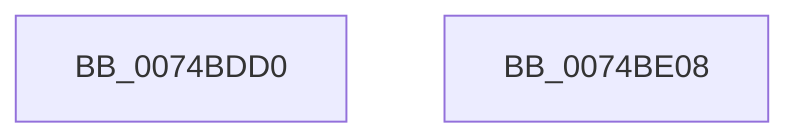

# NtCreatePort

- RVA: `0x0074BDD0`–`0x0074BE09` (길이 `57` bytes)
- VA: `0x000000014074BDD0`
- 실행 섹션: `PAGE`
- PDB 이름 있음: `예`; PDB Function 태그: `아니요`
- unwind 정보 RVA: `0x00064C80`
- 디코드: `16`개 명령, `57/57` bytes 표시
- 미해석 바이트: `0` (있으면 어셈블리에 `.byte`로 보존)

> 이 문서는 커널 이미지의 기계어와 PDB 기호를 분석해 생성했습니다. 4번과 5번은 함수 원형과 자료형을 바이너리 사용 방식에서 추정한 C 해석이며 원본 소스 복구 결과는 아닙니다.

## 1. Dependencies

- 직접 호출 지점: **2**; 고유 호출 대상: **2**
- 직접 호출자로 확인된 함수: **0**
- RIP 상대 이미지 참조: **0**

### Outgoing calls
- `0x0074BDF4` → [AlpcpCreateConnectionPort](../9E/AlpcpCreateConnectionPort_function_009E70B0.md) (function, `0x009E70B0`)
- `0x0074BDFB` → [KeLeaveCriticalRegion](../../text/25/KeLeaveCriticalRegion_function_0025D8B0.md) (function, `0x0025D8B0`)

### Direct callers
- 이 함수 시작 RVA로 연결되는 직접 call은 확인되지 않았습니다. 간접 호출은 완전히 역산할 수 없습니다.

### Static image references
- 디코드된 RIP-relative 메모리 참조가 없습니다.

## 2. Other-region calls and transfers

- 다른 실행 섹션으로 향하는 call: **1**
  - `0x0074BDFB` → [KeLeaveCriticalRegion](../../text/25/KeLeaveCriticalRegion_function_0025D8B0.md) (`PAGE` → `.text`)
- 별도 외부 분기/꼬리 이동을 확인하지 못했습니다.

## 3. Assembly (complete function range)

```asm
0074BDD0  40 53                           push rbx
0074BDD2  48 83 EC 30                     sub rsp, 0x30
0074BDD6  65 48 8B 04 25 88 01 00 00      mov rax, qword ptr gs:[0x188]
0074BDDF  45 33 C0                        xor r8d, r8d
0074BDE2  C6 44 24 28 01                  mov byte ptr [rsp + 0x28], 1
0074BDE7  C6 44 24 20 00                  mov byte ptr [rsp + 0x20], 0
0074BDEC  66 FF 88 E4 01 00 00            dec word ptr [rax + 0x1e4]
0074BDF3  90                              nop
0074BDF4  E8 B7 B2 29 00                  call 0x1409e70b0
0074BDF9  8B D8                           mov ebx, eax
0074BDFB  E8 B0 1A B1 FF                  call 0x14025d8b0
0074BE00  8B C3                           mov eax, ebx
0074BE02  48 83 C4 30                     add rsp, 0x30
0074BE06  5B                              pop rbx
0074BE07  C3                              ret
0074BE08  CC                              int3
```

## 4. C-style interpretation (structured pseudocode)

```c
__int64 __fastcall NtCreatePort(__int64 a1, __int64 a2, int a3)
{
    __int64 result;
    __int64 v_rsp;
    unsigned __int8 v_stack_m10;
    unsigned __int8 v_stack_m18;

    v_rsp = (v_rsp) - (48);
    a3 = 0;
    v_stack_m10 = 1;
    v_stack_m18 = 0;
    result = AlpcpCreateConnectionPort(a1, a2, a3, a4);
    result = KeLeaveCriticalRegion(a1, a2, a3, a4);
    v_rsp = (v_rsp) + (48);
    return (unsigned int)((unsigned int)((unsigned int)((unsigned int)(result))));
}
```

## 5. (Beta) C Style

```c
int64_t NtCreatePort(int64_t Arg1, int64_t Arg2, int32_t Arg3)
{
    int64_t result;
    int64_t local_rsp;
    uint8_t v_stack_m10;
    uint8_t v_stack_m18;

    local_rsp = (local_rsp) - (48);
    Arg3 = 0;
    v_stack_m10 = 1;
    v_stack_m18 = 0;
    result = AlpcpCreateConnectionPort(Arg1, Arg2, Arg3, a4);
    result = KeLeaveCriticalRegion(Arg1, Arg2, Arg3, a4);
    local_rsp = (local_rsp) + (48);
    return (uint32_t)((uint32_t)((uint32_t)((uint32_t)(result))));
}
```

## 6. Execution-region graph

[열기: 2D/3D 그래프와 함수 탐색 컨트롤 패널](../../../control-panel.html?section=page&rva=0x0074BDD0&view=graph)

- 2D 그래프는 위에서 아래로 흐르고, 3D 그래프는 빈 공간을 드래그해 회전합니다. Shift+드래그는 이동, 휠은 확대·축소, 함수 노드 선택은 대상 보고서 이동입니다.

### Static fallback


