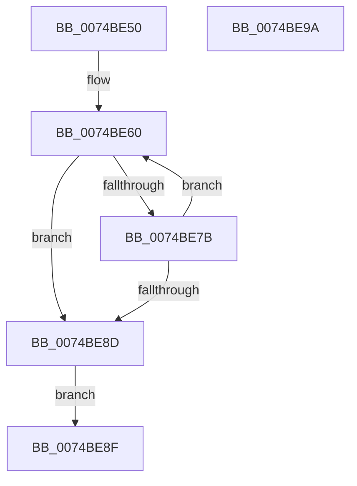

# NtListenPort

- RVA: `0x0074BE50`–`0x0074BE9B` (길이 `75` bytes)
- VA: `0x000000014074BE50`
- 실행 섹션: `PAGE`
- PDB 이름 있음: `예`; PDB Function 태그: `아니요`
- unwind 정보 RVA: `0x000CB66C`
- 디코드: `25`개 명령, `75/75` bytes 표시
- 미해석 바이트: `0` (있으면 어셈블리에 `.byte`로 보존)

> 이 문서는 커널 이미지의 기계어와 PDB 기호를 분석해 생성했습니다. 4번과 5번은 함수 원형과 자료형을 바이너리 사용 방식에서 추정한 C 해석이며 원본 소스 복구 결과는 아닙니다.

## 1. Dependencies

- 직접 호출 지점: **1**; 고유 호출 대상: **1**
- 직접 호출자로 확인된 함수: **0**
- RIP 상대 이미지 참조: **0**

### Outgoing calls
- `0x0074BE71` → [NtReplyWaitReceivePortEx](../89/NtReplyWaitReceivePortEx_function_00895850.md) (function, `0x00895850`)

### Direct callers
- 이 함수 시작 RVA로 연결되는 직접 call은 확인되지 않았습니다. 간접 호출은 완전히 역산할 수 없습니다.

### Static image references
- 디코드된 RIP-relative 메모리 참조가 없습니다.

## 2. Other-region calls and transfers

- 다른 실행 섹션으로 향하는 call: **0**
- 별도 외부 분기/꼬리 이동을 확인하지 못했습니다.

## 3. Assembly (complete function range)

```asm
0074BE50  48 89 5C 24 08                  mov qword ptr [rsp + 8], rbx
0074BE55  57                              push rdi
0074BE56  48 83 EC 30                     sub rsp, 0x30
0074BE5A  48 8B DA                        mov rbx, rdx
0074BE5D  48 8B F9                        mov rdi, rcx
0074BE60  48 83 64 24 20 00               and qword ptr [rsp + 0x20], 0
0074BE66  4C 8B CB                        mov r9, rbx
0074BE69  45 33 C0                        xor r8d, r8d
0074BE6C  33 D2                           xor edx, edx
0074BE6E  48 8B CF                        mov rcx, rdi
0074BE71  E8 DA 99 14 00                  call 0x140895850
0074BE76  90                              nop
0074BE77  85 C0                           test eax, eax
0074BE79  75 12                           jne 0x14074be8d
0074BE7B  0F B7 4B 04                     movzx ecx, word ptr [rbx + 4]
0074BE7F  BA FF 7F 00 00                  mov edx, 0x7fff
0074BE84  66 23 CA                        and cx, dx
0074BE87  66 83 F9 0A                     cmp cx, 0xa
0074BE8B  75 D3                           jne 0x14074be60
0074BE8D  EB 00                           jmp 0x14074be8f
0074BE8F  48 8B 5C 24 40                  mov rbx, qword ptr [rsp + 0x40]
0074BE94  48 83 C4 30                     add rsp, 0x30
0074BE98  5F                              pop rdi
0074BE99  C3                              ret
0074BE9A  CC                              int3
```

## 4. C-style interpretation (structured pseudocode)

```c
__int64 __fastcall NtListenPort(__int64 a1, __int64 a2, int a3)
{
    __int64 result;
    __int64 v_rsp;
    unsigned __int64 v_stack_m18;
    unsigned __int64 v_stack_p8;

    v_stack_p8 = v_rbx;
    v_rsp = (v_rsp) - (48);
loc_0074BE60:
    a3 = 0;
    a2 = 0;
    result = NtReplyWaitReceivePortEx(a1, a2, a3, a2);
    if ((unsigned int)(result) != 0) goto loc_0074BE8D;
    a1 = (unsigned __int16)((*(unsigned __int16 *)(a2 + 4)) & ((unsigned __int16)((unsigned int)(0x7FFFULL))));
    if (((unsigned __int16)(a1)) != 10) goto loc_0074BE60;
loc_0074BE8D:
    goto loc_0074BE8F;
loc_0074BE8F:
    v_rsp = (v_rsp) + (48);
    return result;
}
```

## 5. (Beta) C Style

```c
int64_t NtListenPort(int64_t Arg1, void *Arg2, int32_t Arg3)
{
    uint8_t *arg2 = (uint8_t *)Arg2;

    int64_t result;
    int64_t local_rsp;
    uint64_t v_stack_m18;
    uint64_t v_stack_p8;

    v_stack_p8 = local_rbx;
    local_rsp = (local_rsp) - (48);
loc_0074BE60:
    Arg3 = 0;
    Arg2 = 0;
    result = NtReplyWaitReceivePortEx(Arg1, Arg2, Arg3, Arg2);
    if ((uint32_t)(result) != 0) goto loc_0074BE8D;
    Arg1 = (uint16_t)((*(uint16_t *)(arg2 + 0x4)) & ((uint16_t)((uint32_t)(0x7FFFULL))));
    if (((uint16_t)(Arg1)) != 10) goto loc_0074BE60;
loc_0074BE8D:
    goto loc_0074BE8F;
loc_0074BE8F:
    local_rsp = (local_rsp) + (48);
    return result;
}
```

### 관측된 메모리 오프셋

구조체 형식이 확인되지 않은 접근은 인자 기준의 오프셋으로만 기록했습니다.

| 기준 인자 | 오프셋 표현 | 폭 (bit) | 접근 |
|---|---:|---:|---|
| `Arg2` | `+ 0x4` | `16` | `R` |

## 6. Execution-region graph

[열기: 2D/3D 그래프와 함수 탐색 컨트롤 패널](../../../control-panel.html?section=page&rva=0x0074BE50&view=graph)

- 2D 그래프는 위에서 아래로 흐르고, 3D 그래프는 빈 공간을 드래그해 회전합니다. Shift+드래그는 이동, 휠은 확대·축소, 함수 노드 선택은 대상 보고서 이동입니다.

### Static fallback


