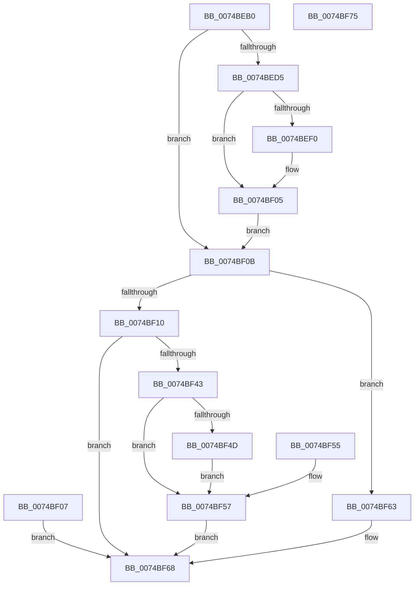

# NtQueryInformationPort

- RVA: `0x0074BEB0`–`0x0074BF76` (길이 `198` bytes)
- VA: `0x000000014074BEB0`
- 실행 섹션: `PAGE`
- PDB 이름 있음: `예`; PDB Function 태그: `아니요`
- unwind 정보 RVA: `0x000CB608`
- 디코드: `54`개 명령, `198/198` bytes 표시
- 미해석 바이트: `0` (있으면 어셈블리에 `.byte`로 보존)

> 이 문서는 커널 이미지의 기계어와 PDB 기호를 분석해 생성했습니다. 4번과 5번은 함수 원형과 자료형을 바이너리 사용 방식에서 추정한 C 해석이며 원본 소스 복구 결과는 아닙니다.

## 1. Dependencies

- 직접 호출 지점: **3**; 고유 호출 대상: **3**
- 직접 호출자로 확인된 함수: **0**
- RIP 상대 이미지 참조: **1**

### Outgoing calls
- `0x0074BEE1` → [ProbeForWrite](../8E/ProbeForWrite_function_008E91C0.md) (function, `0x008E91C0`)
- `0x0074BF38` → [ObReferenceObjectByHandle](../86/ObReferenceObjectByHandle_function_00868DB0.md) (function, `0x00868DB0`)
- `0x0074BF5C` → [ObfDereferenceObject](../../text/2F/ObfDereferenceObject_function_002F9350.md) (function, `0x002F9350`)

### Direct callers
- 이 함수 시작 RVA로 연결되는 직접 call은 확인되지 않았습니다. 간접 호출은 완전히 역산할 수 없습니다.

### Static image references
- `0x0074BF10` → RVA `0x00FC6C18` (`ALMOSTRO`; read)

## 2. Other-region calls and transfers

- 다른 실행 섹션으로 향하는 call: **1**
  - `0x0074BF5C` → [ObfDereferenceObject](../../text/2F/ObfDereferenceObject_function_002F9350.md) (`PAGE` → `.text`)
- 별도 외부 분기/꼬리 이동을 확인하지 못했습니다.

## 3. Assembly (complete function range)

```asm
0074BEB0  48 89 5C 24 08                  mov qword ptr [rsp + 8], rbx
0074BEB5  57                              push rdi
0074BEB6  48 83 EC 40                     sub rsp, 0x40
0074BEBA  4D 8B D0                        mov r10, r8
0074BEBD  48 8B D9                        mov rbx, rcx
0074BEC0  65 48 8B 04 25 88 01 00 00      mov rax, qword ptr gs:[0x188]
0074BEC9  40 8A B8 32 02 00 00            mov dil, byte ptr [rax + 0x232]
0074BED0  40 84 FF                        test dil, dil
0074BED3  74 36                           je 0x14074bf0b
0074BED5  41 8B D1                        mov edx, r9d
0074BED8  41 B8 04 00 00 00               mov r8d, 4
0074BEDE  49 8B CA                        mov rcx, r10
0074BEE1  E8 DA D2 19 00                  call 0x1408e91c0
0074BEE6  48 8B 44 24 70                  mov rax, qword ptr [rsp + 0x70]
0074BEEB  48 85 C0                        test rax, rax
0074BEEE  74 15                           je 0x14074bf05
0074BEF0  48 B9 00 00 FF FF FF 7F 00 00   movabs rcx, 0x7fffffff0000
0074BEFA  48 3B C1                        cmp rax, rcx
0074BEFD  48 0F 42 C8                     cmovb rcx, rax
0074BF01  8B 01                           mov eax, dword ptr [rcx]
0074BF03  89 01                           mov dword ptr [rcx], eax
0074BF05  EB 04                           jmp 0x14074bf0b
0074BF07  8B D8                           mov ebx, eax
0074BF09  EB 5D                           jmp 0x14074bf68
0074BF0B  48 85 DB                        test rbx, rbx
0074BF0E  74 53                           je 0x14074bf63
0074BF10  4C 8B 05 01 AD 87 00            mov r8, qword ptr [rip + 0x87ad01]
0074BF17  48 83 64 24 30 00               and qword ptr [rsp + 0x30], 0
0074BF1D  48 83 64 24 28 00               and qword ptr [rsp + 0x28], 0
0074BF23  48 8D 44 24 30                  lea rax, [rsp + 0x30]
0074BF28  48 89 44 24 20                  mov qword ptr [rsp + 0x20], rax
0074BF2D  44 8A CF                        mov r9b, dil
0074BF30  BA 00 00 02 00                  mov edx, 0x20000
0074BF35  48 8B CB                        mov rcx, rbx
0074BF38  E8 73 CE 11 00                  call 0x140868db0
0074BF3D  8B D8                           mov ebx, eax
0074BF3F  85 C0                           test eax, eax
0074BF41  78 25                           js 0x14074bf68
0074BF43  48 8B 44 24 70                  mov rax, qword ptr [rsp + 0x70]
0074BF48  48 85 C0                        test rax, rax
0074BF4B  74 0A                           je 0x14074bf57
0074BF4D  C7 00 00 00 00 00               mov dword ptr [rax], 0
0074BF53  EB 02                           jmp 0x14074bf57
0074BF55  8B D8                           mov ebx, eax
0074BF57  48 8B 4C 24 30                  mov rcx, qword ptr [rsp + 0x30]
0074BF5C  E8 EF D3 BA FF                  call 0x1402f9350
0074BF61  EB 05                           jmp 0x14074bf68
0074BF63  BB 03 00 00 C0                  mov ebx, 0xc0000003
0074BF68  8B C3                           mov eax, ebx
0074BF6A  48 8B 5C 24 50                  mov rbx, qword ptr [rsp + 0x50]
0074BF6F  48 83 C4 40                     add rsp, 0x40
0074BF73  5F                              pop rdi
0074BF74  C3                              ret
0074BF75  CC                              int3
```

## 4. C-style interpretation (structured pseudocode)

```c
__int64 __fastcall NtQueryInformationPort(__int64 a1, __int64 a2, __int64 a3, int a4, __int64 a5)
{
    __int64 result;
    __int64 v_rsp;
    unsigned __int64 v_stack_m18;
    unsigned __int64 v_stack_m20;
    unsigned __int64 v_stack_m28;
    unsigned __int64 v_stack_p8;

    v_stack_p8 = v_rbx;
    v_rsp = (v_rsp) - (64);
    if ((unsigned __int8)(*(unsigned __int8 *)(*(unsigned __int64 *)(gs_base + (0 + 392)) + 562)) == 0) goto loc_0074BF0B;
    result = ProbeForWrite(a3, (unsigned int)(a4), 4, a4);
    result = a5;
    if (a5 != 0) {
        if (a5 < a3) { a3 = a5; }
        result = *(unsigned int *)(a3);
        *(unsigned int *)(a3) = (unsigned int)(result);
    }
    goto loc_0074BF0B;
loc_0074BF0B:
    if (a1 == 0) goto loc_0074BF63;
    v_stack_m28 = v_stack_m18;
    result = ObReferenceObjectByHandle(a1, (unsigned int)(0x20000ULL), *(unsigned __int64 *)(v_rip + 8891649), (unsigned __int8)(*(unsigned __int8 *)(*(unsigned __int64 *)(gs_base + (0 + 392)) + 562)));
    if (sign_flag) goto loc_0074BF68;
    if (a5 == 0) goto loc_0074BF57;
    *(unsigned int *)(a5) = 0;
    goto loc_0074BF57;
loc_0074BF57:
    result = ObfDereferenceObject(v_stack_m18, (unsigned int)(0x20000ULL), *(unsigned __int64 *)(v_rip + 8891649), (unsigned __int8)(*(unsigned __int8 *)(*(unsigned __int64 *)(gs_base + (0 + 392)) + 562)));
    goto loc_0074BF68;
loc_0074BF63:
loc_0074BF68:
    v_rsp = (v_rsp) + (64);
    return (unsigned int)((unsigned int)((unsigned int)(0xC0000003ULL)));
}
```

## 5. (Beta) C Style

```c
int64_t NtQueryInformationPort(int64_t Arg1, int64_t Arg2, int64_t Arg3, int32_t Arg4, int64_t Arg5)
{
    int64_t result;
    int64_t local_rsp;
    uint64_t v_stack_m18;
    uint64_t v_stack_m20;
    uint64_t v_stack_m28;
    uint64_t v_stack_p8;

    v_stack_p8 = local_rbx;
    local_rsp = (local_rsp) - (64);
    if ((uint8_t)(*(uint8_t *)(*(uint64_t *)(gs_base + (0 + 0x188)) + 0x232)) == 0) goto loc_0074BF0B;
    result = ProbeForWrite(Arg3, (uint32_t)(Arg4), 4, Arg4);
    result = Arg5;
    if (Arg5 != 0) {
        if (Arg5 < Arg3) { Arg3 = Arg5; }
        result = *(uint32_t *)(Arg3);
        *(uint32_t *)(Arg3) = (uint32_t)(result);
    }
    goto loc_0074BF0B;
loc_0074BF0B:
    if (Arg1 == 0) goto loc_0074BF63;
    v_stack_m28 = v_stack_m18;
    result = ObReferenceObjectByHandle(Arg1, (uint32_t)(0x20000ULL), *(uint64_t *)(v_rip + 0x87AD01), (uint8_t)(*(uint8_t *)(*(uint64_t *)(gs_base + (0 + 0x188)) + 0x232)));
    if (sign_flag) goto loc_0074BF68;
    if (Arg5 == 0) goto loc_0074BF57;
    *(uint32_t *)(Arg5) = 0;
    goto loc_0074BF57;
loc_0074BF57:
    result = ObfDereferenceObject(v_stack_m18, (uint32_t)(0x20000ULL), *(uint64_t *)(v_rip + 0x87AD01), (uint8_t)(*(uint8_t *)(*(uint64_t *)(gs_base + (0 + 0x188)) + 0x232)));
    goto loc_0074BF68;
loc_0074BF63:
loc_0074BF68:
    local_rsp = (local_rsp) + (64);
    return (uint32_t)((uint32_t)((uint32_t)(0xC0000003ULL)));
}
```

## 6. Execution-region graph

[열기: 2D/3D 그래프와 함수 탐색 컨트롤 패널](../../../control-panel.html?section=page&rva=0x0074BEB0&view=graph)

- 2D 그래프는 위에서 아래로 흐르고, 3D 그래프는 빈 공간을 드래그해 회전합니다. Shift+드래그는 이동, 휠은 확대·축소, 함수 노드 선택은 대상 보고서 이동입니다.

### Static fallback


