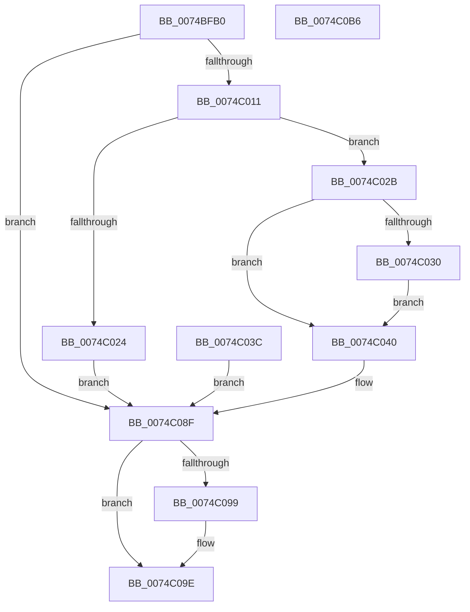

# NtReplyWaitReplyPort

- RVA: `0x0074BFB0`–`0x0074C0B7` (길이 `263` bytes)
- VA: `0x000000014074BFB0`
- 실행 섹션: `PAGE`
- PDB 이름 있음: `예`; PDB Function 태그: `아니요`
- unwind 정보 RVA: `0x000CB640`
- 디코드: `66`개 명령, `263/263` bytes 표시
- 미해석 바이트: `0` (있으면 어셈블리에 `.byte`로 보존)

> 이 문서는 커널 이미지의 기계어와 PDB 기호를 분석해 생성했습니다. 4번과 5번은 함수 원형과 자료형을 바이너리 사용 방식에서 추정한 C 해석이며 원본 소스 복구 결과는 아닙니다.

## 1. Dependencies

- 직접 호출 지점: **5**; 고유 호출 대상: **5**
- 직접 호출자로 확인된 함수: **0**
- RIP 상대 이미지 참조: **1**

### Outgoing calls
- `0x0074C006` → [ObReferenceObjectByHandle](../86/ObReferenceObjectByHandle_function_00868DB0.md) (function, `0x00868DB0`)
- `0x0074C035` → [AlpcpProbeForWriteMessageHeader](../89/AlpcpProbeForWriteMessageHeader_function_00898660.md) (function, `0x00898660`)
- `0x0074C06C` → [AlpcpProcessSynchronousRequest](../92/AlpcpProcessSynchronousRequest_function_00921FCC.md) (function, `0x00921FCC`)
- `0x0074C099` → [ObfDereferenceObject](../../text/2F/ObfDereferenceObject_function_002F9350.md) (function, `0x002F9350`)
- `0x0074C09E` → [KeLeaveCriticalRegion](../../text/25/KeLeaveCriticalRegion_function_0025D8B0.md) (function, `0x0025D8B0`)

### Direct callers
- 이 함수 시작 RVA로 연결되는 직접 call은 확인되지 않았습니다. 간접 호출은 완전히 역산할 수 없습니다.

### Static image references
- `0x0074BFE5` → RVA `0x00FC6C18` (`ALMOSTRO`; read)

## 2. Other-region calls and transfers

- 다른 실행 섹션으로 향하는 call: **2**
  - `0x0074C099` → [ObfDereferenceObject](../../text/2F/ObfDereferenceObject_function_002F9350.md) (`PAGE` → `.text`)
  - `0x0074C09E` → [KeLeaveCriticalRegion](../../text/25/KeLeaveCriticalRegion_function_0025D8B0.md) (`PAGE` → `.text`)
- 별도 외부 분기/꼬리 이동을 확인하지 못했습니다.

## 3. Assembly (complete function range)

```asm
0074BFB0  4C 8B DC                        mov r11, rsp
0074BFB3  49 89 5B 08                     mov qword ptr [r11 + 8], rbx
0074BFB7  49 89 73 10                     mov qword ptr [r11 + 0x10], rsi
0074BFBB  41 56                           push r14
0074BFBD  48 83 EC 50                     sub rsp, 0x50
0074BFC1  48 8B F2                        mov rsi, rdx
0074BFC4  65 48 8B 04 25 88 01 00 00      mov rax, qword ptr gs:[0x188]
0074BFCD  66 FF 88 E4 01 00 00            dec word ptr [rax + 0x1e4]
0074BFD4  90                              nop
0074BFD5  65 48 8B 04 25 88 01 00 00      mov rax, qword ptr gs:[0x188]
0074BFDE  44 8A B0 32 02 00 00            mov r14b, byte ptr [rax + 0x232]
0074BFE5  4C 8B 05 2C AC 87 00            mov r8, qword ptr [rip + 0x87ac2c]
0074BFEC  49 83 63 18 00                  and qword ptr [r11 + 0x18], 0
0074BFF1  49 83 63 D0 00                  and qword ptr [r11 - 0x30], 0
0074BFF6  49 8D 43 18                     lea rax, [r11 + 0x18]
0074BFFA  49 89 43 C8                     mov qword ptr [r11 - 0x38], rax
0074BFFE  45 8A CE                        mov r9b, r14b
0074C001  BA 01 00 00 00                  mov edx, 1
0074C006  E8 A5 CD 11 00                  call 0x140868db0
0074C00B  8B D8                           mov ebx, eax
0074C00D  85 C0                           test eax, eax
0074C00F  78 7E                           js 0x14074c08f
0074C011  48 8B 44 24 70                  mov rax, qword ptr [rsp + 0x70]
0074C016  8B 88 A0 01 00 00               mov ecx, dword ptr [rax + 0x1a0]
0074C01C  80 E1 06                        and cl, 6
0074C01F  80 F9 02                        cmp cl, 2
0074C022  75 07                           jne 0x14074c02b
0074C024  BB 0D 00 00 C0                  mov ebx, 0xc000000d
0074C029  EB 64                           jmp 0x14074c08f
0074C02B  45 84 F6                        test r14b, r14b
0074C02E  74 10                           je 0x14074c040
0074C030  33 D2                           xor edx, edx
0074C032  48 8B CE                        mov rcx, rsi
0074C035  E8 26 C6 14 00                  call 0x140898660
0074C03A  EB 04                           jmp 0x14074c040
0074C03C  8B D8                           mov ebx, eax
0074C03E  EB 4F                           jmp 0x14074c08f
0074C040  44 88 74 24 40                  mov byte ptr [rsp + 0x40], r14b
0074C045  48 83 64 24 38 00               and qword ptr [rsp + 0x38], 0
0074C04B  48 83 64 24 30 00               and qword ptr [rsp + 0x30], 0
0074C051  48 83 64 24 28 00               and qword ptr [rsp + 0x28], 0
0074C057  48 89 74 24 20                  mov qword ptr [rsp + 0x20], rsi
0074C05C  45 33 C9                        xor r9d, r9d
0074C05F  4C 8B C6                        mov r8, rsi
0074C062  BA 01 00 02 00                  mov edx, 0x20001
0074C067  48 8B 4C 24 70                  mov rcx, qword ptr [rsp + 0x70]
0074C06C  E8 5B 5F 1D 00                  call 0x140921fcc
0074C071  8B D8                           mov ebx, eax
0074C073  B8 37 00 00 C0                  mov eax, 0xc0000037
0074C078  81 FB 03 07 00 C0               cmp ebx, 0xc0000703
0074C07E  0F 44 D8                        cmove ebx, eax
0074C081  B8 53 02 00 C0                  mov eax, 0xc0000253
0074C086  81 FB 01 07 00 C0               cmp ebx, 0xc0000701
0074C08C  0F 44 D8                        cmove ebx, eax
0074C08F  48 8B 4C 24 70                  mov rcx, qword ptr [rsp + 0x70]
0074C094  48 85 C9                        test rcx, rcx
0074C097  74 05                           je 0x14074c09e
0074C099  E8 B2 D2 BA FF                  call 0x1402f9350
0074C09E  E8 0D 18 B1 FF                  call 0x14025d8b0
0074C0A3  8B C3                           mov eax, ebx
0074C0A5  48 8B 5C 24 60                  mov rbx, qword ptr [rsp + 0x60]
0074C0AA  48 8B 74 24 68                  mov rsi, qword ptr [rsp + 0x68]
0074C0AF  48 83 C4 50                     add rsp, 0x50
0074C0B3  41 5E                           pop r14
0074C0B5  C3                              ret
0074C0B6  CC                              int3
```

## 4. C-style interpretation (structured pseudocode)

```c
__int64 __fastcall NtReplyWaitReplyPort(__int64 a1, __int64 a2)
{
    __int64 result;
    __int64 v_rbx;
    __int64 v_rsp;
    unsigned __int8 v_stack_m18;
    unsigned __int64 v_stack_m20;
    unsigned __int64 v_stack_m28;
    unsigned __int64 v_stack_m30;
    unsigned __int64 v_stack_m38;
    unsigned __int64 v_stack_p10;
    unsigned __int64 v_stack_p18;
    unsigned __int64 v_stack_p8;

    *(unsigned __int64 *)(v_rsp + 8) = v_rbx;
    *(unsigned __int64 *)(v_rsp + 16) = v_rsi;
    v_rsp = (v_rsp) - (80);
    *(unsigned __int64 *)(v_rsp - 56) = v_rsp + 24;
    result = ObReferenceObjectByHandle(a1, 1, *(unsigned __int64 *)(v_rip + 8891436), (unsigned __int8)(*(unsigned __int8 *)(*(unsigned __int64 *)(gs_base + (0 + 392)) + 562)));
    if (sign_flag) goto loc_0074C08F;
    a1 = (unsigned __int8)(((unsigned int)(*(unsigned int *)(v_stack_p18 + 416))) & (6));
    if (((unsigned __int8)(a1)) != 2) goto loc_0074C02B;
    goto loc_0074C08F;
loc_0074C02B:
    if ((unsigned __int8)(*(unsigned __int8 *)(*(unsigned __int64 *)(gs_base + (0 + 392)) + 562)) == 0) goto loc_0074C040;
    a2 = 0;
    result = AlpcpProbeForWriteMessageHeader(0, a2, *(unsigned __int64 *)(v_rip + 8891436), (unsigned __int8)(*(unsigned __int8 *)(*(unsigned __int64 *)(gs_base + (0 + 392)) + 562)));
    goto loc_0074C040;
loc_0074C040:
    v_stack_m18 = (unsigned __int8)(*(unsigned __int8 *)(*(unsigned __int64 *)(gs_base + (0 + 392)) + 562));
    v_stack_m38 = 0;
    a4 = 0;
    result = AlpcpProcessSynchronousRequest(v_stack_p18, (unsigned int)(0x20001ULL), 0, a4);
    v_rbx = (unsigned int)((unsigned int)(result));
    if (((unsigned int)((unsigned int)((unsigned int)(result)))) == 0xC0000703ULL) { v_rbx = (unsigned int)((unsigned int)(0xC0000037ULL)); }
    if (((unsigned int)(v_rbx)) == 0xC0000701ULL) { v_rbx = (unsigned int)((unsigned int)(0xC0000253ULL)); }
loc_0074C08F:
    result = (unsigned int)(0xC0000253ULL);
    if (v_stack_p18 != 0) {
        result = ObfDereferenceObject(v_stack_p18, (unsigned int)(0x20001ULL), 0, a4);
    }
    result = KeLeaveCriticalRegion(v_stack_p18, (unsigned int)(0x20001ULL), 0, a4);
    v_rsp = (v_rsp) + (80);
    return (unsigned int)((unsigned int)(v_rbx));
}
```

## 5. (Beta) C Style

```c
int64_t NtReplyWaitReplyPort(int64_t Arg1, int64_t Arg2)
{
    int64_t result;
    int64_t local_rbx;
    int64_t local_rsp;
    uint8_t v_stack_m18;
    uint64_t v_stack_m20;
    uint64_t v_stack_m28;
    uint64_t v_stack_m30;
    uint64_t v_stack_m38;
    uint64_t v_stack_p10;
    uint64_t v_stack_p18;
    uint64_t v_stack_p8;

    *(uint64_t *)(local_rsp + 0x8) = local_rbx;
    *(uint64_t *)(local_rsp + 0x10) = local_rsi;
    local_rsp = (local_rsp) - (80);
    *(uint64_t *)(local_rsp - 0x38) = local_rsp + 24;
    result = ObReferenceObjectByHandle(Arg1, 1, *(uint64_t *)(v_rip + 0x87AC2C), (uint8_t)(*(uint8_t *)(*(uint64_t *)(gs_base + (0 + 0x188)) + 0x232)));
    if (sign_flag) goto loc_0074C08F;
    Arg1 = (uint8_t)(((uint32_t)(*(uint32_t *)(v_stack_p18 + 0x1A0))) & (6));
    if (((uint8_t)(Arg1)) != 2) goto loc_0074C02B;
    goto loc_0074C08F;
loc_0074C02B:
    if ((uint8_t)(*(uint8_t *)(*(uint64_t *)(gs_base + (0 + 0x188)) + 0x232)) == 0) goto loc_0074C040;
    Arg2 = 0;
    result = AlpcpProbeForWriteMessageHeader(0, Arg2, *(uint64_t *)(v_rip + 0x87AC2C), (uint8_t)(*(uint8_t *)(*(uint64_t *)(gs_base + (0 + 0x188)) + 0x232)));
    goto loc_0074C040;
loc_0074C040:
    v_stack_m18 = (uint8_t)(*(uint8_t *)(*(uint64_t *)(gs_base + (0 + 0x188)) + 0x232));
    v_stack_m38 = 0;
    a4 = 0;
    result = AlpcpProcessSynchronousRequest(v_stack_p18, (uint32_t)(0x20001ULL), 0, a4);
    local_rbx = (uint32_t)((uint32_t)(result));
    if (((uint32_t)((uint32_t)((uint32_t)(result)))) == 0xC0000703ULL) { local_rbx = (uint32_t)((uint32_t)(0xC0000037ULL)); }
    if (((uint32_t)(local_rbx)) == 0xC0000701ULL) { local_rbx = (uint32_t)((uint32_t)(0xC0000253ULL)); }
loc_0074C08F:
    result = (uint32_t)(0xC0000253ULL);
    if (v_stack_p18 != 0) {
        result = ObfDereferenceObject(v_stack_p18, (uint32_t)(0x20001ULL), 0, a4);
    }
    result = KeLeaveCriticalRegion(v_stack_p18, (uint32_t)(0x20001ULL), 0, a4);
    local_rsp = (local_rsp) + (80);
    return (uint32_t)((uint32_t)(local_rbx));
}
```

## 6. Execution-region graph

[열기: 2D/3D 그래프와 함수 탐색 컨트롤 패널](../../../control-panel.html?section=page&rva=0x0074BFB0&view=graph)

- 2D 그래프는 위에서 아래로 흐르고, 3D 그래프는 빈 공간을 드래그해 회전합니다. Shift+드래그는 이동, 휠은 확대·축소, 함수 노드 선택은 대상 보고서 이동입니다.

### Static fallback


