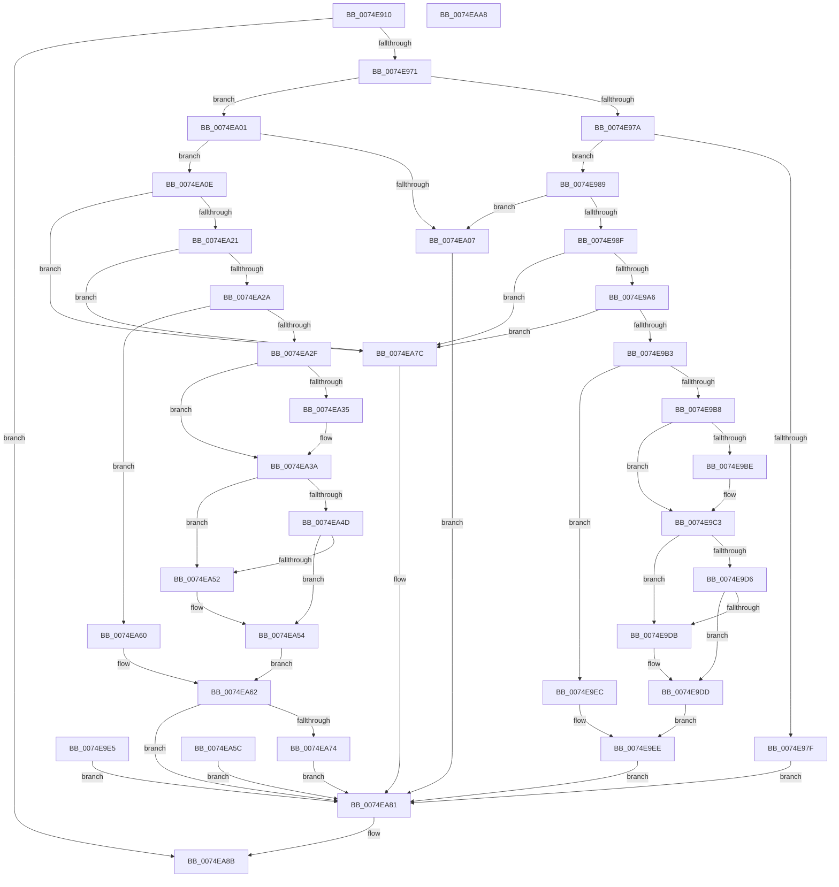

# NtSetInformationSymbolicLink

- RVA: `0x0074E910`–`0x0074EAA9` (길이 `409` bytes)
- VA: `0x000000014074E910`
- 실행 섹션: `PAGE`
- PDB 이름 있음: `예`; PDB Function 태그: `아니요`
- unwind 정보 RVA: `0x000CB7B8`
- 디코드: `113`개 명령, `409/409` bytes 표시
- 미해석 바이트: `0` (있으면 어셈블리에 `.byte`로 보존)

> 이 문서는 커널 이미지의 기계어와 PDB 기호를 분석해 생성했습니다. 4번과 5번은 함수 원형과 자료형을 바이너리 사용 방식에서 추정한 C 해석이며 원본 소스 복구 결과는 아닙니다.

## 1. Dependencies

- 직접 호출 지점: **8**; 고유 호출 대상: **5**
- 직접 호출자로 확인된 함수: **0**
- RIP 상대 이미지 참조: **2**

### Outgoing calls
- `0x0074E962` → [ObReferenceObjectByHandle](../86/ObReferenceObjectByHandle_function_00868DB0.md) (function, `0x00868DB0`)
- `0x0074E999` → [SeSinglePrivilegeCheck](../87/SeSinglePrivilegeCheck_function_00871E20.md) (function, `0x00871E20`)
- `0x0074E9A6` → [PsIsCurrentThreadInServerSilo](../../text/43/PsIsCurrentThreadInServerSilo_function_004362E0.md) (function, `0x004362E0`)
- `0x0074E9BE` → [ExRaiseDatatypeMisalignment](../89/ExRaiseDatatypeMisalignment_function_00899FD0.md) (function, `0x00899FD0`)
- `0x0074EA18` → [SeSinglePrivilegeCheck](../87/SeSinglePrivilegeCheck_function_00871E20.md) (function, `0x00871E20`)
- `0x0074EA21` → [PsIsCurrentThreadInServerSilo](../../text/43/PsIsCurrentThreadInServerSilo_function_004362E0.md) (function, `0x004362E0`)
- `0x0074EA35` → [ExRaiseDatatypeMisalignment](../89/ExRaiseDatatypeMisalignment_function_00899FD0.md) (function, `0x00899FD0`)
- `0x0074EA86` → [ObfDereferenceObject](../../text/2F/ObfDereferenceObject_function_002F9350.md) (function, `0x002F9350`)

### Direct callers
- 이 함수 시작 RVA로 연결되는 직접 call은 확인되지 않았습니다. 간접 호출은 완전히 역산할 수 없습니다.

### Static image references
- `0x0074E941` → RVA `0x00F0F658` (`.data`; read)
- `0x0074E992` → RVA `0x00FD9A78` (`PAGEDATA`; read)

## 2. Other-region calls and transfers

- 다른 실행 섹션으로 향하는 call: **3**
  - `0x0074E9A6` → [PsIsCurrentThreadInServerSilo](../../text/43/PsIsCurrentThreadInServerSilo_function_004362E0.md) (`PAGE` → `.text`)
  - `0x0074EA21` → [PsIsCurrentThreadInServerSilo](../../text/43/PsIsCurrentThreadInServerSilo_function_004362E0.md) (`PAGE` → `.text`)
  - `0x0074EA86` → [ObfDereferenceObject](../../text/2F/ObfDereferenceObject_function_002F9350.md) (`PAGE` → `.text`)
- 별도 외부 분기/꼬리 이동을 확인하지 못했습니다.

## 3. Assembly (complete function range)

```asm
0074E910  4C 8B DC                        mov r11, rsp
0074E913  49 89 5B 08                     mov qword ptr [r11 + 8], rbx
0074E917  49 89 73 10                     mov qword ptr [r11 + 0x10], rsi
0074E91B  49 89 7B 18                     mov qword ptr [r11 + 0x18], rdi
0074E91F  4D 89 73 20                     mov qword ptr [r11 + 0x20], r14
0074E923  41 57                           push r15
0074E925  48 83 EC 40                     sub rsp, 0x40
0074E929  45 8B F9                        mov r15d, r9d
0074E92C  49 8B F8                        mov rdi, r8
0074E92F  8B F2                           mov esi, edx
0074E931  65 48 8B 04 25 88 01 00 00      mov rax, qword ptr gs:[0x188]
0074E93A  44 8A B0 32 02 00 00            mov r14b, byte ptr [rax + 0x232]
0074E941  4C 8B 05 10 0D 7C 00            mov r8, qword ptr [rip + 0x7c0d10]
0074E948  49 83 63 F0 00                  and qword ptr [r11 - 0x10], 0
0074E94D  49 83 63 E0 00                  and qword ptr [r11 - 0x20], 0
0074E952  49 8D 43 F0                     lea rax, [r11 - 0x10]
0074E956  49 89 43 D8                     mov qword ptr [r11 - 0x28], rax
0074E95A  45 8A CE                        mov r9b, r14b
0074E95D  BA 02 00 00 00                  mov edx, 2
0074E962  E8 49 A4 11 00                  call 0x140868db0
0074E967  8B D8                           mov ebx, eax
0074E969  85 C0                           test eax, eax
0074E96B  0F 88 1A 01 00 00               js 0x14074ea8b
0074E971  83 EE 01                        sub esi, 1
0074E974  0F 84 87 00 00 00               je 0x14074ea01
0074E97A  83 FE 01                        cmp esi, 1
0074E97D  74 0A                           je 0x14074e989
0074E97F  BB 03 00 00 C0                  mov ebx, 0xc0000003
0074E984  E9 F8 00 00 00                  jmp 0x14074ea81
0074E989  41 83 FF 04                     cmp r15d, 4
0074E98D  75 78                           jne 0x14074ea07
0074E98F  41 8A D6                        mov dl, r14b
0074E992  48 8B 0D DF B0 88 00            mov rcx, qword ptr [rip + 0x88b0df]
0074E999  E8 82 34 12 00                  call 0x140871e20
0074E99E  84 C0                           test al, al
0074E9A0  0F 84 D6 00 00 00               je 0x14074ea7c
0074E9A6  E8 35 79 CE FF                  call 0x1404362e0
0074E9AB  84 C0                           test al, al
0074E9AD  0F 85 C9 00 00 00               jne 0x14074ea7c
0074E9B3  45 84 F6                        test r14b, r14b
0074E9B6  74 34                           je 0x14074e9ec
0074E9B8  40 F6 C7 03                     test dil, 3
0074E9BC  74 05                           je 0x14074e9c3
0074E9BE  E8 0D B6 14 00                  call 0x140899fd0
0074E9C3  48 8D 4F 04                     lea rcx, [rdi + 4]
0074E9C7  48 B8 00 00 FF FF FF 7F 00 00   movabs rax, 0x7fffffff0000
0074E9D1  48 3B C8                        cmp rcx, rax
0074E9D4  77 05                           ja 0x14074e9db
0074E9D6  48 3B CF                        cmp rcx, rdi
0074E9D9  73 02                           jae 0x14074e9dd
0074E9DB  8A 00                           mov al, byte ptr [rax]
0074E9DD  8B 0F                           mov ecx, dword ptr [rdi]
0074E9DF  89 4C 24 30                     mov dword ptr [rsp + 0x30], ecx
0074E9E3  EB 09                           jmp 0x14074e9ee
0074E9E5  8B D8                           mov ebx, eax
0074E9E7  E9 95 00 00 00                  jmp 0x14074ea81
0074E9EC  8B 0F                           mov ecx, dword ptr [rdi]
0074E9EE  48 8B 44 24 38                  mov rax, qword ptr [rsp + 0x38]
0074E9F3  83 48 1C 08                     or dword ptr [rax + 0x1c], 8
0074E9F7  89 48 20                        mov dword ptr [rax + 0x20], ecx
0074E9FA  33 DB                           xor ebx, ebx
0074E9FC  E9 80 00 00 00                  jmp 0x14074ea81
0074EA01  41 83 FF 04                     cmp r15d, 4
0074EA05  74 07                           je 0x14074ea0e
0074EA07  BB 04 00 00 C0                  mov ebx, 0xc0000004
0074EA0C  EB 73                           jmp 0x14074ea81
0074EA0E  41 8A D6                        mov dl, r14b
0074EA11  48 8B 0D 60 B0 88 00            mov rcx, qword ptr [rip + 0x88b060]
0074EA18  E8 03 34 12 00                  call 0x140871e20
0074EA1D  84 C0                           test al, al
0074EA1F  74 5B                           je 0x14074ea7c
0074EA21  E8 BA 78 CE FF                  call 0x1404362e0
0074EA26  84 C0                           test al, al
0074EA28  75 52                           jne 0x14074ea7c
0074EA2A  45 84 F6                        test r14b, r14b
0074EA2D  74 31                           je 0x14074ea60
0074EA2F  40 F6 C7 03                     test dil, 3
0074EA33  74 05                           je 0x14074ea3a
0074EA35  E8 96 B5 14 00                  call 0x140899fd0
0074EA3A  48 8D 4F 04                     lea rcx, [rdi + 4]
0074EA3E  48 B8 00 00 FF FF FF 7F 00 00   movabs rax, 0x7fffffff0000
0074EA48  48 3B C8                        cmp rcx, rax
0074EA4B  77 05                           ja 0x14074ea52
0074EA4D  48 3B CF                        cmp rcx, rdi
0074EA50  73 02                           jae 0x14074ea54
0074EA52  8A 00                           mov al, byte ptr [rax]
0074EA54  8B 0F                           mov ecx, dword ptr [rdi]
0074EA56  89 4C 24 34                     mov dword ptr [rsp + 0x34], ecx
0074EA5A  EB 06                           jmp 0x14074ea62
0074EA5C  8B D8                           mov ebx, eax
0074EA5E  EB 21                           jmp 0x14074ea81
0074EA60  8B 0F                           mov ecx, dword ptr [rdi]
0074EA62  48 8B 54 24 38                  mov rdx, qword ptr [rsp + 0x38]
0074EA67  8B 42 1C                        mov eax, dword ptr [rdx + 0x1c]
0074EA6A  83 C8 01                        or eax, 1
0074EA6D  89 42 1C                        mov dword ptr [rdx + 0x1c], eax
0074EA70  85 C9                           test ecx, ecx
0074EA72  74 0D                           je 0x14074ea81
0074EA74  83 C8 04                        or eax, 4
0074EA77  89 42 1C                        mov dword ptr [rdx + 0x1c], eax
0074EA7A  EB 05                           jmp 0x14074ea81
0074EA7C  BB 61 00 00 C0                  mov ebx, 0xc0000061
0074EA81  48 8B 4C 24 38                  mov rcx, qword ptr [rsp + 0x38]
0074EA86  E8 C5 A8 BA FF                  call 0x1402f9350
0074EA8B  8B C3                           mov eax, ebx
0074EA8D  48 8B 5C 24 50                  mov rbx, qword ptr [rsp + 0x50]
0074EA92  48 8B 74 24 58                  mov rsi, qword ptr [rsp + 0x58]
0074EA97  48 8B 7C 24 60                  mov rdi, qword ptr [rsp + 0x60]
0074EA9C  4C 8B 74 24 68                  mov r14, qword ptr [rsp + 0x68]
0074EAA1  48 83 C4 40                     add rsp, 0x40
0074EAA5  41 5F                           pop r15
0074EAA7  C3                              ret
0074EAA8  CC                              int3
```

## 4. C-style interpretation (structured pseudocode)

```c
__int64 __fastcall NtSetInformationSymbolicLink(__int64 a1, int a2, __int64 a3, int a4)
{
    __int64 result;
    __int64 v_rbx;
    __int64 v_rsi;
    __int64 v_rsp;
    unsigned __int64 v_stack_m10;
    unsigned int v_stack_m14;
    unsigned int v_stack_m18;
    unsigned __int64 v_stack_p10;
    unsigned __int64 v_stack_p18;
    unsigned __int64 v_stack_p20;
    unsigned __int64 v_stack_p8;

    *(unsigned __int64 *)(v_rsp + 8) = v_rbx;
    *(unsigned __int64 *)(v_rsp + 16) = v_rsi;
    *(unsigned __int64 *)(v_rsp + 24) = v_rdi;
    *(unsigned __int64 *)(v_rsp + 32) = v_r14;
    v_rsp = (v_rsp) - (64);
    *(unsigned __int64 *)(v_rsp - 40) = v_rsp - 16;
    result = ObReferenceObjectByHandle(a1, 2, *(unsigned __int64 *)(v_rip + 8129808), (unsigned __int8)(*(unsigned __int8 *)(*(unsigned __int64 *)(gs_base + (0 + 392)) + 562)));
    if (sign_flag) goto loc_0074EA8B;
    v_rsi = (unsigned int)(((unsigned int)(a2)) - (1));
    if (condition_is_equal) goto loc_0074EA01;
    if (((unsigned int)(v_rsi)) == 1) goto loc_0074E989;
    goto loc_0074EA81;
loc_0074E989:
    if (((unsigned int)((unsigned int)(a4))) != 4) goto loc_0074EA07;
    result = SeSinglePrivilegeCheck(*(unsigned __int64 *)(v_rip + 8958175), (unsigned __int8)(*(unsigned __int8 *)(*(unsigned __int64 *)(gs_base + (0 + 392)) + 562)), *(unsigned __int64 *)(v_rip + 8129808), (unsigned __int8)(*(unsigned __int8 *)(*(unsigned __int64 *)(gs_base + (0 + 392)) + 562)));
    if ((unsigned __int8)(result) == 0) goto loc_0074EA7C;
    result = PsIsCurrentThreadInServerSilo(*(unsigned __int64 *)(v_rip + 8958175), (unsigned __int8)(*(unsigned __int8 *)(*(unsigned __int64 *)(gs_base + (0 + 392)) + 562)), *(unsigned __int64 *)(v_rip + 8129808), (unsigned __int8)(*(unsigned __int8 *)(*(unsigned __int64 *)(gs_base + (0 + 392)) + 562)));
    if ((unsigned __int8)(result) != 0) goto loc_0074EA7C;
    if ((unsigned __int8)(*(unsigned __int8 *)(*(unsigned __int64 *)(gs_base + (0 + 392)) + 562)) == 0) goto loc_0074E9EC;
    if ((((unsigned __int8)(a3)) & (3)) != 0) {
        result = ExRaiseDatatypeMisalignment(*(unsigned __int64 *)(v_rip + 8958175), (unsigned __int8)(*(unsigned __int8 *)(*(unsigned __int64 *)(gs_base + (0 + 392)) + 562)), *(unsigned __int64 *)(v_rip + 8129808), (unsigned __int8)(*(unsigned __int8 *)(*(unsigned __int64 *)(gs_base + (0 + 392)) + 562)));
    }
    if ((a3 + 4) > result) goto loc_0074E9DB;
    if ((a3 + 4) < a3) {
        result = *(unsigned __int8 *)(result);
    }
    v_stack_m18 = (unsigned int)((unsigned int)(*(unsigned int *)(a3)));
    goto loc_0074E9EE;
loc_0074E9EC:
loc_0074E9EE:
    *(unsigned int *)(v_stack_m10 + 32) = (unsigned int)((unsigned int)(*(unsigned int *)(a3)));
    v_rbx = 0;
    goto loc_0074EA81;
loc_0074EA01:
    if (((unsigned int)((unsigned int)(a4))) == 4) goto loc_0074EA0E;
loc_0074EA07:
    goto loc_0074EA81;
loc_0074EA0E:
    result = SeSinglePrivilegeCheck(*(unsigned __int64 *)(v_rip + 8958048), (unsigned __int8)(*(unsigned __int8 *)(*(unsigned __int64 *)(gs_base + (0 + 392)) + 562)), *(unsigned __int64 *)(v_rip + 8129808), (unsigned __int8)(*(unsigned __int8 *)(*(unsigned __int64 *)(gs_base + (0 + 392)) + 562)));
    if ((unsigned __int8)(result) == 0) goto loc_0074EA7C;
    result = PsIsCurrentThreadInServerSilo(*(unsigned __int64 *)(v_rip + 8958048), (unsigned __int8)(*(unsigned __int8 *)(*(unsigned __int64 *)(gs_base + (0 + 392)) + 562)), *(unsigned __int64 *)(v_rip + 8129808), (unsigned __int8)(*(unsigned __int8 *)(*(unsigned __int64 *)(gs_base + (0 + 392)) + 562)));
    if ((unsigned __int8)(result) != 0) goto loc_0074EA7C;
    if ((unsigned __int8)(*(unsigned __int8 *)(*(unsigned __int64 *)(gs_base + (0 + 392)) + 562)) == 0) goto loc_0074EA60;
    if ((((unsigned __int8)(a3)) & (3)) != 0) {
        result = ExRaiseDatatypeMisalignment(*(unsigned __int64 *)(v_rip + 8958048), (unsigned __int8)(*(unsigned __int8 *)(*(unsigned __int64 *)(gs_base + (0 + 392)) + 562)), *(unsigned __int64 *)(v_rip + 8129808), (unsigned __int8)(*(unsigned __int8 *)(*(unsigned __int64 *)(gs_base + (0 + 392)) + 562)));
    }
    if ((a3 + 4) > result) goto loc_0074EA52;
    if ((a3 + 4) < a3) {
        result = *(unsigned __int8 *)(result);
    }
    v_stack_m14 = (unsigned int)((unsigned int)(*(unsigned int *)(a3)));
    goto loc_0074EA62;
loc_0074EA60:
loc_0074EA62:
    result = (unsigned int)(((unsigned int)(*(unsigned int *)(v_stack_m10 + 28))) | (1));
    *(unsigned int *)(v_stack_m10 + 28) = (unsigned int)(result);
    if ((unsigned int)((unsigned int)(*(unsigned int *)(a3))) == 0) goto loc_0074EA81;
    result = (unsigned int)((result) | (4));
    *(unsigned int *)(v_stack_m10 + 28) = (unsigned int)(result);
    goto loc_0074EA81;
loc_0074EA7C:
loc_0074EA81:
    result = ObfDereferenceObject(v_stack_m10, v_stack_m10, *(unsigned __int64 *)(v_rip + 8129808), (unsigned __int8)(*(unsigned __int8 *)(*(unsigned __int64 *)(gs_base + (0 + 392)) + 562)));
loc_0074EA8B:
    v_rsp = (v_rsp) + (64);
    return (unsigned int)((unsigned int)((unsigned int)(0xC0000061ULL)));
}
```

## 5. (Beta) C Style

```c
int64_t NtSetInformationSymbolicLink(int64_t Arg1, int32_t Arg2, void *Arg3, int32_t Arg4)
{
    uint8_t *arg3 = (uint8_t *)Arg3;

    int64_t result;
    int64_t local_rbx;
    int64_t local_rsi;
    int64_t local_rsp;
    uint64_t v_stack_m10;
    uint32_t v_stack_m14;
    uint32_t v_stack_m18;
    uint64_t v_stack_p10;
    uint64_t v_stack_p18;
    uint64_t v_stack_p20;
    uint64_t v_stack_p8;

    *(uint64_t *)(local_rsp + 0x8) = local_rbx;
    *(uint64_t *)(local_rsp + 0x10) = local_rsi;
    *(uint64_t *)(local_rsp + 0x18) = local_rdi;
    *(uint64_t *)(local_rsp + 0x20) = local_r14;
    local_rsp = (local_rsp) - (64);
    *(uint64_t *)(local_rsp - 0x28) = local_rsp - 16;
    result = ObReferenceObjectByHandle(Arg1, 2, *(uint64_t *)(v_rip + 0x7C0D10), (uint8_t)(*(uint8_t *)(*(uint64_t *)(gs_base + (0 + 0x188)) + 0x232)));
    if (sign_flag) goto loc_0074EA8B;
    local_rsi = (uint32_t)(((uint32_t)(Arg2)) - (1));
    if (condition_is_equal) goto loc_0074EA01;
    if (((uint32_t)(local_rsi)) == 1) goto loc_0074E989;
    goto loc_0074EA81;
loc_0074E989:
    if (((uint32_t)((uint32_t)(Arg4))) != 4) goto loc_0074EA07;
    result = SeSinglePrivilegeCheck(*(uint64_t *)(v_rip + 0x88B0DF), (uint8_t)(*(uint8_t *)(*(uint64_t *)(gs_base + (0 + 0x188)) + 0x232)), *(uint64_t *)(v_rip + 0x7C0D10), (uint8_t)(*(uint8_t *)(*(uint64_t *)(gs_base + (0 + 0x188)) + 0x232)));
    if ((uint8_t)(result) == 0) goto loc_0074EA7C;
    result = PsIsCurrentThreadInServerSilo(*(uint64_t *)(v_rip + 0x88B0DF), (uint8_t)(*(uint8_t *)(*(uint64_t *)(gs_base + (0 + 0x188)) + 0x232)), *(uint64_t *)(v_rip + 0x7C0D10), (uint8_t)(*(uint8_t *)(*(uint64_t *)(gs_base + (0 + 0x188)) + 0x232)));
    if ((uint8_t)(result) != 0) goto loc_0074EA7C;
    if ((uint8_t)(*(uint8_t *)(*(uint64_t *)(gs_base + (0 + 0x188)) + 0x232)) == 0) goto loc_0074E9EC;
    if ((((uint8_t)(Arg3)) & (3)) != 0) {
        result = ExRaiseDatatypeMisalignment(*(uint64_t *)(v_rip + 0x88B0DF), (uint8_t)(*(uint8_t *)(*(uint64_t *)(gs_base + (0 + 0x188)) + 0x232)), *(uint64_t *)(v_rip + 0x7C0D10), (uint8_t)(*(uint8_t *)(*(uint64_t *)(gs_base + (0 + 0x188)) + 0x232)));
    }
    if ((Arg3 + 4) > result) goto loc_0074E9DB;
    if ((Arg3 + 4) < Arg3) {
        result = *(uint8_t *)(result);
    }
    v_stack_m18 = (uint32_t)((uint32_t)(*(uint32_t *)(arg3)));
    goto loc_0074E9EE;
loc_0074E9EC:
loc_0074E9EE:
    *(uint32_t *)(v_stack_m10 + 0x20) = (uint32_t)((uint32_t)(*(uint32_t *)(arg3)));
    local_rbx = 0;
    goto loc_0074EA81;
loc_0074EA01:
    if (((uint32_t)((uint32_t)(Arg4))) == 4) goto loc_0074EA0E;
loc_0074EA07:
    goto loc_0074EA81;
loc_0074EA0E:
    result = SeSinglePrivilegeCheck(*(uint64_t *)(v_rip + 0x88B060), (uint8_t)(*(uint8_t *)(*(uint64_t *)(gs_base + (0 + 0x188)) + 0x232)), *(uint64_t *)(v_rip + 0x7C0D10), (uint8_t)(*(uint8_t *)(*(uint64_t *)(gs_base + (0 + 0x188)) + 0x232)));
    if ((uint8_t)(result) == 0) goto loc_0074EA7C;
    result = PsIsCurrentThreadInServerSilo(*(uint64_t *)(v_rip + 0x88B060), (uint8_t)(*(uint8_t *)(*(uint64_t *)(gs_base + (0 + 0x188)) + 0x232)), *(uint64_t *)(v_rip + 0x7C0D10), (uint8_t)(*(uint8_t *)(*(uint64_t *)(gs_base + (0 + 0x188)) + 0x232)));
    if ((uint8_t)(result) != 0) goto loc_0074EA7C;
    if ((uint8_t)(*(uint8_t *)(*(uint64_t *)(gs_base + (0 + 0x188)) + 0x232)) == 0) goto loc_0074EA60;
    if ((((uint8_t)(Arg3)) & (3)) != 0) {
        result = ExRaiseDatatypeMisalignment(*(uint64_t *)(v_rip + 0x88B060), (uint8_t)(*(uint8_t *)(*(uint64_t *)(gs_base + (0 + 0x188)) + 0x232)), *(uint64_t *)(v_rip + 0x7C0D10), (uint8_t)(*(uint8_t *)(*(uint64_t *)(gs_base + (0 + 0x188)) + 0x232)));
    }
    if ((Arg3 + 4) > result) goto loc_0074EA52;
    if ((Arg3 + 4) < Arg3) {
        result = *(uint8_t *)(result);
    }
    v_stack_m14 = (uint32_t)((uint32_t)(*(uint32_t *)(arg3)));
    goto loc_0074EA62;
loc_0074EA60:
loc_0074EA62:
    result = (uint32_t)(((uint32_t)(*(uint32_t *)(v_stack_m10 + 0x1C))) | (1));
    *(uint32_t *)(v_stack_m10 + 0x1C) = (uint32_t)(result);
    if ((uint32_t)((uint32_t)(*(uint32_t *)(arg3))) == 0) goto loc_0074EA81;
    result = (uint32_t)((result) | (4));
    *(uint32_t *)(v_stack_m10 + 0x1C) = (uint32_t)(result);
    goto loc_0074EA81;
loc_0074EA7C:
loc_0074EA81:
    result = ObfDereferenceObject(v_stack_m10, v_stack_m10, *(uint64_t *)(v_rip + 0x7C0D10), (uint8_t)(*(uint8_t *)(*(uint64_t *)(gs_base + (0 + 0x188)) + 0x232)));
loc_0074EA8B:
    local_rsp = (local_rsp) + (64);
    return (uint32_t)((uint32_t)((uint32_t)(0xC0000061ULL)));
}
```

### 관측된 메모리 오프셋

구조체 형식이 확인되지 않은 접근은 인자 기준의 오프셋으로만 기록했습니다.

| 기준 인자 | 오프셋 표현 | 폭 (bit) | 접근 |
|---|---:|---:|---|
| `Arg3` | `+ 0x0` | `32` | `R` |

## 6. Execution-region graph

[열기: 2D/3D 그래프와 함수 탐색 컨트롤 패널](../../../control-panel.html?section=page&rva=0x0074E910&view=graph)

- 2D 그래프는 위에서 아래로 흐르고, 3D 그래프는 빈 공간을 드래그해 회전합니다. Shift+드래그는 이동, 휠은 확대·축소, 함수 노드 선택은 대상 보고서 이동입니다.

### Static fallback


