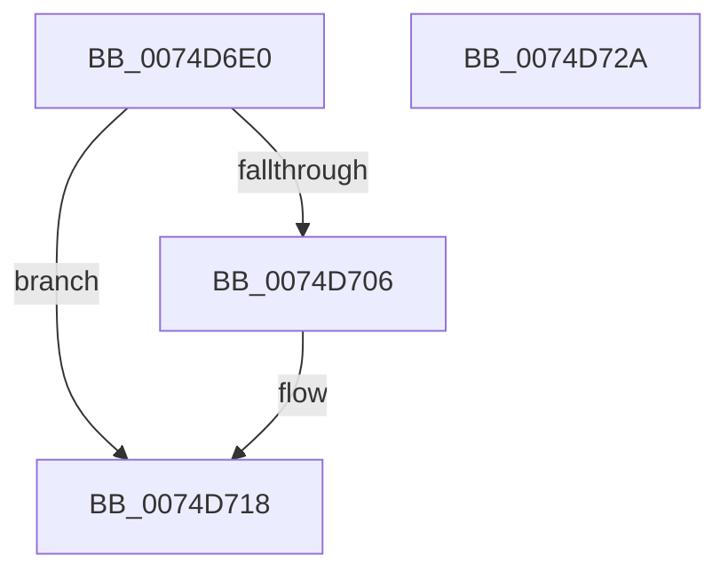

# ObAuditInheritedHandleProcedure

- RVA: `0x0074D6E0`–`0x0074D72B` (길이 `75` bytes)
- VA: `0x000000014074D6E0`
- 실행 섹션: `PAGE`
- PDB 이름 있음: `예`; PDB Function 태그: `아니요`
- unwind 정보 RVA: `0x00060BC4`
- 디코드: `23`개 명령, `75/75` bytes 표시
- 미해석 바이트: `0` (있으면 어셈블리에 `.byte`로 보존)

> 이 문서는 커널 이미지의 기계어와 PDB 기호를 분석해 생성했습니다. 4번과 5번은 함수 원형과 자료형을 바이너리 사용 방식에서 추정한 C 해석이며 원본 소스 복구 결과는 아닙니다.

## 1. Dependencies

- 직접 호출 지점: **2**; 고유 호출 대상: **2**
- 직접 호출자로 확인된 함수: **0**
- RIP 상대 이미지 참조: **0**

### Outgoing calls
- `0x0074D6F8` → [ExUnlockHandleTableEntry](../94/ExUnlockHandleTableEntry_function_0094D2D0.md) (function, `0x0094D2D0`)
- `0x0074D713` → [SeAuditHandleDuplication](../AC/SeAuditHandleDuplication_function_00AC1458.md) (function, `0x00AC1458`)

### Direct callers
- 이 함수 시작 RVA로 연결되는 직접 call은 확인되지 않았습니다. 간접 호출은 완전히 역산할 수 없습니다.

### Static image references
- 디코드된 RIP-relative 메모리 참조가 없습니다.

## 2. Other-region calls and transfers

- 다른 실행 섹션으로 향하는 call: **0**
- 별도 외부 분기/꼬리 이동을 확인하지 못했습니다.

## 3. Assembly (complete function range)

```asm
0074D6E0  48 89 5C 24 08                  mov qword ptr [rsp + 8], rbx
0074D6E5  48 89 74 24 10                  mov qword ptr [rsp + 0x10], rsi
0074D6EA  57                              push rdi
0074D6EB  48 83 EC 20                     sub rsp, 0x20
0074D6EF  48 8B 1A                        mov rbx, qword ptr [rdx]
0074D6F2  49 8B F9                        mov rdi, r9
0074D6F5  49 8B F0                        mov rsi, r8
0074D6F8  E8 D3 FB 1F 00                  call 0x14094d2d0
0074D6FD  48 C1 FB 11                     sar rbx, 0x11
0074D701  F6 C3 04                        test bl, 4
0074D704  74 12                           je 0x14074d718
0074D706  4C 8B 0F                        mov r9, qword ptr [rdi]
0074D709  48 8B D6                        mov rdx, rsi
0074D70C  4C 8B 47 08                     mov r8, qword ptr [rdi + 8]
0074D710  48 8B CE                        mov rcx, rsi
0074D713  E8 40 3D 37 00                  call 0x140ac1458
0074D718  48 8B 5C 24 30                  mov rbx, qword ptr [rsp + 0x30]
0074D71D  32 C0                           xor al, al
0074D71F  48 8B 74 24 38                  mov rsi, qword ptr [rsp + 0x38]
0074D724  48 83 C4 20                     add rsp, 0x20
0074D728  5F                              pop rdi
0074D729  C3                              ret
0074D72A  CC                              int3
```

## 4. C-style interpretation (structured pseudocode)

```c
__int64 __fastcall ObAuditInheritedHandleProcedure(__int64 a1, __int64 a2, __int64 a3, __int64 a4)
{
    __int64 result;
    __int64 v_rbx;
    __int64 v_rsp;
    unsigned __int64 v_stack_p10;
    unsigned __int64 v_stack_p8;

    v_stack_p8 = v_rbx;
    v_stack_p10 = v_rsi;
    v_rsp = (v_rsp) - (32);
    result = ExUnlockHandleTableEntry(a1, a2, a3, a4);
    v_rbx = (*(unsigned __int64 *)(a2)) >> (17);
    if ((((unsigned __int8)(v_rbx)) & (4)) != 0) {
        a4 = *(unsigned __int64 *)(a4);
        a2 = a3;
        a3 = *(unsigned __int64 *)(a4 + 8);
        a1 = a3;
        result = SeAuditHandleDuplication(a1, a2, a3, a4);
    }
    result = 0;
    v_rsp = (v_rsp) + (32);
    return result;
}
```

## 5. (Beta) C Style

```c
int64_t ObAuditInheritedHandleProcedure(int64_t Arg1, void *Arg2, int64_t Arg3, void *Arg4)
{
    uint8_t *arg2 = (uint8_t *)Arg2;
    uint8_t *arg4 = (uint8_t *)Arg4;

    int64_t result;
    int64_t local_rbx;
    int64_t local_rsp;
    uint64_t v_stack_p10;
    uint64_t v_stack_p8;

    v_stack_p8 = local_rbx;
    v_stack_p10 = local_rsi;
    local_rsp = (local_rsp) - (32);
    result = ExUnlockHandleTableEntry(Arg1, Arg2, Arg3, Arg4);
    local_rbx = (*(uint64_t *)(arg2)) >> (17);
    if ((((uint8_t)(local_rbx)) & (4)) != 0) {
        Arg4 = *(uint64_t *)(arg4);
        Arg2 = Arg3;
        Arg3 = *(uint64_t *)(arg4 + 0x8);
        Arg1 = Arg3;
        result = SeAuditHandleDuplication(Arg1, Arg2, Arg3, Arg4);
    }
    result = 0;
    local_rsp = (local_rsp) + (32);
    return result;
}
```

### 관측된 메모리 오프셋

구조체 형식이 확인되지 않은 접근은 인자 기준의 오프셋으로만 기록했습니다.

| 기준 인자 | 오프셋 표현 | 폭 (bit) | 접근 |
|---|---:|---:|---|
| `Arg2` | `+ 0x0` | `64` | `R` |
| `Arg4` | `+ 0x0` | `64` | `R` |
| `Arg4` | `+ 0x8` | `64` | `R` |

## 6. Execution-region graph

[열기: 2D/3D 그래프와 함수 탐색 컨트롤 패널](../../../control-panel.html?section=page&rva=0x0074D6E0&view=graph)

- 2D 그래프는 위에서 아래로 흐르고, 3D 그래프는 빈 공간을 드래그해 회전합니다. Shift+드래그는 이동, 휠은 확대·축소, 함수 노드 선택은 대상 보고서 이동입니다.

### Static fallback


