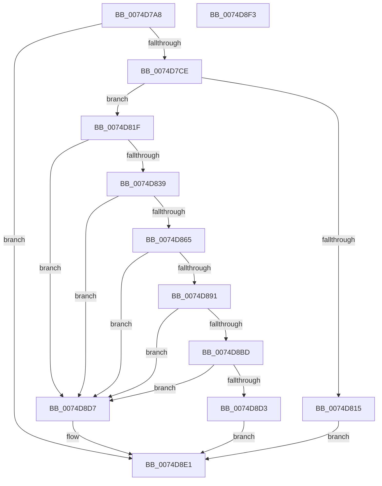

# ObCreateKernelObjectsSD

- RVA: `0x0074D7A8`–`0x0074D8F4` (길이 `332` bytes)
- VA: `0x000000014074D7A8`
- 실행 섹션: `PAGE`
- PDB 이름 있음: `예`; PDB Function 태그: `아니요`
- unwind 정보 RVA: `0x000794E0`
- 디코드: `89`개 명령, `332/332` bytes 표시
- 미해석 바이트: `0` (있으면 어셈블리에 `.byte`로 보존)

> 이 문서는 커널 이미지의 기계어와 PDB 기호를 분석해 생성했습니다. 4번과 5번은 함수 원형과 자료형을 바이너리 사용 방식에서 추정한 C 해석이며 원본 소스 복구 결과는 아닙니다.

## 1. Dependencies

- 직접 호출 지점: **11**; 고유 호출 대상: **7**
- 직접 호출자로 확인된 함수: **2**
- RIP 상대 이미지 참조: **3**

### Outgoing calls
- `0x0074D7BF` → [RtlCreateSecurityDescriptor](../9F/RtlCreateSecurityDescriptor_function_009F1DF0.md) (function, `0x009F1DF0`)
- `0x0074D7D5` → [RtlLengthSid](../../text/45/RtlLengthSid_function_0045D270.md) (function, `0x0045D270`)
- `0x0074D7E3` → [RtlLengthSid](../../text/45/RtlLengthSid_function_0045D270.md) (function, `0x0045D270`)
- `0x0074D7F1` → [RtlLengthSid](../../text/45/RtlLengthSid_function_0045D270.md) (function, `0x0045D270`)
- `0x0074D808` → [ExAllocatePool2](../../poolcode/B8/ExAllocatePool2_function_00B820F0.md) (function, `0x00B820F0`)
- `0x0074D82A` → [RtlCreateAcl](../91/RtlCreateAcl_function_00916F00.md) (function, `0x00916F00`)
- `0x0074D85A` → [RtlpAddKnownAce](../92/RtlpAddKnownAce_function_00929A20.md) (function, `0x00929A20`)
- `0x0074D886` → [RtlpAddKnownAce](../92/RtlpAddKnownAce_function_00929A20.md) (function, `0x00929A20`)
- `0x0074D8B2` → [RtlpAddKnownAce](../92/RtlpAddKnownAce_function_00929A20.md) (function, `0x00929A20`)
- `0x0074D8C8` → [RtlSetDaclSecurityDescriptor](../9E/RtlSetDaclSecurityDescriptor_function_009EC210.md) (function, `0x009EC210`)
- `0x0074D8DC` → [ExFreePoolWithTag](../../poolcode/B8/ExFreePoolWithTag_function_00B82870.md) (function, `0x00B82870`)

### Direct callers
- [ObpInitializeRootNamespace](ObpInitializeRootNamespace_function_0074E588.md) at `0x0074E5F3`
- [MiCreatePartitionNamespace](../81/MiCreatePartitionNamespace_function_00811118.md) at `0x008111BA`

### Static image references
- `0x0074D7CE` → RVA `0x00E67D48` (`.data`; read)
- `0x0074D7DA` → RVA `0x00FD9A68` (`PAGEDATA`; read)
- `0x0074D7E8` → RVA `0x00E67D58` (`.data`; read)

## 2. Other-region calls and transfers

- 다른 실행 섹션으로 향하는 call: **5**
  - `0x0074D7D5` → [RtlLengthSid](../../text/45/RtlLengthSid_function_0045D270.md) (`PAGE` → `.text`)
  - `0x0074D7E3` → [RtlLengthSid](../../text/45/RtlLengthSid_function_0045D270.md) (`PAGE` → `.text`)
  - `0x0074D7F1` → [RtlLengthSid](../../text/45/RtlLengthSid_function_0045D270.md) (`PAGE` → `.text`)
  - `0x0074D808` → [ExAllocatePool2](../../poolcode/B8/ExAllocatePool2_function_00B820F0.md) (`PAGE` → `POOLCODE`)
  - `0x0074D8DC` → [ExFreePoolWithTag](../../poolcode/B8/ExFreePoolWithTag_function_00B82870.md) (`PAGE` → `POOLCODE`)
- 별도 외부 분기/꼬리 이동을 확인하지 못했습니다.

## 3. Assembly (complete function range)

```asm
0074D7A8  48 89 5C 24 08                  mov qword ptr [rsp + 8], rbx
0074D7AD  48 89 74 24 10                  mov qword ptr [rsp + 0x10], rsi
0074D7B2  57                              push rdi
0074D7B3  48 83 EC 30                     sub rsp, 0x30
0074D7B7  BA 01 00 00 00                  mov edx, 1
0074D7BC  48 8B F1                        mov rsi, rcx
0074D7BF  E8 2C 46 2A 00                  call 0x1409f1df0
0074D7C4  8B D8                           mov ebx, eax
0074D7C6  85 C0                           test eax, eax
0074D7C8  0F 88 13 01 00 00               js 0x14074d8e1
0074D7CE  48 8B 0D 73 A5 71 00            mov rcx, qword ptr [rip + 0x71a573]
0074D7D5  E8 96 FA D0 FF                  call 0x14045d270
0074D7DA  48 8B 0D 87 C2 88 00            mov rcx, qword ptr [rip + 0x88c287]
0074D7E1  8B D8                           mov ebx, eax
0074D7E3  E8 88 FA D0 FF                  call 0x14045d270
0074D7E8  48 8B 0D 69 A5 71 00            mov rcx, qword ptr [rip + 0x71a569]
0074D7EF  03 D8                           add ebx, eax
0074D7F1  E8 7A FA D0 FF                  call 0x14045d270
0074D7F6  83 C0 2C                        add eax, 0x2c
0074D7F9  B9 00 01 00 00                  mov ecx, 0x100
0074D7FE  03 D8                           add ebx, eax
0074D800  41 B8 44 61 63 6C               mov r8d, 0x6c636144
0074D806  8B D3                           mov edx, ebx
0074D808  E8 E3 48 43 00                  call 0x140b820f0
0074D80D  48 8B F8                        mov rdi, rax
0074D810  48 85 C0                        test rax, rax
0074D813  75 0A                           jne 0x14074d81f
0074D815  BB 9A 00 00 C0                  mov ebx, 0xc000009a
0074D81A  E9 C2 00 00 00                  jmp 0x14074d8e1
0074D81F  41 B8 02 00 00 00               mov r8d, 2
0074D825  8B D3                           mov edx, ebx
0074D827  48 8B CF                        mov rcx, rdi
0074D82A  E8 D1 96 1C 00                  call 0x140916f00
0074D82F  8B D8                           mov ebx, eax
0074D831  85 C0                           test eax, eax
0074D833  0F 88 9E 00 00 00               js 0x14074d8d7
0074D839  48 8B 05 08 A5 71 00            mov rax, qword ptr [rip + 0x71a508]
0074D840  45 33 C0                        xor r8d, r8d
0074D843  C6 44 24 28 00                  mov byte ptr [rsp + 0x28], 0
0074D848  41 B9 03 00 02 00               mov r9d, 0x20003
0074D84E  48 8B CF                        mov rcx, rdi
0074D851  48 89 44 24 20                  mov qword ptr [rsp + 0x20], rax
0074D856  41 8D 50 02                     lea edx, [r8 + 2]
0074D85A  E8 C1 C1 1D 00                  call 0x140929a20
0074D85F  8B D8                           mov ebx, eax
0074D861  85 C0                           test eax, eax
0074D863  78 72                           js 0x14074d8d7
0074D865  48 8B 05 FC C1 88 00            mov rax, qword ptr [rip + 0x88c1fc]
0074D86C  45 33 C0                        xor r8d, r8d
0074D86F  C6 44 24 28 00                  mov byte ptr [rsp + 0x28], 0
0074D874  41 B9 0F 00 0F 00               mov r9d, 0xf000f
0074D87A  48 8B CF                        mov rcx, rdi
0074D87D  48 89 44 24 20                  mov qword ptr [rsp + 0x20], rax
0074D882  41 8D 50 02                     lea edx, [r8 + 2]
0074D886  E8 95 C1 1D 00                  call 0x140929a20
0074D88B  8B D8                           mov ebx, eax
0074D88D  85 C0                           test eax, eax
0074D88F  78 46                           js 0x14074d8d7
0074D891  48 8B 05 C0 A4 71 00            mov rax, qword ptr [rip + 0x71a4c0]
0074D898  45 33 C0                        xor r8d, r8d
0074D89B  C6 44 24 28 00                  mov byte ptr [rsp + 0x28], 0
0074D8A0  41 B9 0F 00 0F 00               mov r9d, 0xf000f
0074D8A6  48 8B CF                        mov rcx, rdi
0074D8A9  48 89 44 24 20                  mov qword ptr [rsp + 0x20], rax
0074D8AE  41 8D 50 02                     lea edx, [r8 + 2]
0074D8B2  E8 69 C1 1D 00                  call 0x140929a20
0074D8B7  8B D8                           mov ebx, eax
0074D8B9  85 C0                           test eax, eax
0074D8BB  78 1A                           js 0x14074d8d7
0074D8BD  45 33 C9                        xor r9d, r9d
0074D8C0  4C 8B C7                        mov r8, rdi
0074D8C3  B2 01                           mov dl, 1
0074D8C5  48 8B CE                        mov rcx, rsi
0074D8C8  E8 43 E9 29 00                  call 0x1409ec210
0074D8CD  8B D8                           mov ebx, eax
0074D8CF  85 C0                           test eax, eax
0074D8D1  78 04                           js 0x14074d8d7
0074D8D3  33 DB                           xor ebx, ebx
0074D8D5  EB 0A                           jmp 0x14074d8e1
0074D8D7  33 D2                           xor edx, edx
0074D8D9  48 8B CF                        mov rcx, rdi
0074D8DC  E8 8F 4F 43 00                  call 0x140b82870
0074D8E1  48 8B 74 24 48                  mov rsi, qword ptr [rsp + 0x48]
0074D8E6  8B C3                           mov eax, ebx
0074D8E8  48 8B 5C 24 40                  mov rbx, qword ptr [rsp + 0x40]
0074D8ED  48 83 C4 30                     add rsp, 0x30
0074D8F1  5F                              pop rdi
0074D8F2  C3                              ret
0074D8F3  CC                              int3
```

## 4. C-style interpretation (structured pseudocode)

```c
__int64 __fastcall ObCreateKernelObjectsSD(__int64 a1)
{
    __int64 result;
    __int64 v_rbx;
    __int64 v_rsp;
    unsigned __int8 v_stack_m10;
    unsigned __int64 v_stack_m18;
    unsigned __int64 v_stack_p10;
    unsigned __int64 v_stack_p8;

    v_stack_p8 = v_rbx;
    v_stack_p10 = v_rsi;
    v_rsp = (v_rsp) - (48);
    result = RtlCreateSecurityDescriptor(a1, 1, a3, a4);
    if (sign_flag) goto loc_0074D8E1;
    result = RtlLengthSid(*(unsigned __int64 *)(v_rip + 7447923), 1, a3, a4);
    result = RtlLengthSid(*(unsigned __int64 *)(v_rip + 8962695), 1, a3, a4);
    v_rbx = (unsigned int)(((unsigned int)((unsigned int)(result))) + ((unsigned int)(result)));
    result = RtlLengthSid(*(unsigned __int64 *)(v_rip + 7447913), 1, a3, a4);
    result = (unsigned int)((result) + (44));
    v_rbx = (unsigned int)((v_rbx) + ((unsigned int)(result)));
    result = ExAllocatePool2(256, (unsigned int)((unsigned int)(v_rbx)), (unsigned int)(0x6C636144ULL), a4);
    if (result != 0) goto loc_0074D81F;
    goto loc_0074D8E1;
loc_0074D81F:
    result = RtlCreateAcl(result, (unsigned int)((unsigned int)((unsigned int)(0xC000009AULL))), 2, a4);
    if (sign_flag) goto loc_0074D8D7;
    a3 = 0;
    v_stack_m10 = 0;
    v_stack_m18 = *(unsigned __int64 *)(v_rip + 7447816);
    result = RtlpAddKnownAce(result, a3 + 2, a3, (unsigned int)(0x20003ULL));
    if (sign_flag) goto loc_0074D8D7;
    a3 = 0;
    v_stack_m10 = 0;
    v_stack_m18 = *(unsigned __int64 *)(v_rip + 8962556);
    result = RtlpAddKnownAce(result, a3 + 2, a3, (unsigned int)(0xF000FULL));
    if (sign_flag) goto loc_0074D8D7;
    a3 = 0;
    v_stack_m10 = 0;
    v_stack_m18 = *(unsigned __int64 *)(v_rip + 7447744);
    result = RtlpAddKnownAce(result, a3 + 2, a3, (unsigned int)(0xF000FULL));
    if (sign_flag) goto loc_0074D8D7;
    a4 = 0;
    result = RtlSetDaclSecurityDescriptor(a1, 1, result, a4);
    if (sign_flag) goto loc_0074D8D7;
    v_rbx = 0;
    goto loc_0074D8E1;
loc_0074D8D7:
    a2 = 0;
    result = ExFreePoolWithTag(result, a2, result, a4);
loc_0074D8E1:
    v_rsp = (v_rsp) + (48);
    return 0;
}
```

## 5. (Beta) C Style

```c
int64_t ObCreateKernelObjectsSD(int64_t Arg1)
{
    int64_t result;
    int64_t local_rbx;
    int64_t local_rsp;
    uint8_t v_stack_m10;
    uint64_t v_stack_m18;
    uint64_t v_stack_p10;
    uint64_t v_stack_p8;

    v_stack_p8 = local_rbx;
    v_stack_p10 = local_rsi;
    local_rsp = (local_rsp) - (48);
    result = RtlCreateSecurityDescriptor(Arg1, 1, a3, a4);
    if (sign_flag) goto loc_0074D8E1;
    result = RtlLengthSid(*(uint64_t *)(v_rip + 0x71A573), 1, a3, a4);
    result = RtlLengthSid(*(uint64_t *)(v_rip + 0x88C287), 1, a3, a4);
    local_rbx = (uint32_t)(((uint32_t)((uint32_t)(result))) + ((uint32_t)(result)));
    result = RtlLengthSid(*(uint64_t *)(v_rip + 0x71A569), 1, a3, a4);
    result = (uint32_t)((result) + (44));
    local_rbx = (uint32_t)((local_rbx) + ((uint32_t)(result)));
    result = ExAllocatePool2(256, (uint32_t)((uint32_t)(local_rbx)), (uint32_t)(0x6C636144ULL), a4);
    if (result != 0) goto loc_0074D81F;
    goto loc_0074D8E1;
loc_0074D81F:
    result = RtlCreateAcl(result, (uint32_t)((uint32_t)((uint32_t)(0xC000009AULL))), 2, a4);
    if (sign_flag) goto loc_0074D8D7;
    a3 = 0;
    v_stack_m10 = 0;
    v_stack_m18 = *(uint64_t *)(v_rip + 0x71A508);
    result = RtlpAddKnownAce(result, a3 + 2, a3, (uint32_t)(0x20003ULL));
    if (sign_flag) goto loc_0074D8D7;
    a3 = 0;
    v_stack_m10 = 0;
    v_stack_m18 = *(uint64_t *)(v_rip + 0x88C1FC);
    result = RtlpAddKnownAce(result, a3 + 2, a3, (uint32_t)(0xF000FULL));
    if (sign_flag) goto loc_0074D8D7;
    a3 = 0;
    v_stack_m10 = 0;
    v_stack_m18 = *(uint64_t *)(v_rip + 0x71A4C0);
    result = RtlpAddKnownAce(result, a3 + 2, a3, (uint32_t)(0xF000FULL));
    if (sign_flag) goto loc_0074D8D7;
    a4 = 0;
    result = RtlSetDaclSecurityDescriptor(Arg1, 1, result, a4);
    if (sign_flag) goto loc_0074D8D7;
    local_rbx = 0;
    goto loc_0074D8E1;
loc_0074D8D7:
    a2 = 0;
    result = ExFreePoolWithTag(result, a2, result, a4);
loc_0074D8E1:
    local_rsp = (local_rsp) + (48);
    return 0;
}
```

## 6. Execution-region graph

[열기: 2D/3D 그래프와 함수 탐색 컨트롤 패널](../../../control-panel.html?section=page&rva=0x0074D7A8&view=graph)

- 2D 그래프는 위에서 아래로 흐르고, 3D 그래프는 빈 공간을 드래그해 회전합니다. Shift+드래그는 이동, 휠은 확대·축소, 함수 노드 선택은 대상 보고서 이동입니다.

### Static fallback


