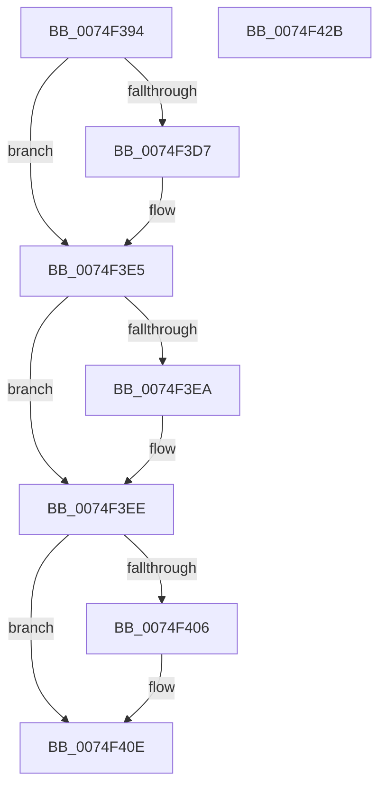

# ObDisableEtwReferenceTrace

- RVA: `0x0074F394`–`0x0074F42C` (길이 `152` bytes)
- VA: `0x000000014074F394`
- 실행 섹션: `PAGE`
- PDB 이름 있음: `예`; PDB Function 태그: `아니요`
- unwind 정보 RVA: `0x00060BC4`
- 디코드: `39`개 명령, `152/152` bytes 표시
- 미해석 바이트: `0` (있으면 어셈블리에 `.byte`로 보존)

> 이 문서는 커널 이미지의 기계어와 PDB 기호를 분석해 생성했습니다. 4번과 5번은 함수 원형과 자료형을 바이너리 사용 방식에서 추정한 C 해석이며 원본 소스 복구 결과는 아닙니다.

## 1. Dependencies

- 직접 호출 지점: **5**; 고유 호출 대상: **5**
- 직접 호출자로 확인된 함수: **1**
- RIP 상대 이미지 참조: **3**

### Outgoing calls
- `0x0074F3C7` → [KeAbPreAcquire](../../text/21/KeAbPreAcquire_function_00210230.md) (function, `0x00210230`)
- `0x0074F3E0` → [ExfAcquirePushLockExclusiveEx](../../text/20/ExfAcquirePushLockExclusiveEx_function_0020FC90.md) (function, `0x0020FC90`)
- `0x0074F409` → [ExfTryToWakePushLock](../../text/26/ExfTryToWakePushLock_function_00265DD0.md) (function, `0x00265DD0`)
- `0x0074F411` → [KeAbPostRelease](../../text/2E/KeAbPostRelease_function_002E1600.md) (function, `0x002E1600`)
- `0x0074F416` → [KeLeaveGuardedRegion](../../text/2E/KeLeaveGuardedRegion_function_002E2C40.md) (function, `0x002E2C40`)

### Direct callers
- [EtwpDisableKernelTrace](../A4/EtwpDisableKernelTrace_function_00A4F7D8.md) at `0x00A4FB6A`

### Static image references
- `0x0074F3AC` → RVA `0x00F0F580` (`.data`; read)
- `0x0074F3EE` → RVA `0x00FC5010` (`ALMOSTRO`; read/write)
- `0x0074F3F5` → RVA `0x00F0F580` (`.data`; read/write)

## 2. Other-region calls and transfers

- 다른 실행 섹션으로 향하는 call: **5**
  - `0x0074F3C7` → [KeAbPreAcquire](../../text/21/KeAbPreAcquire_function_00210230.md) (`PAGE` → `.text`)
  - `0x0074F3E0` → [ExfAcquirePushLockExclusiveEx](../../text/20/ExfAcquirePushLockExclusiveEx_function_0020FC90.md) (`PAGE` → `.text`)
  - `0x0074F409` → [ExfTryToWakePushLock](../../text/26/ExfTryToWakePushLock_function_00265DD0.md) (`PAGE` → `.text`)
  - `0x0074F411` → [KeAbPostRelease](../../text/2E/KeAbPostRelease_function_002E1600.md) (`PAGE` → `.text`)
  - `0x0074F416` → [KeLeaveGuardedRegion](../../text/2E/KeLeaveGuardedRegion_function_002E2C40.md) (`PAGE` → `.text`)
- 별도 외부 분기/꼬리 이동을 확인하지 못했습니다.

## 3. Assembly (complete function range)

```asm
0074F394  48 89 5C 24 08                  mov qword ptr [rsp + 8], rbx
0074F399  48 89 74 24 10                  mov qword ptr [rsp + 0x10], rsi
0074F39E  57                              push rdi
0074F39F  48 83 EC 20                     sub rsp, 0x20
0074F3A3  65 48 8B 04 25 88 01 00 00      mov rax, qword ptr gs:[0x188]
0074F3AC  48 8D 35 CD 01 7C 00            lea rsi, [rip + 0x7c01cd]
0074F3B3  48 83 CB FF                     or rbx, 0xffffffffffffffff
0074F3B7  45 33 C0                        xor r8d, r8d
0074F3BA  33 D2                           xor edx, edx
0074F3BC  48 8B CE                        mov rcx, rsi
0074F3BF  66 01 98 E6 01 00 00            add word ptr [rax + 0x1e6], bx
0074F3C6  90                              nop
0074F3C7  E8 64 0E AC FF                  call 0x140210230
0074F3CC  F0 48 0F BA 2E 00               lock bts qword ptr [rsi], 0
0074F3D2  48 8B F8                        mov rdi, rax
0074F3D5  73 0E                           jae 0x14074f3e5
0074F3D7  4C 8B C6                        mov r8, rsi
0074F3DA  48 8B D0                        mov rdx, rax
0074F3DD  48 8B CE                        mov rcx, rsi
0074F3E0  E8 AB 08 AC FF                  call 0x14020fc90
0074F3E5  48 85 FF                        test rdi, rdi
0074F3E8  74 04                           je 0x14074f3ee
0074F3EA  C6 47 0A 01                     mov byte ptr [rdi + 0xa], 1
0074F3EE  83 25 1B 5C 87 00 FB            and dword ptr [rip + 0x875c1b], 0xfffffffb
0074F3F5  F0 48 0F C1 1D 82 01 7C 00      lock xadd qword ptr [rip + 0x7c0182], rbx
0074F3FE  80 E3 06                        and bl, 6
0074F401  80 FB 02                        cmp bl, 2
0074F404  75 08                           jne 0x14074f40e
0074F406  48 8B CE                        mov rcx, rsi
0074F409  E8 C2 69 B1 FF                  call 0x140265dd0
0074F40E  48 8B CE                        mov rcx, rsi
0074F411  E8 EA 21 B9 FF                  call 0x1402e1600
0074F416  E8 25 38 B9 FF                  call 0x1402e2c40
0074F41B  48 8B 5C 24 30                  mov rbx, qword ptr [rsp + 0x30]
0074F420  48 8B 74 24 38                  mov rsi, qword ptr [rsp + 0x38]
0074F425  48 83 C4 20                     add rsp, 0x20
0074F429  5F                              pop rdi
0074F42A  C3                              ret
0074F42B  CC                              int3
```

## 4. C-style interpretation (structured pseudocode)

```c
__int64 __fastcall ObDisableEtwReferenceTrace(__int64 a1, int a2, int a3)
{
    __int64 result;
    __int64 v_rbx;
    __int64 v_rsp;
    unsigned __int64 v_stack_p10;
    unsigned __int64 v_stack_p8;

    v_stack_p8 = v_rbx;
    v_stack_p10 = v_rsi;
    v_rsp = (v_rsp) - (32);
    v_rbx = (v_rbx) | (-1);
    a3 = 0;
    a2 = 0;
    result = KeAbPreAcquire(v_rip + 8126925, a2, a3, a4);
    if (!(condition_is_above_or_equal)) {
        a3 = v_rip + 8126925;
        a2 = result;
        a1 = v_rip + 8126925;
        result = ExfAcquirePushLockExclusiveEx(a1, a2, a3, a4);
    }
    if (result != 0) {
        *(unsigned __int8 *)(result + 10) = 1;
    }
    v_rbx = (unsigned __int8)((v_rbx) & (6));
    if (((unsigned __int8)(v_rbx)) == 2) {
        a1 = v_rip + 8126925;
        result = ExfTryToWakePushLock(a1, a2, a3, a4);
    }
    result = KeAbPostRelease(v_rip + 8126925, a2, a3, a4);
    result = KeLeaveGuardedRegion(v_rip + 8126925, a2, a3, a4);
    v_rsp = (v_rsp) + (32);
    return result;
}
```

## 5. (Beta) C Style

```c
int64_t ObDisableEtwReferenceTrace(int64_t Arg1, int32_t Arg2, int32_t Arg3)
{
    int64_t result;
    int64_t local_rbx;
    int64_t local_rsp;
    uint64_t v_stack_p10;
    uint64_t v_stack_p8;

    v_stack_p8 = local_rbx;
    v_stack_p10 = local_rsi;
    local_rsp = (local_rsp) - (32);
    local_rbx = (local_rbx) | (-1);
    Arg3 = 0;
    Arg2 = 0;
    result = KeAbPreAcquire(v_rip + 8126925, Arg2, Arg3, a4);
    if (!(condition_is_above_or_equal)) {
        Arg3 = v_rip + 8126925;
        Arg2 = result;
        Arg1 = v_rip + 8126925;
        result = ExfAcquirePushLockExclusiveEx(Arg1, Arg2, Arg3, a4);
    }
    if (result != 0) {
        *(uint8_t *)(result + 0xA) = 1;
    }
    local_rbx = (uint8_t)((local_rbx) & (6));
    if (((uint8_t)(local_rbx)) == 2) {
        Arg1 = v_rip + 8126925;
        result = ExfTryToWakePushLock(Arg1, Arg2, Arg3, a4);
    }
    result = KeAbPostRelease(v_rip + 8126925, Arg2, Arg3, a4);
    result = KeLeaveGuardedRegion(v_rip + 8126925, Arg2, Arg3, a4);
    local_rsp = (local_rsp) + (32);
    return result;
}
```

## 6. Execution-region graph

[열기: 2D/3D 그래프와 함수 탐색 컨트롤 패널](../../../control-panel.html?section=page&rva=0x0074F394&view=graph)

- 2D 그래프는 위에서 아래로 흐르고, 3D 그래프는 빈 공간을 드래그해 회전합니다. Shift+드래그는 이동, 휠은 확대·축소, 함수 노드 선택은 대상 보고서 이동입니다.

### Static fallback


