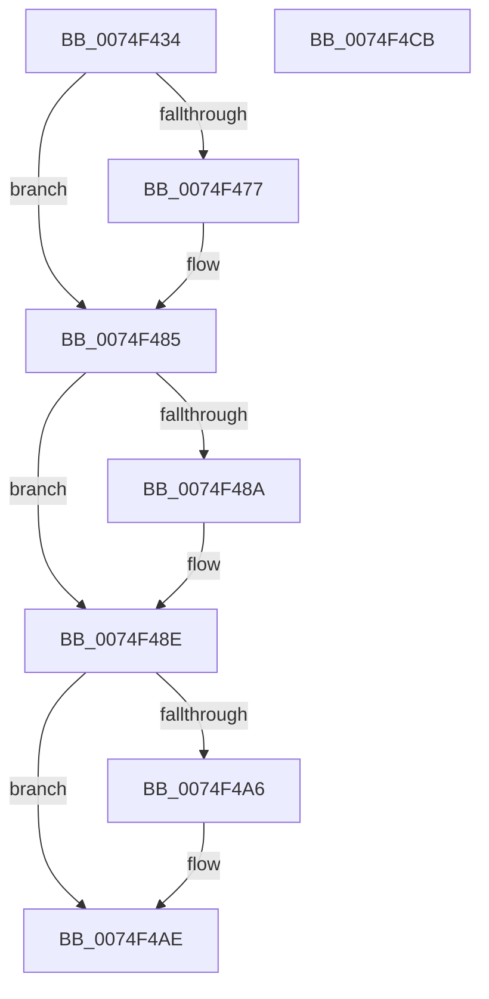

# ObEnableEtwReferenceTrace

- RVA: `0x0074F434`–`0x0074F4CC` (길이 `152` bytes)
- VA: `0x000000014074F434`
- 실행 섹션: `PAGE`
- PDB 이름 있음: `예`; PDB Function 태그: `아니요`
- unwind 정보 RVA: `0x00060BC4`
- 디코드: `39`개 명령, `152/152` bytes 표시
- 미해석 바이트: `0` (있으면 어셈블리에 `.byte`로 보존)

> 이 문서는 커널 이미지의 기계어와 PDB 기호를 분석해 생성했습니다. 4번과 5번은 함수 원형과 자료형을 바이너리 사용 방식에서 추정한 C 해석이며 원본 소스 복구 결과는 아닙니다.

## 1. Dependencies

- 직접 호출 지점: **5**; 고유 호출 대상: **5**
- 직접 호출자로 확인된 함수: **1**
- RIP 상대 이미지 참조: **3**

### Outgoing calls
- `0x0074F467` → [KeAbPreAcquire](../../text/21/KeAbPreAcquire_function_00210230.md) (function, `0x00210230`)
- `0x0074F480` → [ExfAcquirePushLockExclusiveEx](../../text/20/ExfAcquirePushLockExclusiveEx_function_0020FC90.md) (function, `0x0020FC90`)
- `0x0074F4A9` → [ExfTryToWakePushLock](../../text/26/ExfTryToWakePushLock_function_00265DD0.md) (function, `0x00265DD0`)
- `0x0074F4B1` → [KeAbPostRelease](../../text/2E/KeAbPostRelease_function_002E1600.md) (function, `0x002E1600`)
- `0x0074F4B6` → [KeLeaveGuardedRegion](../../text/2E/KeLeaveGuardedRegion_function_002E2C40.md) (function, `0x002E2C40`)

### Direct callers
- [EtwpEnableKernelTrace](../A4/EtwpEnableKernelTrace_function_00A4FBCC.md) at `0x00A50194`

### Static image references
- `0x0074F44C` → RVA `0x00F0F580` (`.data`; read)
- `0x0074F48E` → RVA `0x00FC5010` (`ALMOSTRO`; read/write)
- `0x0074F495` → RVA `0x00F0F580` (`.data`; read/write)

## 2. Other-region calls and transfers

- 다른 실행 섹션으로 향하는 call: **5**
  - `0x0074F467` → [KeAbPreAcquire](../../text/21/KeAbPreAcquire_function_00210230.md) (`PAGE` → `.text`)
  - `0x0074F480` → [ExfAcquirePushLockExclusiveEx](../../text/20/ExfAcquirePushLockExclusiveEx_function_0020FC90.md) (`PAGE` → `.text`)
  - `0x0074F4A9` → [ExfTryToWakePushLock](../../text/26/ExfTryToWakePushLock_function_00265DD0.md) (`PAGE` → `.text`)
  - `0x0074F4B1` → [KeAbPostRelease](../../text/2E/KeAbPostRelease_function_002E1600.md) (`PAGE` → `.text`)
  - `0x0074F4B6` → [KeLeaveGuardedRegion](../../text/2E/KeLeaveGuardedRegion_function_002E2C40.md) (`PAGE` → `.text`)
- 별도 외부 분기/꼬리 이동을 확인하지 못했습니다.

## 3. Assembly (complete function range)

```asm
0074F434  48 89 5C 24 08                  mov qword ptr [rsp + 8], rbx
0074F439  48 89 74 24 10                  mov qword ptr [rsp + 0x10], rsi
0074F43E  57                              push rdi
0074F43F  48 83 EC 20                     sub rsp, 0x20
0074F443  65 48 8B 04 25 88 01 00 00      mov rax, qword ptr gs:[0x188]
0074F44C  48 8D 35 2D 01 7C 00            lea rsi, [rip + 0x7c012d]
0074F453  48 83 CB FF                     or rbx, 0xffffffffffffffff
0074F457  45 33 C0                        xor r8d, r8d
0074F45A  33 D2                           xor edx, edx
0074F45C  48 8B CE                        mov rcx, rsi
0074F45F  66 01 98 E6 01 00 00            add word ptr [rax + 0x1e6], bx
0074F466  90                              nop
0074F467  E8 C4 0D AC FF                  call 0x140210230
0074F46C  F0 48 0F BA 2E 00               lock bts qword ptr [rsi], 0
0074F472  48 8B F8                        mov rdi, rax
0074F475  73 0E                           jae 0x14074f485
0074F477  4C 8B C6                        mov r8, rsi
0074F47A  48 8B D0                        mov rdx, rax
0074F47D  48 8B CE                        mov rcx, rsi
0074F480  E8 0B 08 AC FF                  call 0x14020fc90
0074F485  48 85 FF                        test rdi, rdi
0074F488  74 04                           je 0x14074f48e
0074F48A  C6 47 0A 01                     mov byte ptr [rdi + 0xa], 1
0074F48E  83 0D 7B 5B 87 00 04            or dword ptr [rip + 0x875b7b], 4
0074F495  F0 48 0F C1 1D E2 00 7C 00      lock xadd qword ptr [rip + 0x7c00e2], rbx
0074F49E  80 E3 06                        and bl, 6
0074F4A1  80 FB 02                        cmp bl, 2
0074F4A4  75 08                           jne 0x14074f4ae
0074F4A6  48 8B CE                        mov rcx, rsi
0074F4A9  E8 22 69 B1 FF                  call 0x140265dd0
0074F4AE  48 8B CE                        mov rcx, rsi
0074F4B1  E8 4A 21 B9 FF                  call 0x1402e1600
0074F4B6  E8 85 37 B9 FF                  call 0x1402e2c40
0074F4BB  48 8B 5C 24 30                  mov rbx, qword ptr [rsp + 0x30]
0074F4C0  48 8B 74 24 38                  mov rsi, qword ptr [rsp + 0x38]
0074F4C5  48 83 C4 20                     add rsp, 0x20
0074F4C9  5F                              pop rdi
0074F4CA  C3                              ret
0074F4CB  CC                              int3
```

## 4. C-style interpretation (structured pseudocode)

```c
__int64 __fastcall ObEnableEtwReferenceTrace(__int64 a1, int a2, int a3)
{
    __int64 result;
    __int64 v_rbx;
    __int64 v_rsp;
    unsigned __int64 v_stack_p10;
    unsigned __int64 v_stack_p8;

    v_stack_p8 = v_rbx;
    v_stack_p10 = v_rsi;
    v_rsp = (v_rsp) - (32);
    v_rbx = (v_rbx) | (-1);
    a3 = 0;
    a2 = 0;
    result = KeAbPreAcquire(v_rip + 8126765, a2, a3, a4);
    if (!(condition_is_above_or_equal)) {
        a3 = v_rip + 8126765;
        a2 = result;
        a1 = v_rip + 8126765;
        result = ExfAcquirePushLockExclusiveEx(a1, a2, a3, a4);
    }
    if (result != 0) {
        *(unsigned __int8 *)(result + 10) = 1;
    }
    v_rbx = (unsigned __int8)((v_rbx) & (6));
    if (((unsigned __int8)(v_rbx)) == 2) {
        a1 = v_rip + 8126765;
        result = ExfTryToWakePushLock(a1, a2, a3, a4);
    }
    result = KeAbPostRelease(v_rip + 8126765, a2, a3, a4);
    result = KeLeaveGuardedRegion(v_rip + 8126765, a2, a3, a4);
    v_rsp = (v_rsp) + (32);
    return result;
}
```

## 5. (Beta) C Style

```c
int64_t ObEnableEtwReferenceTrace(int64_t Arg1, int32_t Arg2, int32_t Arg3)
{
    int64_t result;
    int64_t local_rbx;
    int64_t local_rsp;
    uint64_t v_stack_p10;
    uint64_t v_stack_p8;

    v_stack_p8 = local_rbx;
    v_stack_p10 = local_rsi;
    local_rsp = (local_rsp) - (32);
    local_rbx = (local_rbx) | (-1);
    Arg3 = 0;
    Arg2 = 0;
    result = KeAbPreAcquire(v_rip + 8126765, Arg2, Arg3, a4);
    if (!(condition_is_above_or_equal)) {
        Arg3 = v_rip + 8126765;
        Arg2 = result;
        Arg1 = v_rip + 8126765;
        result = ExfAcquirePushLockExclusiveEx(Arg1, Arg2, Arg3, a4);
    }
    if (result != 0) {
        *(uint8_t *)(result + 0xA) = 1;
    }
    local_rbx = (uint8_t)((local_rbx) & (6));
    if (((uint8_t)(local_rbx)) == 2) {
        Arg1 = v_rip + 8126765;
        result = ExfTryToWakePushLock(Arg1, Arg2, Arg3, a4);
    }
    result = KeAbPostRelease(v_rip + 8126765, Arg2, Arg3, a4);
    result = KeLeaveGuardedRegion(v_rip + 8126765, Arg2, Arg3, a4);
    local_rsp = (local_rsp) + (32);
    return result;
}
```

## 6. Execution-region graph

[열기: 2D/3D 그래프와 함수 탐색 컨트롤 패널](../../../control-panel.html?section=page&rva=0x0074F434&view=graph)

- 2D 그래프는 위에서 아래로 흐르고, 3D 그래프는 빈 공간을 드래그해 회전합니다. Shift+드래그는 이동, 휠은 확대·축소, 함수 노드 선택은 대상 보고서 이동입니다.

### Static fallback


