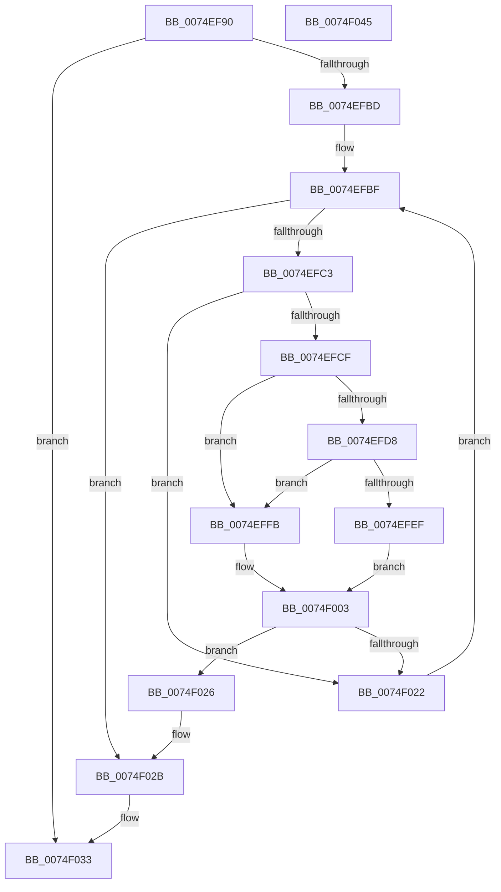

# ObEnumerateObjectsByType

- RVA: `0x0074EF90`–`0x0074F046` (길이 `182` bytes)
- VA: `0x000000014074EF90`
- 실행 섹션: `PAGE`
- PDB 이름 있음: `예`; PDB Function 태그: `아니요`
- unwind 정보 RVA: `0x00086C28`
- 디코드: `53`개 명령, `182/182` bytes 표시
- 미해석 바이트: `0` (있으면 어셈블리에 `.byte`로 보존)

> 이 문서는 커널 이미지의 기계어와 PDB 기호를 분석해 생성했습니다. 4번과 5번은 함수 원형과 자료형을 바이너리 사용 방식에서 추정한 C 해석이며 원본 소스 복구 결과는 아닙니다.

## 1. Dependencies

- 직접 호출 지점: **3**; 고유 호출 대상: **3**
- 직접 호출자로 확인된 함수: **1**
- RIP 상대 이미지 참조: **2**

### Outgoing calls
- `0x0074EFB0` → [ObpCreateTypeArray](../9D/ObpCreateTypeArray_function_009DB4B4.md) (function, `0x009DB4B4`)
- `0x0074F019` → [IovpBuildDriverObjectList](../../pagevrfy/B9/IovpBuildDriverObjectList_function_00B92884.md) (function, `0x00B92884`)
- `0x0074F02E` → [ObpDestroyTypeArray](../9D/ObpDestroyTypeArray_function_009DB464.md) (function, `0x009DB464`)

### Direct callers
- [IovUnloadDrivers](../../pagevrfy/B9/IovUnloadDrivers_function_00B9277C.md) at `0x00B927A5`

### Static image references
- `0x0074EF9F` → RVA `0x00FC6C78` (`ALMOSTRO`; read)
- `0x0074EFDB` → RVA `0x00F0FF80` (`.data`; read)

## 2. Other-region calls and transfers

- 다른 실행 섹션으로 향하는 call: **1**
  - `0x0074F019` → [IovpBuildDriverObjectList](../../pagevrfy/B9/IovpBuildDriverObjectList_function_00B92884.md) (`PAGE` → `PAGEVRFY`)
- 별도 외부 분기/꼬리 이동을 확인하지 못했습니다.

## 3. Assembly (complete function range)

```asm
0074EF90  48 89 5C 24 08                  mov qword ptr [rsp + 8], rbx
0074EF95  48 89 74 24 10                  mov qword ptr [rsp + 0x10], rsi
0074EF9A  57                              push rdi
0074EF9B  48 83 EC 40                     sub rsp, 0x40
0074EF9F  48 8B 0D D2 7C 87 00            mov rcx, qword ptr [rip + 0x877cd2]
0074EFA6  0F 57 C0                        xorps xmm0, xmm0
0074EFA9  0F 11 44 24 30                  movups xmmword ptr [rsp + 0x30], xmm0
0074EFAE  33 DB                           xor ebx, ebx
0074EFB0  E8 FF C4 28 00                  call 0x1409db4b4
0074EFB5  48 8B F0                        mov rsi, rax
0074EFB8  48 85 C0                        test rax, rax
0074EFBB  74 76                           je 0x14074f033
0074EFBD  8B FB                           mov edi, ebx
0074EFBF  3B 3E                           cmp edi, dword ptr [rsi]
0074EFC1  73 68                           jae 0x14074f02b
0074EFC3  8B C7                           mov eax, edi
0074EFC5  4C 8B 44 C6 08                  mov r8, qword ptr [rsi + rax*8 + 8]
0074EFCA  4D 85 C0                        test r8, r8
0074EFCD  74 53                           je 0x14074f022
0074EFCF  41 0F B6 40 3A                  movzx eax, byte ptr [r8 + 0x3a]
0074EFD4  A8 02                           test al, 2
0074EFD6  74 23                           je 0x14074effb
0074EFD8  83 E0 03                        and eax, 3
0074EFDB  48 8D 0D 9E 0F 7C 00            lea rcx, [rip + 0x7c0f9e]
0074EFE2  0F B6 04 08                     movzx eax, byte ptr [rax + rcx]
0074EFE6  49 8D 48 20                     lea rcx, [r8 + 0x20]
0074EFEA  48 2B C8                        sub rcx, rax
0074EFED  74 0C                           je 0x14074effb
0074EFEF  0F 10 41 08                     movups xmm0, xmmword ptr [rcx + 8]
0074EFF3  F3 0F 7F 44 24 30               movdqu xmmword ptr [rsp + 0x30], xmm0
0074EFF9  EB 08                           jmp 0x14074f003
0074EFFB  0F 57 C0                        xorps xmm0, xmm0
0074EFFE  0F 11 44 24 30                  movups xmmword ptr [rsp + 0x30], xmm0
0074F003  4D 8B 48 20                     mov r9, qword ptr [r8 + 0x20]
0074F007  49 8D 48 50                     lea rcx, [r8 + 0x50]
0074F00B  4D 8B 40 28                     mov r8, qword ptr [r8 + 0x28]
0074F00F  48 8D 54 24 30                  lea rdx, [rsp + 0x30]
0074F014  48 89 5C 24 20                  mov qword ptr [rsp + 0x20], rbx
0074F019  E8 66 38 44 00                  call 0x140b92884
0074F01E  84 C0                           test al, al
0074F020  74 04                           je 0x14074f026
0074F022  FF C7                           inc edi
0074F024  EB 99                           jmp 0x14074efbf
0074F026  BB 1A 00 00 80                  mov ebx, 0x8000001a
0074F02B  48 8B CE                        mov rcx, rsi
0074F02E  E8 31 C4 28 00                  call 0x1409db464
0074F033  48 8B 74 24 58                  mov rsi, qword ptr [rsp + 0x58]
0074F038  8B C3                           mov eax, ebx
0074F03A  48 8B 5C 24 50                  mov rbx, qword ptr [rsp + 0x50]
0074F03F  48 83 C4 40                     add rsp, 0x40
0074F043  5F                              pop rdi
0074F044  C3                              ret
0074F045  CC                              int3
```

## 4. C-style interpretation (structured pseudocode)

```c
__int64 __fastcall ObEnumerateObjectsByType(void)
{
    __int64 result;
    __int64 v_rbx;
    __int64 v_rdi;
    __int64 v_rsp;
    unsigned __int64 v_stack_m18;
    unsigned __int64 v_stack_m28;
    unsigned __int64 v_stack_p10;
    unsigned __int64 v_stack_p8;

    v_stack_p8 = v_rbx;
    v_stack_p10 = v_rsi;
    v_rsp = (v_rsp) - (64);
    v_stack_m18 = v_xmm0;
    v_rbx = 0;
    result = ObpCreateTypeArray(*(unsigned __int64 *)(v_rip + 8879314), a2, a3, a4);
    if (result == 0) goto loc_0074F033;
loc_0074EFBF:
    if (0 >= (*(unsigned int *)(result))) goto loc_0074F02B;
    if (*(unsigned __int64 *)(result + 0 * 8 + 8) == 0) goto loc_0074F022;
    if ((((unsigned __int8)(*(unsigned __int8 *)(*(unsigned __int64 *)(result + 0 * 8 + 8) + 58))) & (2)) == 0) goto loc_0074EFFB;
    result = (unsigned int)((*(unsigned __int8 *)(*(unsigned __int64 *)(result + 0 * 8 + 8) + 58)) & (3));
    a1 = (*(unsigned __int64 *)(result + 0 * 8 + 8) + 32) - (*(unsigned __int8 *)(result + v_rip + 8130462 * 1));
    if (condition_is_equal) goto loc_0074EFFB;
    v_stack_m18 = v_xmm0;
    goto loc_0074F003;
loc_0074EFFB:
    v_stack_m18 = v_xmm0;
loc_0074F003:
    v_stack_m28 = 0;
    result = IovpBuildDriverObjectList(*(unsigned __int64 *)(result + 0 * 8 + 8) + 80, v_stack_m18, *(unsigned __int64 *)(*(unsigned __int64 *)(result + 0 * 8 + 8) + 40), *(unsigned __int64 *)(*(unsigned __int64 *)(result + 0 * 8 + 8) + 32));
    if ((unsigned __int8)(result) == 0) goto loc_0074F026;
loc_0074F022:
    v_rdi = (unsigned int)((0) + 1);
    goto loc_0074EFBF;
loc_0074F026:
loc_0074F02B:
    result = ObpDestroyTypeArray(result, v_stack_m18, *(unsigned __int64 *)(*(unsigned __int64 *)(result + 0 * 8 + 8) + 40), *(unsigned __int64 *)(*(unsigned __int64 *)(result + 0 * 8 + 8) + 32));
loc_0074F033:
    v_rsp = (v_rsp) + (64);
    return (unsigned int)((unsigned int)((unsigned int)(0x8000001AULL)));
}
```

## 5. (Beta) C Style

```c
void ObEnumerateObjectsByType(void)
{
    int64_t result;
    int64_t local_rbx;
    int64_t local_rdi;
    int64_t local_rsp;
    uint64_t v_stack_m18;
    uint64_t v_stack_m28;
    uint64_t v_stack_p10;
    uint64_t v_stack_p8;

    v_stack_p8 = local_rbx;
    v_stack_p10 = local_rsi;
    local_rsp = (local_rsp) - (64);
    v_stack_m18 = v_xmm0;
    local_rbx = 0;
    result = ObpCreateTypeArray(*(uint64_t *)(v_rip + 0x877CD2), a2, a3, a4);
    if (result == 0) goto loc_0074F033;
loc_0074EFBF:
    if (0 >= (*(uint32_t *)(result))) goto loc_0074F02B;
    if (*(uint64_t *)(result + 0x0 * 8 + 0x8) == 0) goto loc_0074F022;
    if ((((uint8_t)(*(uint8_t *)(*(uint64_t *)(result + 0x0 * 8 + 0x8) + 0x3A))) & (2)) == 0) goto loc_0074EFFB;
    result = (uint32_t)((*(uint8_t *)(*(uint64_t *)(result + 0x0 * 8 + 0x8) + 0x3A)) & (3));
    a1 = (*(uint64_t *)(result + 0x0 * 8 + 0x8) + 32) - (*(uint8_t *)(result + v_rip + 0x7C0F9E * 1));
    if (condition_is_equal) goto loc_0074EFFB;
    v_stack_m18 = v_xmm0;
    goto loc_0074F003;
loc_0074EFFB:
    v_stack_m18 = v_xmm0;
loc_0074F003:
    v_stack_m28 = 0;
    result = IovpBuildDriverObjectList(*(uint64_t *)(result + 0x0 * 8 + 0x8) + 80, v_stack_m18, *(uint64_t *)(*(uint64_t *)(result + 0x0 * 8 + 0x8) + 0x28), *(uint64_t *)(*(uint64_t *)(result + 0x0 * 8 + 0x8) + 0x20));
    if ((uint8_t)(result) == 0) goto loc_0074F026;
loc_0074F022:
    local_rdi = (uint32_t)((0) + 1);
    goto loc_0074EFBF;
loc_0074F026:
loc_0074F02B:
    result = ObpDestroyTypeArray(result, v_stack_m18, *(uint64_t *)(*(uint64_t *)(result + 0x0 * 8 + 0x8) + 0x28), *(uint64_t *)(*(uint64_t *)(result + 0x0 * 8 + 0x8) + 0x20));
loc_0074F033:
    local_rsp = (local_rsp) + (64);
    return (uint32_t)((uint32_t)((uint32_t)(0x8000001AULL)));
}
```

## 6. Execution-region graph

[열기: 2D/3D 그래프와 함수 탐색 컨트롤 패널](../../../control-panel.html?section=page&rva=0x0074EF90&view=graph)

- 2D 그래프는 위에서 아래로 흐르고, 3D 그래프는 빈 공간을 드래그해 회전합니다. Shift+드래그는 이동, 휠은 확대·축소, 함수 노드 선택은 대상 보고서 이동입니다.

### Static fallback


