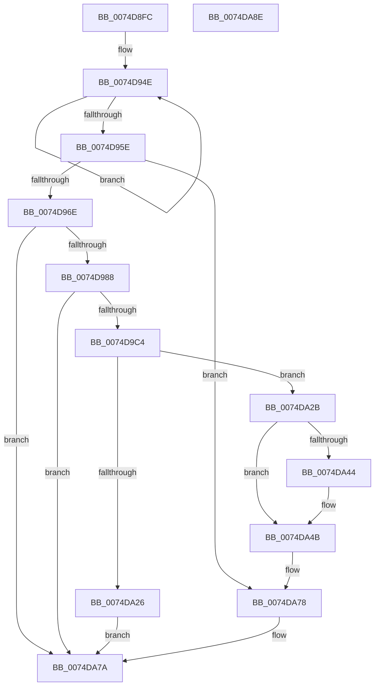

# ObInitServerSilo

- RVA: `0x0074D8FC`–`0x0074DA8F` (길이 `403` bytes)
- VA: `0x000000014074D8FC`
- 실행 섹션: `PAGE`
- PDB 이름 있음: `예`; PDB Function 태그: `아니요`
- unwind 정보 RVA: `0x000CB780`
- 디코드: `104`개 명령, `403/403` bytes 표시
- 미해석 바이트: `0` (있으면 어셈블리에 `.byte`로 보존)

> 이 문서는 커널 이미지의 기계어와 PDB 기호를 분석해 생성했습니다. 4번과 5번은 함수 원형과 자료형을 바이너리 사용 방식에서 추정한 C 해석이며 원본 소스 복구 결과는 아닙니다.

## 1. Dependencies

- 직접 호출 지점: **8**; 고유 호출 대상: **8**
- 직접 호출자로 확인된 함수: **2**
- RIP 상대 이미지 참조: **3**

### Outgoing calls
- `0x0074D92A` → [PsGetServerSiloGlobals](../../text/22/PsGetServerSiloGlobals_function_002250A0.md) (function, `0x002250A0`)
- `0x0074D961` → [PsIsHostSilo](../../text/44/PsIsHostSilo_function_00443B30.md) (function, `0x00443B30`)
- `0x0074D97B` → [PsGetPermanentSiloContext](../../text/3E/PsGetPermanentSiloContext_function_003EE100.md) (function, `0x003EE100`)
- `0x0074D9B7` → [ObOpenObjectByPointer](../8B/ObOpenObjectByPointer_function_008B7420.md) (function, `0x008B7420`)
- `0x0074DA11` → [ObReferenceObjectByNameEx](../8B/ObReferenceObjectByNameEx_function_008BD524.md) (function, `0x008BD524`)
- `0x0074DA1C` → [ZwClose](../../text/6A/ZwClose_function_006AD2B0.md) (function, `0x006AD2B0`)
- `0x0074DA66` → [ObfReferenceObjectWithTag](../../text/21/ObfReferenceObjectWithTag_function_00210710.md) (function, `0x00210710`)
- `0x0074DA73` → [ObfDereferenceObject](../../text/2F/ObfDereferenceObject_function_002F9350.md) (function, `0x002F9350`)

### Direct callers
- [PspInitializeServerSiloDeferred](../77/PspInitializeServerSiloDeferred_function_0077FEE0.md) at `0x00780006`
- [ObInitSystem](../../init/C7/ObInitSystem_function_00C71C7C.md) at `0x00C72012`

### Static image references
- `0x0074D96E` → RVA `0x00FC5068` (`ALMOSTRO`; read)
- `0x0074D99B` → RVA `0x00F0F650` (`.data`; read)
- `0x0074D9C8` → RVA `0x00B4B5E0` (`ObpGlobalDirectoryName`; read)

## 2. Other-region calls and transfers

- 다른 실행 섹션으로 향하는 call: **6**
  - `0x0074D92A` → [PsGetServerSiloGlobals](../../text/22/PsGetServerSiloGlobals_function_002250A0.md) (`PAGE` → `.text`)
  - `0x0074D961` → [PsIsHostSilo](../../text/44/PsIsHostSilo_function_00443B30.md) (`PAGE` → `.text`)
  - `0x0074D97B` → [PsGetPermanentSiloContext](../../text/3E/PsGetPermanentSiloContext_function_003EE100.md) (`PAGE` → `.text`)
  - `0x0074DA1C` → [ZwClose](../../text/6A/ZwClose_function_006AD2B0.md) (`PAGE` → `.text`)
  - `0x0074DA66` → [ObfReferenceObjectWithTag](../../text/21/ObfReferenceObjectWithTag_function_00210710.md) (`PAGE` → `.text`)
  - `0x0074DA73` → [ObfDereferenceObject](../../text/2F/ObfDereferenceObject_function_002F9350.md) (`PAGE` → `.text`)
- 별도 외부 분기/꼬리 이동을 확인하지 못했습니다.

## 3. Assembly (complete function range)

```asm
0074D8FC  48 89 5C 24 08                  mov qword ptr [rsp + 8], rbx
0074D901  55                              push rbp
0074D902  56                              push rsi
0074D903  57                              push rdi
0074D904  41 56                           push r14
0074D906  41 57                           push r15
0074D908  48 8B EC                        mov rbp, rsp
0074D90B  48 83 EC 70                     sub rsp, 0x70
0074D90F  48 83 65 38 00                  and qword ptr [rbp + 0x38], 0
0074D914  33 C0                           xor eax, eax
0074D916  21 45 EC                        and dword ptr [rbp - 0x14], eax
0074D919  48 8B F9                        mov rdi, rcx
0074D91C  48 21 45 48                     and qword ptr [rbp + 0x48], rax
0074D920  48 21 45 40                     and qword ptr [rbp + 0x40], rax
0074D924  89 45 D4                        mov dword ptr [rbp - 0x2c], eax
0074D927  21 45 D4                        and dword ptr [rbp - 0x2c], eax
0074D92A  E8 71 77 AD FF                  call 0x1402250a0
0074D92F  BA 25 00 00 00                  mov edx, 0x25
0074D934  4C 8B F0                        mov r14, rax
0074D937  48 83 60 78 00                  and qword ptr [rax + 0x78], 0
0074D93C  48 8D 88 80 00 00 00            lea rcx, [rax + 0x80]
0074D943  48 83 A1 50 02 00 00 00         and qword ptr [rcx + 0x250], 0
0074D94B  8D 72 EB                        lea esi, [rdx - 0x15]
0074D94E  48 89 49 08                     mov qword ptr [rcx + 8], rcx
0074D952  48 89 09                        mov qword ptr [rcx], rcx
0074D955  48 03 CE                        add rcx, rsi
0074D958  48 83 EA 01                     sub rdx, 1
0074D95C  75 F0                           jne 0x14074d94e
0074D95E  48 8B CF                        mov rcx, rdi
0074D961  E8 CA 61 CF FF                  call 0x140443b30
0074D966  84 C0                           test al, al
0074D968  0F 85 0A 01 00 00               jne 0x14074da78
0074D96E  8B 15 F4 76 87 00               mov edx, dword ptr [rip + 0x8776f4]
0074D974  4C 8D 45 40                     lea r8, [rbp + 0x40]
0074D978  48 8B CF                        mov rcx, rdi
0074D97B  E8 80 07 CA FF                  call 0x1403ee100
0074D980  85 C0                           test eax, eax
0074D982  0F 88 F2 00 00 00               js 0x14074da7a
0074D988  48 8B 4D 40                     mov rcx, qword ptr [rbp + 0x40]
0074D98C  48 8D 45 48                     lea rax, [rbp + 0x48]
0074D990  48 89 44 24 30                  mov qword ptr [rsp + 0x30], rax
0074D995  41 BF 02 00 00 00               mov r15d, 2
0074D99B  48 8B 05 AE 1C 7C 00            mov rax, qword ptr [rip + 0x7c1cae]
0074D9A2  45 8B CF                        mov r9d, r15d
0074D9A5  C6 44 24 28 00                  mov byte ptr [rsp + 0x28], 0
0074D9AA  45 33 C0                        xor r8d, r8d
0074D9AD  BA 40 02 00 00                  mov edx, 0x240
0074D9B2  48 89 44 24 20                  mov qword ptr [rsp + 0x20], rax
0074D9B7  E8 64 9A 16 00                  call 0x1408b7420
0074D9BC  85 C0                           test eax, eax
0074D9BE  0F 88 B6 00 00 00               js 0x14074da7a
0074D9C4  48 8B 5D 48                     mov rbx, qword ptr [rbp + 0x48]
0074D9C8  48 8D 05 11 DC 3F 00            lea rax, [rip + 0x3fdc11]
0074D9CF  4C 8B 0D 7A 1C 7C 00            mov r9, qword ptr [rip + 0x7c1c7a]
0074D9D6  48 8D 4D D0                     lea rcx, [rbp - 0x30]
0074D9DA  48 89 45 E0                     mov qword ptr [rbp - 0x20], rax
0074D9DE  0F 57 C0                        xorps xmm0, xmm0
0074D9E1  48 8D 45 38                     lea rax, [rbp + 0x38]
0074D9E5  C7 45 D0 30 00 00 00            mov dword ptr [rbp - 0x30], 0x30
0074D9EC  48 89 44 24 30                  mov qword ptr [rsp + 0x30], rax
0074D9F1  45 8B C7                        mov r8d, r15d
0074D9F4  48 83 64 24 28 00               and qword ptr [rsp + 0x28], 0
0074D9FA  33 D2                           xor edx, edx
0074D9FC  C6 44 24 20 00                  mov byte ptr [rsp + 0x20], 0
0074DA01  48 89 5D D8                     mov qword ptr [rbp - 0x28], rbx
0074DA05  C7 45 E8 40 02 00 00            mov dword ptr [rbp - 0x18], 0x240
0074DA0C  F3 0F 7F 45 F0                  movdqu xmmword ptr [rbp - 0x10], xmm0
0074DA11  E8 0E FB 16 00                  call 0x1408bd524
0074DA16  48 8B CB                        mov rcx, rbx
0074DA19  44 8B F8                        mov r15d, eax
0074DA1C  E8 8F F8 F5 FF                  call 0x1406ad2b0
0074DA21  45 85 FF                        test r15d, r15d
0074DA24  79 05                           jns 0x14074da2b
0074DA26  41 8B C7                        mov eax, r15d
0074DA29  EB 4F                           jmp 0x14074da7a
0074DA2B  48 8B 45 38                     mov rax, qword ptr [rbp + 0x38]
0074DA2F  48 8B 98 30 01 00 00            mov rbx, qword ptr [rax + 0x130]
0074DA36  F0 48 0F C1 B3 F0 00 00 00      lock xadd qword ptr [rbx + 0xf0], rsi
0074DA3F  48 85 F6                        test rsi, rsi
0074DA42  7F 07                           jg 0x14074da4b
0074DA44  B9 0E 00 00 00                  mov ecx, 0xe
0074DA49  CD 29                           int 0x29
0074DA4B  48 8D 53 0F                     lea rdx, [rbx + 0xf]
0074DA4F  48 8B C3                        mov rax, rbx
0074DA52  48 F7 D8                        neg rax
0074DA55  48 1B C9                        sbb rcx, rcx
0074DA58  48 23 CA                        and rcx, rdx
0074DA5B  BA 4F 62 44 6D                  mov edx, 0x6d44624f
0074DA60  49 89 0E                        mov qword ptr [r14], rcx
0074DA63  48 8B CF                        mov rcx, rdi
0074DA66  E8 A5 2C AC FF                  call 0x140210710
0074DA6B  48 8B 4D 38                     mov rcx, qword ptr [rbp + 0x38]
0074DA6F  48 89 7B 10                     mov qword ptr [rbx + 0x10], rdi
0074DA73  E8 D8 B8 BA FF                  call 0x1402f9350
0074DA78  33 C0                           xor eax, eax
0074DA7A  48 8B 9C 24 A0 00 00 00         mov rbx, qword ptr [rsp + 0xa0]
0074DA82  48 83 C4 70                     add rsp, 0x70
0074DA86  41 5F                           pop r15
0074DA88  41 5E                           pop r14
0074DA8A  5F                              pop rdi
0074DA8B  5E                              pop rsi
0074DA8C  5D                              pop rbp
0074DA8D  C3                              ret
0074DA8E  CC                              int3
```

## 4. C-style interpretation (structured pseudocode)

```c
__int64 __fastcall ObInitServerSilo(__int64 a1)
{
    __int64 result;
    __int64 v_rsp;
    unsigned __int64 v_stack_m38;
    unsigned int v_stack_m3C;
    unsigned int v_stack_m40;
    unsigned __int64 v_stack_m48;
    unsigned __int64 v_stack_m50;
    unsigned int v_stack_m54;
    unsigned __int64 v_stack_m58;
    unsigned __int64 v_stack_m68;
    unsigned __int8 v_stack_m70;
    unsigned __int64 v_stack_m78;
    unsigned __int64 v_stack_p10;
    unsigned __int64 v_stack_p18;
    unsigned __int64 v_stack_p20;
    unsigned __int64 v_stack_p8;

    v_stack_p8 = v_rbx;
    v_rsp = (v_rsp) - (112);
    result = 0;
    v_stack_m54 = 0;
    result = PsGetServerSiloGlobals(a1, a2, a3, a4);
loc_0074D94E:
    *(unsigned __int64 *)(result + 128 + 8) = result + 128;
    *(unsigned __int64 *)(result + 128) = result + 128;
    a1 = (result + 128) + (37 - 21);
    a2 = (37) - (1);
    if (condition_is_not_equal) goto loc_0074D94E;
    result = PsIsHostSilo(a1, a2, a3, a4);
    if ((unsigned __int8)(result) != 0) goto loc_0074DA78;
    result = PsGetPermanentSiloContext(a1, (unsigned int)(*(unsigned int *)(v_rip + 8877812)), v_stack_p18, a4);
    if (sign_flag) goto loc_0074DA7A;
    v_stack_m68 = v_stack_p20;
    v_stack_m70 = 0;
    a3 = 0;
    v_stack_m78 = *(unsigned __int64 *)(v_rip + 8133806);
    result = ObOpenObjectByPointer(v_stack_p18, 576, a3, 2);
    if (sign_flag) goto loc_0074DA7A;
    v_stack_m48 = v_rip + 4185105;
    v_stack_m58 = 48;
    v_stack_m68 = v_stack_p10;
    a2 = 0;
    v_stack_m78 = 0;
    v_stack_m50 = v_stack_p20;
    v_stack_m40 = 576;
    v_stack_m38 = v_xmm0;
    result = ObReferenceObjectByNameEx(v_stack_m58, a2, 2, *(unsigned __int64 *)(v_rip + 8133754));
    result = ZwClose(v_stack_p20, a2, 2, *(unsigned __int64 *)(v_rip + 8133754));
    if (!sign_flag) goto loc_0074DA2B;
    goto loc_0074DA7A;
loc_0074DA2B:
    if (!(condition_is_greater)) {
        a1 = 14;
    }
    result = -(*(unsigned __int64 *)(v_stack_p10 + 304));
    a1 = (a1) & (*(unsigned __int64 *)(v_stack_p10 + 304) + 15);
    *(unsigned __int64 *)(result) = a1;
    result = ObfReferenceObjectWithTag(a1, (unsigned int)(0x6D44624FULL), 2, *(unsigned __int64 *)(v_rip + 8133754));
    *(unsigned __int64 *)(*(unsigned __int64 *)(v_stack_p10 + 304) + 16) = a1;
    result = ObfDereferenceObject(v_stack_p10, (unsigned int)(0x6D44624FULL), 2, *(unsigned __int64 *)(v_rip + 8133754));
loc_0074DA78:
    result = 0;
loc_0074DA7A:
    v_rsp = (v_rsp) + (112);
    return result;
}
```

## 5. (Beta) C Style

```c
int64_t ObInitServerSilo(int64_t Arg1)
{
    int64_t result;
    int64_t local_rsp;
    uint64_t v_stack_m38;
    uint32_t v_stack_m3C;
    uint32_t v_stack_m40;
    uint64_t v_stack_m48;
    uint64_t v_stack_m50;
    uint32_t v_stack_m54;
    uint64_t v_stack_m58;
    uint64_t v_stack_m68;
    uint8_t v_stack_m70;
    uint64_t v_stack_m78;
    uint64_t v_stack_p10;
    uint64_t v_stack_p18;
    uint64_t v_stack_p20;
    uint64_t v_stack_p8;

    v_stack_p8 = local_rbx;
    local_rsp = (local_rsp) - (112);
    result = 0;
    v_stack_m54 = 0;
    result = PsGetServerSiloGlobals(Arg1, a2, a3, a4);
loc_0074D94E:
    *(uint64_t *)(result + 0x80 + 0x8) = result + 128;
    *(uint64_t *)(result + 0x80) = result + 128;
    Arg1 = (result + 128) + (37 - 21);
    a2 = (37) - (1);
    if (condition_is_not_equal) goto loc_0074D94E;
    result = PsIsHostSilo(Arg1, a2, a3, a4);
    if ((uint8_t)(result) != 0) goto loc_0074DA78;
    result = PsGetPermanentSiloContext(Arg1, (uint32_t)(*(uint32_t *)(v_rip + 0x8776F4)), v_stack_p18, a4);
    if (sign_flag) goto loc_0074DA7A;
    v_stack_m68 = v_stack_p20;
    v_stack_m70 = 0;
    a3 = 0;
    v_stack_m78 = *(uint64_t *)(v_rip + 0x7C1CAE);
    result = ObOpenObjectByPointer(v_stack_p18, 576, a3, 2);
    if (sign_flag) goto loc_0074DA7A;
    v_stack_m48 = v_rip + 4185105;
    v_stack_m58 = 48;
    v_stack_m68 = v_stack_p10;
    a2 = 0;
    v_stack_m78 = 0;
    v_stack_m50 = v_stack_p20;
    v_stack_m40 = 576;
    v_stack_m38 = v_xmm0;
    result = ObReferenceObjectByNameEx(v_stack_m58, a2, 2, *(uint64_t *)(v_rip + 0x7C1C7A));
    result = ZwClose(v_stack_p20, a2, 2, *(uint64_t *)(v_rip + 0x7C1C7A));
    if (!sign_flag) goto loc_0074DA2B;
    goto loc_0074DA7A;
loc_0074DA2B:
    if (!(condition_is_greater)) {
        Arg1 = 14;
    }
    result = -(*(uint64_t *)(v_stack_p10 + 0x130));
    Arg1 = (Arg1) & (*(uint64_t *)(v_stack_p10 + 0x130) + 15);
    *(uint64_t *)(result) = Arg1;
    result = ObfReferenceObjectWithTag(Arg1, (uint32_t)(0x6D44624FULL), 2, *(uint64_t *)(v_rip + 0x7C1C7A));
    *(uint64_t *)(*(uint64_t *)(v_stack_p10 + 0x130) + 0x10) = Arg1;
    result = ObfDereferenceObject(v_stack_p10, (uint32_t)(0x6D44624FULL), 2, *(uint64_t *)(v_rip + 0x7C1C7A));
loc_0074DA78:
    result = 0;
loc_0074DA7A:
    local_rsp = (local_rsp) + (112);
    return result;
}
```

## 6. Execution-region graph

[열기: 2D/3D 그래프와 함수 탐색 컨트롤 패널](../../../control-panel.html?section=page&rva=0x0074D8FC&view=graph)

- 2D 그래프는 위에서 아래로 흐르고, 3D 그래프는 빈 공간을 드래그해 회전합니다. Shift+드래그는 이동, 휠은 확대·축소, 함수 노드 선택은 대상 보고서 이동입니다.

### Static fallback


